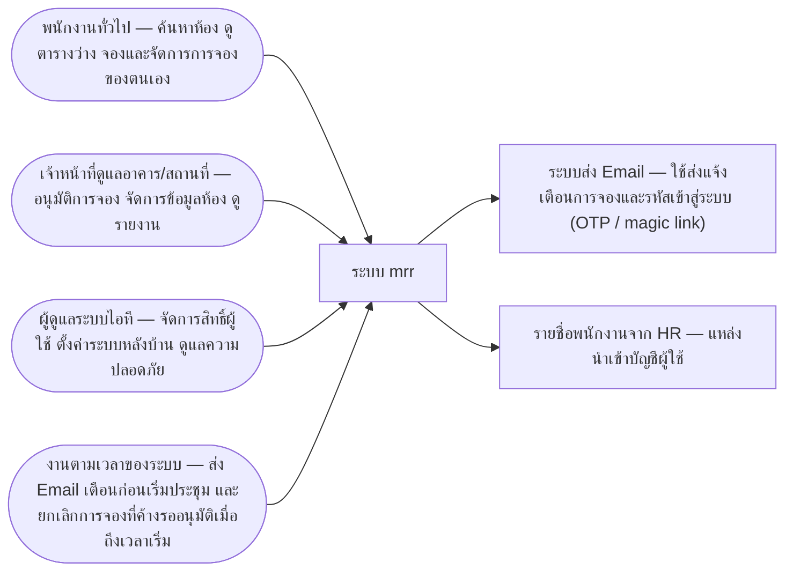
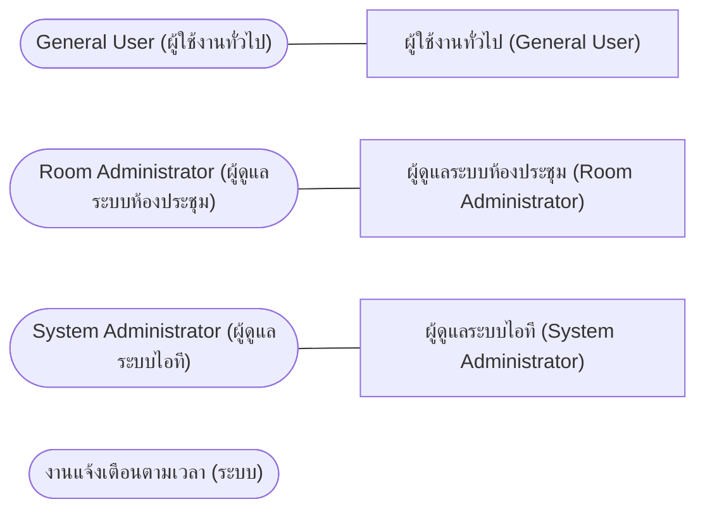
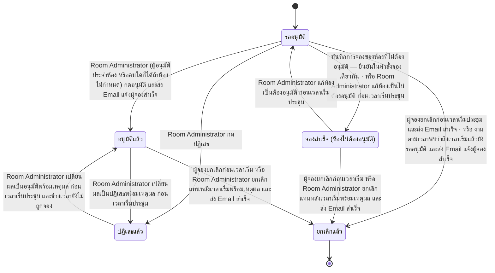
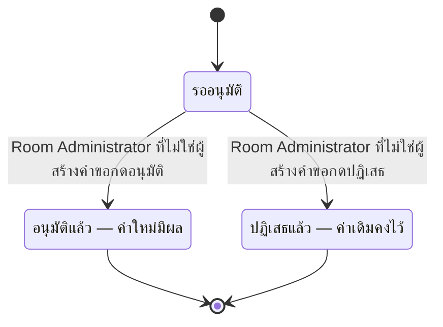
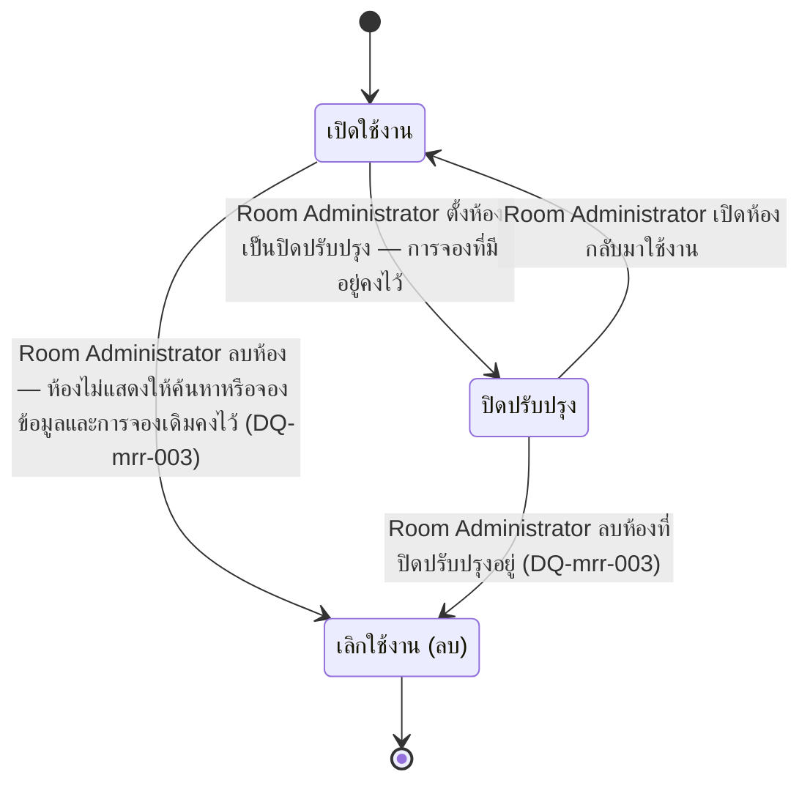
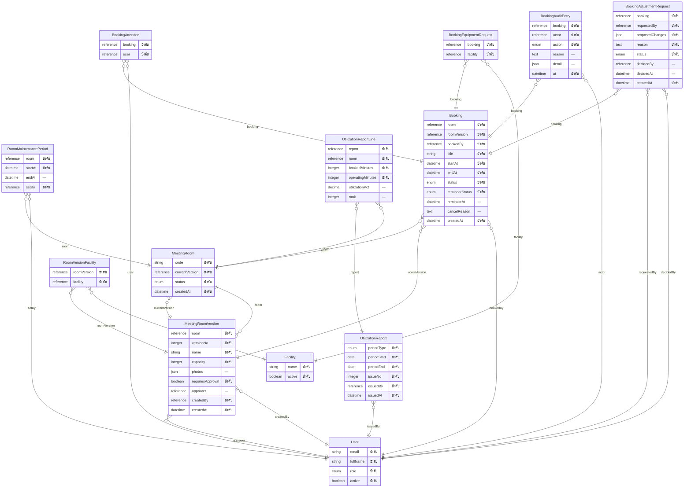
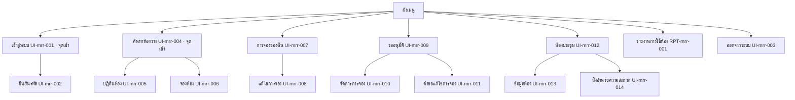

# เอกสารการออกแบบระบบ — mrr

> เอกสารฉบับนี้ถูก **สร้างจากไฟล์ JSON ทั้งฉบับ** (renderer v1.0) — แก้ไฟล์นี้โดยตรงแล้วจะหายในการ render รอบถัดไป
> แก้ที่ต้นทางเสมอ: รายการและตารางแก้ผ่านคำสั่งของ `design` · ร้อยแก้วแก้ที่ไฟล์ Markdown ต้นทางที่ระบุไว้ท้ายแต่ละหัวข้อ

## ปกและตารางแก้ไข

**เอกสารฉบับนี้ไม่มีเลขเวอร์ชันของตัวเอง** — ไม่มีไฟล์ไหนในเฟสนี้เก็บเลขเวอร์ชันของเอกสารไว้
สิ่งที่ใช้แทนคือตารางการเปลี่ยนแปลงข้างล่าง ซึ่งอ่านจากใบเปลี่ยนแปลงจริง และตารางสถานะการอนุมัติรายไฟล์

### ตารางแก้ไข (Revision History)

| รหัส | ที่มา | เมื่อ | เหตุผล | ผู้เกี่ยวข้อง / สถานะ |
|---|---|---|---|---|
| CHG-mrr-001 | req | 2026-10-19T10:00+07:00 | ลูกค้าขอให้เปลี่ยน — การแก้ค่าตั้งของห้องต้องมีผลกับการจองที่ยังไม่ถึงเวลาเริ่มด้วย ไม่ใช่เฉพาะการจองใหม่ | ลูกค้า (คุณ Somchai) ในการประชุมล่าสุด → Adisorn |
| CHG-mrr-002 | req | 2026-10-22T07:00+07:00 | เพิ่มกฎเข้าสู่ระบบด้วยรหัส/magic link ที่ยังไม่มีตอนเซ็น CP1 วันที่ 19/10 | dev:plan · GAP-mrr-003 (UC-mrr-020 เข้าสู่ระบบด้วย OTP ไม่มีกฎรองรับ) ส่งผ่าน design → Noppasorn |
| CHG-mrr-001 | design · revised | 2026-10-19T14:30:00+07:00 | ลูกค้า (คุณ Somchai) ขอให้การแก้ค่าตั้งของห้อง (ต้องอนุมัติ หรือความจุ) มีผลกับการจองที่ยังไม่ถึงเวลาเริ่มด้วย ไม่ใช่เฉพาะการจองใหม่ — อนุมัติโดย Adisorn มีผลตั้งแต่ 2026-10-19 | รับเข้าแล้ว 2026-10-19T06:30:33Z |
| ADR-001 | design · revised | 2026-10-19T08:55:00Z | ลำดับปุ่มใน zone admin-actions ของหน้าจัดการการจอง (ผู้ดูแล) และ zone rooms ของหน้าห้องประชุม ไม่ตรงกับกติกาหน้าตาประจำโปรเจกต์ UIC-001 (ปุ่มประจำแถวเรียง ดู · แก้ไข · ลบ · จัดการ · คำสั่ง) ที่ Noppasorn ยืนยันไว้ — ขอเรียงปุ่มใหม่เท่านั้น ไม่เพิ่มหรือลบฟิลด์ ปุ่ม หรือปลายทางใด ๆ | รับเข้าแล้ว 2026-10-19T09:09:12Z |
| ADR-002 | design · added | 2026-10-21T00:00:00Z | หน้าจัดการการจอง (ผู้ดูแล) ประกาศว่า System Administrator เห็นเฉพาะร่องรอย ปุ่มคำสั่งไม่แสดง และหน้าสิ่งอำนวยความสะดวกประกาศว่าคนที่ไม่ใช่ Room Administrator เห็น 'คุณไม่มีสิทธิ์เข้าหน้านี้' — แต่ไม่มี API ใดบอกหน้าจอว่าผู้ใช้ที่เข้าสู่ระบบมีบทบาทอะไร หน้าจอจึงทำตามสองข้อนี้ไม่ได้ (การ์ดจาก dev GAP-mrr-015 · GAP-mrr-020 · พบจาก /dev:review ของ FE-mrr-009) · ต้องเพิ่มช่องทางให้หน้าจอรู้บทบาทของผู้เรียก และสิทธิ์ของช่องทางนั้น — สิทธิ์จริงยังบังคับที่ api เหมือนเดิม การซ่อนปุ่มไม่ใช่การคุมสิทธิ์ | รับเข้าแล้ว 2026-10-21T07:29:43Z |
| ADR-003 | design · added | 2026-10-21T08:30:00Z | req เพิ่มตัวอย่าง EX-mrr-088 · EX-mrr-089 · EX-mrr-090 (commit 64c0e25 · ยืนยันโดย Noppasorn) ใต้กฎเดิมโดยไม่ขึ้นเวอร์ชัน จึงไม่มี change set — System Administrator เปิดหน้าจัดการการจองแล้วไม่เห็นช่องเหตุผลและปุ่มคำสั่ง ทั้งระหว่างประชุมและก่อนเริ่ม และ General User เปิดหน้าสิ่งอำนวยความสะดวกแล้วเห็น 'คุณไม่มีสิทธิ์เข้าหน้านี้' · design ต้องเขียนเกณฑ์รับที่คัดลอกตัวอย่างทั้งสามคำต่อคำ (S16) และสถานการณ์ทดสอบของมัน เพื่อให้ dev สร้างหน่วยของ API-035 (ADR-002) และแก้หน้าจอที่ถูกการ์ด GAP-mrr-021 บล็อกได้ | รับเข้าแล้ว 2026-10-21T09:43:31Z |
| CHG-mrr-002 | design · added | 2026-10-22T07:13:26Z | req เพิ่มกฎเข้าสู่ระบบด้วยรหัส/magic link 5 ข้อ ตามการ์ด GAP-mrr-003 ของ dev (UC-mrr-020 ไม่มีกฎรองรับ) · อนุมัติโดย Noppasorn มีผล 2026-10-22 · ส่งรหัสไม่สำเร็จล้มทันทีไม่มีคิวส่งซ้ำ · ห้ามขอรหัสใหม่ระหว่างรหัสเดิมยังใช้ได้ · เข้าสู่ระบบได้เฉพาะพนักงานในรายชื่อ HR ที่ active และคนนอกรายชื่อได้ข้อความเดียวกับกรณีปกติ · รหัส 6 หลัก อายุ 10 นาที ใช้ครั้งเดียว นับร่วมกับ magic link · กรอกผิดไม่ทำให้รหัสเสีย · พร้อมตัวอย่าง EX-mrr-091..105 ที่มีข้อความไทยตรงตัวซึ่งต้องเข้าเกณฑ์รับคำต่อคำ (S16) | รับเข้าแล้ว 2026-10-22T08:46:02Z |

### สถานะการอนุมัติรายไฟล์

| ไฟล์ | คำสั่งที่เขียน | สถานะขั้น | สถานะเอกสาร | ผู้อนุมัติ | เมื่อ | หมายเหตุ |
|---|---|---|---|---|---|---|
| design.state.json | /design:init | done | — | — | — | — |
| context.json | /design:overview | done | approved | Noppasorn | 2026-10-19T07:59:59Z | — |
| modules/mrr/functions.json | /design:function | done | approved | Noppasorn | 2026-10-22T08:55:12Z | — |
| trace.design.json | /design:function | done | — | — | — | — |
| datamodel.json | /design:datamodel | done | approved | Noppasorn | 2026-10-19T07:59:59Z | — |
| modules/mrr/statemachines.json | /design:datamodel | done | approved | Noppasorn | 2026-10-19T07:59:59Z | — |
| modules/mrr/scenarios.json | /design:scenario | done | approved | Noppasorn | 2026-10-22T08:55:12Z | — |
| rbac.json | /design:rbac | done | approved | Noppasorn | 2026-10-21T07:40:09Z | — |
| nfr.json | /design:nfr | done | approved | Noppasorn | 2026-10-19T07:59:59Z | — |
| sitemap.json | /design:sitemap | done | approved | Noppasorn | 2026-10-19T09:13:24Z | — |
| modules/mrr/screens.json | /design:sitemap | done | approved | Noppasorn | 2026-10-19T09:13:24Z | — |
| interfaces.json | /design:interface | done | approved | Noppasorn | 2026-10-22T08:55:12Z | — |

> ℹ️ **ข้อจำกัดของข้อมูลชุดนี้** — "สถานะขั้น" มาจากไฟล์สถานะ ส่วน "สถานะเอกสาร" มาจากตัวไฟล์เอง — ขั้นที่ค้างจะเห็นได้ที่คอลัมน์แรกเท่านั้น เพราะเครื่องหมายค้างถูกเก็บที่ขั้น ไม่ใช่ในเนื้อหาที่อนุมัติไปแล้ว

> ℹ️ **ข้อจำกัดของข้อมูลชุดนี้** — ตารางนี้ไม่มีแถวของขั้น `export` เอง เพราะ artifact ของขั้นนั้นคือเอกสารฉบับนี้ — เอกสารที่รายงานสถานะการส่งมอบของตัวเอง จะไม่ตรงกับความจริงทันทีที่มีคนบันทึกว่าส่งแล้ว

## 1 บทนำ

**วัตถุประสงค์ของระบบ** — ระบบการจองห้องประชุม (Meeting Room Reservation System) มีไว้ให้พนักงานตรวจสอบสถานะ จอง แก้ไข และยกเลิกการใช้ห้องประชุมได้อย่างสะดวกรวดเร็ว ลดความซ้ำซ้อนในการจอง และให้องค์กรบริหารจัดการทรัพยากรห้องประชุมให้เกิดประโยชน์สูงสุด (SRC-001 ข้อ 1)

**ที่มาของเอกสาร** — เอกสารนี้เป็นการออกแบบระบบที่สร้างจาก requirement 5 ข้อ (REQ-mrr-001 ถึง REQ-mrr-005) ซึ่งผ่านการยืนยันขั้น CP1 เมื่อวันที่ 19 ตุลาคม 2569 ทุกฟังก์ชัน หน้าจอ API และ scenario ในเอกสารนี้สืบย้อนกลับไปหา requirement ข้อนั้นได้ผ่านตาราง Traceability ในหัวข้อ 7

**สิ่งที่ปรับจากเอกสาร requirement ต้นทาง** — ขอบเขตรอบนี้แคบกว่าที่เอกสารต้นทางเขียนไว้ใน 2 เรื่อง ซึ่งตกลงกันระหว่างการเก็บ requirement:

- **การยืนยันตัวตน** — ต้นทางเขียนว่า "Email ขององค์กร หรือเชื่อมต่อกับ Active Directory (SSO)" รอบนี้ใช้ Email ขององค์กรอย่างเดียว โดยรับรหัส OTP / magic link ทาง Email (DEC-001) ไม่เชื่อม Active Directory
- **ช่องทางแจ้งเตือน** — ต้นทางเขียนว่า "Email หรือแอปพลิเคชันแชทขององค์กร (เช่น Line, Microsoft Teams, Slack)" รอบนี้แจ้งเตือนทาง Email ช่องทางเดียว

รายการที่อยู่และไม่อยู่ในขอบเขตทั้งหมดแสดงในหัวข้อ 1.1 และ 1.2

**ผู้อ่านเอกสาร** — ผู้อนุมัติฝั่งองค์กร (ผู้ใช้งานทั่วไป ผู้ดูแลระบบห้องประชุม และผู้ดูแลระบบไอที ตามหัวข้อ 2.2) ทีมพัฒนา และทีมทดสอบ ส่วนที่ต้องอ่านก่อนลงนามเป็นพิเศษคือตารางสิทธิ์ (หัวข้อ 6.5) และคำตัดสินทางเทคโนโลยี (หัวข้อ 2.6)

### 1.1 ขอบเขตที่อยู่ในงาน

| รหัส | รายการ | ที่มา |
|---|---|---|
| booking | ค้นหาและกรองห้องว่าง ดูปฏิทินการใช้ห้องรายวัน/รายสัปดาห์/รายเดือน จองห้องพร้อมตรวจสอบการจองทับอัตโนมัติ และจัดการการจองของตนเอง (ดูประวัติ แก้ไข ยกเลิก) | REQ-mrr-001 |
| approval | กำหนดห้องที่ต้องอนุมัติ กำหนดผู้อนุมัติประจำห้อง อนุมัติ/ปฏิเสธ/ถอยผลการจอง และบันทึกร่องรอยการกระทำของ Room Administrator | REQ-mrr-002 |
| room-management | เพิ่ม แก้ไข ปิดปรับปรุง หรือลบข้อมูลห้องประชุม พร้อมความจุ รูปภาพ และสิ่งอำนวยความสะดวก | REQ-mrr-003 |
| reports | รายงานการใช้ห้องรายเดือน/รายปี และสถิติอัตราการใช้งานรายห้องสำหรับวางแผนทรัพยากร | REQ-mrr-004 |
| email-notification | แจ้งเตือนทาง Email เมื่อจองสำเร็จ/ได้รับอนุมัติ ใกล้ถึงเวลาประชุม และเมื่อเปลี่ยนเวลาหรือยกเลิกการจอง รวมงานตามเวลาที่ส่งเตือนก่อนเริ่มประชุม | REQ-mrr-005 |
| access-control | เข้าสู่ระบบด้วย Email ขององค์กร และจำกัดสิทธิ์ตามบทบาท (General User · Room Administrator · System Administrator) | REQ-mrr-001 |

### 1.2 ขอบเขตที่ไม่อยู่ในงาน

| รหัส | รายการ | ที่มา |
|---|---|---|
| sso-active-directory | การเชื่อม Active Directory / SSO — ไม่ทำในรอบนี้ | REQ-mrr-001 |
| chat-notification | การแจ้งเตือนผ่านแอปแชทขององค์กร (Line, Microsoft Teams, Slack) — รอบนี้แจ้งเตือนทาง Email อย่างเดียว | REQ-mrr-005 |
| native-mobile-app | แอปมือถือแบบ native (iOS/Android) — รองรับมือถือผ่านเว็บแบบ Responsive เท่านั้น | REQ-mrr-001 |
| external-calendar-sync | การซิงก์การจองกับปฏิทินภายนอก (Outlook / Google Calendar) | — |
| recurring-booking | การจองแบบประจำ (ซ้ำทุกสัปดาห์/ทุกเดือน) — หนึ่งการจองคือหนึ่งช่วงเวลา | — |

### 1.3 เอกสารอ้างอิง

| เอกสาร | ที่อยู่ |
|---|---|
| ความต้องการที่ `req` เก็บไว้ | .aeon/req/requirements.json |
| อภิธานศัพท์ | .aeon/req/glossary.json |
| ผู้มีส่วนได้ส่วนเสีย | .aeon/req/stakeholders.json |

### 1.4 อภิธานศัพท์

| รหัส | คำไทย | คำอังกฤษ | ความหมาย | อย่าสับสนกับ | สถานะ |
|---|---|---|---|---|---|
| UL-mrr-001 | ห้องประชุม | MeetingRoom | ห้องที่เปิดให้จองใช้ได้ มีความจุ รูปภาพ และสิ่งอำนวยความสะดวกประจำห้อง จัดการข้อมูลโดย Room Administrator | — | draft |
| UL-mrr-002 | การจอง | Booking | การขอใช้ห้องประชุมหนึ่งห้องในช่วงเวลาหนึ่ง ระบุหัวข้อการประชุม รายชื่อผู้เข้าร่วม และอุปกรณ์เสริมที่ต้องการ | — | draft |
| UL-mrr-003 | สิ่งอำนวยความสะดวก | Facility | อุปกรณ์ที่ห้องมีอยู่ เช่น โปรเจคเตอร์ กระดานไวท์บอร์ด ระบบ Video Conference — ใช้กรองตอนค้นหาห้อง และเลือกระบุตอนจองว่าต้องการใช้ (เรียกอีกอย่างว่า อุปกรณ์เสริม) | — | draft |
| UL-mrr-005 | การจองซ้ำ | BookingConflict | การจองห้องเดียวกันในช่วงเวลาที่ทับกับการจองที่มีอยู่แล้ว ระบบต้องตรวจจับอัตโนมัติ (Conflict Check) | — | draft |
| UL-mrr-006 | การอนุมัติการจอง | BookingApproval | ขั้นที่ Room Administrator ต้องอนุมัติการจองก่อนจึงใช้ห้องได้จริง ใช้เฉพาะห้องที่ถูกตั้งไว้ว่าต้องอนุมัติ | — | draft |
| UL-mrr-007 | ปิดปรับปรุง | — | สถานะของห้องที่ Room Administrator ตั้งให้ห้องรับการจองใหม่ไม่ได้ชั่วคราว โดยการจองที่มีอยู่แล้วคงไว้ และข้อมูลห้องยังไม่ถูกลบ | — | draft |
| UL-mrr-008 | อัตราการใช้งาน | UtilizationRate | สัดส่วนชั่วโมงที่ห้องถูกจองและใช้ได้จริง ต่อชั่วโมงทำการของห้องในช่วงรายงาน ใช้จัดอันดับห้องเพื่อวางแผนทรัพยากร | — | draft |
| UL-mrr-009 | งานแจ้งเตือนตามเวลา | ReminderJob | งานอัตโนมัติที่ระบบรันเองตามเวลา โดยไม่มีคนกด เช่น ส่งแจ้งเตือนก่อนเริ่มประชุม | — | draft |
| UL-mrr-010 | ผู้อนุมัติประจำห้อง | RoomApprover | Room Administrator ที่ถูกกำหนดให้อนุมัติการจองของห้องหนึ่ง — ถ้าห้องยังไม่กำหนด Room Administrator ทุกคนอนุมัติได้ | — | draft |
| UL-mrr-011 | คำขอแก้ไขการจอง | BookingAdjustmentRequest | รายการแก้ไขการจองที่ประชุมจบไปแล้ว เก็บแยกจากค่าเดิม และมีผลต่อเมื่อ Room Administrator คนอื่นที่ไม่ใช่คนแก้อนุมัติ | — | draft |
| UL-mrr-012 | ชั่วโมงทำการของห้อง | RoomOperatingHours | ช่วงเวลาที่ห้องเปิดให้ใช้ ใช้เป็นตัวหารของอัตราการใช้งาน — ค่าเดียวทั้งองค์กร จ.–ศ. 08:00–18:00 (วันหยุดนักขัตฤกษ์นับตามปกติ) หักช่วงที่ห้องปิดปรับปรุง | — | draft |
| UL-mrr-013 | รหัสเข้าสู่ระบบ | LoginCode | รหัสที่ระบบส่งไปที่ Email องค์กรของผู้ใช้เพื่อใช้เข้าสู่ระบบ — ระบบไม่มีรหัสผ่าน | — | draft |
| UL-mrr-014 | magic link | MagicLink | ลิงก์ใน Email ฉบับเดียวกับรหัสเข้าสู่ระบบ กดแล้วเข้าสู่ระบบได้แทนการกรอกรหัส | — | draft |

## 2 ภาพรวมระบบ

**มุมมองของระบบ** — ระบบนี้เป็นเว็บแอปพลิเคชันใหม่ที่ทำงานแยกเป็นอิสระ ใช้งานผ่านเว็บเบราว์เซอร์ทั้งบนคอมพิวเตอร์และอุปกรณ์เคลื่อนที่ (Responsive) ไม่มีแอปมือถือแบบ native ติดตั้งใน data center ขององค์กร (DEC-004) ระบบภายนอกที่เชื่อมต่อมีระบบเดียวคือระบบส่ง Email (INT-001) ใช้ทั้งส่งแจ้งเตือนการจองและส่งรหัสเข้าสู่ระบบ ส่วนบัญชีผู้ใช้นำเข้าจากรายชื่อพนักงานของฝ่าย HR เป็นระยะ ผู้ใช้ไม่ได้สมัครเอง

### กระบวนการทำงานแบบเดิม (As-Is)

เอกสาร requirement (SRC-001) ไม่ได้บรรยายว่าปัจจุบันพนักงานจองห้องประชุมด้วยวิธีใด ระบุเพียงเป้าหมายว่าต้องการ "ลดความซ้ำซ้อนในการจอง และบริหารจัดการทรัพยากรห้องประชุมขององค์กรให้เกิดประโยชน์สูงสุด"

> ⚠️ **ยังไม่ได้บันทึกกระบวนการเดิม** — ขอให้ผู้อนุมัติฝั่งองค์กรระบุว่าปัจจุบันจองห้องประชุมอย่างไร และปัญหาที่พบคืออะไร เพื่อใช้ยืนยันว่าระบบใหม่แก้ปัญหาได้ตรงจุด

### กระบวนการทำงานแบบใหม่ (To-Be)

1. **เข้าสู่ระบบ** — พนักงานกรอก Email ขององค์กร รับรหัส OTP ทาง Email แล้วเข้าสู่ระบบตามบทบาทของตน
2. **ค้นหาและจอง** — ค้นหาห้องว่างตามวัน เวลา จำนวนผู้เข้าร่วม และสิ่งอำนวยความสะดวก หรือดูปฏิทินการใช้ห้อง แล้วจองโดยระบุหัวข้อ ผู้เข้าร่วม และอุปกรณ์เสริม ระบบตรวจการจองทับให้อัตโนมัติ
3. **อนุมัติ (เฉพาะห้องที่กำหนด)** — ห้องที่ไม่ต้องอนุมัติ การจองใช้ได้ทันที ห้องที่ต้องอนุมัติ การจองรอผู้ดูแลระบบห้องประชุมอนุมัติหรือปฏิเสธ ถ้าถึงเวลาเริ่มแล้วยังไม่มีผู้อนุมัติ ระบบยกเลิกการจองนั้นให้เอง
4. **แจ้งเตือน** — ระบบส่ง Email เมื่อจองสำเร็จหรือได้รับอนุมัติ เมื่อมีการเปลี่ยนเวลาหรือยกเลิก และเตือนก่อนเริ่มประชุม
5. **จัดการการจองของตนเอง** — ผู้จองดูประวัติ แก้ไข หรือยกเลิกการจองของตนได้ก่อนเวลาเริ่มประชุม
6. **ดูแลห้องและวางแผน** — ผู้ดูแลระบบห้องประชุมจัดการข้อมูลห้อง สิ่งอำนวยความสะดวก และการปิดปรับปรุง และออกรายงานอัตราการใช้ห้องรายเดือนหรือรายปีเพื่อวางแผนทรัพยากร

รายละเอียดของแต่ละขั้นอยู่ในหัวข้อ 3 (ความต้องการเชิงหน้าที่) และกฎที่ใช้ตัดสินแต่ละกรณีอ้างอิงตามรหัส BR- ในเอกสาร requirement

### 2.1 ผังบริบทของระบบ (DFD ระดับ 0)

### 2.2 ผู้ใช้ระบบ

| รหัส | ผู้ใช้ | ผู้มีส่วนได้ส่วนเสียที่ `req` บันทึก |
|---|---|---|
| general-user | พนักงานทั่วไป — ค้นหาห้อง ดูตารางว่าง จองและจัดการการจองของตนเอง | STK-mrr-001 |
| room-administrator | เจ้าหน้าที่ดูแลอาคาร/สถานที่ — อนุมัติการจอง จัดการข้อมูลห้อง ดูรายงาน | STK-mrr-002 |
| system-administrator | ผู้ดูแลระบบไอที — จัดการสิทธิ์ผู้ใช้ ตั้งค่าระบบหลังบ้าน ดูแลความปลอดภัย | STK-mrr-003 |
| reminder-scheduler | งานตามเวลาของระบบ — ส่ง Email เตือนก่อนเริ่มประชุม และยกเลิกการจองที่ค้างรออนุมัติเมื่อถึงเวลาเริ่ม | STK-mrr-004 |

### 2.3 ข้อสมมติ

| รหัส | ข้อสมมติ | ที่มา |
|---|---|---|
| single-timezone | ทุกห้องและผู้ใช้อยู่ในเขตเวลาเดียว คือ Asia/Bangkok | — |
| single-organization | ห้องทั้งหมดอยู่ในองค์กรเดียว ไม่ต้องแยกหรือจัดกลุ่มตามอาคาร/สาขา | — |
| user-import-from-hr | บัญชีผู้ใช้ (Email องค์กร) นำเข้าจากรายชื่อพนักงานของ HR เป็นระยะ ผู้ใช้ไม่สมัครเอง | — |

### 2.4 ข้อจำกัด

| รหัส | ข้อจำกัด | ที่มา |
|---|---|---|
| login-org-email-only | เข้าสู่ระบบด้วย Email ขององค์กรอย่างเดียว ไม่เชื่อม Active Directory | REQ-mrr-001 |
| performance-target | รองรับผู้ใช้งานพร้อมกัน 200 คน และหน้าจอตารางห้องประชุมโหลดเสร็จภายใน 2 วินาที | REQ-mrr-001 |
| https-rbac | เข้ารหัสการใช้งานผ่าน HTTPS และจำกัดสิทธิ์ตามระดับผู้ใช้งาน (Role-Based Access Control) | REQ-mrr-001 |
| uptime | เปิดให้บริการตลอด 24 ชั่วโมง (Uptime 99.9%) | REQ-mrr-001 |
| browser-responsive | รองรับ Chrome, Safari, Edge, Firefox และแสดงผลได้ดีบนอุปกรณ์เคลื่อนที่ (Responsive Design) | REQ-mrr-001 |
| email-only-channel | ช่องทางแจ้งเตือนมี Email ช่องทางเดียว | REQ-mrr-005 |
| org-wide-working-hours | ชั่วโมงทำการของห้องเป็นค่าเดียวทั้งองค์กร (ตามคำนิยามใน glossary) ใช้เป็นตัวหารของอัตราการใช้งาน | REQ-mrr-004 |

### 2.5 แผนผังผู้มีส่วนได้ส่วนเสีย

| รหัส | ชื่อ | ประเภท | กลายเป็นบทบาท | คำอธิบาย |
|---|---|---|---|---|
| STK-mrr-001 | General User (ผู้ใช้งานทั่วไป) | internal | — | พนักงานทั่วไปที่ค้นหาห้อง ตรวจสอบตารางว่าง และจองห้องประชุม |
| STK-mrr-002 | Room Administrator (ผู้ดูแลระบบห้องประชุม) | internal | — | เจ้าหน้าที่ดูแลอาคาร/สถานที่ ที่อนุมัติการจอง จัดการข้อมูลห้อง และกำหนดสิ่งอำนวยความสะดวก |
| STK-mrr-003 | System Administrator (ผู้ดูแลระบบไอที) | internal | — | จัดการสิทธิ์การใช้งานของระบบ ตั้งค่าระบบหลังบ้าน และดูแลความปลอดภัย |
| STK-mrr-004 | งานแจ้งเตือนตามเวลา (ระบบ) | system | — | งานตามเวลาที่อ่านข้อมูลการจองแล้วส่งแจ้งเตือนก่อนเริ่มประชุม โดยไม่มีคนกด |

### 2.6 คำตัดสินทางเทคโนโลยี

| รหัส | หัวข้อ | คำถาม | สิ่งที่เลือก | สถานะ |
|---|---|---|---|---|
| DEC-001 | security | ผู้ใช้เข้าสู่ระบบด้วย Email ขององค์กรด้วยวิธีใด (ไม่ใช้ Active Directory / SSO ในรอบนี้) | OTP / magic link ทาง Email | เลือกแล้ว รอลายเซ็น |
| DEC-002 | framework | ใช้ framework ใดพัฒนาระบบ | React + NestJS | เลือกแล้ว รอลายเซ็น |
| DEC-003 | database | ใช้ฐานข้อมูลใดเก็บข้อมูลห้องและการจอง | PostgreSQL | เลือกแล้ว รอลายเซ็น |
| DEC-004 | hosting | ติดตั้งระบบไว้ที่ใด โดยต้องได้ Uptime 99.9% | On-premise ขององค์กร | เลือกแล้ว รอลายเซ็น |
| DEC-005 | integration | ระบบส่ง Email (แจ้งเตือนและรหัสเข้าสู่ระบบ) ผ่านบริการใด | — | ยังไม่เลือก |

#### DEC-001 · ผู้ใช้เข้าสู่ระบบด้วย Email ขององค์กรด้วยวิธีใด (ไม่ใช้ Active Directory / SSO ในรอบนี้)

| ทางเลือกที่ชั่งน้ำหนัก | แนะนำ | หลักฐานที่ตรวจได้ | หมายเหตุ |
|---|---|---|---|
| OTP / magic link ทาง Email | ⭐ | ยืนยันได้ว่าผู้ใช้เป็นเจ้าของ Email องค์กรจริง ระบบไม่ต้องเก็บรหัสผ่าน และไม่ต้องมีหน้าลืมรหัสผ่าน | เข้าสู่ระบบไม่ได้ถ้าระบบส่ง Email ล่ม |
| Email + รหัสผ่านในระบบ | — | — | ระบบต้องเก็บ hash รหัสผ่าน และมีขั้นตอนตั้ง/รีเซ็ตรหัสผ่าน |

| หัวข้อ | รายละเอียด |
|---|---|
| สิ่งที่เลือก | OTP / magic link ทาง Email |
| เหตุผล | เจ้าของโปรเจกต์เลือกเพื่อยืนยันความเป็นเจ้าของ Email องค์กรโดยไม่ต้องดูแลรหัสผ่าน |
| ผู้ตัดสิน | Noppasorn |
| วันที่ตัดสิน | 2026-10-19T12:40:00+07:00 |
| ตัวเลขที่บังคับให้เลือกแบบนี้ | NFR-mrr-001 · NFR-mrr-003 |
| ลายเซ็น | ยังไม่มี |

#### DEC-002 · ใช้ framework ใดพัฒนาระบบ

| ทางเลือกที่ชั่งน้ำหนัก | แนะนำ | หลักฐานที่ตรวจได้ | หมายเหตุ |
|---|---|---|---|
| Next.js (TypeScript) | — | — | เว็บและ API อยู่ในโปรเจกต์เดียว |
| React + NestJS | — | — | แยก frontend กับ backend |
| Laravel (PHP) | — | — | server-rendered มี scheduler ในตัว |

| หัวข้อ | รายละเอียด |
|---|---|
| สิ่งที่เลือก | React + NestJS |
| เหตุผล | เจ้าของโปรเจกต์เลือกแยก frontend (React) กับ backend (NestJS) |
| ผู้ตัดสิน | Noppasorn |
| วันที่ตัดสิน | 2026-10-19T12:40:00+07:00 |
| ตัวเลขที่บังคับให้เลือกแบบนี้ | — |
| ลายเซ็น | ยังไม่มี |

#### DEC-003 · ใช้ฐานข้อมูลใดเก็บข้อมูลห้องและการจอง

| ทางเลือกที่ชั่งน้ำหนัก | แนะนำ | หลักฐานที่ตรวจได้ | หมายเหตุ |
|---|---|---|---|
| PostgreSQL | ⭐ | มี exclusion constraint บนช่วงเวลา (tstzrange แบบ [เริ่ม, จบ)) กันการจองทับกันได้ที่ระดับฐานข้อมูล ตรงกับกฎห้ามจองทับของห้องเดียวกัน | — |
| MySQL | — | — | ไม่มี range exclusion ต้องกันการจองทับด้วยการ lock ในแอป |
| SQL Server | — | — | เหมาะถ้าองค์กรใช้ Microsoft stack อยู่แล้ว |

| หัวข้อ | รายละเอียด |
|---|---|
| สิ่งที่เลือก | PostgreSQL |
| เหตุผล | เจ้าของโปรเจกต์เลือกตามคำแนะนำ — กันการจองทับได้ที่ระดับฐานข้อมูล |
| ผู้ตัดสิน | Noppasorn |
| วันที่ตัดสิน | 2026-10-19T12:40:00+07:00 |
| ตัวเลขที่บังคับให้เลือกแบบนี้ | NFR-mrr-002 |
| ลายเซ็น | ยังไม่มี |

#### DEC-004 · ติดตั้งระบบไว้ที่ใด โดยต้องได้ Uptime 99.9%

| ทางเลือกที่ชั่งน้ำหนัก | แนะนำ | หลักฐานที่ตรวจได้ | หมายเหตุ |
|---|---|---|---|
| Cloud (AWS/Azure/GCP) | — | — | มี managed DB และหลาย zone ช่วยให้ถึง 99.9% ได้ง่ายกว่า |
| On-premise ขององค์กร | — | — | ทีมต้องจัด redundancy และการสำรองข้อมูลเองเพื่อให้ถึง 99.9% |

| หัวข้อ | รายละเอียด |
|---|---|
| สิ่งที่เลือก | On-premise ขององค์กร |
| เหตุผล | เจ้าของโปรเจกต์เลือกติดตั้งใน data center ขององค์กร — การออกแบบต้องรองรับ redundancy เองเพื่อให้ถึง Uptime 99.9% |
| ผู้ตัดสิน | Noppasorn |
| วันที่ตัดสิน | 2026-10-19T12:40:00+07:00 |
| ตัวเลขที่บังคับให้เลือกแบบนี้ | NFR-mrr-004 |
| ลายเซ็น | ยังไม่มี |

#### DEC-005 · ระบบส่ง Email (แจ้งเตือนและรหัสเข้าสู่ระบบ) ผ่านบริการใด

| ทางเลือกที่ชั่งน้ำหนัก | แนะนำ | หลักฐานที่ตรวจได้ | หมายเหตุ |
|---|---|---|---|
| SMTP server ขององค์กร | — | — | ต้องยืนยันว่าองค์กรมีและเปิดให้ระบบใช้ได้ |
| บริการส่ง Email ภายนอก (เช่น Amazon SES, SendGrid) | — | — | ต้องออกอินเทอร์เน็ตจาก on-premise ได้ |

| หัวข้อ | รายละเอียด |
|---|---|
| สิ่งที่เลือก | ยังไม่เลือก |
| เหตุผล | — |
| ผู้ตัดสิน | — |
| วันที่ตัดสิน | — |
| ตัวเลขที่บังคับให้เลือกแบบนี้ | — |
| ลายเซ็น | ยังไม่มี |

> ℹ️ **ข้อจำกัดของข้อมูลชุดนี้** — การ์ดที่ยังไม่มี “สิ่งที่เลือก” คือคำถามที่ยังเปิดอยู่ ไม่ใช่ช่องที่ลืมกรอก — ท่านกำลังอ่านคำถามที่ทีมออกแบบยังไม่ได้ตัดสิน และเป็นคำถามที่ท่านตอบได้ · ลายเซ็นเป็นรายใบ การเซ็นใบหนึ่งจึงไม่ผูกพันใบอื่น · หลักฐานในตารางเป็นสิ่งที่ท่านตรวจได้เอง คำแนะนำที่ไม่มีหลักฐานถูกปฏิเสธตั้งแต่ตอนบันทึก

## 3 ความต้องการเชิงหน้าที่

### 3.1 โมดูล mrr

| รหัส | ฟังก์ชัน | คำอธิบาย | ความต้องการต้นทาง | กฎที่คุม |
|---|---|---|---|---|
| FUN-mrr-001 | ค้นหาและกรองห้องว่าง | ค้นหาห้องที่ว่างตามวันที่ เวลาเริ่ม–สิ้นสุด และจำนวนผู้เข้าร่วม กรองตามสิ่งอำนวยความสะดวก โดยไม่แสดงห้องที่ปิดปรับปรุงหรือช่วงเวลาที่ถูกจองแล้ว | REQ-mrr-001 | BR-mrr-001@v1 · BR-mrr-012@v1 |
| FUN-mrr-002 | แสดงปฏิทินการใช้ห้อง | แสดงตารางการใช้ห้องแบบรายวัน รายสัปดาห์ และรายเดือน โดยแสดงรายละเอียดการจองเฉพาะที่ผู้ดูมีสิทธิ์เห็น | REQ-mrr-001 | BR-mrr-021@v1 · BR-mrr-001@v1 |
| FUN-mrr-003 | จองห้องประชุม | รับการจองห้องพร้อมหัวข้อ ผู้เข้าร่วม และอุปกรณ์เสริม ตรวจการจองทับอัตโนมัติ กำหนดสถานะตามค่าตั้งการอนุมัติของห้อง และแจ้ง Email | REQ-mrr-001 · REQ-mrr-002 · REQ-mrr-005 | BR-mrr-001@v1 · BR-mrr-002@v1 · BR-mrr-004@v1 · BR-mrr-012@v1 · BR-mrr-010@v2 · BR-mrr-007@v1 · BR-mrr-008@v1 · BR-mrr-019@v1 |
| FUN-mrr-004 | จัดการการจองของฉัน | ผู้จองดูประวัติ แก้ไข หรือยกเลิกการจองของตนเองได้จนถึงก่อนเวลาเริ่มประชุม | REQ-mrr-001 · REQ-mrr-005 | BR-mrr-003@v1 · BR-mrr-009@v1 · BR-mrr-001@v1 · BR-mrr-012@v1 · BR-mrr-007@v1 · BR-mrr-019@v1 |
| FUN-mrr-005 | อนุมัติ ปฏิเสธ และเปลี่ยนผลการอนุมัติ | Room Administrator อนุมัติหรือปฏิเสธการจองของห้องที่ต้องอนุมัติ และเปลี่ยนผลได้ก่อนเวลาเริ่มประชุม พร้อมบันทึกร่องรอย | REQ-mrr-002 · REQ-mrr-005 | BR-mrr-004@v1 · BR-mrr-011@v1 · BR-mrr-013@v1 · BR-mrr-016@v1 · BR-mrr-017@v1 · BR-mrr-019@v1 · BR-mrr-007@v1 |
| FUN-mrr-006 | แก้ไขหรือยกเลิกการจองแทนผู้จอง | Room Administrator แก้ไขหรือยกเลิกการจองแทนผู้จองหลังถึงเวลาเริ่มประชุม โดยต้องระบุเหตุผลและบันทึกร่องรอย | REQ-mrr-001 · REQ-mrr-002 | BR-mrr-009@v1 · BR-mrr-017@v1 · BR-mrr-014@v1 · BR-mrr-007@v1 · BR-mrr-019@v1 |
| FUN-mrr-007 | คำขอแก้ไขการจองหลังจบประชุม | การแก้ไขการจองหลังเวลาจบประชุมถูกเก็บเป็นคำขอแก้แยก และมีผลเมื่อ Room Administrator คนอื่นอนุมัติ | REQ-mrr-001 | BR-mrr-014@v1 · BR-mrr-017@v1 |
| FUN-mrr-008 | ดูร่องรอยการกระทำต่อการจอง | แสดงร่องรอยการกระทำของ Room Administrator ต่อการจอง (ใคร เมื่อไหร่ ทำอะไร เหตุผล) ให้ผู้มีสิทธิ์ดู | REQ-mrr-002 | BR-mrr-017@v1 · BR-mrr-018@v1 |
| FUN-mrr-009 | จัดการข้อมูลห้องประชุม | Room Administrator เพิ่ม แก้ไข ปิดปรับปรุง เปิดใช้งาน หรือลบข้อมูลห้อง พร้อมความจุ รูปภาพ สิ่งอำนวยความสะดวก ค่าตั้งการอนุมัติ และผู้อนุมัติประจำห้อง | REQ-mrr-003 · REQ-mrr-002 | BR-mrr-005@v1 · BR-mrr-010@v2 · BR-mrr-012@v1 · BR-mrr-013@v1 |
| FUN-mrr-010 | รายงานและสถิติการใช้ห้อง | ออกและดูรายงานการใช้ห้องรายเดือน/รายปี พร้อมอัตราการใช้งานและอันดับห้อง โดยเก็บทุกฉบับที่ออกไปแล้ว | REQ-mrr-004 | BR-mrr-006@v1 · CALC-mrr-001@v1 · BR-mrr-015@v1 · BR-mrr-022@v1 |
| FUN-mrr-011 | ส่ง Email แจ้งเหตุการณ์การจอง | ส่ง Email เมื่อจองสำเร็จ ได้รับอนุมัติ เปลี่ยนเวลา หรือยกเลิก ถ้าส่งไม่สำเร็จการกระทำที่ก่อให้เกิดแจ้งเตือนล้มทันที | REQ-mrr-005 | BR-mrr-007@v1 · BR-mrr-019@v1 |
| FUN-mrr-012 | งานตามเวลา: เตือนก่อนเริ่มประชุม | งานตามเวลาส่ง Email เตือนผู้จองและผู้เข้าร่วม 15 นาทีก่อนเวลาเริ่ม ครั้งเดียวต่อการจอง | REQ-mrr-005 | BR-mrr-008@v1 · BR-mrr-020@v1 · BR-mrr-023@v1 · BR-mrr-007@v1 |
| FUN-mrr-013 | งานตามเวลา: ยกเลิกการจองที่ค้างรออนุมัติ | งานตามเวลายกเลิกการจองที่ยังรออนุมัติเมื่อถึงเวลาเริ่มประชุม ปล่อยช่วงเวลาคืน และแจ้งผู้จอง | REQ-mrr-002 | BR-mrr-016@v1 · BR-mrr-007@v1 |
| FUN-mrr-014 | ยืนยันตัวตนด้วยรหัส OTP ทาง Email องค์กร และออกจากระบบ | ผู้ใช้เข้าสู่ระบบด้วย Email ขององค์กรอย่างเดียว โดยรับรหัส OTP ทาง Email (ไม่ใช้ Active Directory / SSO และไม่มีรหัสผ่าน) และออกจากระบบเพื่อยกเลิก session | REQ-mrr-001 | BR-mrr-024@v1 · BR-mrr-025@v1 · BR-mrr-026@v1 · BR-mrr-027@v1 · BR-mrr-028@v1 |

#### ผังกรณีใช้งาน — mrr

```mermaid
flowchart LR
  subgraph U0["FUN-mrr-001 · ค้นหาและกรองห้องว่าง"]
    U1(["UC-mrr-001 · ค้นหาห้องว่าง"])
  end
  subgraph U2["FUN-mrr-002 · แสดงปฏิทินการใช้ห้อง"]
    U3(["UC-mrr-002 · ดูปฏิทินการใช้ห้อง"])
  end
  subgraph U4["FUN-mrr-003 · จองห้องประชุม"]
    U5(["UC-mrr-003 · จองห้องประชุม"])
  end
  subgraph U6["FUN-mrr-004 · จัดการการจองของฉัน"]
    U7(["UC-mrr-004 · แก้ไขการจองของตนเอง"])
    U8(["UC-mrr-005 · ยกเลิกการจองของตนเอง"])
    U9(["UC-mrr-006 · ดูการจองของฉัน"])
  end
  subgraph U10["FUN-mrr-005 · อนุมัติ ปฏิเสธ และเปลี่ยนผลการอนุมัติ"]
    U11(["UC-mrr-007 · อนุมัติหรือปฏิเสธการจอง"])
    U12(["UC-mrr-008 · เปลี่ยนผลการอนุมัติ"])
  end
  subgraph U13["FUN-mrr-006 · แก้ไขหรือยกเลิกการจองแทนผู้จอง"]
    U14(["UC-mrr-009 · แก้ไขหรือยกเลิกการจองแทนผู้จอง"])
  end
  subgraph U15["FUN-mrr-007 · คำขอแก้ไขการจองหลังจบประชุม"]
    U16(["UC-mrr-010 · สร้างคำขอแก้ไขการจองหลังจบประชุม"])
    U17(["UC-mrr-011 · อนุมัติคำขอแก้ไขการจอง"])
  end
  subgraph U18["FUN-mrr-008 · ดูร่องรอยการกระทำต่อการจอง"]
    U19(["UC-mrr-012 · ดูร่องรอยการกระทำต่อการจอง"])
  end
  subgraph U20["FUN-mrr-009 · จัดการข้อมูลห้องประชุม"]
    U21(["UC-mrr-013 · เพิ่มหรือแก้ไขข้อมูลห้อง"])
    U22(["UC-mrr-014 · ปิดปรับปรุงหรือเปิดใช้งานห้อง"])
    U23(["UC-mrr-015 · ลบข้อมูลห้อง"])
  end
  subgraph U24["FUN-mrr-010 · รายงานและสถิติการใช้ห้อง"]
    U25(["UC-mrr-016 · ออกและดูรายงานการใช้ห้อง"])
  end
  subgraph U26["FUN-mrr-011 · ส่ง Email แจ้งเหตุการณ์การจอง"]
    U27(["UC-mrr-017 · ส่ง Email แจ้งเหตุการณ์การจอง"])
  end
  subgraph U28["FUN-mrr-012 · งานตามเวลา: เตือนก่อนเริ่มประชุม"]
    U29(["UC-mrr-018 · เตือนก่อนเริ่มประชุม 15 นาที"])
  end
  subgraph U30["FUN-mrr-013 · งานตามเวลา: ยกเลิกการจองที่ค้างรออนุมัติ"]
    U31(["UC-mrr-019 · ยกเลิกการจองที่ค้างรออนุมัติเมื่อถึงเวลาเริ่ม"])
  end
  subgraph U32["FUN-mrr-014 · ยืนยันตัวตนด้วยรหัส OTP ทาง Email องค์กร และออกจากระบบ"]
    U33(["UC-mrr-020 · เข้าสู่ระบบด้วยรหัส OTP"])
    U34(["UC-mrr-021 · ออกจากระบบ"])
  end
  A0["General User"] --> U1
  A0["General User"] --> U3
  A0["General User"] --> U5
  A0["General User"] --> U7
  A0["General User"] --> U8
  A0["General User"] --> U9
  A1["Room Administrator"] --> U11
  A1["Room Administrator"] --> U12
  A1["Room Administrator"] --> U14
  A1["Room Administrator"] --> U16
  A1["Room Administrator"] --> U17
  A1["Room Administrator"] --> U19
  A1["Room Administrator"] --> U21
  A1["Room Administrator"] --> U22
  A1["Room Administrator"] --> U23
  A1["Room Administrator"] --> U25
  A2["ผู้ใช้ที่ทำรายการ (General User หรือ Room Administrator)"] --> U27
  A3["งานแจ้งเตือนตามเวลา (STK-mrr-004)"] --> U29
  A3["งานแจ้งเตือนตามเวลา (STK-mrr-004)"] --> U31
  A4["ผู้ใช้ (General User, Room Administrator หรือ System Administrator)"] --> U33
  A4["ผู้ใช้ (General User, Room Administrator หรือ System Administrator)"] --> U34
```

> ℹ️ **ข้อจำกัดของข้อมูลชุดนี้** — Mermaid ไม่มีไวยากรณ์ของ use case diagram โดยตรง ผังนี้จึงวาดด้วย flowchart — ผู้ใช้เป็นกล่อง กรณีใช้งานเป็นแคปซูล และกรอบคือฟังก์ชันที่เป็นเจ้าของ

#### UC-mrr-001 · ค้นหาห้องว่าง

| หัวข้อ | รายละเอียด |
|---|---|
| ฟังก์ชันที่สังกัด | FUN-mrr-001 |
| ผู้ใช้ | General User |
| เงื่อนไขก่อนเริ่ม | ผู้ใช้เข้าสู่ระบบแล้ว |

**ขั้นตอนหลัก**
1. ผู้ใช้ระบุวันที่ เวลาเริ่ม–สิ้นสุด และจำนวนผู้เข้าร่วม
2. ผู้ใช้เลือกสิ่งอำนวยความสะดวกที่ต้องการ (ถ้ามี)
3. ระบบแสดงรายการห้องที่ความจุพอ ไม่ปิดปรับปรุง และไม่มีการจองทับช่วงเวลานั้น (รวมการจองที่รออนุมัติ)
4. ผู้ใช้เลือกห้องเพื่อไปจอง

**ทางเลือกอื่น**
1. ผู้ใช้ไม่ระบุตัวกรองสิ่งอำนวยความสะดวก — ระบบแสดงทุกห้องที่ว่างและความจุพอ

**กรณียกเว้น**
1. เวลาสิ้นสุดไม่หลังเวลาเริ่ม — ระบบแจ้งให้แก้ช่วงเวลา
2. ไม่มีห้องที่ตรงเงื่อนไข — ระบบแสดงสถานะว่างพร้อมแนะนำให้เปลี่ยนเงื่อนไข

#### UC-mrr-002 · ดูปฏิทินการใช้ห้อง

| หัวข้อ | รายละเอียด |
|---|---|
| ฟังก์ชันที่สังกัด | FUN-mrr-002 |
| ผู้ใช้ | General User |
| เงื่อนไขก่อนเริ่ม | ผู้ใช้เข้าสู่ระบบแล้ว |

**ขั้นตอนหลัก**
1. ผู้ใช้เลือกห้องและมุมมอง (รายวัน/รายสัปดาห์/รายเดือน)
2. ระบบแสดงช่วงเวลาที่ถูกจอง
3. สำหรับการจองที่ผู้ใช้เป็นผู้จองหรือผู้เข้าร่วม ระบบแสดงผู้จอง หัวข้อ และผู้เข้าร่วม
4. สำหรับการจองอื่น ระบบแสดงเพียงว่าช่วงเวลานั้น "ไม่ว่าง"

**ทางเลือกอื่น**
1. Room Administrator เปิดปฏิทิน — การแสดงรายละเอียดเป็นไปตามตารางสิทธิ์ที่ /design:rbac กำหนด

**กรณียกเว้น**
1. ห้องที่เลือกไม่มีอยู่หรือถูกลบ — ระบบแจ้งว่าไม่พบห้อง
2. โหลดข้อมูลไม่สำเร็จ — ระบบแสดงข้อผิดพลาดและให้ลองใหม่

#### UC-mrr-003 · จองห้องประชุม

| หัวข้อ | รายละเอียด |
|---|---|
| ฟังก์ชันที่สังกัด | FUN-mrr-003 |
| ผู้ใช้ | General User |
| เงื่อนไขก่อนเริ่ม | ผู้ใช้เข้าสู่ระบบแล้ว · ห้องที่เลือกไม่อยู่ในสถานะปิดปรับปรุง |

**ขั้นตอนหลัก**
1. ผู้ใช้เลือกห้องและช่วงเวลา
2. ผู้ใช้กรอกหัวข้อการประชุม รายชื่อผู้เข้าร่วม และเลือกอุปกรณ์เสริม (ถ้ามี)
3. ระบบตรวจช่องบังคับและตรวจการจองทับแบบ [เริ่ม, จบ)
4. ห้องไม่ต้องอนุมัติ: ระบบบันทึกการจองเป็นใช้ได้จริง
5. ระบบส่ง Email แจ้งผู้จองสำเร็จ แล้วแสดงข้อความ 'จองห้องสำเร็จ'

**ทางเลือกอื่น**
1. ห้องต้องอนุมัติ: ระบบบันทึกการจองเป็น 'รออนุมัติ' ซึ่งกันช่วงเวลาไว้แล้ว
2. จองเมื่อเหลือน้อยกว่า 15 นาทีก่อนเริ่ม: ระบบส่ง Email เตือนใกล้ถึงเวลาประชุมทันที

**กรณียกเว้น**
1. ช่วงเวลาทับการจองที่มีอยู่ — ระบบปฏิเสธพร้อมข้อความ 'ห้องนี้ไม่ว่างในช่วงเวลาที่เลือก กรุณาเลือกเวลาอื่น'
2. ไม่ระบุหัวข้อหรือผู้เข้าร่วม — ระบบไม่รับการจองและชี้ช่องที่ขาด
3. ห้องถูกตั้งเป็นปิดปรับปรุง — ระบบไม่รับการจอง
4. ส่ง Email ไม่สำเร็จ — การจองไม่ถูกบันทึก และระบบแจ้งให้กดใหม่

#### UC-mrr-004 · แก้ไขการจองของตนเอง

| หัวข้อ | รายละเอียด |
|---|---|
| ฟังก์ชันที่สังกัด | FUN-mrr-004 |
| ผู้ใช้ | General User |
| เงื่อนไขก่อนเริ่ม | ผู้ใช้เป็นผู้จองของการจองนี้ · ยังไม่ถึงเวลาเริ่มประชุม |

**ขั้นตอนหลัก**
1. ผู้จองเปิดการจองจาก My Bookings
2. ผู้จองแก้หัวข้อ ผู้เข้าร่วม อุปกรณ์เสริม หรือเวลา
3. ระบบตรวจช่องบังคับและการจองทับ (เมื่อเปลี่ยนเวลา)
4. ระบบบันทึก — ถ้าเปลี่ยนเวลา ส่ง Email แจ้งผู้จองและผู้เข้าร่วมทุกคน

**ทางเลือกอื่น**
1. แก้เฉพาะหัวข้อหรือรายชื่อผู้เข้าร่วม — ระบบบันทึกโดยไม่ส่ง Email

**กรณียกเว้น**
1. ผู้ใช้ไม่ใช่ผู้จอง — ระบบปฏิเสธคำสั่งที่ฝั่งเซิร์ฟเวอร์ แม้หน้าจอซ่อนปุ่มไว้
2. ถึงเวลาเริ่มประชุมแล้ว — ระบบไม่ให้แก้ ต้องให้ Room Administrator ทำแทน
3. เวลาใหม่ทับการจองอื่น — ระบบปฏิเสธพร้อมข้อความห้องไม่ว่าง
4. ส่ง Email ไม่สำเร็จ — การแก้ไขไม่ถูกบันทึก และระบบแจ้งให้กดใหม่

#### UC-mrr-005 · ยกเลิกการจองของตนเอง

| หัวข้อ | รายละเอียด |
|---|---|
| ฟังก์ชันที่สังกัด | FUN-mrr-004 |
| ผู้ใช้ | General User |
| เงื่อนไขก่อนเริ่ม | ผู้ใช้เป็นผู้จองของการจองนี้ · ยังไม่ถึงเวลาเริ่มประชุม |

**ขั้นตอนหลัก**
1. ผู้จองกดยกเลิกการจอง
2. ระบบเปลี่ยนสถานะเป็นยกเลิกและปล่อยช่วงเวลาคืน
3. ระบบส่ง Email แจ้งผู้จองและผู้เข้าร่วมทุกคน

**ทางเลือกอื่น**
1. ยกเลิกการจองที่ยังรออนุมัติ — ช่วงเวลาถูกปล่อยคืนเช่นเดียวกัน

**กรณียกเว้น**
1. ผู้ใช้ไม่ใช่ผู้จอง — ระบบปฏิเสธคำสั่ง
2. ถึงเวลาเริ่มประชุมแล้ว — ระบบไม่ให้ยกเลิก
3. ส่ง Email ไม่สำเร็จ — การยกเลิกไม่เกิดขึ้น และระบบแจ้งให้กดใหม่

#### UC-mrr-006 · ดูการจองของฉัน

| หัวข้อ | รายละเอียด |
|---|---|
| ฟังก์ชันที่สังกัด | FUN-mrr-004 |
| ผู้ใช้ | General User |
| เงื่อนไขก่อนเริ่ม | ผู้ใช้เข้าสู่ระบบแล้ว |

**ขั้นตอนหลัก**
1. ผู้ใช้เปิดหน้า My Bookings
2. ระบบแสดงการจองที่ผู้ใช้เป็นผู้จอง พร้อมสถานะและประวัติ

**ทางเลือกอื่น**
1. ผู้ใช้ยังไม่มีการจอง — ระบบแสดงสถานะว่าง

**กรณียกเว้น**
1. โหลดข้อมูลไม่สำเร็จ — ระบบแสดงข้อผิดพลาดและให้ลองใหม่

#### UC-mrr-007 · อนุมัติหรือปฏิเสธการจอง

| หัวข้อ | รายละเอียด |
|---|---|
| ฟังก์ชันที่สังกัด | FUN-mrr-005 |
| ผู้ใช้ | Room Administrator |
| เงื่อนไขก่อนเริ่ม | ผู้ใช้เข้าสู่ระบบเป็น Room Administrator · การจองอยู่ในสถานะ 'รออนุมัติ' · ผู้ใช้เป็นผู้อนุมัติประจำห้อง หรือห้องยังไม่กำหนดผู้อนุมัติ |

**ขั้นตอนหลัก**
1. Room Administrator เปิดรายการการจองที่รออนุมัติ
2. Room Administrator กดอนุมัติ
3. ระบบเปลี่ยนสถานะเป็น 'อนุมัติแล้ว' และบันทึกร่องรอย
4. ระบบส่ง Email แจ้งผู้จองว่าได้รับอนุมัติ

**ทางเลือกอื่น**
1. Room Administrator กดปฏิเสธ — สถานะเป็น 'ปฏิเสธแล้ว' และช่วงเวลาถูกปล่อยคืน
2. การจองที่งานตามเวลายกเลิกไม่สำเร็จเพราะส่ง Email ไม่ได้ ยังอนุมัติได้จนกว่างานรอบถัดไปจะยกเลิก

**กรณียกเว้น**
1. ผู้ใช้ไม่ใช่ Room Administrator — ระบบปฏิเสธคำสั่ง
2. ห้องกำหนดผู้อนุมัติประจำห้องไว้เป็นคนอื่น — ระบบปฏิเสธคำสั่ง
3. ส่ง Email ไม่สำเร็จ — การอนุมัติไม่เกิดขึ้น และระบบแจ้งให้กดใหม่

#### UC-mrr-008 · เปลี่ยนผลการอนุมัติ

| หัวข้อ | รายละเอียด |
|---|---|
| ฟังก์ชันที่สังกัด | FUN-mrr-005 |
| ผู้ใช้ | Room Administrator |
| เงื่อนไขก่อนเริ่ม | ผู้ใช้เข้าสู่ระบบเป็น Room Administrator · การจองอยู่ในสถานะ 'อนุมัติแล้ว' หรือ 'ปฏิเสธแล้ว' · ยังไม่ถึงเวลาเริ่มประชุม |

**ขั้นตอนหลัก**
1. Room Administrator เลือกเปลี่ยนผล (อนุมัติ ↔ ปฏิเสธ)
2. Room Administrator ระบุเหตุผล
3. ระบบบันทึกผลใหม่และร่องรอย

**ทางเลือกอื่น**
1. เปลี่ยนจากปฏิเสธเป็นอนุมัติ — ระบบตรวจการจองทับก่อนรับ

**กรณียกเว้น**
1. ไม่ระบุเหตุผล — ระบบไม่รับคำสั่ง
2. ถึงเวลาเริ่มประชุมแล้ว — ระบบไม่ให้เปลี่ยนผล
3. เปลี่ยนเป็นอนุมัติแต่ช่วงเวลาถูกจองไปแล้ว — ระบบปฏิเสธพร้อมข้อความห้องไม่ว่าง

#### UC-mrr-009 · แก้ไขหรือยกเลิกการจองแทนผู้จอง

| หัวข้อ | รายละเอียด |
|---|---|
| ฟังก์ชันที่สังกัด | FUN-mrr-006 |
| ผู้ใช้ | Room Administrator |
| เงื่อนไขก่อนเริ่ม | ผู้ใช้เข้าสู่ระบบเป็น Room Administrator · ถึงเวลาเริ่มประชุมแล้วแต่ยังไม่ถึงเวลาจบ |

**ขั้นตอนหลัก**
1. Room Administrator เปิดการจอง
2. Room Administrator แก้ไขหรือยกเลิก พร้อมระบุเหตุผล
3. ระบบบันทึกการเปลี่ยนแปลงและร่องรอย
4. ระบบส่ง Email แจ้งผู้จองและผู้เข้าร่วมเมื่อเปลี่ยนเวลาหรือยกเลิก

**ทางเลือกอื่น**
1. ถึงเวลาจบประชุมแล้ว — การแก้ไขกลายเป็นคำขอแก้ไข (UC-mrr-010)

**กรณียกเว้น**
1. ไม่ระบุเหตุผล — ระบบไม่รับคำสั่ง
2. ส่ง Email ไม่สำเร็จ — การกระทำไม่เกิดขึ้น และระบบแจ้งให้กดใหม่

#### UC-mrr-010 · สร้างคำขอแก้ไขการจองหลังจบประชุม

| หัวข้อ | รายละเอียด |
|---|---|
| ฟังก์ชันที่สังกัด | FUN-mrr-007 |
| ผู้ใช้ | Room Administrator |
| เงื่อนไขก่อนเริ่ม | ผู้ใช้เข้าสู่ระบบเป็น Room Administrator · ถึงเวลาจบประชุมแล้ว |

**ขั้นตอนหลัก**
1. Room Administrator แก้ข้อมูลการจองพร้อมเหตุผล
2. ระบบเก็บเป็นคำขอแก้ไขแยก ค่าเดิมคงไว้
3. ระบบบันทึกร่องรอย

**ทางเลือกอื่น**
1. ยังไม่ถึงเวลาจบ — ระบบแก้ไขตรงตาม UC-mrr-009

**กรณียกเว้น**
1. ไม่ระบุเหตุผล — ระบบไม่รับคำขอ

#### UC-mrr-011 · อนุมัติคำขอแก้ไขการจอง

| หัวข้อ | รายละเอียด |
|---|---|
| ฟังก์ชันที่สังกัด | FUN-mrr-007 |
| ผู้ใช้ | Room Administrator |
| เงื่อนไขก่อนเริ่ม | มีคำขอแก้ไขที่รออนุมัติ · ผู้ใช้เป็น Room Administrator ที่ไม่ใช่ผู้สร้างคำขอ |

**ขั้นตอนหลัก**
1. Room Administrator เปิดคำขอแก้ไข
2. Room Administrator กดอนุมัติ
3. ระบบนำค่าตามคำขอไปใช้และบันทึกร่องรอย

**ทางเลือกอื่น**
1. Room Administrator ปฏิเสธคำขอ — ค่าเดิมคงไว้

**กรณียกเว้น**
1. ผู้อนุมัติเป็นคนเดียวกับผู้สร้างคำขอ — ระบบปฏิเสธคำสั่ง

#### UC-mrr-012 · ดูร่องรอยการกระทำต่อการจอง

| หัวข้อ | รายละเอียด |
|---|---|
| ฟังก์ชันที่สังกัด | FUN-mrr-008 |
| ผู้ใช้ | Room Administrator |
| เงื่อนไขก่อนเริ่ม | ผู้ใช้เข้าสู่ระบบเป็น Room Administrator หรือ System Administrator |

**ขั้นตอนหลัก**
1. ผู้ใช้เปิดร่องรอยของการจอง
2. ระบบแสดงรายการ ใคร · เมื่อไหร่ · ทำอะไร · เหตุผล

**ทางเลือกอื่น**
1. System Administrator เปิดดู — เห็นร่องรอยเช่นเดียวกัน

**กรณียกเว้น**
1. ผู้ใช้เป็น General User (รวมผู้จองและผู้เข้าร่วม) — ระบบปฏิเสธคำขอ

#### UC-mrr-013 · เพิ่มหรือแก้ไขข้อมูลห้อง

| หัวข้อ | รายละเอียด |
|---|---|
| ฟังก์ชันที่สังกัด | FUN-mrr-009 |
| ผู้ใช้ | Room Administrator |
| เงื่อนไขก่อนเริ่ม | ผู้ใช้เข้าสู่ระบบเป็น Room Administrator |

**ขั้นตอนหลัก**
1. Room Administrator กรอกชื่อห้อง ความจุ รูปภาพ สิ่งอำนวยความสะดวก และค่าตั้งการอนุมัติ
2. Room Administrator กำหนดผู้อนุมัติประจำห้อง (ถ้าต้องการ)
3. ระบบบันทึกและแสดง 'บันทึกข้อมูลห้องสำเร็จ'
4. ค่าตั้งใหม่มีผลกับการจองที่ยังไม่ถึงเวลาเริ่มตามกฎ BR-mrr-010@v2

**ทางเลือกอื่น**
1. แก้เป็นต้องอนุมัติ — การจองเดิมที่ยังไม่ถึงเวลาเริ่มกลับเป็น 'รออนุมัติ'
2. แก้เป็นไม่ต้องอนุมัติ — การจองที่รออนุมัติใช้ได้ทันที

**กรณียกเว้น**
1. ผู้ใช้ไม่ใช่ Room Administrator (รวม System Administrator) — ระบบปฏิเสธคำสั่ง
2. ข้อมูลบังคับไม่ครบหรือความจุไม่ถูกต้อง — ระบบไม่บันทึกและชี้ช่องที่ผิด

#### UC-mrr-014 · ปิดปรับปรุงหรือเปิดใช้งานห้อง

| หัวข้อ | รายละเอียด |
|---|---|
| ฟังก์ชันที่สังกัด | FUN-mrr-009 |
| ผู้ใช้ | Room Administrator |
| เงื่อนไขก่อนเริ่ม | ผู้ใช้เข้าสู่ระบบเป็น Room Administrator |

**ขั้นตอนหลัก**
1. Room Administrator ตั้งห้องเป็นปิดปรับปรุง
2. ระบบหยุดรับการจองใหม่ของห้อง การจองที่มีอยู่คงไว้

**ทางเลือกอื่น**
1. Room Administrator เปิดห้องกลับมาใช้งาน — ห้องรับการจองใหม่ได้

**กรณียกเว้น**
1. ผู้ใช้ไม่ใช่ Room Administrator — ระบบปฏิเสธคำสั่ง

#### UC-mrr-015 · ลบข้อมูลห้อง

| หัวข้อ | รายละเอียด |
|---|---|
| ฟังก์ชันที่สังกัด | FUN-mrr-009 |
| ผู้ใช้ | Room Administrator |
| เงื่อนไขก่อนเริ่ม | ผู้ใช้เข้าสู่ระบบเป็น Room Administrator |

**ขั้นตอนหลัก**
1. Room Administrator เลือกลบห้อง
2. ระบบยืนยันแล้วทำให้ห้องไม่ปรากฏให้จอง (ความหมายของ "ลบ" รอคำตอบ DQ-mrr-003 ใน /design:datamodel)

**ทางเลือกอื่น**
1. ห้องยังมีการจองในอนาคต — ระบบแสดงรายการการจองที่ได้รับผลก่อนให้ยืนยัน (รอคำตอบ DQ-mrr-003)

**กรณียกเว้น**
1. ผู้ใช้ไม่ใช่ Room Administrator — ระบบปฏิเสธคำสั่ง

#### UC-mrr-016 · ออกและดูรายงานการใช้ห้อง

| หัวข้อ | รายละเอียด |
|---|---|
| ฟังก์ชันที่สังกัด | FUN-mrr-010 |
| ผู้ใช้ | Room Administrator |
| เงื่อนไขก่อนเริ่ม | ผู้ใช้เข้าสู่ระบบเป็น Room Administrator |

**ขั้นตอนหลัก**
1. Room Administrator เลือกช่วงรายงาน (รายเดือน/รายปี)
2. ระบบคำนวณอัตราการใช้งานรายห้องตาม CALC-mrr-001@v1 และจัดอันดับ
3. ระบบออกรายงานเป็นฉบับใหม่และแสดงผล

**ทางเลือกอื่น**
1. ข้อมูลการจองเปลี่ยนหลังออกรายงาน — Room Administrator สั่งออกอีกครั้ง ระบบออกเป็นฉบับใหม่และเก็บฉบับเดิม
2. Room Administrator เปิดดูฉบับเก่า — ระบบแสดงฉบับนั้นตามที่ออกไว้

**กรณียกเว้น**
1. ผู้ใช้ไม่ใช่ Room Administrator — ระบบปฏิเสธคำขอ
2. มีคำสั่งแก้ตัวเลขในรายงานที่ออกไปแล้ว — ระบบปฏิเสธ

#### UC-mrr-017 · ส่ง Email แจ้งเหตุการณ์การจอง

| หัวข้อ | รายละเอียด |
|---|---|
| ฟังก์ชันที่สังกัด | FUN-mrr-011 |
| ผู้ใช้ | ผู้ใช้ที่ทำรายการ (General User หรือ Room Administrator) |
| เงื่อนไขก่อนเริ่ม | มีการกระทำที่ต้องแจ้งเตือน: จองสำเร็จ อนุมัติ เปลี่ยนเวลา หรือยกเลิก |

**ขั้นตอนหลัก**
1. ระบบสร้าง Email หัวเรื่อง [จองห้องประชุม] <เหตุการณ์>: <หัวข้อ> · <ห้อง> <วัน> <เวลา>
2. ระบบส่งถึงผู้รับตามเหตุการณ์
3. ส่งสำเร็จ — การกระทำของผู้ใช้ถูกบันทึก

**ทางเลือกอื่น**
1. แก้เฉพาะหัวข้อหรือผู้เข้าร่วม — ไม่ส่ง Email และบันทึกตามปกติ

**กรณียกเว้น**
1. ส่ง Email ไม่สำเร็จ — การกระทำล้มทันที ระบบแจ้งผู้ใช้ให้กดใหม่ ไม่มีคิวส่งซ้ำ

#### UC-mrr-018 · เตือนก่อนเริ่มประชุม 15 นาที

| หัวข้อ | รายละเอียด |
|---|---|
| ฟังก์ชันที่สังกัด | FUN-mrr-012 |
| ผู้ใช้ | งานแจ้งเตือนตามเวลา (STK-mrr-004) |
| เงื่อนไขก่อนเริ่ม | มีการจองที่ใช้ได้จริง (ไม่ต้องอนุมัติ หรืออนุมัติแล้ว) · ยังไม่เคยส่ง Email เตือนของการจองนี้ |

**ขั้นตอนหลัก**
1. งานตามเวลารันและเลือกการจองที่จะเริ่มภายใน 15 นาที
2. ระบบส่ง Email เตือนถึงผู้จองและผู้เข้าร่วมทุกคน
3. ระบบบันทึกว่าส่งแล้ว

**ทางเลือกอื่น**
1. การจองถูกส่งเตือนไปแล้ว (รวมกรณีส่งทันทีตอนจอง) — งานข้ามการจองนั้น
2. การจองยังรออนุมัติ — งานไม่ส่งเตือน

**กรณียกเว้น**
1. ส่ง Email ไม่สำเร็จ — บันทึกว่า 'ส่งไม่สำเร็จ' และไม่ส่งซ้ำในรอบถัดไป

#### UC-mrr-019 · ยกเลิกการจองที่ค้างรออนุมัติเมื่อถึงเวลาเริ่ม

| หัวข้อ | รายละเอียด |
|---|---|
| ฟังก์ชันที่สังกัด | FUN-mrr-013 |
| ผู้ใช้ | งานแจ้งเตือนตามเวลา (STK-mrr-004) |
| เงื่อนไขก่อนเริ่ม | มีการจองสถานะ 'รออนุมัติ' ที่ถึงเวลาเริ่มประชุมแล้ว |

**ขั้นตอนหลัก**
1. งานตามเวลารันและพบการจองที่ค้างรออนุมัติ
2. ระบบส่ง Email แจ้งผู้จอง
3. ส่งสำเร็จ — ระบบยกเลิกการจองและปล่อยช่วงเวลาคืน

**ทางเลือกอื่น**
1. ยังไม่ถึงเวลาเริ่ม — งานไม่ทำอะไรกับการจองนั้น

**กรณียกเว้น**
1. ส่ง Email ไม่สำเร็จ — ยังไม่ยกเลิก รองานรอบถัดไปทำใหม่ ระหว่างนั้น Room Administrator ยังอนุมัติได้

#### UC-mrr-020 · เข้าสู่ระบบด้วยรหัส OTP

| หัวข้อ | รายละเอียด |
|---|---|
| ฟังก์ชันที่สังกัด | FUN-mrr-014 |
| ผู้ใช้ | ผู้ใช้ (General User, Room Administrator หรือ System Administrator) |
| เงื่อนไขก่อนเริ่ม | ผู้ใช้ยังไม่ได้เข้าสู่ระบบ · Email ของผู้ใช้อยู่ในรายชื่อพนักงานที่นำเข้าจาก HR และบัญชี active |

**ขั้นตอนหลัก**
1. ผู้ใช้เปิดหน้าขอรหัสเข้าสู่ระบบและกรอก Email องค์กร
2. ผู้ใช้กดขอรหัสเข้าสู่ระบบ
3. ระบบส่ง Email ที่มีรหัสเข้าสู่ระบบและ magic link ไปที่ Email นั้น (BR-mrr-027@v1) แสดงข้อความยืนยันการส่ง และพาไปหน้ายืนยันรหัส
4. ผู้ใช้กรอกรหัสและกดเข้าสู่ระบบ
5. ระบบตรวจรหัส สร้าง session ตามบทบาทของผู้ใช้ และพาไปหน้าค้นหาห้องว่าง

**ทางเลือกอื่น**
1. ผู้ใช้กด magic link ใน Email แทนการกรอกรหัส — เข้าสู่ระบบได้เหมือนกัน และรหัสใน Email ฉบับนั้นใช้ไม่ได้อีก (BR-mrr-027@v1)
2. ผู้ใช้กรอกรหัสผิด แล้วกรอกใหม่ด้วยรหัสเดิมก่อนหมดอายุ — เข้าสู่ระบบได้ รหัสไม่เสียเพราะกรอกผิด (BR-mrr-028@v1)
3. ผู้ใช้กดขอรหัสใหม่หลังรหัสเดิมหมดอายุหรือถูกใช้ไปแล้ว — ระบบส่งรหัสใหม่ (BR-mrr-025@v1)
4. ส่ง Email ไม่สำเร็จไปแล้ว ผู้ใช้กดขอรหัสอีกครั้งหลังระบบ Email กลับมาทำงาน — ระบบส่งรหัสได้ตามปกติ การขอครั้งที่ล้มไม่นับเป็นรหัสค้าง (BR-mrr-024@v1)
5. ผู้ใช้ที่เข้าสู่ระบบอยู่แล้วเปิดหน้าขอรหัส — ระบบพาไปหน้าค้นหาห้องว่าง

**กรณียกเว้น**
1. Email นอกรายชื่อพนักงาน นอกโดเมนองค์กร หรือบัญชีไม่ active — ระบบตอบข้อความเดียวกับกรณีปกติแต่ไม่ส่งรหัส และเข้าสู่ระบบไม่ได้ (BR-mrr-026@v1)
2. ส่ง Email ไม่สำเร็จ — การขอครั้งนั้นล้มทันที แจ้งให้ผู้ใช้กดขอใหม่เอง และระบบไม่ส่งซ้ำให้เอง (BR-mrr-024@v1)
3. ผู้ใช้กดขอรหัสใหม่ระหว่างที่รหัสเดิมยังใช้ได้ — ระบบไม่ออกรหัสใหม่และแจ้งให้ใช้รหัสเดิม (BR-mrr-025@v1)
4. รหัสผิด หมดอายุ หรือรหัส/ลิงก์ถูกใช้ไปแล้ว — ระบบไม่สร้าง session และแจ้งเหตุแยกตามกรณี (BR-mrr-027@v1, BR-mrr-028@v1)

#### UC-mrr-021 · ออกจากระบบ

| หัวข้อ | รายละเอียด |
|---|---|
| ฟังก์ชันที่สังกัด | FUN-mrr-014 |
| ผู้ใช้ | ผู้ใช้ (General User, Room Administrator หรือ System Administrator) |
| เงื่อนไขก่อนเริ่ม | ผู้ใช้เข้าสู่ระบบอยู่ |

**ขั้นตอนหลัก**
1. ผู้ใช้กดออกจากระบบ
2. ระบบยกเลิก session ของผู้ใช้
3. ระบบแสดงหน้า 'ออกจากระบบแล้ว' พร้อมทางเข้าสู่ระบบอีกครั้ง

**ทางเลือกอื่น**
1. ผู้ที่ไม่ได้เข้าสู่ระบบเปิดหน้าออกจากระบบ — เห็นข้อความเดียวกัน

**กรณียกเว้น**
1. ยกเลิก session ไม่สำเร็จ — ระบบแจ้งให้ลองใหม่ และไม่แสดงว่าออกจากระบบแล้ว

#### เกณฑ์การยอมรับ — mrr

| รหัส | เกณฑ์ | ตัวอย่างต้นทาง | กฎที่คุม | กรณีใช้งาน |
|---|---|---|---|---|
| AC-mrr-001 | กรณีปกติ · ผู้ใช้จองห้อง A เวลา 10:00–11:00 | EX-mrr-001 | BR-mrr-001@v1 · BR-mrr-004@v1 | UC-mrr-003 |
| AC-mrr-002 | กรณีขอบเขต · ผู้ใช้จองห้อง A เวลา 09:59–11:00 | EX-mrr-002 | BR-mrr-001@v1 | UC-mrr-003 |
| AC-mrr-003 | กรณีผิดพลาด · ผู้ใช้อีกคนจองห้อง B เวลา 09:30–10:30 | EX-mrr-003 | BR-mrr-001@v1 | UC-mrr-003 |
| AC-mrr-004 | กรณีทางเลือก · ผู้ใช้อีกคนจองห้อง A เวลา 09:00–10:00 | EX-mrr-004 | BR-mrr-001@v1 | UC-mrr-003 |
| AC-mrr-005 | กรณีปกติ · ผู้ใช้จองห้อง A 13:00–14:00 หัวข้อ 'ประชุมทีม' ผู้เข้าร่วม 3 คน ไม่เลือกอุปกรณ์เสริม | EX-mrr-005 | BR-mrr-002@v1 | UC-mrr-003 |
| AC-mrr-006 | กรณีผิดพลาด · ผู้ใช้จองห้อง A 13:00–14:00 โดยเว้นช่องหัวข้อการประชุมว่าง ผู้เข้าร่วม 3 คน | EX-mrr-006 | BR-mrr-002@v1 | UC-mrr-003 |
| AC-mrr-007 | กรณีผิดพลาด · ผู้ใช้จองห้อง A 13:00–14:00 หัวข้อ 'ประชุมทีม' โดยไม่ใส่ผู้เข้าร่วมเลย (ผู้จองไม่ถูกนับอัตโนมัติ) | EX-mrr-007 | BR-mrr-002@v1 | UC-mrr-003 |
| AC-mrr-008 | กรณีปกติ · U1 แก้หัวข้อเป็น 'ประชุมวางแผน' แล้วกดบันทึก | EX-mrr-008 | BR-mrr-003@v1 | UC-mrr-004 |
| AC-mrr-009 | กรณีปกติ · U1 กดยกเลิกการจองนี้ | EX-mrr-009 | BR-mrr-003@v1 | UC-mrr-005 |
| AC-mrr-010 | กรณีผิดพลาด · U2 ส่งคำสั่งยกเลิกการจองนี้ (แม้หน้าจอจะซ่อนปุ่มไว้) | EX-mrr-010 | BR-mrr-003@v1 | UC-mrr-005 |
| AC-mrr-011 | กรณีทางเลือก · U1 เปิดหน้า My Bookings | EX-mrr-011 | BR-mrr-003@v1 | UC-mrr-006 |
| AC-mrr-012 | กรณีปกติ · U1 จองห้อง B พรุ่งนี้ 10:00–11:00 หัวข้อ 'ประชุมลูกค้า' ผู้เข้าร่วม 2 คน | EX-mrr-012 | BR-mrr-004@v1 | UC-mrr-003 |
| AC-mrr-013 | กรณีปกติ · Room Administrator กดอนุมัติการจองนี้ | EX-mrr-013 | BR-mrr-004@v1 | UC-mrr-007 |
| AC-mrr-014 | กรณีผิดพลาด · U1 ส่งคำสั่งอนุมัติการจองของตัวเอง | EX-mrr-014 | BR-mrr-004@v1 | UC-mrr-007 |
| AC-mrr-015 | กรณีปกติ · Room Administrator เพิ่มห้อง C ความจุ 10 คน แล้วกดบันทึก | EX-mrr-015 | BR-mrr-005@v1 | UC-mrr-013 |
| AC-mrr-016 | กรณีปกติ · Room Administrator ตั้งห้อง A เป็นปิดปรับปรุง | EX-mrr-016 | BR-mrr-005@v1 · BR-mrr-012@v1 | UC-mrr-014 |
| AC-mrr-017 | กรณีผิดพลาด · General User ส่งคำสั่งแก้ความจุห้อง A เป็น 12 คน | EX-mrr-017 | BR-mrr-005@v1 | UC-mrr-013 |
| AC-mrr-018 | กรณีผิดพลาด · System Administrator ส่งคำสั่งแก้ความจุห้อง A เป็น 12 คน | EX-mrr-018 | BR-mrr-005@v1 | UC-mrr-013 |
| AC-mrr-019 | กรณีปกติ · U1 จองห้อง A 17/10 10:00–11:00 หัวข้อ 'ประชุมทีม' ผู้เข้าร่วม U2, U3 | EX-mrr-019 | BR-mrr-007@v1 | UC-mrr-003 · UC-mrr-017 |
| AC-mrr-020 | กรณีปกติ · ถึงเวลา 09:45 วันที่ 17/10 | EX-mrr-020 | BR-mrr-007@v1 · BR-mrr-008@v1 | UC-mrr-018 |
| AC-mrr-021 | กรณีปกติ · U1 เปลี่ยนเวลาเป็น 14:00–15:00 | EX-mrr-021 | BR-mrr-007@v1 | UC-mrr-004 · UC-mrr-017 |
| AC-mrr-022 | กรณีทางเลือก · U1 แก้หัวข้อเป็น 'ประชุมวางแผน' โดยไม่เปลี่ยนเวลา | EX-mrr-022 | BR-mrr-007@v1 | UC-mrr-004 · UC-mrr-017 |
| AC-mrr-023 | กรณีขอบเขต · ถึงเวลา 09:44 วันที่ 17/10 | EX-mrr-023 | BR-mrr-008@v1 | UC-mrr-018 |
| AC-mrr-024 | กรณีขอบเขต · U1 จองห้อง A 17/10 10:00–11:00 หัวข้อ 'ประชุมด่วน' ผู้เข้าร่วม U2 | EX-mrr-024 | BR-mrr-008@v1 | UC-mrr-003 · UC-mrr-017 |
| AC-mrr-025 | กรณีผิดพลาด · ถึงเวลา 09:45 วันที่ 17/10 | EX-mrr-025 | BR-mrr-008@v1 | UC-mrr-018 |
| AC-mrr-026 | กรณีขอบเขต · U1 กดยกเลิกการจองนี้ | EX-mrr-026 | BR-mrr-009@v1 | UC-mrr-005 |
| AC-mrr-027 | กรณีขอบเขต · U1 กดยกเลิกการจองนี้ | EX-mrr-027 | BR-mrr-009@v1 | UC-mrr-005 |
| AC-mrr-028 | กรณีปกติ · Room Administrator ยกเลิกการจองนี้แทน U1 พร้อมเหตุผล 'ห้องต้องใช้จัดงานด่วน' | EX-mrr-028 | BR-mrr-009@v1 | UC-mrr-009 |
| AC-mrr-029 | กรณีผิดพลาด · Room Administrator ยกเลิกการจองนี้แทน U1 โดยเว้นช่องเหตุผลว่าง | EX-mrr-029 | BR-mrr-009@v1 | UC-mrr-009 |
| AC-mrr-030 | กรณีปกติ · วันที่ 16/10 เวลา 11:00 U2 จองห้อง A 18/10 13:00–14:00 หัวข้อ 'ประชุมทีม' ผู้เข้าร่วม 2 คน | EX-mrr-030 | BR-mrr-010@v2 | UC-mrr-013 · UC-mrr-003 |
| AC-mrr-031 | กรณีขอบเขต · วันที่ 16/10 เวลา 10:01 U2 กดยืนยันการจองจากฟอร์มที่เปิดไว้ หัวข้อ 'ประชุมย่อย' ผู้เข้าร่วม 1 คน | EX-mrr-033 | BR-mrr-010@v2 | UC-mrr-013 · UC-mrr-003 |
| AC-mrr-032 | กรณีทางเลือก · วันที่ 16/10 เวลา 11:00 U2 จองห้อง A 18/10 13:00–14:00 หัวข้อ 'ประชุมใหญ่' ผู้เข้าร่วม 6 คน | EX-mrr-034 | BR-mrr-010@v2 | UC-mrr-013 · UC-mrr-003 |
| AC-mrr-033 | กรณีปกติ · Room Administrator เปลี่ยนผลเป็นปฏิเสธ พร้อมเหตุผล 'อนุมัติผิดห้อง' | EX-mrr-035 | BR-mrr-011@v1 | UC-mrr-008 |
| AC-mrr-034 | กรณีผิดพลาด · Room Administrator เปลี่ยนผลเป็นปฏิเสธ โดยเว้นช่องเหตุผลว่าง | EX-mrr-036 | BR-mrr-011@v1 | UC-mrr-008 |
| AC-mrr-035 | กรณีขอบเขต · Room Administrator เปลี่ยนผลเป็นอนุมัติ พร้อมเหตุผล 'ปฏิเสธผิดคน' | EX-mrr-037 | BR-mrr-011@v1 | UC-mrr-008 |
| AC-mrr-036 | กรณีขอบเขต · Room Administrator เปลี่ยนผลเป็นปฏิเสธ พร้อมเหตุผล 'อนุมัติผิดห้อง' | EX-mrr-038 | BR-mrr-011@v1 | UC-mrr-008 |
| AC-mrr-037 | กรณีปกติ · RA1 กดอนุมัติการจองนี้ | EX-mrr-039 | BR-mrr-013@v1 | UC-mrr-007 |
| AC-mrr-038 | กรณีผิดพลาด · RA2 กดอนุมัติการจองนี้ | EX-mrr-040 | BR-mrr-013@v1 | UC-mrr-007 |
| AC-mrr-039 | กรณีทางเลือก · RA2 กดอนุมัติการจองนี้ | EX-mrr-041 | BR-mrr-013@v1 | UC-mrr-007 |
| AC-mrr-040 | กรณีปกติ · Room Administrator แก้ข้อมูลห้อง B กำหนดผู้อนุมัติประจำห้องเป็น RA1 แล้วกดบันทึก | EX-mrr-042 | BR-mrr-013@v1 | UC-mrr-013 |
| AC-mrr-041 | กรณีขอบเขต · RA1 แก้หัวข้อเป็น 'ประชุมวางแผน' พร้อมเหตุผล 'ผู้จองพิมพ์หัวข้อผิด' แล้วกดบันทึก | EX-mrr-043 | BR-mrr-014@v1 | UC-mrr-010 |
| AC-mrr-042 | กรณีขอบเขต · RA1 แก้หัวข้อเป็น 'ประชุมวางแผน' พร้อมเหตุผล 'ผู้จองพิมพ์หัวข้อผิด' แล้วกดบันทึก | EX-mrr-044 | BR-mrr-014@v1 | UC-mrr-009 |
| AC-mrr-043 | กรณีปกติ · RA2 กดอนุมัติคำขอแก้ไขนี้ | EX-mrr-045 | BR-mrr-014@v1 | UC-mrr-011 |
| AC-mrr-044 | กรณีผิดพลาด · RA1 กดอนุมัติคำขอแก้ไขของตัวเอง | EX-mrr-046 | BR-mrr-014@v1 | UC-mrr-011 |
| AC-mrr-045 | กรณีปกติ · Room Administrator สั่งออกรายงานเดือน ต.ค. 2569 อีกครั้ง | EX-mrr-047 | BR-mrr-015@v1 | UC-mrr-016 |
| AC-mrr-046 | กรณีผิดพลาด · Room Administrator ส่งคำสั่งแก้ตัวเลขชั่วโมงที่ถูกจองของห้อง A ในรายงานฉบับที่ 1 | EX-mrr-048 | BR-mrr-015@v1 | UC-mrr-016 |
| AC-mrr-047 | กรณีขอบเขต · Room Administrator เปิดดูรายงานเดือน ต.ค. 2569 ฉบับที่ 1 | EX-mrr-049 | BR-mrr-015@v1 | UC-mrr-016 |
| AC-mrr-048 | กรณีขอบเขต · งานตามเวลารันตอน 18/10 09:59 | EX-mrr-050 | BR-mrr-016@v1 | UC-mrr-019 |
| AC-mrr-049 | กรณีปกติ · งานตามเวลารันตอน 18/10 10:00 และส่ง Email ถึง U1 สำเร็จ | EX-mrr-051 | BR-mrr-016@v1 | UC-mrr-019 |
| AC-mrr-050 | กรณีผิดพลาด · งานตามเวลารันตอน 18/10 10:00 แต่ส่ง Email ถึง U1 ไม่สำเร็จ | EX-mrr-052 | BR-mrr-016@v1 | UC-mrr-019 |
| AC-mrr-051 | กรณีทางเลือก · Room Administrator กดอนุมัติการจองนี้ก่อนงานรอบถัดไปรัน | EX-mrr-053 | BR-mrr-016@v1 | UC-mrr-007 |
| AC-mrr-052 | กรณีปกติ · 16/10 14:05 RA1 กดอนุมัติการจองนี้ แล้วเปิดดูร่องรอยของการจองนี้ | EX-mrr-054 | BR-mrr-017@v1 | UC-mrr-007 · UC-mrr-012 |
| AC-mrr-053 | กรณีปกติ · RA1 ยกเลิกการจองนี้แทน U1 พร้อมเหตุผล 'ห้องต้องใช้จัดงานด่วน' แล้วเปิดดูร่องรอยของการจองนี้ | EX-mrr-055 | BR-mrr-017@v1 | UC-mrr-009 · UC-mrr-012 |
| AC-mrr-054 | กรณีผิดพลาด · U1 กดยกเลิกการจองของตัวเอง แล้ว Room Administrator เปิดดูร่องรอยของการจองนี้ | EX-mrr-056 | BR-mrr-017@v1 | UC-mrr-005 · UC-mrr-012 |
| AC-mrr-055 | กรณีผิดพลาด · RA1 ยกเลิกการจองนี้แทน U1 โดยเว้นช่องเหตุผลว่าง แล้วเปิดดูร่องรอยของการจองนี้ | EX-mrr-057 | BR-mrr-017@v1 | UC-mrr-009 · UC-mrr-012 |
| AC-mrr-056 | กรณีปกติ · RA2 เปิดดูร่องรอยของการจองนี้ | EX-mrr-058 | BR-mrr-018@v1 | UC-mrr-012 |
| AC-mrr-057 | กรณีปกติ · System Administrator เปิดดูร่องรอยของการจองนี้ | EX-mrr-059 | BR-mrr-018@v1 | UC-mrr-012 |
| AC-mrr-058 | กรณีผิดพลาด · U1 ส่งคำขอดูร่องรอยของการจองนี้ | EX-mrr-060 | BR-mrr-018@v1 | UC-mrr-012 |
| AC-mrr-059 | กรณีผิดพลาด · U2 ส่งคำขอดูร่องรอยของการจองนี้ | EX-mrr-061 | BR-mrr-018@v1 | UC-mrr-012 |
| AC-mrr-060 | กรณีผิดพลาด · U1 จองห้อง A 17/10 13:00–14:00 หัวข้อ 'ประชุมทีม' ผู้เข้าร่วม U2 | EX-mrr-062 | BR-mrr-019@v1 | UC-mrr-003 · UC-mrr-017 |
| AC-mrr-061 | กรณีผิดพลาด · U1 เปลี่ยนเวลาเป็น 14:00–15:00 | EX-mrr-063 | BR-mrr-019@v1 | UC-mrr-004 · UC-mrr-017 |
| AC-mrr-062 | กรณีผิดพลาด · Room Administrator กดอนุมัติการจองนี้ | EX-mrr-064 | BR-mrr-019@v1 | UC-mrr-007 · UC-mrr-017 |
| AC-mrr-063 | กรณีทางเลือก · U1 แก้หัวข้อเป็น 'ประชุมวางแผน' โดยไม่เปลี่ยนเวลา | EX-mrr-065 | BR-mrr-019@v1 | UC-mrr-004 · UC-mrr-017 |
| AC-mrr-064 | กรณีผิดพลาด · งานตามเวลารันตอน 17/10 09:45 | EX-mrr-066 | BR-mrr-020@v1 | UC-mrr-018 |
| AC-mrr-065 | กรณีผิดพลาด · งานตามเวลารันรอบถัดไปตอน 17/10 09:50 | EX-mrr-067 | BR-mrr-020@v1 | UC-mrr-018 |
| AC-mrr-066 | กรณีปกติ · U1 เปิดปฏิทินห้อง A วันที่ 17/10 | EX-mrr-068 | BR-mrr-021@v1 | UC-mrr-002 |
| AC-mrr-067 | กรณีปกติ · U2 เปิดปฏิทินห้อง A วันที่ 17/10 | EX-mrr-069 | BR-mrr-021@v1 | UC-mrr-002 |
| AC-mrr-068 | กรณีผิดพลาด · U4 เปิดปฏิทินห้อง A วันที่ 17/10 | EX-mrr-070 | BR-mrr-021@v1 | UC-mrr-002 |
| AC-mrr-069 | กรณีผิดพลาด · U4 เปิดปฏิทินห้อง B วันที่ 17/10 | EX-mrr-071 | BR-mrr-021@v1 | UC-mrr-002 |
| AC-mrr-070 | กรณีปกติ · Room Administrator เปิดหน้ารายงานการใช้ห้อง เดือน ต.ค. 2569 | EX-mrr-072 | BR-mrr-022@v1 | UC-mrr-016 |
| AC-mrr-071 | กรณีผิดพลาด · System Administrator ส่งคำขอเปิดหน้ารายงานการใช้ห้อง เดือน ต.ค. 2569 | EX-mrr-073 | BR-mrr-022@v1 | UC-mrr-016 |
| AC-mrr-072 | กรณีผิดพลาด · U1 ส่งคำขอเปิดหน้ารายงานการใช้ห้อง เดือน ต.ค. 2569 | EX-mrr-074 | BR-mrr-022@v1 | UC-mrr-016 |
| AC-mrr-073 | กรณีปกติ · งานตามเวลารันตอน 17/10 09:45 | EX-mrr-075 | BR-mrr-023@v1 | UC-mrr-018 |
| AC-mrr-074 | กรณีผิดพลาด · งานตามเวลารันซ้ำตอน 17/10 09:50 | EX-mrr-076 | BR-mrr-023@v1 | UC-mrr-018 |
| AC-mrr-075 | กรณีขอบเขต · งานตามเวลารันตอน 17/10 09:55 | EX-mrr-077 | BR-mrr-023@v1 | UC-mrr-018 |
| AC-mrr-076 | กรณีปกติ · วันที่ 16/10 เวลา 10:00 Room Administrator แก้ห้อง A เป็นต้องอนุมัติ แล้วเปิดรายการการจองที่ 'รออนุมัติ' | EX-mrr-078 | BR-mrr-010@v2 | UC-mrr-013 |
| AC-mrr-077 | กรณีทางเลือก · วันที่ 16/10 เวลา 10:00 Room Administrator แก้ห้อง B เป็นไม่ต้องอนุมัติ แล้วเปิดรายการการจองที่ 'รออนุมัติ' | EX-mrr-079 | BR-mrr-010@v2 | UC-mrr-013 |
| AC-mrr-078 | กรณีขอบเขต · วันที่ 16/10 เวลา 10:00 พอดี Room Administrator แก้ห้อง A เป็นต้องอนุมัติ แล้วเปิดรายการการจองที่ 'รออนุมัติ' | EX-mrr-080 | BR-mrr-010@v2 | UC-mrr-013 |
| AC-mrr-079 | กรณีผิดพลาด · U2 จองห้อง A 18/10 13:00–14:00 หัวข้อ 'ประชุมทีม' ผู้เข้าร่วม 2 คน | EX-mrr-081 | BR-mrr-012@v1 | UC-mrr-003 |
| AC-mrr-080 | กรณีทางเลือก · U1 แก้เวลาการจองของตนเป็น 18/10 14:00–15:00 แล้วกดบันทึก | EX-mrr-082 | BR-mrr-012@v1 | UC-mrr-004 |
| AC-mrr-081 | กรณีขอบเขต · Room Administrator เปิดห้อง A กลับมาใช้งาน จากนั้น U2 จองห้อง A 18/10 13:00–14:00 หัวข้อ 'ประชุมทีม' ผู้เข้าร่วม 2 คน | EX-mrr-083 | BR-mrr-012@v1 | UC-mrr-014 · UC-mrr-003 |
| AC-mrr-082 | กรณีปกติ · Room Administrator เปิดรายงานการใช้ห้องเดือน ต.ค. 2569 | EX-mrr-084 | BR-mrr-006@v1 | UC-mrr-016 |
| AC-mrr-083 | กรณีขอบเขต · Room Administrator เปิดรายงานการใช้ห้องเดือน ต.ค. 2569 | EX-mrr-085 | BR-mrr-006@v1 | UC-mrr-016 |
| AC-mrr-084 | กรณีทางเลือก · Room Administrator เปิดรายงานการใช้ห้องเดือน ต.ค. 2569 | EX-mrr-086 | BR-mrr-006@v1 | UC-mrr-016 |
| AC-mrr-085 | กรณีผิดพลาด · Room Administrator เปิดรายงานการใช้ห้องเดือน ต.ค. 2569 | EX-mrr-087 | BR-mrr-006@v1 | UC-mrr-016 |
| AC-mrr-086 | กรณีผิดพลาด · System Administrator เปิดหน้าจัดการการจองระหว่างประชุม | EX-mrr-088 | BR-mrr-009@v1 | UC-mrr-009 |
| AC-mrr-087 | กรณีผิดพลาด · System Administrator เปิดหน้าจัดการการจองก่อนเวลาเริ่ม | EX-mrr-089 | BR-mrr-011@v1 | UC-mrr-008 |
| AC-mrr-088 | กรณีผิดพลาด · General User เปิดหน้าสิ่งอำนวยความสะดวก | EX-mrr-090 | BR-mrr-005@v1 | UC-mrr-013 |
| AC-mrr-089 | กรณีปกติ · ขอรหัสเข้าสู่ระบบสำเร็จ | EX-mrr-091 | BR-mrr-024@v1 · BR-mrr-026@v1 | UC-mrr-020 |
| AC-mrr-090 | กรณีผิดพลาด · ส่ง Email รหัสไม่สำเร็จ | EX-mrr-092 | BR-mrr-024@v1 | UC-mrr-020 |
| AC-mrr-091 | กรณีขอบเขต · ส่งไม่สำเร็จแล้วระบบไม่ส่งซ้ำเอง | EX-mrr-093 | BR-mrr-024@v1 | UC-mrr-020 |
| AC-mrr-092 | กรณีทางเลือก · ขอรหัสอีกครั้งหลังส่งไม่สำเร็จ | EX-mrr-094 | BR-mrr-024@v1 | UC-mrr-020 |
| AC-mrr-093 | กรณีผิดพลาด · ขอรหัสซ้ำก่อนรหัสเดิมหมดอายุหนึ่งวินาที | EX-mrr-095 | BR-mrr-025@v1 | UC-mrr-020 |
| AC-mrr-094 | กรณีขอบเขต · ขอรหัสซ้ำตอนรหัสเดิมหมดอายุพอดี | EX-mrr-096 | BR-mrr-025@v1 | UC-mrr-020 |
| AC-mrr-095 | กรณีปกติ · ขอรหัสใหม่หลังใช้รหัสเดิมแล้ว | EX-mrr-097 | BR-mrr-025@v1 | UC-mrr-020 |
| AC-mrr-096 | กรณีผิดพลาด · Email นอกรายชื่อ HR ขอรหัส | EX-mrr-098 | BR-mrr-026@v1 | UC-mrr-020 |
| AC-mrr-097 | กรณีขอบเขต · บัญชีไม่ active ขอรหัส | EX-mrr-099 | BR-mrr-026@v1 | UC-mrr-020 |
| AC-mrr-098 | กรณีปกติ · กรอกรหัสก่อนหมดอายุหนึ่งวินาที | EX-mrr-100 | BR-mrr-027@v1 | UC-mrr-020 |
| AC-mrr-099 | กรณีขอบเขต · กรอกรหัสตอนหมดอายุพอดี | EX-mrr-101 | BR-mrr-027@v1 · BR-mrr-028@v1 | UC-mrr-020 |
| AC-mrr-100 | กรณีผิดพลาด · กรอกรหัสหลังใช้ magic link แล้ว | EX-mrr-102 | BR-mrr-027@v1 · BR-mrr-028@v1 | UC-mrr-020 |
| AC-mrr-101 | กรณีผิดพลาด · กด magic link หลังใช้รหัสแล้ว | EX-mrr-103 | BR-mrr-027@v1 | UC-mrr-020 |
| AC-mrr-102 | กรณีผิดพลาด · กรอกรหัสผิด | EX-mrr-104 | BR-mrr-028@v1 | UC-mrr-020 |
| AC-mrr-103 | กรณีปกติ · กรอกผิดแล้วกรอกรหัสเดิมได้ | EX-mrr-105 | BR-mrr-028@v1 | UC-mrr-020 |

##### AC-mrr-001 · กรณีปกติ · ผู้ใช้จองห้อง A เวลา 10:00–11:00

| หัวข้อ | รายละเอียด |
|---|---|
| สถานการณ์ตั้งต้น | ห้อง A (ไม่ต้องอนุมัติ) มีการจอง 09:00–10:00 |
| สิ่งที่เกิดขึ้น | ผู้ใช้จองห้อง A เวลา 10:00–11:00 |
| ผลที่ผู้ใช้ต้องเห็น | ระบบรับการจอง และแสดงข้อความ 'จองห้องสำเร็จ' — จบ 10:00 กับเริ่ม 10:00 ไม่นับว่าทับ |

##### AC-mrr-002 · กรณีขอบเขต · ผู้ใช้จองห้อง A เวลา 09:59–11:00

| หัวข้อ | รายละเอียด |
|---|---|
| สถานการณ์ตั้งต้น | ห้อง A (ไม่ต้องอนุมัติ) มีการจอง 09:00–10:00 |
| สิ่งที่เกิดขึ้น | ผู้ใช้จองห้อง A เวลา 09:59–11:00 |
| ผลที่ผู้ใช้ต้องเห็น | ระบบไม่รับการจอง และแสดงข้อความ 'ห้องนี้ไม่ว่างในช่วงเวลาที่เลือก กรุณาเลือกเวลาอื่น' |

##### AC-mrr-003 · กรณีผิดพลาด · ผู้ใช้อีกคนจองห้อง B เวลา 09:30–10:30

| หัวข้อ | รายละเอียด |
|---|---|
| สถานการณ์ตั้งต้น | ห้อง B (ต้องอนุมัติ) มีการจอง 09:00–10:00 สถานะรออนุมัติ |
| สิ่งที่เกิดขึ้น | ผู้ใช้อีกคนจองห้อง B เวลา 09:30–10:30 |
| ผลที่ผู้ใช้ต้องเห็น | ระบบไม่รับการจอง และแสดงข้อความ 'ห้องนี้ไม่ว่างในช่วงเวลาที่เลือก กรุณาเลือกเวลาอื่น' — การจองที่รออนุมัติกันช่วงเวลาไว้ |

##### AC-mrr-004 · กรณีทางเลือก · ผู้ใช้อีกคนจองห้อง A เวลา 09:00–10:00

| หัวข้อ | รายละเอียด |
|---|---|
| สถานการณ์ตั้งต้น | ห้อง A (ไม่ต้องอนุมัติ) มีการจอง 09:00–10:00 ที่ผู้จองยกเลิกแล้ว |
| สิ่งที่เกิดขึ้น | ผู้ใช้อีกคนจองห้อง A เวลา 09:00–10:00 |
| ผลที่ผู้ใช้ต้องเห็น | ระบบรับการจอง และแสดงข้อความ 'จองห้องสำเร็จ' — การจองที่ถูกยกเลิกไม่กันช่วงเวลา |

##### AC-mrr-005 · กรณีปกติ · ผู้ใช้จองห้อง A 13:00–14:00 หัวข้อ 'ประชุมทีม' ผู้เข้าร่วม 3 คน ไม่เลือกอุปกรณ์เสริม

| หัวข้อ | รายละเอียด |
|---|---|
| สถานการณ์ตั้งต้น | ห้อง A (ไม่ต้องอนุมัติ) ว่างช่วง 13:00–14:00 |
| สิ่งที่เกิดขึ้น | ผู้ใช้จองห้อง A 13:00–14:00 หัวข้อ 'ประชุมทีม' ผู้เข้าร่วม 3 คน ไม่เลือกอุปกรณ์เสริม |
| ผลที่ผู้ใช้ต้องเห็น | ระบบรับการจอง และแสดงข้อความ 'จองห้องสำเร็จ' — อุปกรณ์เสริมไม่บังคับ |

##### AC-mrr-006 · กรณีผิดพลาด · ผู้ใช้จองห้อง A 13:00–14:00 โดยเว้นช่องหัวข้อการประชุมว่าง ผู้เข้าร่วม 3 คน

| หัวข้อ | รายละเอียด |
|---|---|
| สถานการณ์ตั้งต้น | ห้อง A (ไม่ต้องอนุมัติ) ว่างช่วง 13:00–14:00 |
| สิ่งที่เกิดขึ้น | ผู้ใช้จองห้อง A 13:00–14:00 โดยเว้นช่องหัวข้อการประชุมว่าง ผู้เข้าร่วม 3 คน |
| ผลที่ผู้ใช้ต้องเห็น | ระบบไม่รับการจอง และแสดงข้อความ 'กรุณาระบุหัวข้อการประชุม' |

##### AC-mrr-007 · กรณีผิดพลาด · ผู้ใช้จองห้อง A 13:00–14:00 หัวข้อ 'ประชุมทีม' โดยไม่ใส่ผู้เข้าร่วมเลย (ผู้จองไม่ถูกนับอัตโนมัติ)

| หัวข้อ | รายละเอียด |
|---|---|
| สถานการณ์ตั้งต้น | ห้อง A (ไม่ต้องอนุมัติ) ว่างช่วง 13:00–14:00 |
| สิ่งที่เกิดขึ้น | ผู้ใช้จองห้อง A 13:00–14:00 หัวข้อ 'ประชุมทีม' โดยไม่ใส่ผู้เข้าร่วมเลย (ผู้จองไม่ถูกนับอัตโนมัติ) |
| ผลที่ผู้ใช้ต้องเห็น | ระบบไม่รับการจอง และแสดงข้อความ 'กรุณาระบุผู้เข้าร่วมอย่างน้อย 1 คน' |

##### AC-mrr-008 · กรณีปกติ · U1 แก้หัวข้อเป็น 'ประชุมวางแผน' แล้วกดบันทึก

| หัวข้อ | รายละเอียด |
|---|---|
| สถานการณ์ตั้งต้น | U1 เป็นผู้จองห้อง A พรุ่งนี้ 10:00–11:00 หัวข้อ 'ประชุมทีม' (ยังไม่ถึงเวลาเริ่ม) |
| สิ่งที่เกิดขึ้น | U1 แก้หัวข้อเป็น 'ประชุมวางแผน' แล้วกดบันทึก |
| ผลที่ผู้ใช้ต้องเห็น | ระบบบันทึกการแก้ไข และแสดงข้อความ 'บันทึกการแก้ไขสำเร็จ' |

##### AC-mrr-009 · กรณีปกติ · U1 กดยกเลิกการจองนี้

| หัวข้อ | รายละเอียด |
|---|---|
| สถานการณ์ตั้งต้น | U1 เป็นผู้จองห้อง A พรุ่งนี้ 10:00–11:00 (ยังไม่ถึงเวลาเริ่ม) |
| สิ่งที่เกิดขึ้น | U1 กดยกเลิกการจองนี้ |
| ผลที่ผู้ใช้ต้องเห็น | ระบบยกเลิกการจอง และแสดงข้อความ 'ยกเลิกการจองสำเร็จ' |

##### AC-mrr-010 · กรณีผิดพลาด · U2 ส่งคำสั่งยกเลิกการจองนี้ (แม้หน้าจอจะซ่อนปุ่มไว้)

| หัวข้อ | รายละเอียด |
|---|---|
| สถานการณ์ตั้งต้น | U1 เป็นผู้จองห้อง A พรุ่งนี้ 10:00–11:00 และ U2 อยู่ในรายชื่อผู้เข้าร่วม (ไม่ใช่ผู้จอง) |
| สิ่งที่เกิดขึ้น | U2 ส่งคำสั่งยกเลิกการจองนี้ (แม้หน้าจอจะซ่อนปุ่มไว้) |
| ผลที่ผู้ใช้ต้องเห็น | ระบบไม่ยกเลิก การจองคงเดิม และแสดงข้อความ 'เฉพาะผู้จองเท่านั้นที่แก้ไขหรือยกเลิกได้' |

##### AC-mrr-011 · กรณีทางเลือก · U1 เปิดหน้า My Bookings

| หัวข้อ | รายละเอียด |
|---|---|
| สถานการณ์ตั้งต้น | U1 จองห้อง A พรุ่งนี้ 10:00–11:00 เอง และเป็นผู้เข้าร่วมในการจองห้อง B 13:00–14:00 ของ U2 |
| สิ่งที่เกิดขึ้น | U1 เปิดหน้า My Bookings |
| ผลที่ผู้ใช้ต้องเห็น | รายการแสดงเฉพาะการจองห้อง A 10:00–11:00 ที่ U1 สร้างเอง ไม่แสดงการจองห้อง B ของ U2 |

##### AC-mrr-012 · กรณีปกติ · U1 จองห้อง B พรุ่งนี้ 10:00–11:00 หัวข้อ 'ประชุมลูกค้า' ผู้เข้าร่วม 2 คน

| หัวข้อ | รายละเอียด |
|---|---|
| สถานการณ์ตั้งต้น | ห้อง B ถูกตั้งไว้ว่าต้องอนุมัติ และว่างช่วงพรุ่งนี้ 10:00–11:00 |
| สิ่งที่เกิดขึ้น | U1 จองห้อง B พรุ่งนี้ 10:00–11:00 หัวข้อ 'ประชุมลูกค้า' ผู้เข้าร่วม 2 คน |
| ผลที่ผู้ใช้ต้องเห็น | การจองมีสถานะ 'รออนุมัติ' ยังใช้ห้องไม่ได้ และแสดงข้อความ 'ส่งคำขอจองแล้ว รอการอนุมัติ' |

##### AC-mrr-013 · กรณีปกติ · Room Administrator กดอนุมัติการจองนี้

| หัวข้อ | รายละเอียด |
|---|---|
| สถานการณ์ตั้งต้น | การจองห้อง B พรุ่งนี้ 10:00–11:00 ของ U1 มีสถานะ 'รออนุมัติ' และผู้ใช้ล็อกอินเป็น Room Administrator |
| สิ่งที่เกิดขึ้น | Room Administrator กดอนุมัติการจองนี้ |
| ผลที่ผู้ใช้ต้องเห็น | การจองเปลี่ยนเป็นสถานะ 'อนุมัติแล้ว' ใช้ห้องได้ และ Room Administrator เห็นข้อความ 'อนุมัติการจองสำเร็จ' |

##### AC-mrr-014 · กรณีผิดพลาด · U1 ส่งคำสั่งอนุมัติการจองของตัวเอง

| หัวข้อ | รายละเอียด |
|---|---|
| สถานการณ์ตั้งต้น | การจองห้อง B พรุ่งนี้ 10:00–11:00 ของ U1 มีสถานะ 'รออนุมัติ' และ U1 เป็น General User |
| สิ่งที่เกิดขึ้น | U1 ส่งคำสั่งอนุมัติการจองของตัวเอง |
| ผลที่ผู้ใช้ต้องเห็น | สถานะยังเป็น 'รออนุมัติ' และแสดงข้อความ 'เฉพาะผู้ดูแลห้องเท่านั้นที่อนุมัติได้' |

##### AC-mrr-015 · กรณีปกติ · Room Administrator เพิ่มห้อง C ความจุ 10 คน แล้วกดบันทึก

| หัวข้อ | รายละเอียด |
|---|---|
| สถานการณ์ตั้งต้น | ผู้ใช้ล็อกอินเป็น Room Administrator และยังไม่มีห้อง C ในระบบ |
| สิ่งที่เกิดขึ้น | Room Administrator เพิ่มห้อง C ความจุ 10 คน แล้วกดบันทึก |
| ผลที่ผู้ใช้ต้องเห็น | ระบบสร้างห้อง C และแสดงข้อความ 'บันทึกข้อมูลห้องสำเร็จ' |

##### AC-mrr-016 · กรณีปกติ · Room Administrator ตั้งห้อง A เป็นปิดปรับปรุง

| หัวข้อ | รายละเอียด |
|---|---|
| สถานการณ์ตั้งต้น | ผู้ใช้ล็อกอินเป็น Room Administrator และห้อง A เปิดใช้งานอยู่ มีการจองพรุ่งนี้ 10:00–11:00 |
| สิ่งที่เกิดขึ้น | Room Administrator ตั้งห้อง A เป็นปิดปรับปรุง |
| ผลที่ผู้ใช้ต้องเห็น | ห้อง A เป็นสถานะปิดปรับปรุง การจองพรุ่งนี้ 10:00–11:00 คงเดิม และแสดงข้อความ 'ตั้งห้องเป็นปิดปรับปรุงแล้ว การจองที่มีอยู่คงเดิม' |

##### AC-mrr-017 · กรณีผิดพลาด · General User ส่งคำสั่งแก้ความจุห้อง A เป็น 12 คน

| หัวข้อ | รายละเอียด |
|---|---|
| สถานการณ์ตั้งต้น | ห้อง A ความจุ 8 คน และผู้ใช้ล็อกอินเป็น General User |
| สิ่งที่เกิดขึ้น | General User ส่งคำสั่งแก้ความจุห้อง A เป็น 12 คน |
| ผลที่ผู้ใช้ต้องเห็น | ความจุห้อง A ยังเป็น 8 คน และแสดงข้อความ 'เฉพาะผู้ดูแลห้องเท่านั้นที่จัดการข้อมูลห้องได้' |

##### AC-mrr-018 · กรณีผิดพลาด · System Administrator ส่งคำสั่งแก้ความจุห้อง A เป็น 12 คน

| หัวข้อ | รายละเอียด |
|---|---|
| สถานการณ์ตั้งต้น | ห้อง A ความจุ 8 คน และผู้ใช้ล็อกอินเป็น System Administrator |
| สิ่งที่เกิดขึ้น | System Administrator ส่งคำสั่งแก้ความจุห้อง A เป็น 12 คน |
| ผลที่ผู้ใช้ต้องเห็น | ความจุห้อง A ยังเป็น 8 คน และแสดงข้อความ 'เฉพาะผู้ดูแลห้องเท่านั้นที่จัดการข้อมูลห้องได้' |

##### AC-mrr-019 · กรณีปกติ · U1 จองห้อง A 17/10 10:00–11:00 หัวข้อ 'ประชุมทีม' ผู้เข้าร่วม U2, U3

| หัวข้อ | รายละเอียด |
|---|---|
| สถานการณ์ตั้งต้น | ห้อง A (ไม่ต้องอนุมัติ) ว่างวันที่ 17/10 10:00–11:00 |
| สิ่งที่เกิดขึ้น | U1 จองห้อง A 17/10 10:00–11:00 หัวข้อ 'ประชุมทีม' ผู้เข้าร่วม U2, U3 |
| ผลที่ผู้ใช้ต้องเห็น | U1 ได้รับ Email หัวเรื่อง '[จองห้องประชุม] จองสำเร็จ: ประชุมทีม · ห้อง A 17/10 10:00–11:00' — U2 และ U3 ไม่ได้รับ Email |

##### AC-mrr-020 · กรณีปกติ · ถึงเวลา 09:45 วันที่ 17/10

| หัวข้อ | รายละเอียด |
|---|---|
| สถานการณ์ตั้งต้น | การจองห้อง A 17/10 10:00–11:00 หัวข้อ 'ประชุมทีม' ของ U1 ใช้ได้จริง ผู้เข้าร่วม U2, U3 |
| สิ่งที่เกิดขึ้น | ถึงเวลา 09:45 วันที่ 17/10 |
| ผลที่ผู้ใช้ต้องเห็น | U1, U2 และ U3 ได้รับ Email หัวเรื่อง '[จองห้องประชุม] ใกล้ถึงเวลาประชุม: ประชุมทีม · ห้อง A 17/10 10:00–11:00' |

##### AC-mrr-021 · กรณีปกติ · U1 เปลี่ยนเวลาเป็น 14:00–15:00

| หัวข้อ | รายละเอียด |
|---|---|
| สถานการณ์ตั้งต้น | การจองห้อง A 17/10 10:00–11:00 หัวข้อ 'ประชุมทีม' ของ U1 ผู้เข้าร่วม U2, U3 (ยังไม่ถึงเวลาเริ่ม) และห้อง A ว่างช่วง 14:00–15:00 |
| สิ่งที่เกิดขึ้น | U1 เปลี่ยนเวลาเป็น 14:00–15:00 |
| ผลที่ผู้ใช้ต้องเห็น | U1, U2 และ U3 ได้รับ Email หัวเรื่อง '[จองห้องประชุม] เปลี่ยนเวลา: ประชุมทีม · ห้อง A 17/10 14:00–15:00' |

##### AC-mrr-022 · กรณีทางเลือก · U1 แก้หัวข้อเป็น 'ประชุมวางแผน' โดยไม่เปลี่ยนเวลา

| หัวข้อ | รายละเอียด |
|---|---|
| สถานการณ์ตั้งต้น | การจองห้อง A 17/10 10:00–11:00 หัวข้อ 'ประชุมทีม' ของ U1 ผู้เข้าร่วม U2, U3 (ยังไม่ถึงเวลาเริ่ม) |
| สิ่งที่เกิดขึ้น | U1 แก้หัวข้อเป็น 'ประชุมวางแผน' โดยไม่เปลี่ยนเวลา |
| ผลที่ผู้ใช้ต้องเห็น | ระบบบันทึกการแก้ไข แสดงข้อความ 'บันทึกการแก้ไขสำเร็จ' และไม่มีใครได้รับ Email |

##### AC-mrr-023 · กรณีขอบเขต · ถึงเวลา 09:44 วันที่ 17/10

| หัวข้อ | รายละเอียด |
|---|---|
| สถานการณ์ตั้งต้น | การจองห้อง A 17/10 10:00–11:00 หัวข้อ 'ประชุมทีม' ของ U1 ใช้ได้จริง ผู้เข้าร่วม U2, U3 |
| สิ่งที่เกิดขึ้น | ถึงเวลา 09:44 วันที่ 17/10 |
| ผลที่ผู้ใช้ต้องเห็น | ยังไม่มีใครได้รับ Email หัวเรื่อง '[จองห้องประชุม] ใกล้ถึงเวลาประชุม: ประชุมทีม · ห้อง A 17/10 10:00–11:00' |

##### AC-mrr-024 · กรณีขอบเขต · U1 จองห้อง A 17/10 10:00–11:00 หัวข้อ 'ประชุมด่วน' ผู้เข้าร่วม U2

| หัวข้อ | รายละเอียด |
|---|---|
| สถานการณ์ตั้งต้น | ห้อง A (ไม่ต้องอนุมัติ) ว่างวันที่ 17/10 10:00–11:00 และขณะนี้เวลา 09:50 |
| สิ่งที่เกิดขึ้น | U1 จองห้อง A 17/10 10:00–11:00 หัวข้อ 'ประชุมด่วน' ผู้เข้าร่วม U2 |
| ผลที่ผู้ใช้ต้องเห็น | U1 ได้รับ Email หัวเรื่อง '[จองห้องประชุม] จองสำเร็จ: ประชุมด่วน · ห้อง A 17/10 10:00–11:00' และ U1, U2 ได้รับ Email หัวเรื่อง '[จองห้องประชุม] ใกล้ถึงเวลาประชุม: ประชุมด่วน · ห้อง A 17/10 10:00–11:00' ทันที |

##### AC-mrr-025 · กรณีผิดพลาด · ถึงเวลา 09:45 วันที่ 17/10

| หัวข้อ | รายละเอียด |
|---|---|
| สถานการณ์ตั้งต้น | ห้อง B (ต้องอนุมัติ) มีการจอง 17/10 10:00–11:00 หัวข้อ 'ประชุมลูกค้า' ของ U1 สถานะรออนุมัติ ผู้เข้าร่วม U2 |
| สิ่งที่เกิดขึ้น | ถึงเวลา 09:45 วันที่ 17/10 |
| ผลที่ผู้ใช้ต้องเห็น | ไม่มีใครได้รับ Email หัวเรื่อง '[จองห้องประชุม] ใกล้ถึงเวลาประชุม: ประชุมลูกค้า · ห้อง B 17/10 10:00–11:00' |

##### AC-mrr-026 · กรณีขอบเขต · U1 กดยกเลิกการจองนี้

| หัวข้อ | รายละเอียด |
|---|---|
| สถานการณ์ตั้งต้น | U1 เป็นผู้จองห้อง A วันนี้ 10:00–11:00 และขณะนี้เวลา 09:59 |
| สิ่งที่เกิดขึ้น | U1 กดยกเลิกการจองนี้ |
| ผลที่ผู้ใช้ต้องเห็น | ระบบยกเลิกการจอง และแสดงข้อความ 'ยกเลิกการจองสำเร็จ' |

##### AC-mrr-027 · กรณีขอบเขต · U1 กดยกเลิกการจองนี้

| หัวข้อ | รายละเอียด |
|---|---|
| สถานการณ์ตั้งต้น | U1 เป็นผู้จองห้อง A วันนี้ 10:00–11:00 และขณะนี้เวลา 10:00 |
| สิ่งที่เกิดขึ้น | U1 กดยกเลิกการจองนี้ |
| ผลที่ผู้ใช้ต้องเห็น | การจองคงเดิม และแสดงข้อความ 'การประชุมเริ่มแล้ว กรุณาติดต่อผู้ดูแลห้องเพื่อแก้ไขหรือยกเลิก' |

##### AC-mrr-028 · กรณีปกติ · Room Administrator ยกเลิกการจองนี้แทน U1 พร้อมเหตุผล 'ห้องต้องใช้จัดงานด่วน'

| หัวข้อ | รายละเอียด |
|---|---|
| สถานการณ์ตั้งต้น | U1 เป็นผู้จองห้อง A วันนี้ 10:00–11:00 ขณะนี้เวลา 10:30 และผู้ใช้ล็อกอินเป็น Room Administrator |
| สิ่งที่เกิดขึ้น | Room Administrator ยกเลิกการจองนี้แทน U1 พร้อมเหตุผล 'ห้องต้องใช้จัดงานด่วน' |
| ผลที่ผู้ใช้ต้องเห็น | ระบบยกเลิกการจอง และ Room Administrator เห็นข้อความ 'ยกเลิกการจองสำเร็จ' |

##### AC-mrr-029 · กรณีผิดพลาด · Room Administrator ยกเลิกการจองนี้แทน U1 โดยเว้นช่องเหตุผลว่าง

| หัวข้อ | รายละเอียด |
|---|---|
| สถานการณ์ตั้งต้น | U1 เป็นผู้จองห้อง A วันนี้ 10:00–11:00 ขณะนี้เวลา 10:30 และผู้ใช้ล็อกอินเป็น Room Administrator |
| สิ่งที่เกิดขึ้น | Room Administrator ยกเลิกการจองนี้แทน U1 โดยเว้นช่องเหตุผลว่าง |
| ผลที่ผู้ใช้ต้องเห็น | การจองคงเดิม และแสดงข้อความ 'กรุณาระบุเหตุผล' |

##### AC-mrr-030 · กรณีปกติ · วันที่ 16/10 เวลา 11:00 U2 จองห้อง A 18/10 13:00–14:00 หัวข้อ 'ประชุมทีม' ผู้เข้าร่วม 2 คน

| หัวข้อ | รายละเอียด |
|---|---|
| สถานการณ์ตั้งต้น | ห้อง A ไม่ต้องอนุมัติ · วันที่ 16/10 เวลา 10:00 Room Administrator แก้ห้อง A เป็นต้องอนุมัติ และเห็นข้อความ 'บันทึกข้อมูลห้องสำเร็จ' · ห้อง A ว่างวันที่ 18/10 13:00–14:00 |
| สิ่งที่เกิดขึ้น | วันที่ 16/10 เวลา 11:00 U2 จองห้อง A 18/10 13:00–14:00 หัวข้อ 'ประชุมทีม' ผู้เข้าร่วม 2 คน |
| ผลที่ผู้ใช้ต้องเห็น | การจองมีสถานะ 'รออนุมัติ' ยังใช้ห้องไม่ได้ และแสดงข้อความ 'ส่งคำขอจองแล้ว รอการอนุมัติ' — การจองที่สร้างหลังการแก้ใช้ค่าตั้งใหม่ |

##### AC-mrr-031 · กรณีขอบเขต · วันที่ 16/10 เวลา 10:01 U2 กดยืนยันการจองจากฟอร์มที่เปิดไว้ หัวข้อ 'ประชุมย่อย' ผู้เข้าร่วม 1 คน

| หัวข้อ | รายละเอียด |
|---|---|
| สถานการณ์ตั้งต้น | ห้อง A ไม่ต้องอนุมัติ · วันที่ 16/10 เวลา 09:58 U2 เปิดฟอร์มจองห้อง A 18/10 15:00–16:00 · เวลา 10:00 Room Administrator แก้ห้อง A เป็นต้องอนุมัติ |
| สิ่งที่เกิดขึ้น | วันที่ 16/10 เวลา 10:01 U2 กดยืนยันการจองจากฟอร์มที่เปิดไว้ หัวข้อ 'ประชุมย่อย' ผู้เข้าร่วม 1 คน |
| ผลที่ผู้ใช้ต้องเห็น | การจองมีสถานะ 'รออนุมัติ' และแสดงข้อความ 'ส่งคำขอจองแล้ว รอการอนุมัติ' — นับเวลาสร้างที่กดยืนยัน ไม่ใช่เวลาที่เปิดฟอร์ม |

##### AC-mrr-032 · กรณีทางเลือก · วันที่ 16/10 เวลา 11:00 U2 จองห้อง A 18/10 13:00–14:00 หัวข้อ 'ประชุมใหญ่' ผู้เข้าร่วม 6 คน

| หัวข้อ | รายละเอียด |
|---|---|
| สถานการณ์ตั้งต้น | ห้อง A (ไม่ต้องอนุมัติ) ความจุ 10 คน · วันที่ 16/10 เวลา 09:00 U1 จองห้อง A 18/10 10:00–11:00 ผู้เข้าร่วม 8 คน · เวลา 10:00 Room Administrator แก้ความจุห้อง A เป็น 4 คน และเห็นข้อความ 'บันทึกข้อมูลห้องสำเร็จ' · ห้อง A ว่าง 18/10 13:00–14:00 |
| สิ่งที่เกิดขึ้น | วันที่ 16/10 เวลา 11:00 U2 จองห้อง A 18/10 13:00–14:00 หัวข้อ 'ประชุมใหญ่' ผู้เข้าร่วม 6 คน |
| ผลที่ผู้ใช้ต้องเห็น | ระบบรับการจองของ U2 และแสดงข้อความ 'จองห้องสำเร็จ' · การจองของ U1 (ผู้เข้าร่วม 8 คน) คงเดิมและยังใช้ห้องได้ — ความจุไม่บังคับจำนวนผู้เข้าร่วม ทั้งการจองเดิมและการจองที่สร้างหลังการแก้ |

##### AC-mrr-033 · กรณีปกติ · Room Administrator เปลี่ยนผลเป็นปฏิเสธ พร้อมเหตุผล 'อนุมัติผิดห้อง'

| หัวข้อ | รายละเอียด |
|---|---|
| สถานการณ์ตั้งต้น | การจองห้อง B 18/10 10:00–11:00 ของ U1 มีสถานะ 'อนุมัติแล้ว' · ขณะนี้ 16/10 15:00 และผู้ใช้ล็อกอินเป็น Room Administrator |
| สิ่งที่เกิดขึ้น | Room Administrator เปลี่ยนผลเป็นปฏิเสธ พร้อมเหตุผล 'อนุมัติผิดห้อง' |
| ผลที่ผู้ใช้ต้องเห็น | การจองเปลี่ยนเป็นสถานะ 'ปฏิเสธแล้ว' และ Room Administrator เห็นข้อความ 'เปลี่ยนผลการอนุมัติสำเร็จ' |

##### AC-mrr-034 · กรณีผิดพลาด · Room Administrator เปลี่ยนผลเป็นปฏิเสธ โดยเว้นช่องเหตุผลว่าง

| หัวข้อ | รายละเอียด |
|---|---|
| สถานการณ์ตั้งต้น | การจองห้อง B 18/10 10:00–11:00 ของ U1 มีสถานะ 'อนุมัติแล้ว' · ขณะนี้ 16/10 15:00 และผู้ใช้ล็อกอินเป็น Room Administrator |
| สิ่งที่เกิดขึ้น | Room Administrator เปลี่ยนผลเป็นปฏิเสธ โดยเว้นช่องเหตุผลว่าง |
| ผลที่ผู้ใช้ต้องเห็น | สถานะยังเป็น 'อนุมัติแล้ว' และแสดงข้อความ 'กรุณาระบุเหตุผล' |

##### AC-mrr-035 · กรณีขอบเขต · Room Administrator เปลี่ยนผลเป็นอนุมัติ พร้อมเหตุผล 'ปฏิเสธผิดคน'

| หัวข้อ | รายละเอียด |
|---|---|
| สถานการณ์ตั้งต้น | การจองห้อง B 18/10 10:00–11:00 ของ U1 มีสถานะ 'ปฏิเสธแล้ว' ห้อง B ช่วงนั้นยังไม่มีการจองอื่น · ขณะนี้ 18/10 09:59 และผู้ใช้ล็อกอินเป็น Room Administrator |
| สิ่งที่เกิดขึ้น | Room Administrator เปลี่ยนผลเป็นอนุมัติ พร้อมเหตุผล 'ปฏิเสธผิดคน' |
| ผลที่ผู้ใช้ต้องเห็น | การจองเปลี่ยนเป็นสถานะ 'อนุมัติแล้ว' และ Room Administrator เห็นข้อความ 'เปลี่ยนผลการอนุมัติสำเร็จ' — 1 นาทีก่อนเริ่มยังเปลี่ยนได้ |

##### AC-mrr-036 · กรณีขอบเขต · Room Administrator เปลี่ยนผลเป็นปฏิเสธ พร้อมเหตุผล 'อนุมัติผิดห้อง'

| หัวข้อ | รายละเอียด |
|---|---|
| สถานการณ์ตั้งต้น | การจองห้อง B 18/10 10:00–11:00 ของ U1 มีสถานะ 'อนุมัติแล้ว' · ขณะนี้ 18/10 10:00 และผู้ใช้ล็อกอินเป็น Room Administrator |
| สิ่งที่เกิดขึ้น | Room Administrator เปลี่ยนผลเป็นปฏิเสธ พร้อมเหตุผล 'อนุมัติผิดห้อง' |
| ผลที่ผู้ใช้ต้องเห็น | สถานะยังเป็น 'อนุมัติแล้ว' และแสดงข้อความ 'การประชุมเริ่มแล้ว ไม่สามารถเปลี่ยนผลการอนุมัติได้' |

##### AC-mrr-037 · กรณีปกติ · RA1 กดอนุมัติการจองนี้

| หัวข้อ | รายละเอียด |
|---|---|
| สถานการณ์ตั้งต้น | ห้อง B ต้องอนุมัติ และกำหนดผู้อนุมัติประจำห้องเป็น RA1 · การจองห้อง B 18/10 10:00–11:00 ของ U1 มีสถานะ 'รออนุมัติ' · ผู้ใช้ล็อกอินเป็น RA1 |
| สิ่งที่เกิดขึ้น | RA1 กดอนุมัติการจองนี้ |
| ผลที่ผู้ใช้ต้องเห็น | การจองเปลี่ยนเป็นสถานะ 'อนุมัติแล้ว' และ RA1 เห็นข้อความ 'อนุมัติการจองสำเร็จ' |

##### AC-mrr-038 · กรณีผิดพลาด · RA2 กดอนุมัติการจองนี้

| หัวข้อ | รายละเอียด |
|---|---|
| สถานการณ์ตั้งต้น | ห้อง B ต้องอนุมัติ และกำหนดผู้อนุมัติประจำห้องเป็น RA1 · การจองห้อง B 18/10 10:00–11:00 ของ U1 มีสถานะ 'รออนุมัติ' · ผู้ใช้ล็อกอินเป็น RA2 (เป็น Room Administrator แต่ไม่ใช่ผู้อนุมัติประจำห้อง B) |
| สิ่งที่เกิดขึ้น | RA2 กดอนุมัติการจองนี้ |
| ผลที่ผู้ใช้ต้องเห็น | สถานะยังเป็น 'รออนุมัติ' และแสดงข้อความ 'เฉพาะผู้อนุมัติประจำห้องนี้เท่านั้นที่อนุมัติได้' |

##### AC-mrr-039 · กรณีทางเลือก · RA2 กดอนุมัติการจองนี้

| หัวข้อ | รายละเอียด |
|---|---|
| สถานการณ์ตั้งต้น | ห้อง B ต้องอนุมัติ และยังไม่กำหนดผู้อนุมัติประจำห้อง · การจองห้อง B 18/10 10:00–11:00 ของ U1 มีสถานะ 'รออนุมัติ' · ผู้ใช้ล็อกอินเป็น RA2 |
| สิ่งที่เกิดขึ้น | RA2 กดอนุมัติการจองนี้ |
| ผลที่ผู้ใช้ต้องเห็น | การจองเปลี่ยนเป็นสถานะ 'อนุมัติแล้ว' และ RA2 เห็นข้อความ 'อนุมัติการจองสำเร็จ' — ห้องที่ยังไม่กำหนด Room Administrator ทุกคนอนุมัติได้ |

##### AC-mrr-040 · กรณีปกติ · Room Administrator แก้ข้อมูลห้อง B กำหนดผู้อนุมัติประจำห้องเป็น RA1 แล้วกดบันทึก

| หัวข้อ | รายละเอียด |
|---|---|
| สถานการณ์ตั้งต้น | ห้อง B ต้องอนุมัติ ยังไม่กำหนดผู้อนุมัติประจำห้อง และผู้ใช้ล็อกอินเป็น Room Administrator |
| สิ่งที่เกิดขึ้น | Room Administrator แก้ข้อมูลห้อง B กำหนดผู้อนุมัติประจำห้องเป็น RA1 แล้วกดบันทึก |
| ผลที่ผู้ใช้ต้องเห็น | ผู้อนุมัติประจำห้อง B เป็น RA1 และแสดงข้อความ 'บันทึกข้อมูลห้องสำเร็จ' — กำหนดทีหลังได้ |

##### AC-mrr-041 · กรณีขอบเขต · RA1 แก้หัวข้อเป็น 'ประชุมวางแผน' พร้อมเหตุผล 'ผู้จองพิมพ์หัวข้อผิด' แล้วกดบันทึก

| หัวข้อ | รายละเอียด |
|---|---|
| สถานการณ์ตั้งต้น | การจองห้อง A 18/10 10:00–11:00 หัวข้อ 'ประชุมทีม' ของ U1 · ขณะนี้ 18/10 11:00 (ตรงเวลาจบ) และผู้ใช้ล็อกอินเป็น RA1 |
| สิ่งที่เกิดขึ้น | RA1 แก้หัวข้อเป็น 'ประชุมวางแผน' พร้อมเหตุผล 'ผู้จองพิมพ์หัวข้อผิด' แล้วกดบันทึก |
| ผลที่ผู้ใช้ต้องเห็น | ระบบสร้างคำขอแก้ไข หัวข้อของการจองยังเป็น 'ประชุมทีม' และ RA1 เห็นข้อความ 'ส่งคำขอแก้ไขแล้ว รอผู้ดูแลห้องคนอื่นอนุมัติ' |

##### AC-mrr-042 · กรณีขอบเขต · RA1 แก้หัวข้อเป็น 'ประชุมวางแผน' พร้อมเหตุผล 'ผู้จองพิมพ์หัวข้อผิด' แล้วกดบันทึก

| หัวข้อ | รายละเอียด |
|---|---|
| สถานการณ์ตั้งต้น | การจองห้อง A 18/10 10:00–11:00 หัวข้อ 'ประชุมทีม' ของ U1 · ขณะนี้ 18/10 10:59 (ก่อนจบ 1 นาที) และผู้ใช้ล็อกอินเป็น RA1 |
| สิ่งที่เกิดขึ้น | RA1 แก้หัวข้อเป็น 'ประชุมวางแผน' พร้อมเหตุผล 'ผู้จองพิมพ์หัวข้อผิด' แล้วกดบันทึก |
| ผลที่ผู้ใช้ต้องเห็น | หัวข้อของการจองเปลี่ยนเป็น 'ประชุมวางแผน' ทันที ไม่มีคำขอแก้ไข และ RA1 เห็นข้อความ 'บันทึกการแก้ไขสำเร็จ' |

##### AC-mrr-043 · กรณีปกติ · RA2 กดอนุมัติคำขอแก้ไขนี้

| หัวข้อ | รายละเอียด |
|---|---|
| สถานการณ์ตั้งต้น | การจองห้อง A 18/10 10:00–11:00 หัวข้อ 'ประชุมทีม' ของ U1 ประชุมจบแล้ว · มีคำขอแก้ไขที่ RA1 สร้าง ขอเปลี่ยนหัวข้อเป็น 'ประชุมวางแผน' · ผู้ใช้ล็อกอินเป็น RA2 |
| สิ่งที่เกิดขึ้น | RA2 กดอนุมัติคำขอแก้ไขนี้ |
| ผลที่ผู้ใช้ต้องเห็น | หัวข้อของการจองเปลี่ยนเป็น 'ประชุมวางแผน' และ RA2 เห็นข้อความ 'อนุมัติคำขอแก้ไขสำเร็จ' |

##### AC-mrr-044 · กรณีผิดพลาด · RA1 กดอนุมัติคำขอแก้ไขของตัวเอง

| หัวข้อ | รายละเอียด |
|---|---|
| สถานการณ์ตั้งต้น | การจองห้อง A 18/10 10:00–11:00 หัวข้อ 'ประชุมทีม' ของ U1 ประชุมจบแล้ว · มีคำขอแก้ไขที่ RA1 สร้าง ขอเปลี่ยนหัวข้อเป็น 'ประชุมวางแผน' · ผู้ใช้ล็อกอินเป็น RA1 |
| สิ่งที่เกิดขึ้น | RA1 กดอนุมัติคำขอแก้ไขของตัวเอง |
| ผลที่ผู้ใช้ต้องเห็น | หัวข้อของการจองยังเป็น 'ประชุมทีม' คำขอยังรออนุมัติ และแสดงข้อความ 'ผู้แก้ไขอนุมัติคำขอของตัวเองไม่ได้ ต้องให้ผู้ดูแลห้องคนอื่นอนุมัติ' |

##### AC-mrr-045 · กรณีปกติ · Room Administrator สั่งออกรายงานเดือน ต.ค. 2569 อีกครั้ง

| หัวข้อ | รายละเอียด |
|---|---|
| สถานการณ์ตั้งต้น | รายงานการใช้ห้องประจำเดือน ต.ค. 2569 ออกไปแล้วเป็นฉบับที่ 1 เมื่อ 1/11 · วันที่ 3/11 การจองห้อง A 15/10 10:00–11:00 ถูกแก้เวลาผ่านคำขอแก้ไขที่อนุมัติแล้ว · ผู้ใช้ล็อกอินเป็น Room Administrator |
| สิ่งที่เกิดขึ้น | Room Administrator สั่งออกรายงานเดือน ต.ค. 2569 อีกครั้ง |
| ผลที่ผู้ใช้ต้องเห็น | ระบบสร้างรายงานฉบับที่ 2 ที่คิดจากข้อมูลการจองล่าสุด ฉบับที่ 1 ยังอยู่ในรายการรายงาน และแสดงข้อความ 'ออกรายงานฉบับใหม่แล้ว ฉบับเดิมยังเก็บไว้' |

##### AC-mrr-046 · กรณีผิดพลาด · Room Administrator ส่งคำสั่งแก้ตัวเลขชั่วโมงที่ถูกจองของห้อง A ในรายงานฉบับที่ 1

| หัวข้อ | รายละเอียด |
|---|---|
| สถานการณ์ตั้งต้น | รายงานการใช้ห้องประจำเดือน ต.ค. 2569 ออกไปแล้วเป็นฉบับที่ 1 เมื่อ 1/11 · ผู้ใช้ล็อกอินเป็น Room Administrator |
| สิ่งที่เกิดขึ้น | Room Administrator ส่งคำสั่งแก้ตัวเลขชั่วโมงที่ถูกจองของห้อง A ในรายงานฉบับที่ 1 |
| ผลที่ผู้ใช้ต้องเห็น | ตัวเลขในฉบับที่ 1 คงเดิม และแสดงข้อความ 'รายงานที่ออกแล้วแก้ไขไม่ได้ กรุณาออกฉบับใหม่' |

##### AC-mrr-047 · กรณีขอบเขต · Room Administrator เปิดดูรายงานเดือน ต.ค. 2569 ฉบับที่ 1

| หัวข้อ | รายละเอียด |
|---|---|
| สถานการณ์ตั้งต้น | รายงานการใช้ห้องประจำเดือน ต.ค. 2569 ออกไปแล้วเป็นฉบับที่ 1 เมื่อ 1/11 · หลังข้อมูลการจองเปลี่ยน Room Administrator ออกฉบับที่ 2 แล้วเมื่อ 3/11 |
| สิ่งที่เกิดขึ้น | Room Administrator เปิดดูรายงานเดือน ต.ค. 2569 ฉบับที่ 1 |
| ผลที่ผู้ใช้ต้องเห็น | ฉบับที่ 1 แสดงตัวเลขทุกค่าเท่ากับตอนออกเมื่อ 1/11 ไม่เปลี่ยนตามข้อมูลการจองที่แก้ทีหลัง — ตัวเลขที่เปลี่ยนแล้วอยู่ในฉบับที่ 2 เท่านั้น |

##### AC-mrr-048 · กรณีขอบเขต · งานตามเวลารันตอน 18/10 09:59

| หัวข้อ | รายละเอียด |
|---|---|
| สถานการณ์ตั้งต้น | ห้อง B (ต้องอนุมัติ) มีการจอง 18/10 10:00–11:00 หัวข้อ 'ประชุมลูกค้า' ของ U1 สถานะ 'รออนุมัติ' |
| สิ่งที่เกิดขึ้น | งานตามเวลารันตอน 18/10 09:59 |
| ผลที่ผู้ใช้ต้องเห็น | การจองยังเป็นสถานะ 'รออนุมัติ' ช่วงเวลายังถูกกันไว้ และ U1 ไม่ได้รับ Email — ยังไม่ถึงเวลาเริ่ม |

##### AC-mrr-049 · กรณีปกติ · งานตามเวลารันตอน 18/10 10:00 และส่ง Email ถึง U1 สำเร็จ

| หัวข้อ | รายละเอียด |
|---|---|
| สถานการณ์ตั้งต้น | ห้อง B (ต้องอนุมัติ) มีการจอง 18/10 10:00–11:00 หัวข้อ 'ประชุมลูกค้า' ของ U1 สถานะ 'รออนุมัติ' |
| สิ่งที่เกิดขึ้น | งานตามเวลารันตอน 18/10 10:00 และส่ง Email ถึง U1 สำเร็จ |
| ผลที่ผู้ใช้ต้องเห็น | การจองเปลี่ยนเป็นสถานะ 'ยกเลิกแล้ว' ช่วง 10:00–11:00 ของห้อง B ว่างให้จองได้ และ U1 ได้รับ Email หัวเรื่อง '[จองห้องประชุม] ยกเลิกอัตโนมัติ: ประชุมลูกค้า · ห้อง B 18/10 10:00–11:00' |

##### AC-mrr-050 · กรณีผิดพลาด · งานตามเวลารันตอน 18/10 10:00 แต่ส่ง Email ถึง U1 ไม่สำเร็จ

| หัวข้อ | รายละเอียด |
|---|---|
| สถานการณ์ตั้งต้น | ห้อง B (ต้องอนุมัติ) มีการจอง 18/10 10:00–11:00 หัวข้อ 'ประชุมลูกค้า' ของ U1 สถานะ 'รออนุมัติ' |
| สิ่งที่เกิดขึ้น | งานตามเวลารันตอน 18/10 10:00 แต่ส่ง Email ถึง U1 ไม่สำเร็จ |
| ผลที่ผู้ใช้ต้องเห็น | การจองยังเป็นสถานะ 'รออนุมัติ' ช่วงเวลายังถูกกันไว้ และรองานตามเวลารอบถัดไปลองยกเลิกและส่ง Email ใหม่ |

##### AC-mrr-051 · กรณีทางเลือก · Room Administrator กดอนุมัติการจองนี้ก่อนงานรอบถัดไปรัน

| หัวข้อ | รายละเอียด |
|---|---|
| สถานการณ์ตั้งต้น | ห้อง B (ต้องอนุมัติ) มีการจอง 18/10 10:00–11:00 หัวข้อ 'ประชุมลูกค้า' ของ U1 สถานะ 'รออนุมัติ' · งานตามเวลารอบ 10:00 ส่ง Email ไม่สำเร็จ การจองจึงยังค้างอยู่ · ขณะนี้ 18/10 10:03 และผู้ใช้ล็อกอินเป็น Room Administrator |
| สิ่งที่เกิดขึ้น | Room Administrator กดอนุมัติการจองนี้ก่อนงานรอบถัดไปรัน |
| ผลที่ผู้ใช้ต้องเห็น | การจองเปลี่ยนเป็นสถานะ 'อนุมัติแล้ว' Room Administrator เห็นข้อความ 'อนุมัติการจองสำเร็จ' และงานรอบถัดไปไม่ยกเลิกการจองนี้ |

##### AC-mrr-052 · กรณีปกติ · 16/10 14:05 RA1 กดอนุมัติการจองนี้ แล้วเปิดดูร่องรอยของการจองนี้

| หัวข้อ | รายละเอียด |
|---|---|
| สถานการณ์ตั้งต้น | การจองห้อง B 18/10 10:00–11:00 ของ U1 สถานะ 'รออนุมัติ' · ผู้ใช้ล็อกอินเป็น RA1 |
| สิ่งที่เกิดขึ้น | 16/10 14:05 RA1 กดอนุมัติการจองนี้ แล้วเปิดดูร่องรอยของการจองนี้ |
| ผลที่ผู้ใช้ต้องเห็น | RA1 เห็นข้อความ 'อนุมัติการจองสำเร็จ' และร่องรอยมีรายการใหม่ 1 รายการ: ผู้ทำ RA1 · เวลา 16/10 14:05 · การกระทำ 'อนุมัติ' · เหตุผล '—' |

##### AC-mrr-053 · กรณีปกติ · RA1 ยกเลิกการจองนี้แทน U1 พร้อมเหตุผล 'ห้องต้องใช้จัดงานด่วน' แล้วเปิดดูร่องรอยของการจองนี้

| หัวข้อ | รายละเอียด |
|---|---|
| สถานการณ์ตั้งต้น | การจองห้อง A 18/10 10:00–11:00 ของ U1 · ขณะนี้ 18/10 10:30 และผู้ใช้ล็อกอินเป็น RA1 |
| สิ่งที่เกิดขึ้น | RA1 ยกเลิกการจองนี้แทน U1 พร้อมเหตุผล 'ห้องต้องใช้จัดงานด่วน' แล้วเปิดดูร่องรอยของการจองนี้ |
| ผลที่ผู้ใช้ต้องเห็น | RA1 เห็นข้อความ 'ยกเลิกการจองสำเร็จ' และร่องรอยมีรายการใหม่ 1 รายการ: ผู้ทำ RA1 · เวลา 18/10 10:30 · การกระทำ 'ยกเลิกแทนผู้จอง' · เหตุผล 'ห้องต้องใช้จัดงานด่วน' |

##### AC-mrr-054 · กรณีผิดพลาด · U1 กดยกเลิกการจองของตัวเอง แล้ว Room Administrator เปิดดูร่องรอยของการจองนี้

| หัวข้อ | รายละเอียด |
|---|---|
| สถานการณ์ตั้งต้น | U1 เป็นผู้จองห้อง A 18/10 10:00–11:00 · ขณะนี้ 17/10 09:00 (ยังไม่ถึงเวลาเริ่ม) |
| สิ่งที่เกิดขึ้น | U1 กดยกเลิกการจองของตัวเอง แล้ว Room Administrator เปิดดูร่องรอยของการจองนี้ |
| ผลที่ผู้ใช้ต้องเห็น | U1 เห็นข้อความ 'ยกเลิกการจองสำเร็จ' และร่องรอยของการจองนี้ไม่มีรายการใหม่ — การกระทำของผู้จองเองไม่บันทึกร่องรอย |

##### AC-mrr-055 · กรณีผิดพลาด · RA1 ยกเลิกการจองนี้แทน U1 โดยเว้นช่องเหตุผลว่าง แล้วเปิดดูร่องรอยของการจองนี้

| หัวข้อ | รายละเอียด |
|---|---|
| สถานการณ์ตั้งต้น | การจองห้อง A 18/10 10:00–11:00 ของ U1 · ขณะนี้ 18/10 10:30 และผู้ใช้ล็อกอินเป็น RA1 |
| สิ่งที่เกิดขึ้น | RA1 ยกเลิกการจองนี้แทน U1 โดยเว้นช่องเหตุผลว่าง แล้วเปิดดูร่องรอยของการจองนี้ |
| ผลที่ผู้ใช้ต้องเห็น | การจองคงเดิม แสดงข้อความ 'กรุณาระบุเหตุผล' และร่องรอยของการจองนี้ไม่มีรายการใหม่ — การกระทำที่ไม่สำเร็จไม่บันทึกร่องรอย |

##### AC-mrr-056 · กรณีปกติ · RA2 เปิดดูร่องรอยของการจองนี้

| หัวข้อ | รายละเอียด |
|---|---|
| สถานการณ์ตั้งต้น | การจองห้อง A 18/10 10:00–11:00 ของ U1 ผู้เข้าร่วม U2 ถูก RA1 ยกเลิกแทนผู้จองเมื่อ 18/10 10:30 พร้อมเหตุผล 'ห้องต้องใช้จัดงานด่วน' · ผู้ใช้ล็อกอินเป็น RA2 (Room Administrator คนอื่นที่ไม่ใช่คนทำ) |
| สิ่งที่เกิดขึ้น | RA2 เปิดดูร่องรอยของการจองนี้ |
| ผลที่ผู้ใช้ต้องเห็น | RA2 เห็นร่องรอย 1 รายการ: ผู้ทำ RA1 · เวลา 18/10 10:30 · การกระทำ 'ยกเลิกแทนผู้จอง' · เหตุผล 'ห้องต้องใช้จัดงานด่วน' |

##### AC-mrr-057 · กรณีปกติ · System Administrator เปิดดูร่องรอยของการจองนี้

| หัวข้อ | รายละเอียด |
|---|---|
| สถานการณ์ตั้งต้น | การจองห้อง A 18/10 10:00–11:00 ของ U1 ผู้เข้าร่วม U2 ถูก RA1 ยกเลิกแทนผู้จองเมื่อ 18/10 10:30 พร้อมเหตุผล 'ห้องต้องใช้จัดงานด่วน' · ผู้ใช้ล็อกอินเป็น System Administrator |
| สิ่งที่เกิดขึ้น | System Administrator เปิดดูร่องรอยของการจองนี้ |
| ผลที่ผู้ใช้ต้องเห็น | System Administrator เห็นร่องรอย 1 รายการ: ผู้ทำ RA1 · เวลา 18/10 10:30 · การกระทำ 'ยกเลิกแทนผู้จอง' · เหตุผล 'ห้องต้องใช้จัดงานด่วน' |

##### AC-mrr-058 · กรณีผิดพลาด · U1 ส่งคำขอดูร่องรอยของการจองนี้

| หัวข้อ | รายละเอียด |
|---|---|
| สถานการณ์ตั้งต้น | การจองห้อง A 18/10 10:00–11:00 ของ U1 ผู้เข้าร่วม U2 ถูก RA1 ยกเลิกแทนผู้จองเมื่อ 18/10 10:30 พร้อมเหตุผล 'ห้องต้องใช้จัดงานด่วน' · ผู้ใช้ล็อกอินเป็น U1 (ผู้จอง · General User) |
| สิ่งที่เกิดขึ้น | U1 ส่งคำขอดูร่องรอยของการจองนี้ |
| ผลที่ผู้ใช้ต้องเห็น | U1 ไม่เห็นร่องรอย และแสดงข้อความ 'เฉพาะผู้ดูแลห้องและผู้ดูแลระบบเท่านั้นที่ดูร่องรอยได้' |

##### AC-mrr-059 · กรณีผิดพลาด · U2 ส่งคำขอดูร่องรอยของการจองนี้

| หัวข้อ | รายละเอียด |
|---|---|
| สถานการณ์ตั้งต้น | การจองห้อง A 18/10 10:00–11:00 ของ U1 ผู้เข้าร่วม U2 ถูก RA1 ยกเลิกแทนผู้จองเมื่อ 18/10 10:30 พร้อมเหตุผล 'ห้องต้องใช้จัดงานด่วน' · ผู้ใช้ล็อกอินเป็น U2 (ผู้เข้าร่วม · General User) |
| สิ่งที่เกิดขึ้น | U2 ส่งคำขอดูร่องรอยของการจองนี้ |
| ผลที่ผู้ใช้ต้องเห็น | U2 ไม่เห็นร่องรอย และแสดงข้อความ 'เฉพาะผู้ดูแลห้องและผู้ดูแลระบบเท่านั้นที่ดูร่องรอยได้' |

##### AC-mrr-060 · กรณีผิดพลาด · U1 จองห้อง A 17/10 13:00–14:00 หัวข้อ 'ประชุมทีม' ผู้เข้าร่วม U2

| หัวข้อ | รายละเอียด |
|---|---|
| สถานการณ์ตั้งต้น | ห้อง A (ไม่ต้องอนุมัติ) ว่าง 17/10 13:00–14:00 · ระบบ Email ส่งไม่สำเร็จ (mail server ล่ม) |
| สิ่งที่เกิดขึ้น | U1 จองห้อง A 17/10 13:00–14:00 หัวข้อ 'ประชุมทีม' ผู้เข้าร่วม U2 |
| ผลที่ผู้ใช้ต้องเห็น | ระบบไม่สร้างการจอง ห้อง A ช่วง 13:00–14:00 ยังว่าง และแสดงข้อความ 'ส่ง Email แจ้งเตือนไม่สำเร็จ กรุณากดใหม่อีกครั้ง' |

##### AC-mrr-061 · กรณีผิดพลาด · U1 เปลี่ยนเวลาเป็น 14:00–15:00

| หัวข้อ | รายละเอียด |
|---|---|
| สถานการณ์ตั้งต้น | การจองห้อง A 17/10 10:00–11:00 หัวข้อ 'ประชุมทีม' ของ U1 ผู้เข้าร่วม U2 (ยังไม่ถึงเวลาเริ่ม) ห้อง A ว่าง 14:00–15:00 · ระบบ Email ส่งไม่สำเร็จ (mail server ล่ม) |
| สิ่งที่เกิดขึ้น | U1 เปลี่ยนเวลาเป็น 14:00–15:00 |
| ผลที่ผู้ใช้ต้องเห็น | การจองยังเป็น 10:00–11:00 ตามเดิม และแสดงข้อความ 'ส่ง Email แจ้งเตือนไม่สำเร็จ กรุณากดใหม่อีกครั้ง' |

##### AC-mrr-062 · กรณีผิดพลาด · Room Administrator กดอนุมัติการจองนี้

| หัวข้อ | รายละเอียด |
|---|---|
| สถานการณ์ตั้งต้น | การจองห้อง B 17/10 10:00–11:00 ของ U1 สถานะ 'รออนุมัติ' ผู้ใช้ล็อกอินเป็น Room Administrator · ระบบ Email ส่งไม่สำเร็จ (mail server ล่ม) |
| สิ่งที่เกิดขึ้น | Room Administrator กดอนุมัติการจองนี้ |
| ผลที่ผู้ใช้ต้องเห็น | สถานะยังเป็น 'รออนุมัติ' และ Room Administrator เห็นข้อความ 'ส่ง Email แจ้งเตือนไม่สำเร็จ กรุณากดใหม่อีกครั้ง' |

##### AC-mrr-063 · กรณีทางเลือก · U1 แก้หัวข้อเป็น 'ประชุมวางแผน' โดยไม่เปลี่ยนเวลา

| หัวข้อ | รายละเอียด |
|---|---|
| สถานการณ์ตั้งต้น | การจองห้อง A 17/10 10:00–11:00 หัวข้อ 'ประชุมทีม' ของ U1 (ยังไม่ถึงเวลาเริ่ม) · ระบบ Email ส่งไม่สำเร็จ (mail server ล่ม) |
| สิ่งที่เกิดขึ้น | U1 แก้หัวข้อเป็น 'ประชุมวางแผน' โดยไม่เปลี่ยนเวลา |
| ผลที่ผู้ใช้ต้องเห็น | ระบบบันทึกการแก้ไข และแสดงข้อความ 'บันทึกการแก้ไขสำเร็จ' — การกระทำนี้ไม่ส่ง Email จึงไม่ล้มตาม |

##### AC-mrr-064 · กรณีผิดพลาด · งานตามเวลารันตอน 17/10 09:45

| หัวข้อ | รายละเอียด |
|---|---|
| สถานการณ์ตั้งต้น | การจองห้อง A 17/10 10:00–11:00 หัวข้อ 'ประชุมทีม' ของ U1 ใช้ได้จริง ผู้เข้าร่วม U2, U3 · ระบบ Email ส่งไม่สำเร็จ (mail server ล่ม) |
| สิ่งที่เกิดขึ้น | งานตามเวลารันตอน 17/10 09:45 |
| ผลที่ผู้ใช้ต้องเห็น | U1, U2 และ U3 ไม่ได้รับ Email หัวเรื่อง '[จองห้องประชุม] ใกล้ถึงเวลาประชุม: ประชุมทีม · ห้อง A 17/10 10:00–11:00' · ระบบบันทึกการส่งเตือนของการจองนี้เป็น 'ส่งไม่สำเร็จ' และการจองยังใช้ได้ตามเดิม |

##### AC-mrr-065 · กรณีผิดพลาด · งานตามเวลารันรอบถัดไปตอน 17/10 09:50

| หัวข้อ | รายละเอียด |
|---|---|
| สถานการณ์ตั้งต้น | การจองห้อง A 17/10 10:00–11:00 หัวข้อ 'ประชุมทีม' ของ U1 ใช้ได้จริง ผู้เข้าร่วม U2, U3 · งานตามเวลารอบ 09:45 ส่ง Email เตือนไม่สำเร็จ และบันทึกเป็น 'ส่งไม่สำเร็จ' แล้ว · ตอนนี้ระบบ Email กลับมาใช้ได้ |
| สิ่งที่เกิดขึ้น | งานตามเวลารันรอบถัดไปตอน 17/10 09:50 |
| ผลที่ผู้ใช้ต้องเห็น | ยังไม่มีใครได้รับ Email หัวเรื่อง '[จองห้องประชุม] ใกล้ถึงเวลาประชุม: ประชุมทีม · ห้อง A 17/10 10:00–11:00' และบันทึกการส่งเตือนยังเป็น 'ส่งไม่สำเร็จ' — ไม่ส่งซ้ำ |

##### AC-mrr-066 · กรณีปกติ · U1 เปิดปฏิทินห้อง A วันที่ 17/10

| หัวข้อ | รายละเอียด |
|---|---|
| สถานการณ์ตั้งต้น | ห้อง A มีการจอง 17/10 10:00–11:00 หัวข้อ 'ประชุมทีม' ของ U1 ผู้เข้าร่วม U2, U3 · ผู้ใช้ล็อกอินเป็น U1 (General User · ผู้จอง) |
| สิ่งที่เกิดขึ้น | U1 เปิดปฏิทินห้อง A วันที่ 17/10 |
| ผลที่ผู้ใช้ต้องเห็น | ช่อง 10:00–11:00 ของห้อง A แสดงผู้จอง 'U1' · หัวข้อ 'ประชุมทีม' · ผู้เข้าร่วม 'U2, U3' |

##### AC-mrr-067 · กรณีปกติ · U2 เปิดปฏิทินห้อง A วันที่ 17/10

| หัวข้อ | รายละเอียด |
|---|---|
| สถานการณ์ตั้งต้น | ห้อง A มีการจอง 17/10 10:00–11:00 หัวข้อ 'ประชุมทีม' ของ U1 ผู้เข้าร่วม U2, U3 · ผู้ใช้ล็อกอินเป็น U2 (General User · ผู้เข้าร่วม) |
| สิ่งที่เกิดขึ้น | U2 เปิดปฏิทินห้อง A วันที่ 17/10 |
| ผลที่ผู้ใช้ต้องเห็น | ช่อง 10:00–11:00 ของห้อง A แสดงผู้จอง 'U1' · หัวข้อ 'ประชุมทีม' · ผู้เข้าร่วม 'U2, U3' |

##### AC-mrr-068 · กรณีผิดพลาด · U4 เปิดปฏิทินห้อง A วันที่ 17/10

| หัวข้อ | รายละเอียด |
|---|---|
| สถานการณ์ตั้งต้น | ห้อง A มีการจอง 17/10 10:00–11:00 หัวข้อ 'ประชุมทีม' ของ U1 ผู้เข้าร่วม U2, U3 · ผู้ใช้ล็อกอินเป็น U4 (General User · ไม่ได้จองและไม่ได้เป็นผู้เข้าร่วม) |
| สิ่งที่เกิดขึ้น | U4 เปิดปฏิทินห้อง A วันที่ 17/10 |
| ผลที่ผู้ใช้ต้องเห็น | ช่อง 10:00–11:00 ของห้อง A แสดงแค่คำว่า 'ไม่ว่าง' ไม่แสดงผู้จอง หัวข้อ หรือผู้เข้าร่วม |

##### AC-mrr-069 · กรณีผิดพลาด · U4 เปิดปฏิทินห้อง B วันที่ 17/10

| หัวข้อ | รายละเอียด |
|---|---|
| สถานการณ์ตั้งต้น | ห้อง B (ต้องอนุมัติ) มีการจอง 17/10 10:00–11:00 หัวข้อ 'ประชุมลูกค้า' ของ U1 สถานะ 'รออนุมัติ' ผู้เข้าร่วม U2 · ผู้ใช้ล็อกอินเป็น U4 (General User · ไม่เกี่ยวข้อง) |
| สิ่งที่เกิดขึ้น | U4 เปิดปฏิทินห้อง B วันที่ 17/10 |
| ผลที่ผู้ใช้ต้องเห็น | ช่อง 10:00–11:00 ของห้อง B แสดงแค่คำว่า 'ไม่ว่าง' ไม่แสดงผู้จอง หัวข้อ ผู้เข้าร่วม หรือสถานะ 'รออนุมัติ' |

##### AC-mrr-070 · กรณีปกติ · Room Administrator เปิดหน้ารายงานการใช้ห้อง เดือน ต.ค. 2569

| หัวข้อ | รายละเอียด |
|---|---|
| สถานการณ์ตั้งต้น | รายงานการใช้ห้องประจำเดือน ต.ค. 2569 ออกแล้ว · ผู้ใช้ล็อกอินเป็น Room Administrator |
| สิ่งที่เกิดขึ้น | Room Administrator เปิดหน้ารายงานการใช้ห้อง เดือน ต.ค. 2569 |
| ผลที่ผู้ใช้ต้องเห็น | เห็นรายงานเดือน ต.ค. 2569 พร้อมอันดับห้องที่มีอัตราการใช้งานสูงสุด |

##### AC-mrr-071 · กรณีผิดพลาด · System Administrator ส่งคำขอเปิดหน้ารายงานการใช้ห้อง เดือน ต.ค. 2569

| หัวข้อ | รายละเอียด |
|---|---|
| สถานการณ์ตั้งต้น | รายงานการใช้ห้องประจำเดือน ต.ค. 2569 ออกแล้ว · ผู้ใช้ล็อกอินเป็น System Administrator |
| สิ่งที่เกิดขึ้น | System Administrator ส่งคำขอเปิดหน้ารายงานการใช้ห้อง เดือน ต.ค. 2569 |
| ผลที่ผู้ใช้ต้องเห็น | System Administrator ไม่เห็นรายงานและสถิติ และแสดงข้อความ 'เฉพาะผู้ดูแลห้องเท่านั้นที่ดูรายงานได้' |

##### AC-mrr-072 · กรณีผิดพลาด · U1 ส่งคำขอเปิดหน้ารายงานการใช้ห้อง เดือน ต.ค. 2569

| หัวข้อ | รายละเอียด |
|---|---|
| สถานการณ์ตั้งต้น | รายงานการใช้ห้องประจำเดือน ต.ค. 2569 ออกแล้ว · ผู้ใช้ล็อกอินเป็น U1 (General User) |
| สิ่งที่เกิดขึ้น | U1 ส่งคำขอเปิดหน้ารายงานการใช้ห้อง เดือน ต.ค. 2569 |
| ผลที่ผู้ใช้ต้องเห็น | U1 ไม่เห็นรายงานและสถิติ และแสดงข้อความ 'เฉพาะผู้ดูแลห้องเท่านั้นที่ดูรายงานได้' |

##### AC-mrr-073 · กรณีปกติ · งานตามเวลารันตอน 17/10 09:45

| หัวข้อ | รายละเอียด |
|---|---|
| สถานการณ์ตั้งต้น | การจองห้อง A 17/10 10:00–11:00 หัวข้อ 'ประชุมทีม' ของ U1 ใช้ได้จริง ผู้เข้าร่วม U2, U3 · ยังไม่เคยส่ง Email เตือนของการจองนี้ |
| สิ่งที่เกิดขึ้น | งานตามเวลารันตอน 17/10 09:45 |
| ผลที่ผู้ใช้ต้องเห็น | U1, U2 และ U3 ได้รับ Email หัวเรื่อง '[จองห้องประชุม] ใกล้ถึงเวลาประชุม: ประชุมทีม · ห้อง A 17/10 10:00–11:00' คนละ 1 ฉบับ และระบบบันทึกว่าการจองนี้ส่งเตือนแล้ว |

##### AC-mrr-074 · กรณีผิดพลาด · งานตามเวลารันซ้ำตอน 17/10 09:50

| หัวข้อ | รายละเอียด |
|---|---|
| สถานการณ์ตั้งต้น | การจองห้อง A 17/10 10:00–11:00 หัวข้อ 'ประชุมทีม' ของ U1 ใช้ได้จริง ผู้เข้าร่วม U2, U3 · งานตามเวลารอบ 09:45 ส่ง Email เตือนของการจองนี้สำเร็จแล้ว |
| สิ่งที่เกิดขึ้น | งานตามเวลารันซ้ำตอน 17/10 09:50 |
| ผลที่ผู้ใช้ต้องเห็น | ไม่มีใครได้รับ Email หัวเรื่อง '[จองห้องประชุม] ใกล้ถึงเวลาประชุม: ประชุมทีม · ห้อง A 17/10 10:00–11:00' เพิ่ม — U1, U2 และ U3 มี Email นี้คนละ 1 ฉบับเท่าเดิม |

##### AC-mrr-075 · กรณีขอบเขต · งานตามเวลารันตอน 17/10 09:55

| หัวข้อ | รายละเอียด |
|---|---|
| สถานการณ์ตั้งต้น | ขณะนี้ 17/10 09:50 · U1 จองห้อง A 17/10 10:00–11:00 หัวข้อ 'ประชุมด่วน' ผู้เข้าร่วม U2 และ U1, U2 ได้รับ Email หัวเรื่อง '[จองห้องประชุม] ใกล้ถึงเวลาประชุม: ประชุมด่วน · ห้อง A 17/10 10:00–11:00' ทันทีตอนจอง |
| สิ่งที่เกิดขึ้น | งานตามเวลารันตอน 17/10 09:55 |
| ผลที่ผู้ใช้ต้องเห็น | ไม่มีใครได้รับ Email หัวเรื่อง '[จองห้องประชุม] ใกล้ถึงเวลาประชุม: ประชุมด่วน · ห้อง A 17/10 10:00–11:00' เพิ่ม — Email ที่ส่งทันทีตอนจองนับเป็นครั้งเดียวของการจองนี้แล้ว |

##### AC-mrr-076 · กรณีปกติ · วันที่ 16/10 เวลา 10:00 Room Administrator แก้ห้อง A เป็นต้องอนุมัติ แล้วเปิดรายการการจองที่ 'รออนุมัติ'

| หัวข้อ | รายละเอียด |
|---|---|
| สถานการณ์ตั้งต้น | ห้อง A ไม่ต้องอนุมัติ · วันที่ 16/10 เวลา 09:00 U1 จองห้อง A 18/10 10:00–11:00 หัวข้อ 'ประชุมทีม' และเห็นข้อความ 'จองห้องสำเร็จ' |
| สิ่งที่เกิดขึ้น | วันที่ 16/10 เวลา 10:00 Room Administrator แก้ห้อง A เป็นต้องอนุมัติ แล้วเปิดรายการการจองที่ 'รออนุมัติ' |
| ผลที่ผู้ใช้ต้องเห็น | Room Administrator เห็นข้อความ 'บันทึกข้อมูลห้องสำเร็จ' · การจองของ U1 วันที่ 18/10 10:00–11:00 เปลี่ยนเป็นสถานะ 'รออนุมัติ' ยังใช้ห้องไม่ได้ และอยู่ในรายการ 'รออนุมัติ' · U1 ไม่ได้รับ Email — การจองเดิมที่ยังไม่ถึงเวลาเริ่มกลับไปรออนุมัติ |

##### AC-mrr-077 · กรณีทางเลือก · วันที่ 16/10 เวลา 10:00 Room Administrator แก้ห้อง B เป็นไม่ต้องอนุมัติ แล้วเปิดรายการการจองที่ 'รออนุมัติ'

| หัวข้อ | รายละเอียด |
|---|---|
| สถานการณ์ตั้งต้น | ห้อง B ต้องอนุมัติ · วันที่ 16/10 เวลา 09:00 U1 จองห้อง B 18/10 10:00–11:00 หัวข้อ 'ประชุมทีม' สถานะ 'รออนุมัติ' |
| สิ่งที่เกิดขึ้น | วันที่ 16/10 เวลา 10:00 Room Administrator แก้ห้อง B เป็นไม่ต้องอนุมัติ แล้วเปิดรายการการจองที่ 'รออนุมัติ' |
| ผลที่ผู้ใช้ต้องเห็น | Room Administrator เห็นข้อความ 'บันทึกข้อมูลห้องสำเร็จ' · การจองของ U1 ไม่อยู่ในรายการ 'รออนุมัติ' และใช้ห้องได้ทันทีโดยไม่ขึ้นสถานะ 'อนุมัติแล้ว' (เหมือนจองห้องที่ไม่ต้องอนุมัติ) · U1 ได้รับ Email หัวเรื่อง '[จองห้องประชุม] จองสำเร็จ: ประชุมทีม · ห้อง B 18/10 10:00–11:00' |

##### AC-mrr-078 · กรณีขอบเขต · วันที่ 16/10 เวลา 10:00 พอดี Room Administrator แก้ห้อง A เป็นต้องอนุมัติ แล้วเปิดรายการการจองที่ 'รออนุมัติ'

| หัวข้อ | รายละเอียด |
|---|---|
| สถานการณ์ตั้งต้น | ห้อง A ไม่ต้องอนุมัติ · มีการจองห้อง A วันที่ 16/10 สองรายการที่ใช้ห้องได้แล้ว: U1 10:00–11:00 หัวข้อ 'ประชุมเช้า' และ U2 11:00–12:00 หัวข้อ 'ประชุมสาย' |
| สิ่งที่เกิดขึ้น | วันที่ 16/10 เวลา 10:00 พอดี Room Administrator แก้ห้อง A เป็นต้องอนุมัติ แล้วเปิดรายการการจองที่ 'รออนุมัติ' |
| ผลที่ผู้ใช้ต้องเห็น | การจองของ U1 (เริ่ม 10:00 = เวลาที่แก้) ไม่อยู่ในรายการ 'รออนุมัติ' และยังใช้ห้องได้ตามเดิม — เริ่มพอดีนับว่าถึงเวลาเริ่มแล้ว · การจองของ U2 (เริ่ม 11:00) เปลี่ยนเป็นสถานะ 'รออนุมัติ' และอยู่ในรายการ 'รออนุมัติ' |

##### AC-mrr-079 · กรณีผิดพลาด · U2 จองห้อง A 18/10 13:00–14:00 หัวข้อ 'ประชุมทีม' ผู้เข้าร่วม 2 คน

| หัวข้อ | รายละเอียด |
|---|---|
| สถานการณ์ตั้งต้น | ห้อง A ไม่ต้องอนุมัติ และ Room Administrator ตั้งห้อง A เป็นปิดปรับปรุงแล้ว · ห้อง A ไม่มีการจอง 18/10 13:00–14:00 |
| สิ่งที่เกิดขึ้น | U2 จองห้อง A 18/10 13:00–14:00 หัวข้อ 'ประชุมทีม' ผู้เข้าร่วม 2 คน |
| ผลที่ผู้ใช้ต้องเห็น | ระบบไม่สร้างการจอง และแสดงข้อความ 'ห้องนี้ปิดปรับปรุง ไม่สามารถจองได้' |

##### AC-mrr-080 · กรณีทางเลือก · U1 แก้เวลาการจองของตนเป็น 18/10 14:00–15:00 แล้วกดบันทึก

| หัวข้อ | รายละเอียด |
|---|---|
| สถานการณ์ตั้งต้น | U1 มีการจองห้อง A 18/10 10:00–11:00 หัวข้อ 'ประชุมทีม' ที่ใช้ห้องได้ · จากนั้น Room Administrator ตั้งห้อง A เป็นปิดปรับปรุง · ห้อง A ว่าง 18/10 14:00–15:00 |
| สิ่งที่เกิดขึ้น | U1 แก้เวลาการจองของตนเป็น 18/10 14:00–15:00 แล้วกดบันทึก |
| ผลที่ผู้ใช้ต้องเห็น | ระบบไม่บันทึกการแก้ไข และแสดงข้อความ 'ห้องนี้ปิดปรับปรุง ไม่สามารถจองได้' · การจองของ U1 ยังเป็น 18/10 10:00–11:00 และใช้ห้องได้ตามเดิม — การเปลี่ยนเวลานับเป็นการจองใหม่ |

##### AC-mrr-081 · กรณีขอบเขต · Room Administrator เปิดห้อง A กลับมาใช้งาน จากนั้น U2 จองห้อง A 18/10 13:00–14:00 หัวข้อ 'ประชุมทีม' ผู้เข้าร่วม 2 คน

| หัวข้อ | รายละเอียด |
|---|---|
| สถานการณ์ตั้งต้น | ห้อง A ไม่ต้องอนุมัติ และอยู่ในสถานะปิดปรับปรุง · ห้อง A ว่าง 18/10 13:00–14:00 |
| สิ่งที่เกิดขึ้น | Room Administrator เปิดห้อง A กลับมาใช้งาน จากนั้น U2 จองห้อง A 18/10 13:00–14:00 หัวข้อ 'ประชุมทีม' ผู้เข้าร่วม 2 คน |
| ผลที่ผู้ใช้ต้องเห็น | Room Administrator เห็นข้อความ 'เปิดห้องใช้งานแล้ว' · การจองของ U2 สร้างสำเร็จทันที และแสดงข้อความ 'จองห้องสำเร็จ' — ออกจากปิดปรับปรุงแล้วรับการจองใหม่ได้ |

##### AC-mrr-082 · กรณีปกติ · Room Administrator เปิดรายงานการใช้ห้องเดือน ต.ค. 2569

| หัวข้อ | รายละเอียด |
|---|---|
| สถานการณ์ตั้งต้น | ต.ค. 2569 มีวัน จ.–ศ. 22 วัน (ชั่วโมงทำการ 13,200 นาทีต่อห้อง) · ห้อง A มีการจองที่ใช้ได้จริง (ไม่ต้องอนุมัติ หรืออนุมัติแล้ว) ทุกวัน จ.–ศ. 09:00–12:20 รวม 4,400 นาที และมีการจองที่ยกเลิก 5/10 13:00–15:00 · รออนุมัติ 6/10 13:00–14:00 · ถูกปฏิเสธ 7/10 13:00–14:00 · ห้อง B มีการจองที่ใช้ได้จริงทุกวัน จ.–ศ. 08:00–14:40 รวม 8,800 นาที |
| สิ่งที่เกิดขึ้น | Room Administrator เปิดรายงานการใช้ห้องเดือน ต.ค. 2569 |
| ผลที่ผู้ใช้ต้องเห็น | อันดับ 1 ห้อง B '66.67%' · อันดับ 2 ห้อง A '33.33%' — การจองที่ยกเลิก / รออนุมัติ / ถูกปฏิเสธไม่นับ และ 66.666… ปัดแบบ round half up เป็น 66.67 |

##### AC-mrr-083 · กรณีขอบเขต · Room Administrator เปิดรายงานการใช้ห้องเดือน ต.ค. 2569

| หัวข้อ | รายละเอียด |
|---|---|
| สถานการณ์ตั้งต้น | ห้อง C ใน ต.ค. 2569 มีการจองที่ใช้ได้จริงเพียง 2 รายการ: ศ. 30/10 17:00–19:00 และ ส. 31/10 10:00–12:00 |
| สิ่งที่เกิดขึ้น | Room Administrator เปิดรายงานการใช้ห้องเดือน ต.ค. 2569 |
| ผลที่ผู้ใช้ต้องเห็น | ห้อง C แสดง '0.45%' — นับเฉพาะ 17:00–18:00 ของวันศุกร์ (60 นาที) ส่วนหลัง 18:00 และวันเสาร์ไม่นับ · 60 ÷ 13,200 × 100 = 0.4545… ปัดเป็น 0.45 |

##### AC-mrr-084 · กรณีทางเลือก · Room Administrator เปิดรายงานการใช้ห้องเดือน ต.ค. 2569

| หัวข้อ | รายละเอียด |
|---|---|
| สถานการณ์ตั้งต้น | ห้อง D ปิดปรับปรุงเต็มวัน 19/10–23/10 (จ.–ศ. 5 วัน = 3,000 นาทีในเวลาทำการ) · มีการจองที่คงอยู่ระหว่างปิดปรับปรุง 21/10 10:00–11:00 · วัน จ.–ศ. อื่นอีก 17 วันมีการจองที่ใช้ได้จริง 08:00–13:00 ทุกวัน รวม 5,100 นาที |
| สิ่งที่เกิดขึ้น | Room Administrator เปิดรายงานการใช้ห้องเดือน ต.ค. 2569 |
| ผลที่ผู้ใช้ต้องเห็น | ห้อง D แสดง '50.00%' — ตัวหารเหลือ 13,200 − 3,000 = 10,200 นาที และการจอง 21/10 ที่อยู่ในช่วงปิดปรับปรุงไม่นับในตัวตั้ง |

##### AC-mrr-085 · กรณีผิดพลาด · Room Administrator เปิดรายงานการใช้ห้องเดือน ต.ค. 2569

| หัวข้อ | รายละเอียด |
|---|---|
| สถานการณ์ตั้งต้น | ห้อง E ปิดปรับปรุงทุกวัน จ.–ศ. ตลอด ต.ค. 2569 · มีการจองที่คงอยู่ 5/10 10:00–11:00 |
| สิ่งที่เกิดขึ้น | Room Administrator เปิดรายงานการใช้ห้องเดือน ต.ค. 2569 |
| ผลที่ผู้ใช้ต้องเห็น | ห้อง E แสดง '—' ไม่มีเลขอันดับ และไม่อยู่ในอันดับห้องที่มีอัตราการใช้งานสูงสุด — ชั่วโมงทำการเหลือ 0 จึงไม่คำนวณ |

##### AC-mrr-086 · กรณีผิดพลาด · System Administrator เปิดหน้าจัดการการจองระหว่างประชุม

| หัวข้อ | รายละเอียด |
|---|---|
| สถานการณ์ตั้งต้น | U1 เป็นผู้จองห้อง A วันนี้ 10:00–11:00 ขณะนี้เวลา 10:30 และผู้ใช้ล็อกอินเป็น System Administrator |
| สิ่งที่เกิดขึ้น | System Administrator เปิดหน้าจัดการการจองนี้ |
| ผลที่ผู้ใช้ต้องเห็น | System Administrator เห็นข้อมูลการจองและร่องรอย แต่ไม่เห็นช่องเหตุผล ไม่เห็นปุ่ม 'แก้แทนผู้จอง' และ 'ยกเลิกแทนผู้จอง' — การจองคงเดิม |

##### AC-mrr-087 · กรณีผิดพลาด · System Administrator เปิดหน้าจัดการการจองก่อนเวลาเริ่ม

| หัวข้อ | รายละเอียด |
|---|---|
| สถานการณ์ตั้งต้น | การจองห้อง B 18/10 10:00–11:00 ของ U1 มีสถานะ 'อนุมัติแล้ว' · ขณะนี้ 16/10 15:00 และผู้ใช้ล็อกอินเป็น System Administrator |
| สิ่งที่เกิดขึ้น | System Administrator เปิดหน้าจัดการการจองนี้ |
| ผลที่ผู้ใช้ต้องเห็น | System Administrator เห็นข้อมูลการจองและร่องรอย แต่ไม่เห็นช่องเหตุผล และไม่เห็นปุ่ม 'เปลี่ยนผลการอนุมัติ' — สถานะยังเป็น 'อนุมัติแล้ว' |

##### AC-mrr-088 · กรณีผิดพลาด · General User เปิดหน้าสิ่งอำนวยความสะดวก

| หัวข้อ | รายละเอียด |
|---|---|
| สถานการณ์ตั้งต้น | ผู้ใช้ล็อกอินเป็น General User |
| สิ่งที่เกิดขึ้น | General User เปิดหน้าสิ่งอำนวยความสะดวก |
| ผลที่ผู้ใช้ต้องเห็น | แสดงข้อความ 'คุณไม่มีสิทธิ์เข้าหน้านี้' และไม่เห็นรายการสิ่งอำนวยความสะดวก |

##### AC-mrr-089 · กรณีปกติ · ขอรหัสเข้าสู่ระบบสำเร็จ

| หัวข้อ | รายละเอียด |
|---|---|
| สถานการณ์ตั้งต้น | U1 เป็นพนักงานในรายชื่อนำเข้าจาก HR บัญชี active · ระบบ Email ทำงานปกติ |
| สิ่งที่เกิดขึ้น | U1 กรอก Email องค์กรของตนที่หน้าขอรหัสเข้าสู่ระบบ แล้วกด 'ขอรหัสเข้าสู่ระบบ' |
| ผลที่ผู้ใช้ต้องเห็น | แสดงข้อความ 'หากเป็น Email ในระบบ เราได้ส่งรหัสเข้าสู่ระบบไปแล้ว กรุณาตรวจสอบ Email' และ U1 ได้รับ Email ที่มีรหัสเข้าสู่ระบบ |

##### AC-mrr-090 · กรณีผิดพลาด · ส่ง Email รหัสไม่สำเร็จ

| หัวข้อ | รายละเอียด |
|---|---|
| สถานการณ์ตั้งต้น | U1 เป็นพนักงานในรายชื่อนำเข้าจาก HR บัญชี active · ระบบ Email ส่งไม่สำเร็จ (mail server ล่ม) |
| สิ่งที่เกิดขึ้น | U1 กรอก Email องค์กรของตน แล้วกด 'ขอรหัสเข้าสู่ระบบ' ตอน 10:00 |
| ผลที่ผู้ใช้ต้องเห็น | แสดงข้อความ 'ส่งรหัสไม่สำเร็จ กรุณาลองใหม่อีกครั้ง' · U1 ไม่ได้รับ Email และยังเข้าสู่ระบบไม่ได้ |

##### AC-mrr-091 · กรณีขอบเขต · ส่งไม่สำเร็จแล้วระบบไม่ส่งซ้ำเอง

| หัวข้อ | รายละเอียด |
|---|---|
| สถานการณ์ตั้งต้น | U1 กดขอรหัสตอน 10:00 แล้วเห็นข้อความ 'ส่งรหัสไม่สำเร็จ กรุณาลองใหม่อีกครั้ง' · mail server กลับมาทำงานตอน 10:05 |
| สิ่งที่เกิดขึ้น | U1 ไม่ได้กดขอรหัสอีก จนถึง 10:30 |
| ผลที่ผู้ใช้ต้องเห็น | U1 ไม่ได้รับ Email รหัสเข้าสู่ระบบเลย — ระบบไม่ส่งซ้ำให้เอง เพราะไม่มีคิวส่งซ้ำ |

##### AC-mrr-092 · กรณีทางเลือก · ขอรหัสอีกครั้งหลังส่งไม่สำเร็จ

| หัวข้อ | รายละเอียด |
|---|---|
| สถานการณ์ตั้งต้น | U1 กดขอรหัสตอน 10:00 แล้วเห็นข้อความ 'ส่งรหัสไม่สำเร็จ กรุณาลองใหม่อีกครั้ง' · mail server กลับมาทำงานตอน 10:05 |
| สิ่งที่เกิดขึ้น | U1 กด 'ขอรหัสเข้าสู่ระบบ' อีกครั้งตอน 10:06 |
| ผลที่ผู้ใช้ต้องเห็น | แสดงข้อความ 'หากเป็น Email ในระบบ เราได้ส่งรหัสเข้าสู่ระบบไปแล้ว กรุณาตรวจสอบ Email' และ U1 ได้รับ Email ที่มีรหัสเข้าสู่ระบบ — การขอครั้งที่ล้มไม่นับเป็นรหัสที่ยังใช้ได้ จึงไม่ถูกกันการขอซ้ำ |

##### AC-mrr-093 · กรณีผิดพลาด · ขอรหัสซ้ำก่อนรหัสเดิมหมดอายุหนึ่งวินาที

| หัวข้อ | รายละเอียด |
|---|---|
| สถานการณ์ตั้งต้น | U1 เป็นพนักงานในรายชื่อนำเข้าจาก HR บัญชี active · ระบบส่งรหัสเข้าสู่ระบบให้ U1 สำเร็จตอน 10:00:00 (อายุ 10 นาที ใช้ได้ถึงก่อน 10:10:00) · U1 ยังไม่ได้ใช้รหัส |
| สิ่งที่เกิดขึ้น | U1 กด 'ขอรหัสเข้าสู่ระบบ' อีกครั้งตอน 10:09:59 |
| ผลที่ผู้ใช้ต้องเห็น | แสดงข้อความ 'ส่งรหัสไปแล้ว กรุณาใช้รหัสเดิมใน Email หรือรอให้รหัสหมดอายุก่อนขอใหม่' · ระบบไม่ออกรหัสใหม่ U1 ไม่ได้รับ Email ฉบับใหม่ และรหัสเดิมยังใช้เข้าสู่ระบบได้ |

##### AC-mrr-094 · กรณีขอบเขต · ขอรหัสซ้ำตอนรหัสเดิมหมดอายุพอดี

| หัวข้อ | รายละเอียด |
|---|---|
| สถานการณ์ตั้งต้น | U1 เป็นพนักงานในรายชื่อนำเข้าจาก HR บัญชี active · ระบบส่งรหัสเข้าสู่ระบบให้ U1 สำเร็จตอน 10:00:00 (อายุ 10 นาที ใช้ได้ถึงก่อน 10:10:00) · U1 ยังไม่ได้ใช้รหัส |
| สิ่งที่เกิดขึ้น | U1 กด 'ขอรหัสเข้าสู่ระบบ' อีกครั้งตอน 10:10:00 |
| ผลที่ผู้ใช้ต้องเห็น | แสดงข้อความ 'หากเป็น Email ในระบบ เราได้ส่งรหัสเข้าสู่ระบบไปแล้ว กรุณาตรวจสอบ Email' และ U1 ได้รับ Email ฉบับใหม่ที่มีรหัสใหม่ — รหัสเดิมหมดอายุพอดีที่ 10:10:00 จึงไม่ถูกกันการขอซ้ำ |

##### AC-mrr-095 · กรณีปกติ · ขอรหัสใหม่หลังใช้รหัสเดิมแล้ว

| หัวข้อ | รายละเอียด |
|---|---|
| สถานการณ์ตั้งต้น | U1 เป็นพนักงานในรายชื่อนำเข้าจาก HR บัญชี active · ระบบส่งรหัสเข้าสู่ระบบให้ U1 สำเร็จตอน 10:00:00 (อายุ 10 นาที ใช้ได้ถึงก่อน 10:10:00) · U1 ใช้รหัสนั้นเข้าสู่ระบบแล้วตอน 10:02 และออกจากระบบตอน 10:03 |
| สิ่งที่เกิดขึ้น | U1 กด 'ขอรหัสเข้าสู่ระบบ' ตอน 10:04 |
| ผลที่ผู้ใช้ต้องเห็น | แสดงข้อความ 'หากเป็น Email ในระบบ เราได้ส่งรหัสเข้าสู่ระบบไปแล้ว กรุณาตรวจสอบ Email' และ U1 ได้รับ Email ฉบับใหม่ที่มีรหัสใหม่ — รหัสเดิมถูกใช้ไปแล้ว จึงขอใหม่ได้แม้ยังไม่ถึง 10:10:00 |

##### AC-mrr-096 · กรณีผิดพลาด · Email นอกรายชื่อ HR ขอรหัส

| หัวข้อ | รายละเอียด |
|---|---|
| สถานการณ์ตั้งต้น | U9 มี Email องค์กร แต่ไม่อยู่ในรายชื่อนำเข้าจาก HR · ระบบ Email ทำงานปกติ |
| สิ่งที่เกิดขึ้น | U9 กรอก Email องค์กรของตนที่หน้าขอรหัสเข้าสู่ระบบ แล้วกด 'ขอรหัสเข้าสู่ระบบ' |
| ผลที่ผู้ใช้ต้องเห็น | แสดงข้อความ 'หากเป็น Email ในระบบ เราได้ส่งรหัสเข้าสู่ระบบไปแล้ว กรุณาตรวจสอบ Email' เหมือนกรณีปกติทุกตัวอักษร · แต่ระบบไม่ส่ง Email รหัสเข้าสู่ระบบ U9 จึงเข้าสู่ระบบไม่ได้ |

##### AC-mrr-097 · กรณีขอบเขต · บัญชีไม่ active ขอรหัส

| หัวข้อ | รายละเอียด |
|---|---|
| สถานการณ์ตั้งต้น | U5 อยู่ในรายชื่อนำเข้าจาก HR แต่บัญชีไม่ active · ระบบ Email ทำงานปกติ |
| สิ่งที่เกิดขึ้น | U5 กรอก Email องค์กรของตนที่หน้าขอรหัสเข้าสู่ระบบ แล้วกด 'ขอรหัสเข้าสู่ระบบ' |
| ผลที่ผู้ใช้ต้องเห็น | แสดงข้อความ 'หากเป็น Email ในระบบ เราได้ส่งรหัสเข้าสู่ระบบไปแล้ว กรุณาตรวจสอบ Email' เหมือนกรณีปกติทุกตัวอักษร · แต่ระบบไม่ส่ง Email รหัสเข้าสู่ระบบ U5 จึงเข้าสู่ระบบไม่ได้ — อยู่ในรายชื่ออย่างเดียวไม่พอ ต้อง active ด้วย |

##### AC-mrr-098 · กรณีปกติ · กรอกรหัสก่อนหมดอายุหนึ่งวินาที

| หัวข้อ | รายละเอียด |
|---|---|
| สถานการณ์ตั้งต้น | U1 เป็นพนักงานในรายชื่อนำเข้าจาก HR บัญชี active · ระบบส่ง Email ให้ U1 ตอน 10:00:00 มีรหัสเข้าสู่ระบบ 482913 และ magic link (อายุ 10 นาที ใช้ได้ถึงก่อน 10:10:00) · ยังไม่ได้ใช้ทั้งรหัสและลิงก์ |
| สิ่งที่เกิดขึ้น | U1 กรอกรหัส 482913 แล้วกดยืนยันตอน 10:09:59 |
| ผลที่ผู้ใช้ต้องเห็น | U1 เข้าสู่ระบบได้ และถูกพาไปหน้า 'ค้นหาห้องว่าง' ทันที โดยไม่มีข้อความแจ้ง |

##### AC-mrr-099 · กรณีขอบเขต · กรอกรหัสตอนหมดอายุพอดี

| หัวข้อ | รายละเอียด |
|---|---|
| สถานการณ์ตั้งต้น | U1 เป็นพนักงานในรายชื่อนำเข้าจาก HR บัญชี active · ระบบส่ง Email ให้ U1 ตอน 10:00:00 มีรหัสเข้าสู่ระบบ 482913 และ magic link (อายุ 10 นาที ใช้ได้ถึงก่อน 10:10:00) · ยังไม่ได้ใช้ทั้งรหัสและลิงก์ |
| สิ่งที่เกิดขึ้น | U1 กรอกรหัส 482913 แล้วกดยืนยันตอน 10:10:00 |
| ผลที่ผู้ใช้ต้องเห็น | แสดงข้อความ 'รหัสหรือลิงก์เข้าสู่ระบบหมดอายุแล้ว กรุณาขอรหัสใหม่' · ระบบไม่สร้าง session และ U1 ยังอยู่หน้ากรอกรหัส |

##### AC-mrr-100 · กรณีผิดพลาด · กรอกรหัสหลังใช้ magic link แล้ว

| หัวข้อ | รายละเอียด |
|---|---|
| สถานการณ์ตั้งต้น | U1 เป็นพนักงานในรายชื่อนำเข้าจาก HR บัญชี active · ระบบส่ง Email ให้ U1 ตอน 10:00:00 มีรหัสเข้าสู่ระบบ 482913 และ magic link (อายุ 10 นาที ใช้ได้ถึงก่อน 10:10:00) · U1 กด magic link เข้าสู่ระบบสำเร็จแล้วตอน 10:02 |
| สิ่งที่เกิดขึ้น | U1 กรอกรหัส 482913 บนอีกเครื่องหนึ่งตอน 10:03 |
| ผลที่ผู้ใช้ต้องเห็น | แสดงข้อความ 'รหัสหรือลิงก์นี้ถูกใช้เข้าสู่ระบบไปแล้ว กรุณาขอรหัสใหม่' · ระบบไม่สร้าง session บนเครื่องนั้น — รหัสกับลิงก์นับการใช้ร่วมกัน |

##### AC-mrr-101 · กรณีผิดพลาด · กด magic link หลังใช้รหัสแล้ว

| หัวข้อ | รายละเอียด |
|---|---|
| สถานการณ์ตั้งต้น | U1 เป็นพนักงานในรายชื่อนำเข้าจาก HR บัญชี active · ระบบส่ง Email ให้ U1 ตอน 10:00:00 มีรหัสเข้าสู่ระบบ 482913 และ magic link (อายุ 10 นาที ใช้ได้ถึงก่อน 10:10:00) · U1 กรอกรหัส 482913 เข้าสู่ระบบสำเร็จแล้วตอน 10:02 และออกจากระบบตอน 10:03 |
| สิ่งที่เกิดขึ้น | U1 กด magic link ใน Email ฉบับเดียวกันตอน 10:04 |
| ผลที่ผู้ใช้ต้องเห็น | แสดงข้อความ 'รหัสหรือลิงก์นี้ถูกใช้เข้าสู่ระบบไปแล้ว กรุณาขอรหัสใหม่' · ระบบไม่สร้าง session — ลิงก์ใช้ไม่ได้แม้ยังไม่ถึง 10:10:00 |

##### AC-mrr-102 · กรณีผิดพลาด · กรอกรหัสผิด

| หัวข้อ | รายละเอียด |
|---|---|
| สถานการณ์ตั้งต้น | U1 เป็นพนักงานในรายชื่อนำเข้าจาก HR บัญชี active · ระบบส่ง Email ให้ U1 ตอน 10:00:00 มีรหัสเข้าสู่ระบบ 482913 และ magic link (อายุ 10 นาที ใช้ได้ถึงก่อน 10:10:00) · ยังไม่ได้ใช้ทั้งรหัสและลิงก์ |
| สิ่งที่เกิดขึ้น | U1 กรอกรหัส 482931 แล้วกดยืนยันตอน 10:03 |
| ผลที่ผู้ใช้ต้องเห็น | แสดงข้อความ 'รหัสไม่ถูกต้อง กรุณาตรวจสอบรหัสใน Email แล้วกรอกใหม่' · ระบบไม่สร้าง session และ U1 ยังอยู่หน้ากรอกรหัส |

##### AC-mrr-103 · กรณีปกติ · กรอกผิดแล้วกรอกรหัสเดิมได้

| หัวข้อ | รายละเอียด |
|---|---|
| สถานการณ์ตั้งต้น | U1 เป็นพนักงานในรายชื่อนำเข้าจาก HR บัญชี active · ระบบส่ง Email ให้ U1 ตอน 10:00:00 มีรหัสเข้าสู่ระบบ 482913 และ magic link (อายุ 10 นาที ใช้ได้ถึงก่อน 10:10:00) · ยังไม่ได้ใช้ทั้งรหัสและลิงก์ · U1 กรอกรหัส 482931 ผิดไปแล้วตอน 10:03 และ 10:04 (เห็นข้อความ 'รหัสไม่ถูกต้อง กรุณาตรวจสอบรหัสใน Email แล้วกรอกใหม่' ทั้งสองครั้ง) |
| สิ่งที่เกิดขึ้น | U1 กรอกรหัส 482913 แล้วกดยืนยันตอน 10:05 |
| ผลที่ผู้ใช้ต้องเห็น | U1 เข้าสู่ระบบได้ และถูกพาไปหน้า 'ค้นหาห้องว่าง' ทันที โดยไม่มีข้อความแจ้ง — กรอกผิดไม่ทำให้รหัสเสีย |

> ℹ️ **ข้อจำกัดของข้อมูลชุดนี้** — แถว “ผลที่ผู้ใช้ต้องเห็น” คัดลอกมาจากตัวอย่างของกฎที่ `req` เขียนไว้ **คำต่อคำ** — ผู้ทดสอบเทียบข้อความนี้ทีละไบต์ การแก้ถ้อยคำตรงนี้จึงทำให้สิ่งที่ท่านเซ็นกับสิ่งที่ถูกทดสอบเลิกเป็นข้อเดียวกัน · ถ้อยคำที่ต้องแก้ ให้แก้ที่ต้นทางแล้วสร้างเอกสารใหม่

#### วงจรชีวิต STM-mrr-001 · วงจรชีวิตของการจอง

เอนทิตี: `ENT-007`

| จาก | ไป | เหตุการณ์ | ผู้กระทำ |
|---|---|---|---|
| PENDING_APPROVAL | CONFIRMED | บันทึกการจองของห้องที่ไม่ต้องอนุมัติ — ยืนยันในคำสั่งจองเดียวกัน · หรือ Room Administrator แก้ห้องเป็นไม่ต้องอนุมัติ ก่อนเวลาเริ่มประชุม | — |
| PENDING_APPROVAL | APPROVED | Room Administrator (ผู้อนุมัติประจำห้อง หรือคนใดก็ได้ถ้าห้องไม่กำหนด) กดอนุมัติ และส่ง Email แจ้งผู้จองสำเร็จ | — |
| PENDING_APPROVAL | REJECTED | Room Administrator กดปฏิเสธ | — |
| PENDING_APPROVAL | CANCELLED | ผู้จองยกเลิกก่อนเวลาเริ่มประชุม และส่ง Email สำเร็จ · หรือ งานตามเวลาพบว่าถึงเวลาเริ่มแล้วยังรออนุมัติ และส่ง Email แจ้งผู้จองสำเร็จ | — |
| CONFIRMED | PENDING_APPROVAL | Room Administrator แก้ห้องเป็นต้องอนุมัติ ก่อนเวลาเริ่มประชุม | — |
| CONFIRMED | CANCELLED | ผู้จองยกเลิกก่อนเวลาเริ่ม หรือ Room Administrator ยกเลิกแทนหลังเวลาเริ่มพร้อมเหตุผล และส่ง Email สำเร็จ | — |
| APPROVED | REJECTED | Room Administrator เปลี่ยนผลเป็นปฏิเสธพร้อมเหตุผล ก่อนเวลาเริ่มประชุม | — |
| APPROVED | CANCELLED | ผู้จองยกเลิกก่อนเวลาเริ่ม หรือ Room Administrator ยกเลิกแทนหลังเวลาเริ่มพร้อมเหตุผล และส่ง Email สำเร็จ | — |
| REJECTED | APPROVED | Room Administrator เปลี่ยนผลเป็นอนุมัติพร้อมเหตุผล ก่อนเวลาเริ่มประชุม และช่วงเวลายังไม่ถูกจอง | — |

#### วงจรชีวิต STM-mrr-002 · วงจรชีวิตของคำขอแก้ไขการจอง

เอนทิตี: `ENT-011`

| จาก | ไป | เหตุการณ์ | ผู้กระทำ |
|---|---|---|---|
| PENDING | APPROVED | Room Administrator ที่ไม่ใช่ผู้สร้างคำขอกดอนุมัติ | — |
| PENDING | REJECTED | Room Administrator ที่ไม่ใช่ผู้สร้างคำขอกดปฏิเสธ | — |

#### วงจรชีวิต STM-mrr-003 · วงจรชีวิตของห้องประชุม

เอนทิตี: `ENT-002`

| จาก | ไป | เหตุการณ์ | ผู้กระทำ |
|---|---|---|---|
| ACTIVE | UNDER_MAINTENANCE | Room Administrator ตั้งห้องเป็นปิดปรับปรุง — การจองที่มีอยู่คงไว้ | — |
| UNDER_MAINTENANCE | ACTIVE | Room Administrator เปิดห้องกลับมาใช้งาน | — |
| ACTIVE | ARCHIVED | Room Administrator ลบห้อง — ห้องไม่แสดงให้ค้นหาหรือจอง ข้อมูลและการจองเดิมคงไว้ (DQ-mrr-003) | — |
| UNDER_MAINTENANCE | ARCHIVED | Room Administrator ลบห้องที่ปิดปรับปรุงอยู่ (DQ-mrr-003) | — |

## 4 ความต้องการที่ไม่ใช่เชิงหน้าที่

| รหัส | ด้าน | ข้อความจาก `req` | สิ่งที่วัด | เป้าหมาย | เงื่อนไข | วัดด้วย |
|---|---|---|---|---|---|---|
| NFR-mrr-001 | security | เข้าสู่ระบบด้วย Email ขององค์กรอย่างเดียว — ไม่เชื่อม Active Directory (SSO) ในรอบนี้ (SRC-010) | อายุของรหัส OTP / magic link ที่ส่งไปยัง Email องค์กร นับจากเวลาที่ส่งจนถึงเวลาที่ระบบไม่รับรหัสนั้นแล้ว | <= 10 นาที | รหัสใช้เข้าสู่ระบบได้ครั้งเดียว · ขอรหัสได้เฉพาะ Email ที่อยู่ในรายชื่อพนักงานที่นำเข้าและ User.active = true — Email นอกรายชื่อหรือนอกโดเมนองค์กรต้องเข้าสู่ระบบไม่ได้ทุกกรณี · ไม่มีการเข้าสู่ระบบผ่าน Active Directory | ทดสอบรับมอบ: ขอรหัสแล้วใช้ที่นาทีที่ 9:59 (ผ่าน) และ 10:01 (ไม่ผ่าน) · ใช้รหัสเดิมซ้ำ (ไม่ผ่าน) · ขอรหัสด้วย Email นอกรายชื่อ (ไม่ส่งรหัส) |
| NFR-mrr-002 | performance | รองรับผู้ใช้งานพร้อมกัน 200 คน และหน้าจอตารางห้องประชุมโหลดเสร็จภายใน 2 วินาที (เอกสารเขียน "อย่างน้อย 100-200 คน" — เจ้าของเลือก 200 ดู Q-mrr-004) | เวลาจากที่ผู้ใช้เปิดปฏิทินห้องรายสัปดาห์ จนข้อมูลการจองของสัปดาห์นั้นแสดงครบบนหน้าจอ | <= 2 วินาที | ค่า p95 ขณะมีผู้ใช้ทำงานพร้อมกัน 200 คน ต่อเนื่อง 30 นาที · ข้อมูลห้อง 50 ห้อง และการจองสะสม 2 ปี (ประมาณ 50,000 รายการ) · วัดบนสภาพแวดล้อม on-premise ที่ใช้งานจริงหรือเทียบเท่า | load test ด้วยเครื่องมือจำลองผู้ใช้ (เช่น k6 หรือ JMeter) บนชุดข้อมูลตามเงื่อนไข และรายงานค่า p95 ของเวลาโหลดปฏิทิน |
| NFR-mrr-003 | security | เข้ารหัสข้อมูลการใช้งานผ่าน HTTPS และจำกัดสิทธิ์การเข้าถึงตามระดับผู้ใช้งาน (Role-Based Access Control) | จำนวนคำขอที่ผ่านทั้งที่ไม่ควรผ่าน: คำขอผ่าน HTTP ที่ไม่ถูกบังคับเป็น HTTPS และคำขอข้ามบทบาทหรือข้ามเจ้าของที่ระบบตอบสำเร็จ | = 0 ครั้ง | ทดสอบทุก endpoint ของระบบ ด้วยบัญชีของทั้ง 3 บทบาท และกับการจองที่ผู้ทดสอบไม่ได้เป็นเจ้าของ ตามตารางสิทธิ์ใน rbac.json | ชุดทดสอบความปลอดภัยอัตโนมัติ: เรียกทุก endpoint ผ่าน HTTP และด้วยบทบาทที่ไม่ได้รับสิทธิ์ แล้วนับคำขอที่ได้รับคำตอบสำเร็จ |
| NFR-mrr-004 | availability | เปิดให้บริการตลอด 24 ชั่วโมง (Uptime 99.9%) | สัดส่วนเวลาที่ระบบตอบหน้าเข้าสู่ระบบและ API ตรวจสุขภาพได้สำเร็จ ต่อเวลาทั้งหมดในเดือนนั้น | >= 99.9 เปอร์เซ็นต์ | วัดต่อเดือนปฏิทิน ตลอด 24 ชั่วโมง (หยุดได้ไม่เกินประมาณ 43 นาทีต่อเดือน) · ไม่นับช่วงปิดปรับปรุงที่แจ้งผู้ใช้ล่วงหน้าอย่างน้อย 3 วันทำการ | ระบบ monitoring ภายนอกตัวแอป เรียก health check ทุก 1 นาที และสรุปรายงาน uptime ประจำเดือน |
| NFR-mrr-005 | usability | รองรับ Chrome, Safari, Edge, Firefox และแสดงผลได้ดีบนอุปกรณ์เคลื่อนที่ (Responsive Design) | จำนวน scenario รับมอบที่ล้มเหลวเมื่อรันบนเบราว์เซอร์และขนาดหน้าจอที่กำหนด | = 0 รายการ | Chrome, Safari, Edge และ Firefox 2 รุ่นหลักล่าสุด ณ วันทดสอบรับมอบ · หน้าจอกว้างตั้งแต่ 360px ขึ้นไป โดยไม่มีการเลื่อนหน้าจอแนวนอน | รันชุด scenario รับมอบด้วย Playwright บนทั้ง 4 เบราว์เซอร์ ที่ความกว้าง 360px และ 1280px |

> ℹ️ **ข้อจำกัดของข้อมูลชุดนี้** — ช่อง *ด้าน* กับ *ข้อความ* เป็นของ `req` และไม่ถูกคัดลอกลงไฟล์ของ `design` — ถ้าเห็นเป็นขีด แปลว่ารหัสนี้ไม่มีอยู่ในสัญญาที่ `req` ส่งมา

## 5 ความต้องการด้านข้อมูล

### 5.1 แผนภาพความสัมพันธ์ของข้อมูล (ERD)

| ชื่อในผัง | รหัส | ชื่อที่แสดง | มีวงจรชีวิต | คำอธิบาย |
|---|---|---|---|---|
| User | ENT-001 | ผู้ใช้งาน | ไม่มี | — |
| MeetingRoom | ENT-002 | ห้องประชุม | มี | — |
| MeetingRoomVersion | ENT-003 | เวอร์ชันข้อมูลห้องประชุม | ไม่มี | — |
| Facility | ENT-004 | สิ่งอำนวยความสะดวก | ไม่มี | — |
| RoomVersionFacility | ENT-005 | สิ่งอำนวยความสะดวกของห้อง | ไม่มี | — |
| RoomMaintenancePeriod | ENT-006 | ช่วงปิดปรับปรุงห้อง | ไม่มี | — |
| Booking | ENT-007 | การจอง | มี | — |
| BookingAttendee | ENT-008 | ผู้เข้าร่วมประชุม | ไม่มี | — |
| BookingEquipmentRequest | ENT-009 | อุปกรณ์เสริมที่ขอใช้ | ไม่มี | — |
| BookingAuditEntry | ENT-010 | ร่องรอยการกระทำต่อการจอง | ไม่มี | — |
| BookingAdjustmentRequest | ENT-011 | คำขอแก้ไขการจอง | มี | — |
| UtilizationReport | ENT-012 | รายงานการใช้ห้อง | ไม่มี | — |
| UtilizationReportLine | ENT-013 | อัตราการใช้งานรายห้องในรายงาน | ไม่มี | — |

### 5.2 พจนานุกรมข้อมูล (Data Dictionary)

#### ENT-001 · ผู้ใช้งาน

| ฟิลด์ | ชื่อที่แสดง | ชนิด | บังคับ | ข้อมูลส่วนบุคคล | ชั้นความอ่อนไหว | ระยะเก็บรักษา | กฎตรวจสอบ |
|---|---|---|---|---|---|---|---|
| email | — | string | บังคับ | ไม่ใช่ | — | — | Email ขององค์กร ไม่ซ้ำกันทั้งระบบ ใช้เข้าสู่ระบบด้วย OTP / magic link |
| fullName | — | string | บังคับ | ไม่ใช่ | — | — | ชื่อ-นามสกุลตามรายชื่อพนักงานที่นำเข้าจาก HR ไม่เกิน 200 ตัวอักษร |
| role | — | enum: GENERAL_USER · ROOM_ADMINISTRATOR · SYSTEM_ADMINISTRATOR | บังคับ | ไม่ใช่ | — | — | บทบาทเดียวต่อผู้ใช้ ตารางสิทธิ์รายละเอียดอยู่ที่ /design:rbac |
| active | — | boolean | บังคับ | ไม่ใช่ | — | — | false เมื่อพนักงานไม่อยู่ในรายชื่อนำเข้ารอบล่าสุด — เข้าสู่ระบบไม่ได้ แต่ประวัติการจองยังอ้างถึงได้ |

#### ENT-002 · ห้องประชุม

| ฟิลด์ | ชื่อที่แสดง | ชนิด | บังคับ | ข้อมูลส่วนบุคคล | ชั้นความอ่อนไหว | ระยะเก็บรักษา | กฎตรวจสอบ |
|---|---|---|---|---|---|---|---|
| code | — | string | บังคับ | ไม่ใช่ | — | — | รหัสห้อง ไม่ซ้ำกัน กำหนดตอนสร้างและแก้ไม่ได้ |
| currentVersion | — | reference → ENT-003 | บังคับ | ไม่ใช่ | — | — | ชี้ไปที่เวอร์ชันล่าสุดของข้อมูลห้อง ทุกการแก้สร้างเวอร์ชันใหม่ (DQ-mrr-002) |
| status | — | enum ตาม STM-mrr-003: ACTIVE · UNDER_MAINTENANCE · ARCHIVED | บังคับ | ไม่ใช่ | — | — | สถานะตามวงจรชีวิตของห้อง ห้องที่ไม่ใช่ ACTIVE รับการจองใหม่ไม่ได้ |
| createdAt | — | datetime | บังคับ | ไม่ใช่ | — | — | เวลาที่สร้างห้อง ตั้งโดยระบบ |

#### ENT-003 · เวอร์ชันข้อมูลห้องประชุม

| ฟิลด์ | ชื่อที่แสดง | ชนิด | บังคับ | ข้อมูลส่วนบุคคล | ชั้นความอ่อนไหว | ระยะเก็บรักษา | กฎตรวจสอบ |
|---|---|---|---|---|---|---|---|
| room | — | reference → ENT-002 | บังคับ | ไม่ใช่ | — | — | ห้องที่เวอร์ชันนี้เป็นของ |
| versionNo | — | integer | บังคับ | ไม่ใช่ | — | — | เริ่มที่ 1 เพิ่มทีละ 1 ต่อห้อง ไม่ซ้ำภายในห้องเดียวกัน · เวอร์ชันที่บันทึกแล้วแก้ไม่ได้ (DQ-mrr-001, DQ-mrr-002) |
| name | — | string | บังคับ | ไม่ใช่ | — | — | ชื่อห้องที่แสดงให้ผู้ใช้ ไม่เกิน 100 ตัวอักษร |
| capacity | — | integer | บังคับ | ไม่ใช่ | — | — | จำนวนคนที่ห้องรองรับ ≥ 1 ใช้กรองตอนค้นหา |
| photos | — | json | ไม่บังคับ | ไม่ใช่ | — | — | รายการไฟล์รูปภาพของห้อง (อาร์เรย์ของ file id) ว่างได้ |
| requiresApproval | — | boolean | บังคับ | ไม่ใช่ | — | — | true = การจองห้องนี้ต้องให้ Room Administrator อนุมัติก่อนใช้ได้จริง · การเปลี่ยนค่ามีผลกับการจองที่ยังไม่ถึงเวลาเริ่ม |
| approver | — | reference → ENT-001 | ไม่บังคับ | ไม่ใช่ | — | — | ผู้อนุมัติประจำห้อง ต้องเป็นผู้ใช้บทบาท ROOM_ADMINISTRATOR · ว่าง = Room Administrator ทุกคนอนุมัติได้ |
| createdBy | — | reference → ENT-001 | บังคับ | ไม่ใช่ | — | — | Room Administrator ที่บันทึกเวอร์ชันนี้ |
| createdAt | — | datetime | บังคับ | ไม่ใช่ | — | — | เวลาที่บันทึกเวอร์ชัน ตั้งโดยระบบ |

#### ENT-004 · สิ่งอำนวยความสะดวก

| ฟิลด์ | ชื่อที่แสดง | ชนิด | บังคับ | ข้อมูลส่วนบุคคล | ชั้นความอ่อนไหว | ระยะเก็บรักษา | กฎตรวจสอบ |
|---|---|---|---|---|---|---|---|
| name | — | string | บังคับ | ไม่ใช่ | — | — | ชื่อสิ่งอำนวยความสะดวก เช่น โปรเจคเตอร์ ไม่ซ้ำกัน ไม่เกิน 100 ตัวอักษร |
| active | — | boolean | บังคับ | ไม่ใช่ | — | — | false = ไม่แสดงเป็นตัวกรองหรือตัวเลือกใหม่ แต่ข้อมูลเดิมที่อ้างถึงยังอยู่ |

#### ENT-005 · สิ่งอำนวยความสะดวกของห้อง

| ฟิลด์ | ชื่อที่แสดง | ชนิด | บังคับ | ข้อมูลส่วนบุคคล | ชั้นความอ่อนไหว | ระยะเก็บรักษา | กฎตรวจสอบ |
|---|---|---|---|---|---|---|---|
| roomVersion | — | reference → ENT-003 | บังคับ | ไม่ใช่ | — | — | เวอร์ชันข้อมูลห้อง |
| facility | — | reference → ENT-004 | บังคับ | ไม่ใช่ | — | — | สิ่งอำนวยความสะดวกที่ห้องมี · คู่ (roomVersion, facility) ไม่ซ้ำ |

#### ENT-006 · ช่วงปิดปรับปรุงห้อง

| ฟิลด์ | ชื่อที่แสดง | ชนิด | บังคับ | ข้อมูลส่วนบุคคล | ชั้นความอ่อนไหว | ระยะเก็บรักษา | กฎตรวจสอบ |
|---|---|---|---|---|---|---|---|
| room | — | reference → ENT-002 | บังคับ | ไม่ใช่ | — | — | ห้องที่ปิดปรับปรุง |
| startAt | — | datetime | บังคับ | ไม่ใช่ | — | — | เวลาที่ตั้งห้องเป็นปิดปรับปรุง |
| endAt | — | datetime | ไม่บังคับ | ไม่ใช่ | — | — | เวลาที่เปิดห้องกลับมาใช้งาน · ว่าง = ยังปิดปรับปรุงอยู่ · ต้องหลัง startAt · ช่วงของห้องเดียวกันห้ามทับกัน |
| setBy | — | reference → ENT-001 | บังคับ | ไม่ใช่ | — | — | Room Administrator ที่ตั้งปิดปรับปรุง |

#### ENT-007 · การจอง

ข้อบังคับที่ต้องเป็นจริงเสมอ: `BR-mrr-001@v1` · `BR-mrr-023@v1`

| ฟิลด์ | ชื่อที่แสดง | ชนิด | บังคับ | ข้อมูลส่วนบุคคล | ชั้นความอ่อนไหว | ระยะเก็บรักษา | กฎตรวจสอบ |
|---|---|---|---|---|---|---|---|
| room | — | reference → ENT-002 | บังคับ | ไม่ใช่ | — | — | ห้องที่จอง ต้องอยู่ในสถานะ ACTIVE ตอนสร้าง |
| roomVersion | — | reference → ENT-003 | บังคับ | ไม่ใช่ | — | — | เวอร์ชันข้อมูลห้อง ณ ตอนจอง (DQ-mrr-001) |
| bookedBy | — | reference → ENT-001 | บังคับ | ไม่ใช่ | — | — | ผู้จอง ตั้งตอนสร้างและเปลี่ยนไม่ได้ — โอนการจองไม่ได้ (DQ-mrr-012) |
| title | — | string | บังคับ | ไม่ใช่ | — | — | หัวข้อการประชุม ห้ามว่าง ไม่เกิน 200 ตัวอักษร |
| startAt | — | datetime | บังคับ | ไม่ใช่ | — | — | เวลาเริ่ม · ช่วง [startAt, endAt) ของห้องเดียวกันห้ามทับการจองที่สถานะ PENDING_APPROVAL · CONFIRMED · APPROVED — บังคับด้วย exclusion constraint บน (room, ช่วงเวลา) (DQ-mrr-006) |
| endAt | — | datetime | บังคับ | ไม่ใช่ | — | — | เวลาจบ ต้องหลัง startAt |
| status | — | enum ตาม STM-mrr-001: PENDING_APPROVAL · CONFIRMED · APPROVED · REJECTED · CANCELLED | บังคับ | ไม่ใช่ | — | — | สถานะตามวงจรชีวิตของการจอง |
| reminderStatus | — | enum: NOT_SENT · SENT · FAILED | บังคับ | ไม่ใช่ | — | — | สถานะ Email เตือนก่อนเริ่มประชุม เริ่มที่ NOT_SENT · เปลี่ยนจาก NOT_SENT ได้ครั้งเดียว — SENT หรือ FAILED แล้วไม่ส่งซ้ำ |
| reminderAt | — | datetime | ไม่บังคับ | ไม่ใช่ | — | — | เวลาที่ส่งหรือพยายามส่ง Email เตือน ว่างเมื่อยัง NOT_SENT |
| cancelReason | — | text | ไม่บังคับ | ไม่ใช่ | — | — | เหตุผลเมื่อ Room Administrator ยกเลิกแทนผู้จอง — บังคับในกรณีนั้น |
| createdAt | — | datetime | บังคับ | ไม่ใช่ | — | — | เวลาที่สร้างการจอง ตั้งโดยระบบ |

#### ENT-008 · ผู้เข้าร่วมประชุม

| ฟิลด์ | ชื่อที่แสดง | ชนิด | บังคับ | ข้อมูลส่วนบุคคล | ชั้นความอ่อนไหว | ระยะเก็บรักษา | กฎตรวจสอบ |
|---|---|---|---|---|---|---|---|
| booking | — | reference → ENT-007 | บังคับ | ไม่ใช่ | — | — | การจองที่ผู้ใช้เข้าร่วม · ทุกการจองต้องมีผู้เข้าร่วมอย่างน้อย 1 คน และผู้จองไม่ถูกนับอัตโนมัติ |
| user | — | reference → ENT-001 | บังคับ | ไม่ใช่ | — | — | ผู้เข้าร่วม · คู่ (booking, user) ไม่ซ้ำ · ผู้เข้าร่วมเห็นรายละเอียดการจองในปฏิทิน |

#### ENT-009 · อุปกรณ์เสริมที่ขอใช้

| ฟิลด์ | ชื่อที่แสดง | ชนิด | บังคับ | ข้อมูลส่วนบุคคล | ชั้นความอ่อนไหว | ระยะเก็บรักษา | กฎตรวจสอบ |
|---|---|---|---|---|---|---|---|
| booking | — | reference → ENT-007 | บังคับ | ไม่ใช่ | — | — | การจองที่ขอ · ไม่บังคับให้มี (อุปกรณ์เสริมเลือกหรือไม่เลือกก็ได้) |
| facility | — | reference → ENT-004 | บังคับ | ไม่ใช่ | — | — | อุปกรณ์ที่ขอใช้ · คู่ (booking, facility) ไม่ซ้ำ |

#### ENT-010 · ร่องรอยการกระทำต่อการจอง

ข้อบังคับที่ต้องเป็นจริงเสมอ: `BR-mrr-017@v1`

| ฟิลด์ | ชื่อที่แสดง | ชนิด | บังคับ | ข้อมูลส่วนบุคคล | ชั้นความอ่อนไหว | ระยะเก็บรักษา | กฎตรวจสอบ |
|---|---|---|---|---|---|---|---|
| booking | — | reference → ENT-007 | บังคับ | ไม่ใช่ | — | — | การจองที่ถูกกระทำ |
| actor | — | reference → ENT-001 | บังคับ | ไม่ใช่ | — | — | Room Administrator ผู้กระทำ |
| action | — | enum: APPROVE · REJECT · CHANGE_DECISION · EDIT_ON_BEHALF · CANCEL_ON_BEHALF · CREATE_ADJUSTMENT · APPROVE_ADJUSTMENT · REJECT_ADJUSTMENT | บังคับ | ไม่ใช่ | — | — | สิ่งที่ทำ |
| reason | — | text | ไม่บังคับ | ไม่ใช่ | — | — | เหตุผล · บังคับสำหรับ CHANGE_DECISION · EDIT_ON_BEHALF · CANCEL_ON_BEHALF · CREATE_ADJUSTMENT |
| detail | — | json | ไม่บังคับ | ไม่ใช่ | — | — | ค่าก่อนและหลังของฟิลด์ที่เปลี่ยน |
| at | — | datetime | บังคับ | ไม่ใช่ | — | — | เวลาที่กระทำ ตั้งโดยระบบ · บันทึกแล้วแก้หรือลบไม่ได้ · ดูได้เฉพาะ Room Administrator และ System Administrator |

#### ENT-011 · คำขอแก้ไขการจอง

| ฟิลด์ | ชื่อที่แสดง | ชนิด | บังคับ | ข้อมูลส่วนบุคคล | ชั้นความอ่อนไหว | ระยะเก็บรักษา | กฎตรวจสอบ |
|---|---|---|---|---|---|---|---|
| booking | — | reference → ENT-007 | บังคับ | ไม่ใช่ | — | — | การจองที่ประชุมจบแล้ว — ค่าเดิมของการจองคงไว้จนคำขอได้รับอนุมัติ |
| requestedBy | — | reference → ENT-001 | บังคับ | ไม่ใช่ | — | — | Room Administrator ที่สร้างคำขอ |
| proposedChanges | — | json | บังคับ | ไม่ใช่ | — | — | ฟิลด์และค่าใหม่ที่ขอเปลี่ยน ต้องมีอย่างน้อย 1 ฟิลด์ |
| reason | — | text | บังคับ | ไม่ใช่ | — | — | เหตุผลของการแก้ ห้ามว่าง |
| status | — | enum ตาม STM-mrr-002: PENDING · APPROVED · REJECTED | บังคับ | ไม่ใช่ | — | — | สถานะของคำขอ |
| decidedBy | — | reference → ENT-001 | ไม่บังคับ | ไม่ใช่ | — | — | Room Administrator ที่อนุมัติหรือปฏิเสธ ต้องไม่ใช่ requestedBy · ว่างระหว่างรออนุมัติ |
| decidedAt | — | datetime | ไม่บังคับ | ไม่ใช่ | — | — | เวลาที่ตัดสิน ว่างระหว่างรออนุมัติ |
| createdAt | — | datetime | บังคับ | ไม่ใช่ | — | — | เวลาที่สร้างคำขอ ตั้งโดยระบบ |

#### ENT-012 · รายงานการใช้ห้อง

ข้อบังคับที่ต้องเป็นจริงเสมอ: `BR-mrr-015@v1`

| ฟิลด์ | ชื่อที่แสดง | ชนิด | บังคับ | ข้อมูลส่วนบุคคล | ชั้นความอ่อนไหว | ระยะเก็บรักษา | กฎตรวจสอบ |
|---|---|---|---|---|---|---|---|
| periodType | — | enum: MONTH · YEAR | บังคับ | ไม่ใช่ | — | — | ช่วงรายงาน |
| periodStart | — | date | บังคับ | ไม่ใช่ | — | — | วันแรกของช่วงรายงาน |
| periodEnd | — | date | บังคับ | ไม่ใช่ | — | — | วันสุดท้ายของช่วงรายงาน ไม่ก่อน periodStart |
| issueNo | — | integer | บังคับ | ไม่ใช่ | — | — | ฉบับที่ เริ่มที่ 1 เพิ่มทีละ 1 ต่อช่วงรายงานเดียวกัน · ฉบับที่ออกแล้วแก้ไม่ได้ ต้องออกฉบับใหม่ |
| issuedBy | — | reference → ENT-001 | บังคับ | ไม่ใช่ | — | — | Room Administrator ที่สั่งออกรายงาน |
| issuedAt | — | datetime | บังคับ | ไม่ใช่ | — | — | เวลาที่ออกรายงาน ตั้งโดยระบบ |

#### ENT-013 · อัตราการใช้งานรายห้องในรายงาน

| ฟิลด์ | ชื่อที่แสดง | ชนิด | บังคับ | ข้อมูลส่วนบุคคล | ชั้นความอ่อนไหว | ระยะเก็บรักษา | กฎตรวจสอบ |
|---|---|---|---|---|---|---|---|
| report | — | reference → ENT-012 | บังคับ | ไม่ใช่ | — | — | รายงานฉบับที่บรรทัดนี้เป็นของ · แก้ไม่ได้เมื่อรายงานออกแล้ว |
| room | — | reference → ENT-002 | บังคับ | ไม่ใช่ | — | — | ห้อง · คู่ (report, room) ไม่ซ้ำ |
| bookedMinutes | — | integer | บังคับ | ไม่ใช่ | — | — | นาทีที่ถูกจองและใช้ได้จริงในเวลาทำการ ≥ 0 |
| operatingMinutes | — | integer | บังคับ | ไม่ใช่ | — | — | นาทีทำการหักช่วงปิดปรับปรุง ≥ 0 |
| utilizationPct | — | decimal | ไม่บังคับ | ไม่ใช่ | — | — | decimal(5,2) ช่วง 0.00–100.00 ปัด HALF_UP · ว่างเมื่อ operatingMinutes = 0 (แสดง "—") (DQ-mrr-010) |
| rank | — | integer | ไม่บังคับ | ไม่ใช่ | — | — | อันดับตาม utilizationPct จากมากไปน้อย เริ่มที่ 1 · ว่างเมื่อ utilizationPct ว่าง |

> ℹ️ **ข้อจำกัดของข้อมูลชุดนี้** — มีฟิลด์ที่ติดธงว่าเป็นข้อมูลส่วนบุคคล 0 ฟิลด์ — ฟิลด์ที่ไม่มีใครติดธง ไม่มีสคริปต์ไหนรู้ว่าเป็นข้อมูลส่วนบุคคล ตารางนี้จึงไม่ใช่ผลการตรวจ PDPA

## 6 ความต้องการด้าน Interface

### 6.1 หน้าจอ

#### โมดูล mrr

| รหัส | หน้าจอ | ชนิดหน้า | หน้าที่ | ถือข้อมูล | บทบาทที่เข้าถึงได้ |
|---|---|---|---|---|---|
| UI-mrr-001 | ขอรหัสเข้าสู่ระบบ | auth | ผู้ใช้กรอก Email องค์กรเพื่อรับรหัส OTP / magic link สำหรับเข้าสู่ระบบ | ไม่ใช่ | ROLE-001 · ROLE-002 · ROLE-003 |
| UI-mrr-002 | ยืนยันรหัส OTP | auth | ผู้ใช้กรอกรหัสที่ได้รับ (หรือเปิด magic link) เพื่อเข้าสู่ระบบ | ไม่ใช่ | ROLE-001 · ROLE-002 · ROLE-003 |
| UI-mrr-003 | ออกจากระบบ | auth | ยืนยันกับผู้ใช้ว่าออกจากระบบแล้ว และ session ถูกยกเลิก | ไม่ใช่ | ROLE-001 · ROLE-002 · ROLE-003 |
| UI-mrr-004 | ค้นหาห้องว่าง | list | หาห้องที่ว่างและรองรับจำนวนคนในช่วงเวลาที่ต้องการ แล้วเลือกไปจอง | ใช่ | ROLE-001 · ROLE-002 · ROLE-003 |
| UI-mrr-005 | ปฏิทินห้อง | detail | ดูตารางการใช้ห้องรายวัน รายสัปดาห์ หรือรายเดือน เพื่อหาช่วงที่ว่าง | ใช่ | ROLE-001 · ROLE-002 · ROLE-003 |
| UI-mrr-006 | จองห้องประชุม | create | สร้างการจองห้องพร้อมหัวข้อ ผู้เข้าร่วม และอุปกรณ์เสริม | ใช่ | ROLE-001 · ROLE-002 · ROLE-003 |
| UI-mrr-007 | การจองของฉัน | list | ดูรายการและประวัติการจองที่ตนเป็นผู้จอง แล้วเลือกแก้ไขหรือยกเลิก | ใช่ | ROLE-001 · ROLE-002 · ROLE-003 |
| UI-mrr-008 | แก้ไขการจอง | edit | ผู้จองแก้เวลา หัวข้อ ผู้เข้าร่วม หรืออุปกรณ์เสริมของการจองตนเองก่อนเวลาเริ่ม | ใช่ | ROLE-001 · ROLE-002 · ROLE-003 |
| UI-mrr-009 | รายการรออนุมัติ | workflow | Room Administrator ดูการจองที่รออนุมัติแล้วอนุมัติหรือปฏิเสธ | ใช่ | ROLE-002 |
| UI-mrr-010 | จัดการการจอง (ผู้ดูแล) | manage | Room Administrator เปลี่ยนผลการอนุมัติ แก้หรือยกเลิกแทนผู้จอง และดูร่องรอยของการจองหนึ่ง | ใช่ | ROLE-002 · ROLE-003 |
| UI-mrr-011 | คำขอแก้ไขการจอง | workflow | Room Administrator อนุมัติหรือปฏิเสธคำขอแก้ไขการจองที่ประชุมจบแล้ว ซึ่ง Room Administrator คนอื่นสร้าง | ใช่ | ROLE-002 |
| UI-mrr-012 | ห้องประชุม | manage | Room Administrator ดูรายการห้องทั้งหมด แล้วเพิ่ม แก้ไข ปิดปรับปรุง เปิดใช้งาน หรือลบห้อง | ใช่ | ROLE-002 |
| UI-mrr-013 | ข้อมูลห้อง | edit | Room Administrator กรอกหรือแก้ข้อมูลห้อง — ทุกการบันทึกสร้างเวอร์ชันใหม่ | ใช่ | ROLE-002 |
| UI-mrr-014 | สิ่งอำนวยความสะดวก | master | Room Administrator เพิ่ม แก้ชื่อ หรือปิดใช้รายการสิ่งอำนวยความสะดวกที่ใช้กรองและเลือกตอนจอง | ใช่ | ROLE-002 |
| RPT-mrr-001 | รายงานการใช้ห้อง | report | Room Administrator ออกและดูรายงานอัตราการใช้งานรายห้องรายเดือน/รายปี พร้อมอันดับ | ใช่ | ROLE-002 |

##### UI-mrr-001 · ขอรหัสเข้าสู่ระบบ

| ฟิลด์ | ผูกกับข้อมูล | อ่าน/กรอก | บังคับ | กฎตรวจสอบ | กฎธุรกิจที่คุม |
|---|---|---|---|---|---|
| Email องค์กร | ไม่ผูกกับเอนทิตีไหน | กรอก | บังคับ | รูปแบบ Email และอยู่ในโดเมนองค์กร · ระบบไม่บอกว่า Email มีในรายชื่อหรือไม่ (ตอบข้อความเดียวกันทุกกรณี) | — |

| การกระทำ | ชนิด | ผลที่เกิด | ไปที่ |
|---|---|---|---|
| ขอรหัสเข้าสู่ระบบ | command | ถ้า Email อยู่ในรายชื่อและ active ระบบส่ง OTP / magic link อายุ 10 นาที | หน้ายืนยันรหัส OTP |

| สถานะที่ต้องรองรับ | พฤติกรรม |
|---|---|
| empty | แสดงช่อง Email ว่างพร้อมคำอธิบายว่าระบบจะส่งรหัสไปที่ Email องค์กร |
| loading | ปุ่มขอรหัสถูกปิดและแสดงว่ากำลังส่ง จนกว่าระบบตอบ |
| error | ส่ง Email ไม่สำเร็จ — แจ้ง 'ส่งรหัสไม่สำเร็จ กรุณาลองใหม่อีกครั้ง' และให้กดใหม่ |
| unauthorized | ไม่เกิด — หน้านี้เปิดได้ก่อนยืนยันตัวตน · ผู้ที่เข้าสู่ระบบอยู่แล้วถูกพาไปหน้าค้นหาห้องว่าง |
| overflow | Email ยาวเกิน 254 ตัวอักษร — ไม่รับและแจ้งที่ช่อง |

##### UI-mrr-002 · ยืนยันรหัส OTP

| ฟิลด์ | ผูกกับข้อมูล | อ่าน/กรอก | บังคับ | กฎตรวจสอบ | กฎธุรกิจที่คุม |
|---|---|---|---|---|---|
| Email ที่ขอรหัส | ไม่ผูกกับเอนทิตีไหน | อ่าน | บังคับ | แสดง Email ที่ขอรหัสไว้ แก้ไม่ได้ | — |
| รหัส OTP | ไม่ผูกกับเอนทิตีไหน | กรอก | บังคับ | ตัวเลข 6 หลัก · หมดอายุ 10 นาทีนับจากเวลาส่ง · ใช้ได้ครั้งเดียว | — |

| การกระทำ | ชนิด | ผลที่เกิด | ไปที่ |
|---|---|---|---|
| เข้าสู่ระบบ | command | ตรวจรหัส ถ้าถูกต้องและยังไม่หมดอายุ สร้าง session ของผู้ใช้ | หน้าค้นหาห้องว่าง |
| ขอรหัสใหม่ | command | ส่งรหัสใหม่ รหัสเดิมใช้ไม่ได้อีก | อยู่ที่หน้าเดิม |

| สถานะที่ต้องรองรับ | พฤติกรรม |
|---|---|
| empty | ช่องรหัสว่าง พร้อมบอกว่ารหัสถูกส่งไปที่ Email ใด |
| loading | ปุ่มเข้าสู่ระบบถูกปิดระหว่างตรวจรหัส |
| error | รหัสผิด หมดอายุ หรือใช้ไปแล้ว — แจ้งเหตุและให้ขอรหัสใหม่ |
| unauthorized | ไม่เกิด — หน้านี้เปิดได้ก่อนยืนยันตัวตน |
| overflow | ไม่เกิด — รหัสรับได้ 6 หลักเท่านั้น |

##### UI-mrr-003 · ออกจากระบบ

| ฟิลด์ | ผูกกับข้อมูล | อ่าน/กรอก | บังคับ | กฎตรวจสอบ | กฎธุรกิจที่คุม |
|---|---|---|---|---|---|
| ข้อความยืนยัน | ไม่ผูกกับเอนทิตีไหน | อ่าน | บังคับ | ข้อความคงที่ 'ออกจากระบบแล้ว' | — |

| การกระทำ | ชนิด | ผลที่เกิด | ไปที่ |
|---|---|---|---|
| เข้าสู่ระบบอีกครั้ง | navigate | พาไปหน้าขอรหัสเข้าสู่ระบบ | หน้าขอรหัสเข้าสู่ระบบ |

| สถานะที่ต้องรองรับ | พฤติกรรม |
|---|---|
| empty | ไม่เกิด — หน้านี้แสดงข้อความคงที่เสมอ |
| loading | แสดงว่ากำลังออกจากระบบจนกว่า session ถูกยกเลิก |
| error | ยกเลิก session ไม่สำเร็จ — แจ้งให้ลองใหม่ และไม่แสดงว่าออกจากระบบแล้ว |
| unauthorized | ไม่เกิด — ผู้ที่ไม่ได้เข้าสู่ระบบเห็นข้อความเดียวกัน |
| overflow | ไม่เกิด — ไม่มีข้อมูลรายการ |

##### UI-mrr-004 · ค้นหาห้องว่าง

| ฟิลด์ | ผูกกับข้อมูล | อ่าน/กรอก | บังคับ | กฎตรวจสอบ | กฎธุรกิจที่คุม |
|---|---|---|---|---|---|
| วันที่ | ไม่ผูกกับเอนทิตีไหน | กรอก | บังคับ | วันที่วันนี้หรืออนาคต | — |
| เวลาเริ่ม | ไม่ผูกกับเอนทิตีไหน | กรอก | บังคับ | รูปแบบ HH:MM | — |
| เวลาสิ้นสุด | ไม่ผูกกับเอนทิตีไหน | กรอก | บังคับ | ต้องหลังเวลาเริ่ม | — |
| จำนวนผู้เข้าร่วม | ไม่ผูกกับเอนทิตีไหน | กรอก | บังคับ | จำนวนเต็ม ≥ 1 | — |
| สิ่งอำนวยความสะดวก | ENT-004.name | กรอก | ไม่บังคับ | เลือกได้หลายรายการจาก Facility ที่ active | — |
| ชื่อห้อง | ENT-003.name | อ่าน | บังคับ | จากเวอร์ชันปัจจุบันของห้อง | — |
| ความจุ | ENT-003.capacity | อ่าน | บังคับ | จำนวนคน | — |
| ต้องอนุมัติ | ENT-003.requiresApproval | อ่าน | บังคับ | แสดงว่าห้องนี้ต้องรออนุมัติหรือไม่ | BR-mrr-004@v1 |

| การกระทำ | ชนิด | ผลที่เกิด | ไปที่ |
|---|---|---|---|
| ค้นหา | filter | แสดงห้อง ACTIVE ที่ความจุพอและไม่มีการจองทับช่วงเวลา (รวมรออนุมัติ) | อยู่ที่หน้าเดิม |
| ดูปฏิทินห้อง | navigate | เปิดปฏิทินของห้องที่เลือก | หน้าปฏิทินห้อง |
| จองห้องนี้ | navigate | เปิดฟอร์มจองพร้อมห้องและช่วงเวลาที่ค้นหา | หน้าจองห้องประชุม |

| สถานะที่ต้องรองรับ | พฤติกรรม |
|---|---|
| empty | ไม่พบห้องว่างตามเงื่อนไข — แสดง 'ไม่พบห้องว่าง' และแนะนำให้เปลี่ยนเวลา จำนวนคน หรือตัวกรอง |
| loading | แสดงตัวบอกกำลังค้นหาแทนรายการ เงื่อนไขค้นหายังแก้ได้ |
| error | ค้นหาไม่สำเร็จ — แจ้งข้อผิดพลาดและให้กดค้นหาอีกครั้ง |
| unauthorized | ผู้ที่ยังไม่เข้าสู่ระบบถูกพาไปหน้าขอรหัสเข้าสู่ระบบ |
| overflow | ผลมากกว่า 20 ห้อง — แบ่งหน้า 20 ห้องต่อหน้า · ชื่อห้องยาวเกิน 1 บรรทัดตัดด้วย … และแสดงเต็มเมื่อชี้ |

##### UI-mrr-005 · ปฏิทินห้อง

| ฟิลด์ | ผูกกับข้อมูล | อ่าน/กรอก | บังคับ | กฎตรวจสอบ | กฎธุรกิจที่คุม |
|---|---|---|---|---|---|
| มุมมอง | ไม่ผูกกับเอนทิตีไหน | กรอก | บังคับ | รายวัน · รายสัปดาห์ · รายเดือน | — |
| ช่วงเวลาที่ถูกจอง | ENT-007.startAt | อ่าน | บังคับ | [เริ่ม, จบ) ของการจองที่ไม่ใช่ CANCELLED/REJECTED | BR-mrr-001@v1 |
| หัวข้อ | ENT-007.title | อ่าน | ไม่บังคับ | แสดงเฉพาะการจองที่ผู้ดูเป็นผู้จองหรือผู้เข้าร่วม ไม่งั้นแสดง 'ไม่ว่าง' | BR-mrr-021@v1 |
| ผู้จอง | ENT-007.bookedBy | อ่าน | ไม่บังคับ | แสดงเฉพาะการจองที่ผู้ดูเป็นผู้จองหรือผู้เข้าร่วม | BR-mrr-021@v1 |
| ผู้เข้าร่วม | ENT-008.user | อ่าน | ไม่บังคับ | แสดงเฉพาะการจองที่ผู้ดูเป็นผู้จองหรือผู้เข้าร่วม | BR-mrr-021@v1 |

| การกระทำ | ชนิด | ผลที่เกิด | ไปที่ |
|---|---|---|---|
| เปลี่ยนมุมมอง | filter | สลับรายวัน/รายสัปดาห์/รายเดือน | อยู่ที่หน้าเดิม |
| จองช่วงที่ว่าง | navigate | เปิดฟอร์มจองพร้อมช่วงเวลาที่เลือก | หน้าจองห้องประชุม |

| สถานะที่ต้องรองรับ | พฤติกรรม |
|---|---|
| empty | ช่วงที่ดูไม่มีการจอง — ปฏิทินแสดงว่างทั้งหมดและเลือกช่วงเพื่อจองได้ |
| loading | แสดงโครงปฏิทินพร้อมตัวบอกกำลังโหลด · เป้าโหลดเสร็จ ≤ 2 วินาที (NFR-mrr-002) |
| error | โหลดไม่สำเร็จ — แจ้งข้อผิดพลาดและปุ่มโหลดใหม่ |
| unauthorized | การจองของคนอื่นแสดงเพียง 'ไม่ว่าง' ไม่มีรายละเอียด · ผู้ที่ยังไม่เข้าสู่ระบบถูกพาไปหน้าขอรหัสเข้าสู่ระบบ |
| overflow | หลายการจองในช่องเดียวของมุมมองรายเดือน — แสดง 3 รายการแรกและ '+N' ที่กดดูทั้งหมดได้ |

##### UI-mrr-006 · จองห้องประชุม

| ฟิลด์ | ผูกกับข้อมูล | อ่าน/กรอก | บังคับ | กฎตรวจสอบ | กฎธุรกิจที่คุม |
|---|---|---|---|---|---|
| ห้อง | ENT-007.room | อ่าน | บังคับ | ห้องที่เลือกมา ต้อง ACTIVE | BR-mrr-012@v1 |
| เวลาเริ่ม | ENT-007.startAt | กรอก | บังคับ | วันเวลาในอนาคต | BR-mrr-001@v1 |
| เวลาสิ้นสุด | ENT-007.endAt | กรอก | บังคับ | ต้องหลังเวลาเริ่ม · ไม่ทับการจองอื่นของห้อง | BR-mrr-001@v1 |
| หัวข้อการประชุม | ENT-007.title | กรอก | บังคับ | ห้ามว่าง ไม่เกิน 200 ตัวอักษร | BR-mrr-002@v1 |
| ผู้เข้าร่วม | ENT-008.user | กรอก | บังคับ | เลือกจากรายชื่อผู้ใช้อย่างน้อย 1 คน · ผู้จองไม่ถูกนับอัตโนมัติ | BR-mrr-002@v1 |
| อุปกรณ์เสริม | ENT-009.facility | กรอก | ไม่บังคับ | เลือกได้หลายรายการ ไม่บังคับ | BR-mrr-002@v1 |

| การกระทำ | ชนิด | ผลที่เกิด | ไปที่ |
|---|---|---|---|
| ยืนยันการจอง | create | ตรวจการจองทับ บันทึกการจอง (CONFIRMED หรือ PENDING_APPROVAL ตามห้อง) และส่ง Email — ถ้าส่ง Email ไม่สำเร็จไม่บันทึก | หน้าการจองของฉัน |
| ยกเลิก | navigate | ปิดฟอร์มโดยไม่บันทึก | หน้าค้นหาห้องว่าง |

| สถานะที่ต้องรองรับ | พฤติกรรม |
|---|---|
| empty | ฟอร์มเปิดพร้อมห้องและช่วงเวลาที่เลือกมา ช่องอื่นว่าง |
| loading | ปุ่มยืนยันถูกปิดระหว่างบันทึกและส่ง Email |
| error | ช่วงเวลาไม่ว่าง — แสดง 'ห้องนี้ไม่ว่างในช่วงเวลาที่เลือก กรุณาเลือกเวลาอื่น' · ห้องปิดปรับปรุง — แสดง 'ห้องนี้ปิดปรับปรุง ไม่สามารถจองได้' · ส่ง Email ไม่สำเร็จ — แจ้งให้กดใหม่ ข้อมูลในฟอร์มคงไว้ |
| unauthorized | ผู้ที่ยังไม่เข้าสู่ระบบถูกพาไปหน้าขอรหัสเข้าสู่ระบบ |
| overflow | หัวข้อเกิน 200 ตัวอักษรไม่รับ · ผู้เข้าร่วมเกินความจุห้อง — แสดงคำเตือนแต่ยังบันทึกได้ (req ไม่มีกฎห้าม) |

##### UI-mrr-007 · การจองของฉัน

| ฟิลด์ | ผูกกับข้อมูล | อ่าน/กรอก | บังคับ | กฎตรวจสอบ | กฎธุรกิจที่คุม |
|---|---|---|---|---|---|
| ห้อง | ENT-007.room | อ่าน | บังคับ | ห้องของการจอง | — |
| ช่วงเวลา | ENT-007.startAt | อ่าน | บังคับ | วันและเวลาเริ่ม–จบ | — |
| หัวข้อ | ENT-007.title | อ่าน | บังคับ | หัวข้อการประชุม | — |
| สถานะ | ENT-007.status | อ่าน | บังคับ | ป้ายตามสถานะใน STM-mrr-001 | — |

| การกระทำ | ชนิด | ผลที่เกิด | ไปที่ |
|---|---|---|---|
| แก้ไข | edit | เปิดการจองเพื่อแก้ไข เฉพาะที่ยังไม่ถึงเวลาเริ่ม | หน้าแก้ไขการจอง |
| ยกเลิกการจอง | command | ยกเลิกการจองที่ยังไม่ถึงเวลาเริ่ม ปล่อยช่วงเวลาคืน และส่ง Email ถึงผู้จองและผู้เข้าร่วม | อยู่ที่หน้าเดิม |

| สถานะที่ต้องรองรับ | พฤติกรรม |
|---|---|
| empty | ยังไม่มีการจอง — แสดง 'คุณยังไม่มีการจอง' พร้อมทางไปหน้าค้นหาห้องว่าง |
| loading | แสดงตัวบอกกำลังโหลดแทนรายการ |
| error | โหลดไม่สำเร็จ — แจ้งข้อผิดพลาดและปุ่มโหลดใหม่ · ยกเลิกไม่สำเร็จเพราะ Email — แจ้งให้กดใหม่ สถานะไม่เปลี่ยน |
| unauthorized | แสดงเฉพาะการจองของผู้ใช้เอง · ผู้ที่ยังไม่เข้าสู่ระบบถูกพาไปหน้าขอรหัสเข้าสู่ระบบ |
| overflow | มากกว่า 20 รายการ — แบ่งหน้า เรียงจากเวลาเริ่มล่าสุด · หัวข้อยาวตัดด้วย … |

##### UI-mrr-008 · แก้ไขการจอง

| ฟิลด์ | ผูกกับข้อมูล | อ่าน/กรอก | บังคับ | กฎตรวจสอบ | กฎธุรกิจที่คุม |
|---|---|---|---|---|---|
| เวลาเริ่ม | ENT-007.startAt | กรอก | บังคับ | ไม่ทับการจองอื่น และห้องต้องไม่ปิดปรับปรุงเมื่อเปลี่ยนเวลา | BR-mrr-001@v1 · BR-mrr-012@v1 |
| เวลาสิ้นสุด | ENT-007.endAt | กรอก | บังคับ | ต้องหลังเวลาเริ่ม | BR-mrr-001@v1 |
| หัวข้อการประชุม | ENT-007.title | กรอก | บังคับ | ห้ามว่าง ไม่เกิน 200 ตัวอักษร | BR-mrr-002@v1 |
| ผู้เข้าร่วม | ENT-008.user | กรอก | บังคับ | อย่างน้อย 1 คน | BR-mrr-002@v1 |
| อุปกรณ์เสริม | ENT-009.facility | กรอก | ไม่บังคับ | ไม่บังคับ | — |
| สถานะ | ENT-007.status | อ่าน | บังคับ | สถานะปัจจุบันของการจอง | — |

| การกระทำ | ชนิด | ผลที่เกิด | ไปที่ |
|---|---|---|---|
| บันทึก | edit | บันทึกการแก้ไข · เปลี่ยนเวลาส่ง Email ถึงผู้จองและผู้เข้าร่วม · แก้หัวข้อหรือผู้เข้าร่วมไม่ส่ง Email | หน้าการจองของฉัน |
| กลับ | navigate | กลับโดยไม่บันทึก | หน้าการจองของฉัน |

| สถานะที่ต้องรองรับ | พฤติกรรม |
|---|---|
| empty | ไม่เกิด — หน้านี้เปิดจากการจองที่มีอยู่เสมอ |
| loading | ปุ่มบันทึกถูกปิดระหว่างบันทึกและส่ง Email |
| error | เวลาใหม่ไม่ว่าง ห้องปิดปรับปรุง หรือส่ง Email ไม่สำเร็จ — แจ้งเหตุ การจองคงค่าเดิม |
| unauthorized | ไม่ใช่ผู้จอง หรือถึงเวลาเริ่มแล้ว — แสดง 'แก้ไขการจองนี้ไม่ได้' และไม่แสดงฟอร์ม |
| overflow | หัวข้อเกิน 200 ตัวอักษรไม่รับ |

##### UI-mrr-009 · รายการรออนุมัติ

| ฟิลด์ | ผูกกับข้อมูล | อ่าน/กรอก | บังคับ | กฎตรวจสอบ | กฎธุรกิจที่คุม |
|---|---|---|---|---|---|
| ห้อง | ENT-007.room | อ่าน | บังคับ | ห้องที่ต้องอนุมัติ | — |
| ช่วงเวลา | ENT-007.startAt | อ่าน | บังคับ | วันและเวลาเริ่ม–จบ | — |
| หัวข้อ | ENT-007.title | อ่าน | บังคับ | หัวข้อการประชุม | — |
| ผู้จอง | ENT-007.bookedBy | อ่าน | บังคับ | ผู้จอง | — |
| ผู้อนุมัติประจำห้อง | ENT-003.approver | อ่าน | ไม่บังคับ | ว่าง = ใครก็อนุมัติได้ | BR-mrr-013@v1 |

| การกระทำ | ชนิด | ผลที่เกิด | ไปที่ |
|---|---|---|---|
| อนุมัติ | command | เปลี่ยนเป็น APPROVED บันทึกร่องรอย และส่ง Email ถึงผู้จอง — ส่งไม่สำเร็จไม่เปลี่ยนสถานะ | อยู่ที่หน้าเดิม |
| ปฏิเสธ | command | เปลี่ยนเป็น REJECTED บันทึกร่องรอย และปล่อยช่วงเวลาคืน | อยู่ที่หน้าเดิม |
| จัดการการจอง | navigate | เปิดหน้าจัดการการจองของรายการนี้ | หน้าจัดการการจอง (ผู้ดูแล) |

| สถานะที่ต้องรองรับ | พฤติกรรม |
|---|---|
| empty | ไม่มีการจองรออนุมัติ — แสดง 'ไม่มีรายการรออนุมัติ' |
| loading | แสดงตัวบอกกำลังโหลดแทนรายการ |
| error | โหลดไม่สำเร็จ — ปุ่มโหลดใหม่ · อนุมัติไม่สำเร็จเพราะ Email — 'ส่ง Email แจ้งเตือนไม่สำเร็จ กรุณากดใหม่อีกครั้ง' |
| unauthorized | ไม่ใช่ Room Administrator — แสดง 'คุณไม่มีสิทธิ์เข้าหน้านี้' · ห้องที่มีผู้อนุมัติประจำห้องเป็นคนอื่น — ปุ่มอนุมัติ/ปฏิเสธถูกปิดและ API ปฏิเสธ |
| overflow | มากกว่า 20 รายการ — แบ่งหน้า เรียงตามเวลาเริ่มที่ใกล้ที่สุดก่อน |

##### UI-mrr-010 · จัดการการจอง (ผู้ดูแล)

| ฟิลด์ | ผูกกับข้อมูล | อ่าน/กรอก | บังคับ | กฎตรวจสอบ | กฎธุรกิจที่คุม |
|---|---|---|---|---|---|
| หัวข้อ | ENT-007.title | อ่าน | บังคับ | หัวข้อการประชุม | — |
| ช่วงเวลา | ENT-007.startAt | อ่าน | บังคับ | วันและเวลาเริ่ม–จบ | — |
| สถานะ | ENT-007.status | อ่าน | บังคับ | สถานะปัจจุบัน | — |
| เหตุผล | ENT-010.reason | กรอก | บังคับ | ห้ามว่าง เมื่อเปลี่ยนผล แก้ หรือยกเลิกแทนผู้จอง | BR-mrr-009@v1 · BR-mrr-011@v1 · BR-mrr-017@v1 |
| ร่องรอย: ผู้กระทำ | ENT-010.actor | อ่าน | บังคับ | Room Administrator ผู้กระทำ | BR-mrr-018@v1 |
| ร่องรอย: การกระทำ | ENT-010.action | อ่าน | บังคับ | การกระทำ | BR-mrr-018@v1 |
| ร่องรอย: เวลา | ENT-010.at | อ่าน | บังคับ | เวลาที่กระทำ | BR-mrr-018@v1 |

| การกระทำ | ชนิด | ผลที่เกิด | ไปที่ |
|---|---|---|---|
| เปลี่ยนผลการอนุมัติ | command | อนุมัติ ↔ ปฏิเสธ พร้อมเหตุผล ก่อนเวลาเริ่ม และบันทึกร่องรอย | อยู่ที่หน้าเดิม |
| แก้แทนผู้จอง | edit | หลังเวลาเริ่มก่อนเวลาจบ แก้ตรงพร้อมเหตุผล · หลังเวลาจบสร้างคำขอแก้ไข | อยู่ที่หน้าเดิม |
| ยกเลิกแทนผู้จอง | command | ยกเลิกพร้อมเหตุผล บันทึกร่องรอย และส่ง Email ถึงผู้จองและผู้เข้าร่วม | อยู่ที่หน้าเดิม |
| กลับ | navigate | กลับไปรายการรออนุมัติ | หน้ารายการรออนุมัติ |

| สถานะที่ต้องรองรับ | พฤติกรรม |
|---|---|
| empty | การจองนี้ยังไม่มีร่องรอย — ส่วนร่องรอยแสดง 'ยังไม่มีการกระทำของผู้ดูแล' |
| loading | แสดงตัวบอกกำลังโหลด · ปุ่มคำสั่งถูกปิดระหว่างบันทึก |
| error | ไม่ระบุเหตุผล ถึงเวลาเริ่มแล้ว หรือส่ง Email ไม่สำเร็จ — แจ้งเหตุ สถานะไม่เปลี่ยน |
| unauthorized | General User — แสดง 'คุณไม่มีสิทธิ์เข้าหน้านี้' · System Administrator เห็นเฉพาะร่องรอย ปุ่มคำสั่งไม่แสดงและ API ปฏิเสธ |
| overflow | ร่องรอยมากกว่า 50 รายการ — แบ่งหน้า เรียงล่าสุดก่อน · เหตุผลยาวพับและกดขยายได้ |

##### UI-mrr-011 · คำขอแก้ไขการจอง

| ฟิลด์ | ผูกกับข้อมูล | อ่าน/กรอก | บังคับ | กฎตรวจสอบ | กฎธุรกิจที่คุม |
|---|---|---|---|---|---|
| การจอง | ENT-011.booking | อ่าน | บังคับ | การจองที่ขอแก้ | — |
| ผู้สร้างคำขอ | ENT-011.requestedBy | อ่าน | บังคับ | Room Administrator ที่สร้าง | — |
| ค่าที่ขอเปลี่ยน | ENT-011.proposedChanges | อ่าน | บังคับ | ฟิลด์และค่าใหม่ | — |
| เหตุผล | ENT-011.reason | อ่าน | บังคับ | เหตุผลของคำขอ | — |
| สถานะ | ENT-011.status | อ่าน | บังคับ | สถานะของคำขอ | — |

| การกระทำ | ชนิด | ผลที่เกิด | ไปที่ |
|---|---|---|---|
| อนุมัติคำขอ | command | ค่าใหม่มีผลกับการจอง และบันทึกร่องรอย — ผู้สร้างคำขออนุมัติเองไม่ได้ | อยู่ที่หน้าเดิม |
| ปฏิเสธคำขอ | command | ค่าเดิมคงไว้ และบันทึกร่องรอย | อยู่ที่หน้าเดิม |

| สถานะที่ต้องรองรับ | พฤติกรรม |
|---|---|
| empty | ไม่มีคำขอรออนุมัติ — แสดง 'ไม่มีคำขอแก้ไข' |
| loading | แสดงตัวบอกกำลังโหลดแทนรายการ |
| error | อนุมัติไม่สำเร็จ — แจ้งเหตุ สถานะคำขอไม่เปลี่ยน |
| unauthorized | ไม่ใช่ Room Administrator — 'คุณไม่มีสิทธิ์เข้าหน้านี้' · คำขอที่ตนสร้าง — ปุ่มอนุมัติถูกปิดและ API ปฏิเสธ |
| overflow | มากกว่า 20 รายการ — แบ่งหน้า · ค่าที่ขอเปลี่ยนจำนวนมากพับและกดขยายได้ |

##### UI-mrr-012 · ห้องประชุม

| ฟิลด์ | ผูกกับข้อมูล | อ่าน/กรอก | บังคับ | กฎตรวจสอบ | กฎธุรกิจที่คุม |
|---|---|---|---|---|---|
| รหัสห้อง | ENT-002.code | อ่าน | บังคับ | รหัสไม่ซ้ำ | — |
| ชื่อห้อง | ENT-003.name | อ่าน | บังคับ | จากเวอร์ชันปัจจุบัน | — |
| ความจุ | ENT-003.capacity | อ่าน | บังคับ | จำนวนคน | — |
| สถานะห้อง | ENT-002.status | อ่าน | บังคับ | ป้ายตามสถานะใน STM-mrr-003 | — |

| การกระทำ | ชนิด | ผลที่เกิด | ไปที่ |
|---|---|---|---|
| เพิ่มห้อง | create | เปิดฟอร์มเพิ่มห้องใหม่ | หน้าข้อมูลห้อง |
| แก้ไขห้อง | edit | เปิดฟอร์มแก้ข้อมูลห้องที่เลือก | หน้าข้อมูลห้อง |
| ปิดปรับปรุง / เปิดใช้งาน | command | สลับสถานะระหว่าง ACTIVE กับ UNDER_MAINTENANCE · การจองที่มีอยู่คงไว้ | อยู่ที่หน้าเดิม |
| ลบห้อง | delete | เปลี่ยนห้องเป็น ARCHIVED ถาวร ห้องไม่แสดงให้ค้นหาหรือจอง ข้อมูลเดิมคงไว้ | อยู่ที่หน้าเดิม |
| สิ่งอำนวยความสะดวก | navigate | เปิดหน้าจัดการรายการสิ่งอำนวยความสะดวก | หน้าสิ่งอำนวยความสะดวก |

| สถานะที่ต้องรองรับ | พฤติกรรม |
|---|---|
| empty | ยังไม่มีห้อง — แสดง 'ยังไม่มีห้องประชุม' พร้อมปุ่มเพิ่มห้อง |
| loading | แสดงตัวบอกกำลังโหลดแทนรายการ |
| error | โหลดหรือเปลี่ยนสถานะไม่สำเร็จ — แจ้งเหตุ สถานะห้องไม่เปลี่ยน |
| unauthorized | ไม่ใช่ Room Administrator (รวม System Administrator) — 'คุณไม่มีสิทธิ์เข้าหน้านี้' |
| overflow | มากกว่า 20 ห้อง — แบ่งหน้าและค้นหาตามชื่อหรือรหัส · ห้อง ARCHIVED ซ่อนไว้โดยเปิดดูได้ด้วยตัวกรอง |

##### UI-mrr-013 · ข้อมูลห้อง

| ฟิลด์ | ผูกกับข้อมูล | อ่าน/กรอก | บังคับ | กฎตรวจสอบ | กฎธุรกิจที่คุม |
|---|---|---|---|---|---|
| รหัสห้อง | ENT-002.code | กรอก | บังคับ | ไม่ซ้ำ · กรอกได้ตอนสร้าง แก้ไม่ได้ภายหลัง | — |
| ชื่อห้อง | ENT-003.name | กรอก | บังคับ | ไม่เกิน 100 ตัวอักษร | — |
| ความจุ | ENT-003.capacity | กรอก | บังคับ | จำนวนเต็ม ≥ 1 | BR-mrr-010@v2 |
| รูปภาพ | ENT-003.photos | กรอก | ไม่บังคับ | ไฟล์ภาพ ไม่บังคับ | — |
| สิ่งอำนวยความสะดวก | ENT-005.facility | กรอก | ไม่บังคับ | เลือกจาก Facility ที่ active | — |
| ต้องอนุมัติ | ENT-003.requiresApproval | กรอก | บังคับ | เปิด/ปิด · มีผลกับการจองที่ยังไม่ถึงเวลาเริ่ม | BR-mrr-004@v1 · BR-mrr-010@v2 |
| ผู้อนุมัติประจำห้อง | ENT-003.approver | กรอก | ไม่บังคับ | เลือกจากผู้ใช้บทบาท Room Administrator · ว่างได้ | BR-mrr-013@v1 |
| เวอร์ชัน | ENT-003.versionNo | อ่าน | บังคับ | เลขเวอร์ชันปัจจุบัน | — |

| การกระทำ | ชนิด | ผลที่เกิด | ไปที่ |
|---|---|---|---|
| บันทึก | edit | สร้างเวอร์ชันใหม่ของห้อง และปรับสถานะการจองที่ยังไม่ถึงเวลาเริ่มตามค่าตั้งการอนุมัติ | หน้าห้องประชุม |
| กลับ | navigate | กลับโดยไม่บันทึก | หน้าห้องประชุม |

| สถานะที่ต้องรองรับ | พฤติกรรม |
|---|---|
| empty | ฟอร์มเพิ่มห้องใหม่ — ทุกช่องว่าง ต้องอนุมัติเริ่มที่ปิด |
| loading | ปุ่มบันทึกถูกปิดระหว่างบันทึก |
| error | ข้อมูลไม่ครบหรือรหัสซ้ำ — ชี้ช่องที่ผิด ไม่สร้างเวอร์ชันใหม่ |
| unauthorized | ไม่ใช่ Room Administrator — 'คุณไม่มีสิทธิ์เข้าหน้านี้' และ API ปฏิเสธ |
| overflow | ชื่อเกิน 100 ตัวอักษรไม่รับ · รูปภาพเกินขนาดที่กำหนดไม่รับและแจ้งที่ช่อง |

##### UI-mrr-014 · สิ่งอำนวยความสะดวก

| ฟิลด์ | ผูกกับข้อมูล | อ่าน/กรอก | บังคับ | กฎตรวจสอบ | กฎธุรกิจที่คุม |
|---|---|---|---|---|---|
| ชื่อ | ENT-004.name | กรอก | บังคับ | ไม่ซ้ำ ไม่เกิน 100 ตัวอักษร | — |
| ใช้งาน | ENT-004.active | กรอก | บังคับ | ปิดแล้วไม่แสดงเป็นตัวเลือกใหม่ ข้อมูลเดิมคงไว้ | — |

| การกระทำ | ชนิด | ผลที่เกิด | ไปที่ |
|---|---|---|---|
| เพิ่ม | create | เพิ่มรายการใหม่ | อยู่ที่หน้าเดิม |
| บันทึก | edit | บันทึกชื่อหรือสถานะใช้งาน | อยู่ที่หน้าเดิม |
| กลับ | navigate | กลับไปหน้าห้องประชุม | หน้าห้องประชุม |

| สถานะที่ต้องรองรับ | พฤติกรรม |
|---|---|
| empty | ยังไม่มีรายการ — แสดง 'ยังไม่มีสิ่งอำนวยความสะดวก' พร้อมปุ่มเพิ่ม |
| loading | แสดงตัวบอกกำลังโหลดแทนรายการ |
| error | ชื่อซ้ำหรือบันทึกไม่สำเร็จ — แจ้งที่แถวนั้น |
| unauthorized | ไม่ใช่ Room Administrator — 'คุณไม่มีสิทธิ์เข้าหน้านี้' |
| overflow | มากกว่า 50 รายการ — แบ่งหน้า |

##### RPT-mrr-001 · รายงานการใช้ห้อง

| ฟิลด์ | ผูกกับข้อมูล | อ่าน/กรอก | บังคับ | กฎตรวจสอบ | กฎธุรกิจที่คุม |
|---|---|---|---|---|---|
| ช่วงรายงาน | ENT-012.periodType | กรอก | บังคับ | รายเดือน หรือ รายปี | — |
| เริ่มช่วง | ENT-012.periodStart | กรอก | บังคับ | วันแรกของเดือนหรือปี | — |
| ฉบับที่ | ENT-012.issueNo | อ่าน | บังคับ | เลขฉบับของช่วงนั้น | BR-mrr-015@v1 |
| ห้อง | ENT-013.room | อ่าน | บังคับ | ห้อง | — |
| นาทีที่ใช้จริง | ENT-013.bookedMinutes | อ่าน | บังคับ | จำนวนเต็ม | CALC-mrr-001@v1 |
| นาทีทำการ | ENT-013.operatingMinutes | อ่าน | บังคับ | จำนวนเต็ม หักช่วงปิดปรับปรุง | CALC-mrr-001@v1 |
| อัตราการใช้งาน | ENT-013.utilizationPct | อ่าน | ไม่บังคับ | ทศนิยม 2 ตำแหน่ง + % · ว่างแสดง '—' | CALC-mrr-001@v1 · BR-mrr-006@v1 |
| อันดับ | ENT-013.rank | อ่าน | ไม่บังคับ | ว่างเมื่อไม่ได้คำนวณ | BR-mrr-006@v1 |

| การกระทำ | ชนิด | ผลที่เกิด | ไปที่ |
|---|---|---|---|
| ออกรายงานฉบับใหม่ | create | คำนวณจากข้อมูลล่าสุดและบันทึกเป็นฉบับใหม่ ฉบับเดิมคงไว้ | อยู่ที่หน้าเดิม |
| เปิดฉบับที่ออกแล้ว | view | แสดงฉบับที่เลือกตามค่าที่ออกไว้ แก้ไม่ได้ | อยู่ที่หน้าเดิม |
| ส่งออก | export | ดาวน์โหลดฉบับที่เปิดอยู่เป็นไฟล์ | อยู่ที่หน้าเดิม |

| สถานะที่ต้องรองรับ | พฤติกรรม |
|---|---|
| empty | ช่วงนี้ยังไม่เคยออกรายงาน — แสดง 'ยังไม่มีรายงานของช่วงนี้' พร้อมปุ่มออกรายงาน |
| loading | แสดงตัวบอกกำลังคำนวณ ปุ่มออกรายงานถูกปิด |
| error | คำนวณหรือบันทึกไม่สำเร็จ — แจ้งเหตุ ไม่สร้างฉบับใหม่ · คำสั่งแก้ตัวเลข — 'รายงานที่ออกแล้วแก้ไขไม่ได้ กรุณาออกฉบับใหม่' |
| unauthorized | ไม่ใช่ Room Administrator (รวม System Administrator) — 'คุณไม่มีสิทธิ์เข้าหน้านี้' และ API ปฏิเสธ |
| overflow | มากกว่า 50 ห้อง — แบ่งหน้าบนจอ ไฟล์ส่งออกมีครบทุกห้อง |

### 6.2 ระบบภายนอกและ API

```mermaid
flowchart LR
  SYS["ระบบ mrr"]
  E0["API-001 · ค้นหาห้องว่าง"]
  SYS --- E0
  E1["API-002 · รายการสิ่งอำนวยความสะดวก"]
  SYS --- E1
  E2["API-003 · ปฏิทินห้อง"]
  SYS --- E2
  E3["API-004 · สร้างการจอง"]
  SYS --- E3
  E4["API-005 · ค้นหาผู้ใช้"]
  SYS --- E4
  E5["API-006 · การจองของฉัน"]
  SYS --- E5
  E6["API-007 · รายละเอียดการจอง"]
  SYS --- E6
  E7["API-008 · แก้ไขการจองของตนเอง"]
  SYS --- E7
  E8["API-009 · ยกเลิกการจองของตนเอง"]
  SYS --- E8
  E9["API-010 · รายการรออนุมัติ"]
  SYS --- E9
  E10["API-011 · อนุมัติการจอง"]
  SYS --- E10
  E11["API-012 · ปฏิเสธการจอง"]
  SYS --- E11
  E12["API-013 · เปลี่ยนผลการอนุมัติ"]
  SYS --- E12
  E13["API-014 · แก้แทนผู้จอง"]
  SYS --- E13
  E14["API-015 · ยกเลิกแทนผู้จอง"]
  SYS --- E14
  E15["API-016 · ร่องรอยการจอง"]
  SYS --- E15
  E16["API-017 · รายการคำขอแก้ไข"]
  SYS --- E16
  E17["API-018 · อนุมัติคำขอแก้ไข"]
  SYS --- E17
  E18["API-019 · ปฏิเสธคำขอแก้ไข"]
  SYS --- E18
  E19["API-020 · รายการห้อง"]
  SYS --- E19
  E20["API-021 · เพิ่มห้อง"]
  SYS --- E20
  E21["API-022 · ข้อมูลห้อง"]
  SYS --- E21
  E22["API-023 · บันทึกเวอร์ชันใหม่ของห้อง"]
  SYS --- E22
  E23["API-024 · ปิดปรับปรุง / เปิดใช้งานห้อง"]
  SYS --- E23
  E24["API-025 · ลบห้อง"]
  SYS --- E24
  E25["API-026 · เพิ่มสิ่งอำนวยความสะดวก"]
  SYS --- E25
  E26["API-027 · แก้สิ่งอำนวยความสะดวก"]
  SYS --- E26
  E27["API-028 · ออกรายงานการใช้ห้อง"]
  SYS --- E27
  E28["API-029 · ดูรายงานการใช้ห้อง"]
  SYS --- E28
  E29["API-030 · ส่งออกรายงาน"]
  SYS --- E29
  E30["API-031 · ขอรหัสเข้าสู่ระบบ"]
  SYS --- E30
  E31["API-032 · ยืนยันรหัสเข้าสู่ระบบ"]
  SYS --- E31
  E32["API-033 · เข้าสู่ระบบด้วย magic link"]
  SYS --- E32
  E33["API-034 · ออกจากระบบ"]
  SYS --- E33
  E34["API-035 · ข้อมูลผู้ใช้ปัจจุบัน"]
  SYS --- E34
  I0[["ระบบส่ง Email · ฝ่ายไอทีขององค์กรผู้ดูแล mail server (หรือผู้ให้บริการส่ง Email ภายนอก ถ้า DEC-005 เลือกทางนั้น)"]]
  SYS --> I0
```

> ℹ️ **ข้อจำกัดของข้อมูลชุดนี้** — §11.1 ขอทั้ง Sequence และ Integration Diagram — ที่วาดได้คือ Integration เท่านั้น เพราะ `interfaces.json` เก็บ *ชุด* ของ endpoint ไม่ได้เก็บ *ลำดับ* ของข้อความ และการวาดลำดับที่ไม่มีใครเขียนไว้คือการอ้างพฤติกรรมที่ไม่มีหลักฐาน

#### ระบบที่อยู่อีกฝั่งของสาย

| รหัส | ระบบ | เจ้าของ | ทิศทาง | โปรโตคอล | ต้องยืนยันตัวตน | วิธี |
|---|---|---|---|---|---|---|
| INT-001 | ระบบส่ง Email | ฝ่ายไอทีขององค์กรผู้ดูแล mail server (หรือผู้ให้บริการส่ง Email ภายนอก ถ้า DEC-005 เลือกทางนั้น) | outbound | SMTP ผ่าน TLS (STARTTLS พอร์ต 587) — ถ้า DEC-005 เลือกบริการภายนอกจะเปลี่ยนเป็น HTTPS API ของผู้ให้บริการ | ต้อง | SMTP AUTH (บัญชีบริการของระบบ) |

#### เมื่อปลายทางล่ม

| รหัส | รู้ได้ยังไง | ระบบทำอะไร | ผู้ใช้เห็นอะไร | รายการที่ค้างกลางทาง |
|---|---|---|---|---|
| INT-001 | การเชื่อมต่อหรือคำสั่งส่งไม่สำเร็จภายใน 10 วินาที หรือ mail server ตอบรหัสผิดพลาด (4xx/5xx) | การกระทำของผู้ใช้ที่ต้องแจ้ง Email ล้มทั้งรายการและไม่บันทึกข้อมูล ไม่มีคิวส่งซ้ำ (BR-mrr-019@v1) · งานเตือนก่อนเริ่มบันทึก reminderStatus = FAILED และไม่ส่งซ้ำ (BR-mrr-020@v1) · งานยกเลิกการจองค้างอนุมัติยังไม่ยกเลิก รอรอบถัดไป (BR-mrr-016@v1) · การขอรหัสเข้าสู่ระบบครั้งนั้นล้มทันที ไม่มีรหัสที่ใช้ได้ค้างอยู่ และไม่มีคิวส่งซ้ำ (BR-mrr-024@v1) | ผู้ใช้เห็น 'ส่ง Email แจ้งเตือนไม่สำเร็จ กรุณากดใหม่อีกครั้ง' และข้อมูลในฟอร์มคงไว้ให้กดใหม่ · หน้าขอรหัสแสดง 'ส่งรหัสไม่สำเร็จ กรุณาลองใหม่อีกครั้ง' · งานตามเวลาไม่มีผู้ใช้เห็นทันที | ไม่มีรายการค้างส่งให้กู้ เพราะการกระทำที่ล้มไม่ถูกบันทึก ผู้ใช้กดใหม่เอง · Email เตือนที่ FAILED ไม่ถูกส่งย้อนหลังตามกฎ · การจองค้างอนุมัติถูกงานรอบถัดไปจัดการต่อเมื่อ mail server กลับมา · การขอรหัสที่ล้มไม่ทิ้งรหัสที่ใช้ได้ไว้ จึงไม่ติดการกันขอซ้ำ (BR-mrr-025@v1) — ผู้ใช้กดขอรหัสใหม่เองเมื่อ mail server กลับมา |

#### ที่อยู่ที่ระบบนี้ตอบ

| รหัส | ชื่อ | การกระทำ | เพื่ออะไร |
|---|---|---|---|
| API-001 | ค้นหาห้องว่าง | GET /rooms/available?date={d}&start={t}&end={t}&attendees={n}&facilities={ids} | รายการห้อง ACTIVE ที่ความจุพอและไม่มีการจองทับช่วงเวลา |
| API-002 | รายการสิ่งอำนวยความสะดวก | GET /facilities?active=true | ตัวเลือกสิ่งอำนวยความสะดวกสำหรับตัวกรองและฟอร์ม |
| API-003 | ปฏิทินห้อง | GET /rooms/{id}/calendar?view={day\|week\|month}&date={d} | ช่วงที่ถูกจองของห้อง พร้อมรายละเอียดเฉพาะการจองที่ผู้เรียกเป็นผู้จองหรือผู้เข้าร่วม |
| API-004 | สร้างการจอง | POST /bookings | สร้างการจองหลังตรวจการจองทับ และส่ง Email แจ้งผู้จอง |
| API-005 | ค้นหาผู้ใช้ | GET /users?query={text} | รายชื่อผู้ใช้ active สำหรับเลือกผู้เข้าร่วมหรือผู้อนุมัติประจำห้อง |
| API-006 | การจองของฉัน | GET /me/bookings?page={n} | รายการการจองที่ผู้เรียกเป็นผู้จอง |
| API-007 | รายละเอียดการจอง | GET /bookings/{id} | ข้อมูลการจองหนึ่งรายการตามสิทธิ์ของผู้เรียก |
| API-008 | แก้ไขการจองของตนเอง | PATCH /bookings/{id} | บันทึกการแก้ไขของผู้จองก่อนเวลาเริ่ม และส่ง Email เมื่อเปลี่ยนเวลา |
| API-009 | ยกเลิกการจองของตนเอง | POST /bookings/{id}/cancel | ยกเลิกก่อนเวลาเริ่ม ปล่อยช่วงเวลาคืน และส่ง Email |
| API-010 | รายการรออนุมัติ | GET /bookings?status=PENDING_APPROVAL&page={n} | การจองที่รออนุมัติสำหรับ Room Administrator |
| API-011 | อนุมัติการจอง | POST /bookings/{id}/approve | เปลี่ยนเป็น APPROVED บันทึกร่องรอย และส่ง Email ถึงผู้จอง |
| API-012 | ปฏิเสธการจอง | POST /bookings/{id}/reject | เปลี่ยนเป็น REJECTED บันทึกร่องรอย และปล่อยช่วงเวลาคืน |
| API-013 | เปลี่ยนผลการอนุมัติ | POST /bookings/{id}/decision | อนุมัติ ↔ ปฏิเสธ พร้อมเหตุผล ก่อนเวลาเริ่ม |
| API-014 | แก้แทนผู้จอง | POST /bookings/{id}/admin-edit | หลังเวลาเริ่มแก้ตรงพร้อมเหตุผล · หลังเวลาจบสร้างคำขอแก้ไข |
| API-015 | ยกเลิกแทนผู้จอง | POST /bookings/{id}/admin-cancel | ยกเลิกพร้อมเหตุผล บันทึกร่องรอย และส่ง Email ถึงผู้จองและผู้เข้าร่วม |
| API-016 | ร่องรอยการจอง | GET /bookings/{id}/audit | รายการการกระทำของ Room Administrator ต่อการจอง |
| API-017 | รายการคำขอแก้ไข | GET /adjustment-requests?status=PENDING&page={n} | คำขอแก้ไขการจองที่รออนุมัติ |
| API-018 | อนุมัติคำขอแก้ไข | POST /adjustment-requests/{id}/approve | ค่าใหม่มีผลกับการจอง — ผู้สร้างคำขออนุมัติเองไม่ได้ |
| API-019 | ปฏิเสธคำขอแก้ไข | POST /adjustment-requests/{id}/reject | ค่าเดิมคงไว้ |
| API-020 | รายการห้อง | GET /rooms?status={s}&query={text}&page={n} | ห้องทั้งหมดพร้อมสถานะสำหรับ Room Administrator |
| API-021 | เพิ่มห้อง | POST /rooms | สร้างห้องใหม่พร้อมเวอร์ชันที่ 1 |
| API-022 | ข้อมูลห้อง | GET /rooms/{id} | ข้อมูลห้องพร้อมเวอร์ชันปัจจุบัน |
| API-023 | บันทึกเวอร์ชันใหม่ของห้อง | POST /rooms/{id}/versions | สร้างเวอร์ชันใหม่ และปรับสถานะการจองที่ยังไม่ถึงเวลาเริ่มตามค่าตั้งการอนุมัติ |
| API-024 | ปิดปรับปรุง / เปิดใช้งานห้อง | POST /rooms/{id}/maintenance | สลับ ACTIVE ↔ UNDER_MAINTENANCE และบันทึกช่วงปิดปรับปรุง |
| API-025 | ลบห้อง | POST /rooms/{id}/archive | เปลี่ยนห้องเป็น ARCHIVED ถาวร |
| API-026 | เพิ่มสิ่งอำนวยความสะดวก | POST /facilities | สร้างรายการใหม่ |
| API-027 | แก้สิ่งอำนวยความสะดวก | PATCH /facilities/{id} | แก้ชื่อหรือสถานะใช้งาน |
| API-028 | ออกรายงานการใช้ห้อง | POST /reports/utilization | คำนวณจากข้อมูลล่าสุดและบันทึกเป็นฉบับใหม่ของช่วงนั้น |
| API-029 | ดูรายงานการใช้ห้อง | GET /reports/utilization?periodType={MONTH\|YEAR}&periodStart={d}&issueNo={n} | ฉบับที่ระบุพร้อมบรรทัดรายห้อง ตามค่าที่ออกไว้ |
| API-030 | ส่งออกรายงาน | GET /reports/utilization/{id}/export | ไฟล์ของรายงานฉบับที่ระบุ |
| API-031 | ขอรหัสเข้าสู่ระบบ | POST /auth/otp/request | รับ Email องค์กร · ถ้าเป็น User ในรายชื่อ HR ที่ active ออกรหัส 6 หลักพร้อม magic link อายุ 10 นาที และส่งทาง Email · ตอบข้อความเดียวกันทุกกรณีไม่ว่า Email มีในรายชื่อหรือ active หรือไม่ (BR-mrr-026@v1) · ถ้า User นั้นยังมีรหัสที่ยังไม่หมดอายุและยังไม่ถูกใช้ ปฏิเสธและไม่ออกรหัสใหม่ (BR-mrr-025@v1) · ส่ง Email ไม่สำเร็จ การขอนั้นล้มและไม่มีรหัสที่ใช้ได้ค้างอยู่ (BR-mrr-024@v1) |
| API-032 | ยืนยันรหัสเข้าสู่ระบบ | POST /auth/otp/verify | ตรวจรหัสกับ Email ที่ขอ · ถ้าถูกต้อง ยังไม่หมดอายุ และทั้งรหัสและ magic link ใน Email ฉบับนั้นยังไม่ถูกใช้ สร้าง session ตามบทบาทของ User และทำให้ทั้งคู่ใช้ไม่ได้อีก (BR-mrr-027@v1) · รหัสผิด หมดอายุ หรือถูกใช้แล้ว ตอบเหตุแยกกันและไม่สร้าง session · การกรอกผิดไม่ทำให้รหัสเสีย (BR-mrr-028@v1) |
| API-033 | เข้าสู่ระบบด้วย magic link | GET /auth/magic-link?token={t} | ตรวจ token จาก Email ด้วยเงื่อนไขเดียวกับรหัส ถ้าผ่าน สร้าง session และพาไปหน้าค้นหาห้องว่าง · token กับรหัสใน Email ฉบับเดียวกันนับการใช้ร่วมกัน ใช้อย่างใดอย่างหนึ่งแล้วอีกอย่างใช้ไม่ได้ (BR-mrr-027@v1) · หมดอายุหรือถูกใช้แล้วไม่สร้าง session และแจ้งเหตุ (BR-mrr-028@v1) |
| API-034 | ออกจากระบบ | POST /auth/logout | ยกเลิก session ของผู้เรียก · ผู้ที่ไม่มี session ได้คำตอบสำเร็จเหมือนกัน |
| API-035 | ข้อมูลผู้ใช้ปัจจุบัน | GET /auth/me | ชื่อและบทบาทของผู้ใช้เจ้าของ session ที่เรียก เพื่อให้หน้าจอแสดงหรือซ่อนคำสั่งตามบทบาท (ADR-002) · ไม่รับพารามิเตอร์ระบุผู้ใช้อื่น · ไม่มี session ได้ 401 · การซ่อนปุ่มไม่ใช่การคุมสิทธิ์ — ทุกคำสั่งยังถูกตรวจที่ api ของมันเอง |

#### กฎธุรกิจถูกบังคับใช้ที่ชั้นไหน

| กฎ | ชั้นที่บังคับใช้ | หมายเหตุ |
|---|---|---|
| BR-mrr-001@v1 | db · domain · api | exclusion constraint บน (room, ช่วงเวลา [เริ่ม, จบ)) สำหรับสถานะที่กันช่วงเวลา (DQ-mrr-006) · domain ตรวจก่อนบันทึกเพื่อให้ข้อความถูกต้อง |
| BR-mrr-002@v1 | ui · api · domain | ui ชี้ช่องที่ขาดก่อนส่ง · api/domain ปฏิเสธเมื่อหัวข้อว่างหรือไม่มีผู้เข้าร่วม |
| BR-mrr-003@v1 | api · domain | ตรวจว่า bookedBy = ผู้เรียก ก่อนแก้ไข ยกเลิก หรือแสดงในการจองของฉัน |
| BR-mrr-004@v1 | domain | สถานะเริ่มต้นและการอนุมัติตาม requiresApproval ของเวอร์ชันห้อง |
| BR-mrr-005@v1 | api · domain | เฉพาะ ROLE-002 ตามตารางสิทธิ์ |
| BR-mrr-006@v1 | domain | คำนวณตาม CALC-mrr-001@v1 นับเฉพาะ CONFIRMED และ APPROVED |
| BR-mrr-007@v1 | domain | domain ตัดสินว่าเหตุการณ์ใดส่ง Email ถึงใคร และใช้รูปแบบหัวเรื่องตามกฎ |
| BR-mrr-008@v1 | domain | งานตามเวลาเลือกการจองที่จะเริ่มใน 15 นาที · การจองใหม่ที่เหลือน้อยกว่า 15 นาทีส่งทันที |
| BR-mrr-009@v1 | api · domain | ปฏิเสธการแก้/ยกเลิกของผู้จองเมื่อเวลาปัจจุบัน ≥ startAt · การทำแทนต้องมีเหตุผล |
| BR-mrr-010@v2 | domain | เมื่อบันทึกเวอร์ชันห้องใหม่ ปรับสถานะการจองที่ startAt > เวลาปัจจุบัน ในธุรกรรมเดียวกัน |
| BR-mrr-011@v1 | api · domain | เปลี่ยนผลได้เฉพาะก่อน startAt และต้องมีเหตุผล |
| BR-mrr-012@v1 | domain · api | ไม่รับการจองใหม่หรือการเปลี่ยนเวลาเมื่อห้องไม่ ACTIVE |
| BR-mrr-013@v1 | domain | ถ้าห้องกำหนดผู้อนุมัติ ต้องเป็นผู้เรียกเท่านั้น |
| BR-mrr-014@v1 | domain | หลัง endAt การแก้สร้าง BookingAdjustmentRequest และผู้อนุมัติต้องไม่ใช่ requestedBy |
| BR-mrr-015@v1 | db · domain | UtilizationReport และบรรทัดเป็น insert-only (สิทธิ์ DB ไม่ให้ UPDATE) · ออกใหม่เป็น issueNo ถัดไป |
| BR-mrr-016@v1 | domain | งานตามเวลายกเลิกเมื่อถึง startAt และส่ง Email สำเร็จเท่านั้น |
| BR-mrr-017@v1 | domain · db | domain เขียน BookingAuditEntry ในธุรกรรมเดียวกับการกระทำ · ตารางเป็น insert-only |
| BR-mrr-018@v1 | api · domain | เฉพาะ ROLE-002 และ ROLE-003 |
| BR-mrr-019@v1 | domain | ส่ง Email ก่อน commit ธุรกรรม — ส่งไม่สำเร็จ rollback ทั้งรายการ (ประเด็นขอบเขตธุรกรรมยังเปิดที่ DQ-mrr-005) |
| BR-mrr-020@v1 | domain | บันทึก reminderStatus = FAILED และงานรอบถัดไปข้ามสถานะนี้ |
| BR-mrr-021@v1 | api · domain | API ปฏิทินตัดฟิลด์รายละเอียดออกจากการจองที่ผู้เรียกไม่ได้เป็นผู้จองหรือผู้เข้าร่วม — ไม่พึ่งการซ่อนที่หน้าจอ |
| BR-mrr-022@v1 | api · domain | เฉพาะ ROLE-002 |
| BR-mrr-023@v1 | domain · db | เปลี่ยน reminderStatus จาก NOT_SENT แบบมีเงื่อนไข (update … where reminderStatus = NOT_SENT) กันงานที่รันซ้อนกัน |
| CALC-mrr-001@v1 | domain | คำนวณด้วย decimal ปัด HALF_UP 2 ตำแหน่ง เก็บ decimal(5,2) |
| BR-mrr-024@v1 | api · domain | api ตอบล้มเมื่อ INT-001 ส่งไม่สำเร็จ · domain ไม่ทิ้งรหัสที่ใช้ได้จากการขอที่ล้ม (ขอบเขต transaction อยู่ที่ DQ-mrr-014) · ไม่มีคิวส่งซ้ำ |
| BR-mrr-025@v1 | api · domain · db | domain ตรวจว่า User มีรหัสที่ยังไม่หมดอายุและยังไม่ถูกใช้ก่อนออกใหม่ · db กันรหัสที่ใช้ได้เกินหนึ่งตัวต่อ User เพื่อกันการกดรัวที่มาพร้อมกัน (natural key อยู่ที่ DQ-mrr-015) · ui ปิดปุ่มระหว่างส่งเป็นแค่ความสะดวก ไม่ใช่การบังคับ |
| BR-mrr-026@v1 | api · domain | domain ตรวจรายชื่อนำเข้าจาก HR และ active ก่อนออกรหัส และตรวจซ้ำตอนสร้าง session · api ตอบข้อความเดียวกันทุกกรณีเพื่อไม่บอกว่า Email มีในรายชื่อหรือไม่ |
| BR-mrr-027@v1 | ui · domain · db | domain ออกรหัส 6 หลัก ใช้ได้ช่วง [เวลาออก, เวลาออก+10 นาที) · db บันทึกการใช้รหัสและ magic link ของ Email ฉบับเดียวกันด้วยการอัปเดตแบบมีเงื่อนไขครั้งเดียว ใช้ได้ครั้งเดียวแม้เรียกพร้อมกัน · ui รับเฉพาะตัวเลข 6 หลักเป็นความสะดวก |
| BR-mrr-028@v1 | api · domain | domain แยกเหตุ รหัสผิด / หมดอายุ / ถูกใช้แล้ว และไม่สร้าง session · การกรอกผิดไม่เปลี่ยนสถานะรหัส · api ตอบเหตุให้หน้าจอแสดงข้อความตรงตัว |

### 6.5 ตารางกำหนดสิทธิ์

**ค่าเริ่มต้นเมื่อไม่มีรายการไหนตรง:** `deny`

#### บทบาท

| รหัส | บทบาท | ผู้มีส่วนได้ส่วนเสียต้นทาง | สืบทอดจาก |
|---|---|---|---|
| ROLE-001 | ผู้ใช้งานทั่วไป (General User) | STK-mrr-001 | — |
| ROLE-002 | ผู้ดูแลระบบห้องประชุม (Room Administrator) | STK-mrr-002 | ROLE-001 |
| ROLE-003 | ผู้ดูแลระบบไอที (System Administrator) | STK-mrr-003 | ROLE-001 |

#### ตารางสิทธิ์

| รหัส | บทบาท | ทำกับอะไร | ทำอะไรได้ | ขอบเขตข้อมูล | เฉพาะตอนสถานะ | บังคับใช้ที่ชั้น |
|---|---|---|---|---|---|---|
| ACL-001 | ROLE-001 | UC-mrr-001 | ค้นหาห้องว่างและกรองตามสิ่งอำนวยความสะดวก — เห็นทุกห้องที่ไม่ได้ปิดปรับปรุงหรือเลิกใช้งาน | all | STM-mrr-003 ACTIVE | api · domain |
| ACL-002 | ROLE-001 | UC-mrr-002 | ดูปฏิทินของทุกห้อง เห็นช่วงเวลาที่ถูกจองเป็น 'ไม่ว่าง' โดยไม่มีผู้จอง หัวข้อ หรือผู้เข้าร่วม | all | — | api · domain |
| ACL-003 | ROLE-001 | UC-mrr-002 | ดูรายละเอียดการจอง (ผู้จอง · หัวข้อ · ผู้เข้าร่วม) ในปฏิทิน เฉพาะการจองที่ตนเป็นผู้จองหรือผู้เข้าร่วม | own | — | api · domain |
| ACL-004 | ROLE-001 | UC-mrr-003 | สร้างการจองโดยตนเป็นผู้จอง ในห้องที่เปิดใช้งาน | own | STM-mrr-003 ACTIVE | ui · api · domain |
| ACL-005 | ROLE-001 | UC-mrr-004 | แก้ไขการจองที่ตนเป็นผู้จอง ก่อนเวลาเริ่มประชุม | own | STM-mrr-001 PENDING_APPROVAL · CONFIRMED · APPROVED | ui · api · domain |
| ACL-006 | ROLE-001 | UC-mrr-005 | ยกเลิกการจองที่ตนเป็นผู้จอง ก่อนเวลาเริ่มประชุม | own | STM-mrr-001 PENDING_APPROVAL · CONFIRMED · APPROVED | ui · api · domain |
| ACL-007 | ROLE-001 | UC-mrr-006 | ดูรายการและประวัติการจองที่ตนเป็นผู้จอง | own | — | api · domain |
| ACL-008 | ROLE-002 | UC-mrr-007 | อนุมัติหรือปฏิเสธการจองที่รออนุมัติ — เฉพาะห้องที่ตนเป็นผู้อนุมัติประจำห้อง หรือห้องที่ยังไม่กำหนดผู้อนุมัติ (ตรวจที่ domain) | all | STM-mrr-001 PENDING_APPROVAL | ui · api · domain |
| ACL-009 | ROLE-002 | UC-mrr-008 | เปลี่ยนผลการอนุมัติ (อนุมัติ ↔ ปฏิเสธ) พร้อมเหตุผล ก่อนเวลาเริ่มประชุม | all | STM-mrr-001 APPROVED · REJECTED | ui · api · domain |
| ACL-010 | ROLE-002 | UC-mrr-009 | แก้ไขหรือยกเลิกการจองของผู้อื่นแทนผู้จอง พร้อมเหตุผล หลังเวลาเริ่มและก่อนเวลาจบ | all | STM-mrr-001 CONFIRMED · APPROVED | ui · api · domain |
| ACL-011 | ROLE-002 | UC-mrr-010 | สร้างคำขอแก้ไขการจองที่ประชุมจบแล้ว พร้อมเหตุผล | all | STM-mrr-001 CONFIRMED · APPROVED | ui · api · domain |
| ACL-012 | ROLE-002 | UC-mrr-011 | อนุมัติหรือปฏิเสธคำขอแก้ไขการจอง — ต้องไม่ใช่ผู้สร้างคำขอ (ตรวจที่ domain) | all | STM-mrr-002 PENDING | ui · api · domain |
| ACL-013 | ROLE-002 | UC-mrr-012 | ดูร่องรอยการกระทำต่อการจองทุกการจอง | all | — | api · domain |
| ACL-014 | ROLE-002 | UC-mrr-013 | เพิ่มห้องใหม่ หรือแก้ข้อมูลห้อง (ความจุ รูปภาพ สิ่งอำนวยความสะดวก ค่าตั้งการอนุมัติ ผู้อนุมัติประจำห้อง) | all | STM-mrr-003 ACTIVE · UNDER_MAINTENANCE | ui · api · domain |
| ACL-015 | ROLE-002 | UC-mrr-014 | ตั้งห้องเป็นปิดปรับปรุง หรือเปิดห้องกลับมาใช้งาน | all | STM-mrr-003 ACTIVE · UNDER_MAINTENANCE | ui · api · domain |
| ACL-016 | ROLE-002 | UC-mrr-015 | ลบห้อง (เปลี่ยนเป็นเลิกใช้งาน) | all | STM-mrr-003 ACTIVE · UNDER_MAINTENANCE | ui · api · domain |
| ACL-017 | ROLE-002 | UC-mrr-016 | ออกรายงานการใช้ห้องฉบับใหม่ และเปิดดูทุกฉบับที่ออกแล้ว | all | — | ui · api · domain |
| ACL-018 | ROLE-003 | UC-mrr-012 | ดูร่องรอยการกระทำต่อการจองทุกการจอง | all | — | api · domain |
| ACL-019 | ROLE-001 | UI-mrr-003 | ออกจากระบบของตนเอง | own | — | api · domain |
| ACL-020 | ROLE-001 | UI-mrr-004 | เปิดหน้าค้นหาห้องว่าง | all | — | api · domain |
| ACL-021 | ROLE-001 | UI-mrr-005 | เปิดปฏิทินห้อง — รายละเอียดการจองตาม ACL-003 | all | — | api · domain |
| ACL-022 | ROLE-001 | UI-mrr-006 | เปิดหน้าจองห้อง | own | — | api · domain |
| ACL-023 | ROLE-001 | UI-mrr-007 | เปิดหน้าการจองของฉัน | own | — | api · domain |
| ACL-024 | ROLE-001 | UI-mrr-008 | เปิดหน้าแก้ไขการจองที่ตนเป็นผู้จอง | own | STM-mrr-001 PENDING_APPROVAL · CONFIRMED · APPROVED | api · domain |
| ACL-025 | ROLE-002 | UI-mrr-009 | เปิดหน้ารายการรออนุมัติ | all | — | api · domain |
| ACL-026 | ROLE-002 | UI-mrr-010 | เปิดหน้าจัดการการจองพร้อมคำสั่งของผู้ดูแล | all | — | api · domain |
| ACL-027 | ROLE-003 | UI-mrr-010 | เปิดหน้าจัดการการจองเพื่อดูร่องรอยอย่างเดียว ไม่มีคำสั่ง | all | — | api · domain |
| ACL-028 | ROLE-002 | UI-mrr-011 | เปิดหน้าคำขอแก้ไขการจอง | all | — | api · domain |
| ACL-029 | ROLE-002 | UI-mrr-012 | เปิดหน้าห้องประชุม | all | — | api · domain |
| ACL-030 | ROLE-002 | UI-mrr-013 | เปิดหน้าข้อมูลห้อง | all | — | api · domain |
| ACL-031 | ROLE-002 | UI-mrr-014 | เปิดหน้าสิ่งอำนวยความสะดวก | all | — | api · domain |
| ACL-032 | ROLE-002 | RPT-mrr-001 | เปิด ออก และส่งออกรายงานการใช้ห้อง | all | — | api · domain |
| ACL-033 | ROLE-001 | UI-mrr-001 | เปิดหน้าขอรหัสเข้าสู่ระบบ และขอรหัสด้วย Email ของตนเอง — ระบบส่งรหัสเฉพาะ Email ของ User ที่ active = true | own | — | api · domain |
| ACL-034 | ROLE-001 | UI-mrr-002 | เปิดหน้ายืนยันรหัส OTP และยืนยันรหัสที่ส่งถึง Email ของตนเอง | own | — | api · domain |
| ACL-035 | ROLE-001 | UC-mrr-020 | เข้าสู่ระบบด้วยบัญชีของตนเอง (User.active = true) — session ได้บทบาทของ User นั้น | own | — | api · domain |
| ACL-036 | ROLE-001 | UC-mrr-021 | ออกจากระบบของตนเอง — ยกเลิกได้เฉพาะ session ของตน | own | — | api · domain |
| ACL-037 | ROLE-001 | UC-mrr-020 | อ่านข้อมูลของตนเองใน session ปัจจุบัน (ชื่อ · บทบาท) เพื่อให้หน้าจอแสดงหรือซ่อนคำสั่งตามบทบาท (ADR-002) — เห็นเฉพาะของตน ไม่มีพารามิเตอร์ระบุผู้ใช้อื่น · การซ่อนปุ่มไม่ใช่การคุมสิทธิ์ ทุกคำสั่งยังถูกตรวจที่ api | own | — | api · domain |

#### ฟิลด์ที่จำกัดการมองเห็น

_(ไม่มีรายการ)_

#### การมอบอำนาจ

| เปิดใช้ | ขอบเขตที่ผู้รับมอบได้ |
|---|---|
| ปิด | — |

#### เมทริกซ์สิทธิ์ · บทบาท × หน้าจอ

|  | ผู้ใช้งานทั่วไป (General User) ROLE-001 | ผู้ดูแลระบบห้องประชุม (Room Administrator) ROLE-002 | ผู้ดูแลระบบไอที (System Administrator) ROLE-003 |
|---|---|---|---|
| ขอรหัสเข้าสู่ระบบ UI-mrr-001 | ✅ ACL-033 | ✅ ACL-033 (สืบทอด) | ✅ ACL-033 (สืบทอด) |
| ยืนยันรหัส OTP UI-mrr-002 | ✅ ACL-034 | ✅ ACL-034 (สืบทอด) | ✅ ACL-034 (สืบทอด) |
| ออกจากระบบ UI-mrr-003 | ✅ ACL-019 | ✅ ACL-019 (สืบทอด) | ✅ ACL-019 (สืบทอด) |
| ค้นหาห้องว่าง UI-mrr-004 | ✅ ACL-020 | ✅ ACL-020 (สืบทอด) | ✅ ACL-020 (สืบทอด) |
| ปฏิทินห้อง UI-mrr-005 | ✅ ACL-021 | ✅ ACL-021 (สืบทอด) | ✅ ACL-021 (สืบทอด) |
| จองห้องประชุม UI-mrr-006 | ✅ ACL-022 | ✅ ACL-022 (สืบทอด) | ✅ ACL-022 (สืบทอด) |
| การจองของฉัน UI-mrr-007 | ✅ ACL-023 | ✅ ACL-023 (สืบทอด) | ✅ ACL-023 (สืบทอด) |
| แก้ไขการจอง UI-mrr-008 | ✅ ACL-024 | ✅ ACL-024 (สืบทอด) | ✅ ACL-024 (สืบทอด) |
| รายการรออนุมัติ UI-mrr-009 | ⛔ ปฏิเสธ | ✅ ACL-025 | ⛔ ปฏิเสธ |
| จัดการการจอง (ผู้ดูแล) UI-mrr-010 | ⛔ ปฏิเสธ | ✅ ACL-026 | ✅ ACL-027 |
| คำขอแก้ไขการจอง UI-mrr-011 | ⛔ ปฏิเสธ | ✅ ACL-028 | ⛔ ปฏิเสธ |
| ห้องประชุม UI-mrr-012 | ⛔ ปฏิเสธ | ✅ ACL-029 | ⛔ ปฏิเสธ |
| ข้อมูลห้อง UI-mrr-013 | ⛔ ปฏิเสธ | ✅ ACL-030 | ⛔ ปฏิเสธ |
| สิ่งอำนวยความสะดวก UI-mrr-014 | ⛔ ปฏิเสธ | ✅ ACL-031 | ⛔ ปฏิเสธ |
| รายงานการใช้ห้อง RPT-mrr-001 | ⛔ ปฏิเสธ | ✅ ACL-032 | ⛔ ปฏิเสธ |

#### เมทริกซ์สิทธิ์ · บทบาท × API

|  | ผู้ใช้งานทั่วไป (General User) ROLE-001 | ผู้ดูแลระบบห้องประชุม (Room Administrator) ROLE-002 | ผู้ดูแลระบบไอที (System Administrator) ROLE-003 |
|---|---|---|---|
| API-001 | ✅ ACL-001 | ✅ ACL-001 (สืบทอด) | ✅ ACL-001 (สืบทอด) |
| API-002 | ✅ ACL-001 | ✅ ACL-001 (สืบทอด) | ✅ ACL-001 (สืบทอด) |
| API-003 | ✅ ACL-002 ACL-003 | ✅ ACL-002 ACL-003 (สืบทอด) | ✅ ACL-002 ACL-003 (สืบทอด) |
| API-004 | ✅ ACL-004 | ✅ ACL-004 (สืบทอด) | ✅ ACL-004 (สืบทอด) |
| API-005 | ✅ ACL-004 ACL-005 | ✅ ACL-004 ACL-005 ACL-014 | ✅ ACL-004 ACL-005 (สืบทอด) |
| API-006 | ✅ ACL-007 | ✅ ACL-007 (สืบทอด) | ✅ ACL-007 (สืบทอด) |
| API-007 | ✅ ACL-007 | ✅ ACL-007 ACL-013 | ✅ ACL-007 ACL-018 |
| API-008 | ✅ ACL-005 | ✅ ACL-005 (สืบทอด) | ✅ ACL-005 (สืบทอด) |
| API-009 | ✅ ACL-006 | ✅ ACL-006 (สืบทอด) | ✅ ACL-006 (สืบทอด) |
| API-010 | ⛔ ปฏิเสธ | ✅ ACL-008 | ⛔ ปฏิเสธ |
| API-011 | ⛔ ปฏิเสธ | ✅ ACL-008 | ⛔ ปฏิเสธ |
| API-012 | ⛔ ปฏิเสธ | ✅ ACL-008 | ⛔ ปฏิเสธ |
| API-013 | ⛔ ปฏิเสธ | ✅ ACL-009 | ⛔ ปฏิเสธ |
| API-014 | ⛔ ปฏิเสธ | ✅ ACL-010 ACL-011 | ⛔ ปฏิเสธ |
| API-015 | ⛔ ปฏิเสธ | ✅ ACL-010 | ⛔ ปฏิเสธ |
| API-016 | ⛔ ปฏิเสธ | ✅ ACL-013 | ✅ ACL-018 |
| API-017 | ⛔ ปฏิเสธ | ✅ ACL-012 | ⛔ ปฏิเสธ |
| API-018 | ⛔ ปฏิเสธ | ✅ ACL-012 | ⛔ ปฏิเสธ |
| API-019 | ⛔ ปฏิเสธ | ✅ ACL-012 | ⛔ ปฏิเสธ |
| API-020 | ⛔ ปฏิเสธ | ✅ ACL-014 | ⛔ ปฏิเสธ |
| API-021 | ⛔ ปฏิเสธ | ✅ ACL-014 | ⛔ ปฏิเสธ |
| API-022 | ⛔ ปฏิเสธ | ✅ ACL-014 | ⛔ ปฏิเสธ |
| API-023 | ⛔ ปฏิเสธ | ✅ ACL-014 | ⛔ ปฏิเสธ |
| API-024 | ⛔ ปฏิเสธ | ✅ ACL-015 | ⛔ ปฏิเสธ |
| API-025 | ⛔ ปฏิเสธ | ✅ ACL-016 | ⛔ ปฏิเสธ |
| API-026 | ⛔ ปฏิเสธ | ✅ ACL-031 | ⛔ ปฏิเสธ |
| API-027 | ⛔ ปฏิเสธ | ✅ ACL-031 | ⛔ ปฏิเสธ |
| API-028 | ⛔ ปฏิเสธ | ✅ ACL-017 | ⛔ ปฏิเสธ |
| API-029 | ⛔ ปฏิเสธ | ✅ ACL-017 | ⛔ ปฏิเสธ |
| API-030 | ⛔ ปฏิเสธ | ✅ ACL-017 | ⛔ ปฏิเสธ |
| API-031 | ✅ ACL-033 ACL-035 | ✅ ACL-033 ACL-035 (สืบทอด) | ✅ ACL-033 ACL-035 (สืบทอด) |
| API-032 | ✅ ACL-034 ACL-035 | ✅ ACL-034 ACL-035 (สืบทอด) | ✅ ACL-034 ACL-035 (สืบทอด) |
| API-033 | ✅ ACL-035 | ✅ ACL-035 (สืบทอด) | ✅ ACL-035 (สืบทอด) |
| API-034 | ✅ ACL-036 | ✅ ACL-036 (สืบทอด) | ✅ ACL-036 (สืบทอด) |
| API-035 | ✅ ACL-037 | ✅ ACL-037 (สืบทอด) | ✅ ACL-037 (สืบทอด) |

> ℹ️ **ข้อจำกัดของข้อมูลชุดนี้** — สองตารางข้างบน **คำนวณสดจากตารางสิทธิ์** ไม่ได้เก็บไว้เป็นอีกไฟล์ · ช่องที่ไม่ใช่ ✅ คือ `deny` ตามค่าเริ่มต้นที่ไฟล์นี้ประกาศเอง **ไม่ใช่ช่องที่ลืมกรอก** — คนที่ไม่มีข้อห้ามจึงทำอะไรไม่ได้ ซึ่งเป็นสิ่งที่เมทริกซ์เต็มช่องมีไว้กัน · **ที่นี่ยังไม่มีค่า "ไม่เกี่ยวข้อง"** แยกจาก "ปฏิเสธ" เพราะไม่มีไฟล์ไหนบันทึกความต่างนั้นไว้ และการเดาแทนคือสิ่งที่ตลาดนี้ห้าม · ✅ ที่มีคำว่า *สืบทอด* คือสิทธิ์ที่ได้จากบทบาทที่สืบทอดมา ไม่ใช่แถวที่บทบาทนี้เขียนเอง · ⚠️ คือช่องที่**ไม่มีรายการไหนอนุญาต** แต่ค่าเริ่มต้นของไฟล์ไม่ใช่ `deny` ⇒ เข้าได้โดยไม่มีใครตัดสินใจให้เข้า ซึ่งเป็นสภาพที่เมทริกซ์นี้มีไว้ทำให้เห็น

> ℹ️ **ข้อจำกัดของข้อมูลชุดนี้** — ตารางนี้เป็นเอกสารที่ **ลูกค้าเซ็น** ไม่ใช่ของภายในทีม — อำนาจในองค์กรเป็นคำถามทางธุรกิจ ตารางที่ไม่เข้าเอกสารส่งมอบคือตารางที่จะไปเถียงกันตอนตรวจรับ

## 7 ตารางสอบทานความต้องการ (RTM)

| ความต้องการ | หัวข้อ | ฟังก์ชัน | หน้าจอ | สถานการณ์ทดสอบ | ต้องมีหน้าจอไหม | ผลสอบทานหน้าจอ | ผลสอบทานการทดสอบ |
|---|---|---|---|---|---|---|---|
| REQ-mrr-001 | การจองห้องประชุม | FUN-mrr-001 · FUN-mrr-002 · FUN-mrr-003 · FUN-mrr-004 · FUN-mrr-006 · FUN-mrr-007 · FUN-mrr-014 | UI-mrr-001 · UI-mrr-002 · UI-mrr-003 · UI-mrr-004 · UI-mrr-005 · UI-mrr-006 · UI-mrr-007 · UI-mrr-008 · UI-mrr-010 · UI-mrr-011 | SCN-mrr-076 · SCN-mrr-077 · SCN-mrr-078 · SCN-mrr-079 · SCN-mrr-080 · SCN-mrr-001 · SCN-mrr-002 · SCN-mrr-003 · SCN-mrr-004 · SCN-mrr-005 · SCN-mrr-006 · SCN-mrr-007 · SCN-mrr-008 · SCN-mrr-009 · SCN-mrr-010 · SCN-mrr-011 · SCN-mrr-012 · SCN-mrr-013 · SCN-mrr-014 · SCN-mrr-015 · SCN-mrr-016 · SCN-mrr-017 · SCN-mrr-018 · SCN-mrr-019 · SCN-mrr-020 · SCN-mrr-021 · SCN-mrr-022 · SCN-mrr-023 · SCN-mrr-024 · SCN-mrr-025 · SCN-mrr-026 · SCN-mrr-027 · SCN-mrr-028 · SCN-mrr-029 · SCN-mrr-030 · SCN-mrr-031 · SCN-mrr-042 · SCN-mrr-043 · SCN-mrr-044 · SCN-mrr-045 · SCN-mrr-046 · SCN-mrr-047 · SCN-mrr-054 · SCN-mrr-059 · SCN-mrr-081 · SCN-mrr-082 · SCN-mrr-083 · SCN-mrr-084 · SCN-mrr-085 · SCN-mrr-086 · SCN-mrr-087 · SCN-mrr-088 · SCN-mrr-089 · SCN-mrr-090 · SCN-mrr-091 · SCN-mrr-094 · SCN-mrr-095 · SCN-mrr-096 · SCN-mrr-097 · SCN-mrr-098 · SCN-mrr-099 · SCN-mrr-100 | ต้องมี | มีแล้ว | มีแล้ว |
| REQ-mrr-002 | การอนุมัติการจอง | FUN-mrr-003 · FUN-mrr-005 · FUN-mrr-006 · FUN-mrr-008 · FUN-mrr-009 · FUN-mrr-013 | UI-mrr-006 · UI-mrr-009 · UI-mrr-010 · UI-mrr-012 · UI-mrr-013 · UI-mrr-014 | SCN-mrr-009 · SCN-mrr-010 · SCN-mrr-011 · SCN-mrr-012 · SCN-mrr-013 · SCN-mrr-014 · SCN-mrr-015 · SCN-mrr-016 · SCN-mrr-017 · SCN-mrr-018 · SCN-mrr-019 · SCN-mrr-020 · SCN-mrr-032 · SCN-mrr-033 · SCN-mrr-034 · SCN-mrr-035 · SCN-mrr-036 · SCN-mrr-037 · SCN-mrr-038 · SCN-mrr-039 · SCN-mrr-040 · SCN-mrr-041 · SCN-mrr-042 · SCN-mrr-043 · SCN-mrr-044 · SCN-mrr-048 · SCN-mrr-049 · SCN-mrr-050 · SCN-mrr-051 · SCN-mrr-052 · SCN-mrr-053 · SCN-mrr-054 · SCN-mrr-055 · SCN-mrr-056 · SCN-mrr-057 · SCN-mrr-058 · SCN-mrr-059 · SCN-mrr-072 · SCN-mrr-073 · SCN-mrr-074 · SCN-mrr-075 · SCN-mrr-091 · SCN-mrr-092 · SCN-mrr-093 · SCN-mrr-094 | ต้องมี | มีแล้ว | มีแล้ว |
| REQ-mrr-003 | การจัดการข้อมูลห้องประชุม | FUN-mrr-009 | UI-mrr-012 · UI-mrr-013 · UI-mrr-014 | SCN-mrr-020 · SCN-mrr-050 · SCN-mrr-051 · SCN-mrr-052 · SCN-mrr-053 · SCN-mrr-054 · SCN-mrr-055 · SCN-mrr-056 · SCN-mrr-057 · SCN-mrr-058 · SCN-mrr-059 · SCN-mrr-093 | ต้องมี | มีแล้ว | มีแล้ว |
| REQ-mrr-004 | รายงานและสถิติการใช้ห้อง | FUN-mrr-010 | RPT-mrr-001 | SCN-mrr-059 · SCN-mrr-060 · SCN-mrr-061 · SCN-mrr-062 · SCN-mrr-063 · SCN-mrr-064 · SCN-mrr-065 · SCN-mrr-066 | ต้องมี | มีแล้ว | มีแล้ว |
| REQ-mrr-005 | การแจ้งเตือน | FUN-mrr-003 · FUN-mrr-004 · FUN-mrr-005 · FUN-mrr-011 · FUN-mrr-012 | UI-mrr-006 · UI-mrr-007 · UI-mrr-008 · UI-mrr-009 · UI-mrr-010 | SCN-mrr-009 · SCN-mrr-010 · SCN-mrr-011 · SCN-mrr-012 · SCN-mrr-013 · SCN-mrr-014 · SCN-mrr-015 · SCN-mrr-016 · SCN-mrr-017 · SCN-mrr-018 · SCN-mrr-019 · SCN-mrr-020 · SCN-mrr-021 · SCN-mrr-022 · SCN-mrr-023 · SCN-mrr-024 · SCN-mrr-025 · SCN-mrr-026 · SCN-mrr-027 · SCN-mrr-028 · SCN-mrr-029 · SCN-mrr-030 · SCN-mrr-031 · SCN-mrr-032 · SCN-mrr-033 · SCN-mrr-034 · SCN-mrr-035 · SCN-mrr-036 · SCN-mrr-037 · SCN-mrr-038 · SCN-mrr-039 · SCN-mrr-040 · SCN-mrr-041 · SCN-mrr-042 · SCN-mrr-054 · SCN-mrr-067 · SCN-mrr-068 · SCN-mrr-069 · SCN-mrr-070 · SCN-mrr-071 · SCN-mrr-073 · SCN-mrr-075 · SCN-mrr-092 | ไม่ต้องมี | มีแล้ว | มีแล้ว |

**สรุป:** 5 ความต้องการ · 0 ข้อยังมีช่องว่าง

**กฎธุรกิจข้อไหนถูกนำมาใช้ในดีไซน์นี้บ้าง** — ตารางข้างบนอ่านจากความต้องการลงมา ตารางนี้อ่านจากกฎขึ้นไป ความต้องการที่ครบทุกช่องยังมีกฎข้างในที่ไม่มีใครหยิบไปใช้ได้

| กฎ | ข้อความ | สถานะจาก `req` | สิ่งที่ชี้ถึงกฎนี้ | ผลสอบทาน |
|---|---|---|---|---|
| BR-mrr-001@v1 | ห้องเดียวกันห้ามมีการจองที่ช่วงเวลาทับกัน — ระบบตรวจสอบความพร้อมของห้องอัตโนมัติก่อนรับการจอง · ช่วงเวลานับแบบ [เริ่ม, จบ) การจองที่จบ 10:00 กับที่เริ่ม 10:00 ไม่นับว่าทับ จองต่อกันได้ · การจองที่รออนุมัตินับเป็นการจองที่กันช่วงเวลา จนกว่าจะถูกปฏิเสธหรือยกเลิก | draft | FUN-mrr-001, FUN-mrr-002, FUN-mrr-003, FUN-mrr-004, AC-mrr-001, AC-mrr-002, AC-mrr-003, AC-mrr-004 | `req` ยังไม่ยืนยัน |
| BR-mrr-002@v1 | การจองต้องระบุหัวข้อการประชุมและรายชื่อผู้เข้าร่วม ส่วนอุปกรณ์เสริมเลือกหรือไม่เลือกก็ได้ | draft | FUN-mrr-003, AC-mrr-005, AC-mrr-006, AC-mrr-007 | `req` ยังไม่ยืนยัน |
| BR-mrr-003@v1 | ผู้ใช้ดูประวัติ แก้ไข หรือยกเลิกได้เฉพาะการจองของตนเอง | draft | FUN-mrr-004, AC-mrr-008, AC-mrr-009, AC-mrr-010, AC-mrr-011 | `req` ยังไม่ยืนยัน |
| BR-mrr-009@v1 | เมื่อถึงเวลาเริ่มประชุมแล้ว ผู้จองแก้ไขหรือยกเลิกการจองเองไม่ได้ — ต้องให้ Room Administrator เป็นผู้แก้ไขหรือยกเลิก โดยต้องระบุเหตุผลทุกครั้ง | draft | FUN-mrr-004, FUN-mrr-006, AC-mrr-026, AC-mrr-027, AC-mrr-028, AC-mrr-029, AC-mrr-086 | `req` ยังไม่ยืนยัน |
| BR-mrr-014@v1 | หลังเวลาจบประชุม การแก้ไขการจองเก็บเป็นคำขอแก้แยก ค่าเดิมคงไว้ — คำขอจะมีผลต่อเมื่อได้รับอนุมัติจาก Room Administrator คนอื่นที่ไม่ใช่คนแก้ | draft | FUN-mrr-006, FUN-mrr-007, AC-mrr-041, AC-mrr-042, AC-mrr-043, AC-mrr-044 | `req` ยังไม่ยืนยัน |
| BR-mrr-021@v1 | ในปฏิทิน General User เห็นรายละเอียด (ผู้จอง · หัวข้อ · ผู้เข้าร่วม) เฉพาะการจองที่ตัวเองจองหรือเป็นผู้เข้าร่วม — การจองของคนอื่นเห็นแค่ว่าช่วงเวลานั้น "ไม่ว่าง" | draft | FUN-mrr-002, AC-mrr-066, AC-mrr-067, AC-mrr-068, AC-mrr-069 | `req` ยังไม่ยืนยัน |
| BR-mrr-024@v1 | ถ้าส่ง Email รหัสเข้าสู่ระบบไม่สำเร็จ การขอรหัสครั้งนั้นล้มทันที และแจ้งผู้ใช้ให้กดขอรหัสใหม่เอง — ไม่มีคิวส่งซ้ำ | draft | FUN-mrr-014, AC-mrr-089, AC-mrr-090, AC-mrr-091, AC-mrr-092 | `req` ยังไม่ยืนยัน |
| BR-mrr-025@v1 | ระหว่างที่รหัสเข้าสู่ระบบที่ส่งไปแล้วยังใช้ได้ ผู้ใช้คนเดิมขอรหัสใหม่ไม่ได้ — ระบบกันการขอซ้ำ แจ้ง error และไม่ออกรหัสใหม่ | draft | FUN-mrr-014, AC-mrr-093, AC-mrr-094, AC-mrr-095 | `req` ยังไม่ยืนยัน |
| BR-mrr-026@v1 | เข้าสู่ระบบได้เฉพาะพนักงานที่อยู่ในรายชื่อนำเข้าจาก HR และบัญชี active — Email นอกรายชื่อหรือบัญชีไม่ active ได้ข้อความตอบกลับเดียวกับกรณีปกติ แต่ระบบไม่ส่งรหัส และเข้าสู่ระบบไม่ได้ | draft | FUN-mrr-014, AC-mrr-089, AC-mrr-096, AC-mrr-097 | `req` ยังไม่ยืนยัน |
| BR-mrr-027@v1 | รหัสเข้าสู่ระบบเป็นตัวเลข 6 หลัก อายุ 10 นาที และใช้ได้ครั้งเดียว — Email ฉบับเดียวกันมี magic link อายุเท่ากันที่ใช้แทนการกรอกรหัสได้ และนับการใช้ร่วมกับรหัส: ใช้อย่างใดอย่างหนึ่งเข้าสู่ระบบแล้ว อีกอย่างใช้ไม่ได้อีก | draft | FUN-mrr-014, AC-mrr-098, AC-mrr-099, AC-mrr-100, AC-mrr-101 | `req` ยังไม่ยืนยัน |
| BR-mrr-028@v1 | รหัสที่ผิด หมดอายุ หรือถูกใช้ไปแล้ว เข้าสู่ระบบไม่ได้ — ระบบไม่สร้าง session และแจ้งเหตุ · กรอกผิดไม่ทำให้รหัสเสีย ผู้ใช้กรอกใหม่ด้วยรหัสเดิมได้จนหมดอายุ | draft | FUN-mrr-014, AC-mrr-099, AC-mrr-100, AC-mrr-102, AC-mrr-103 | `req` ยังไม่ยืนยัน |
| BR-mrr-004@v1 | การจองห้องที่ถูกตั้งไว้ว่า "ต้องอนุมัติ" จะใช้งานจริงได้ต่อเมื่อ Room Administrator อนุมัติแล้ว ห้องที่ไม่ได้ตั้งไว้ไม่ต้องรออนุมัติ | draft | FUN-mrr-003, FUN-mrr-005, AC-mrr-001, AC-mrr-012, AC-mrr-013, AC-mrr-014 | `req` ยังไม่ยืนยัน |
| BR-mrr-011@v1 | Room Administrator เปลี่ยนผลการอนุมัติหรือปฏิเสธการจองได้ โดยต้องระบุเหตุผลทุกครั้ง และทำได้เฉพาะก่อนถึงเวลาเริ่มประชุม | draft | FUN-mrr-005, AC-mrr-033, AC-mrr-034, AC-mrr-035, AC-mrr-036, AC-mrr-087 | `req` ยังไม่ยืนยัน |
| BR-mrr-013@v1 | แต่ละห้องที่ต้องอนุมัติกำหนดผู้อนุมัติประจำห้อง (Room Administrator) ได้ — ถ้ายังไม่กำหนด Room Administrator ทุกคนอนุมัติได้ และกำหนดทีหลังได้ | draft | FUN-mrr-005, FUN-mrr-009, AC-mrr-037, AC-mrr-038, AC-mrr-039, AC-mrr-040 | `req` ยังไม่ยืนยัน |
| BR-mrr-016@v1 | การจองที่ยังรออนุมัติเมื่อถึงเวลาเริ่มประชุม ถูกยกเลิกอัตโนมัติ ปล่อยช่วงเวลาคืน และแจ้งผู้จอง — ถ้าส่ง Email แจ้งผู้จองไม่สำเร็จ ยังไม่ยกเลิก รองานรอบถัดไปทำใหม่ · ระหว่างที่ค้างอยู่ Room Administrator ยังอนุมัติได้ | draft | FUN-mrr-005, FUN-mrr-013, AC-mrr-048, AC-mrr-049, AC-mrr-050, AC-mrr-051 | `req` ยังไม่ยืนยัน |
| BR-mrr-017@v1 | ทุกการกระทำของ Room Administrator ต่อการจอง (อนุมัติ · ปฏิเสธ · ถอยผล · แก้หรือยกเลิกแทนผู้จอง) ต้องบันทึกร่องรอย: ใคร · เมื่อไหร่ · ทำอะไร · เหตุผล | draft | FUN-mrr-005, FUN-mrr-006, FUN-mrr-007, FUN-mrr-008, AC-mrr-052, AC-mrr-053, AC-mrr-054, AC-mrr-055 | `req` ยังไม่ยืนยัน |
| BR-mrr-018@v1 | ร่องรอยการกระทำดูได้เฉพาะ Room Administrator และ System Administrator — ผู้จองดูไม่ได้ | draft | FUN-mrr-008, AC-mrr-056, AC-mrr-057, AC-mrr-058, AC-mrr-059 | `req` ยังไม่ยืนยัน |
| BR-mrr-005@v1 | การเพิ่ม แก้ไข ปิดปรับปรุง หรือลบข้อมูลห้องประชุม ทำได้เฉพาะ Room Administrator | draft | FUN-mrr-009, AC-mrr-015, AC-mrr-016, AC-mrr-017, AC-mrr-018, AC-mrr-088 | `req` ยังไม่ยืนยัน |
| BR-mrr-010@v2 | การแก้ค่าตั้งของห้อง (เช่น ต้องอนุมัติ หรือความจุ — ไม่รวมการตั้งปิดปรับปรุง ซึ่งเป็นไปตาม BR-mrr-012) มีผลกับการจองที่ยังไม่ถึงเวลาเริ่มด้วย — ถ้าห้องถูกแก้เป็นต้องอนุมัติ การจองเดิมที่ยังไม่ถึงเวลาเริ่มจะกลับไปเป็นสถานะ 'รออนุมัติ' · ถ้าห้องถูกแก้เป็นไม่ต้องอนุมัติ การจองที่รออนุมัติอยู่จะใช้ได้ทันที | draft | FUN-mrr-003, FUN-mrr-009, AC-mrr-030, AC-mrr-031, AC-mrr-032, AC-mrr-076, AC-mrr-077, AC-mrr-078 | `req` ยังไม่ยืนยัน |
| BR-mrr-012@v1 | ห้องที่ตั้งเป็นปิดปรับปรุงรับการจองใหม่ไม่ได้ — การจองที่มีอยู่แล้วคงไว้ตามเดิม | draft | FUN-mrr-001, FUN-mrr-003, FUN-mrr-004, FUN-mrr-009, AC-mrr-016, AC-mrr-079, AC-mrr-080, AC-mrr-081 | `req` ยังไม่ยืนยัน |
| BR-mrr-006@v1 | อัตราการใช้งานรายห้อง = ชั่วโมงที่ถูกจองและใช้ได้จริง (ไม่ต้องอนุมัติ หรืออนุมัติแล้ว — ไม่นับยกเลิก / ปฏิเสธ / รออนุมัติ) ÷ ชั่วโมงทำการของห้องในช่วงรายงาน · ปัดทุกจุดแบบ round half up · ใช้จัดอันดับห้องที่ใช้งานสูงสุด | draft | FUN-mrr-010, AC-mrr-082, AC-mrr-083, AC-mrr-084, AC-mrr-085 | `req` ยังไม่ยืนยัน |
| BR-mrr-015@v1 | รายงานการใช้ห้องที่ออกไปแล้ว ถ้าข้อมูลการจองเปลี่ยนทีหลัง ต้องออกฉบับใหม่ทับ และเก็บฉบับเดิมไว้ — ห้ามแก้ฉบับที่ออกไปแล้ว | draft | FUN-mrr-010, AC-mrr-045, AC-mrr-046, AC-mrr-047 | `req` ยังไม่ยืนยัน |
| BR-mrr-022@v1 | รายงานและสถิติการใช้ห้องดูได้เฉพาะ Room Administrator | draft | FUN-mrr-010, AC-mrr-070, AC-mrr-071, AC-mrr-072 | `req` ยังไม่ยืนยัน |
| BR-mrr-007@v1 | ระบบส่งแจ้งเตือนทาง Email เมื่อ (1) จองห้องสำเร็จหรือได้รับการอนุมัติ — ถึงผู้จอง (2) ใกล้ถึงเวลาประชุม (3) มีการเปลี่ยนเวลาหรือยกเลิกการจอง — (2)(3) ถึงผู้จองและผู้เข้าร่วมทุกคน · การแก้เฉพาะหัวข้อหรือรายชื่อผู้เข้าร่วมไม่ส่ง Email · หัวเรื่อง: [จองห้องประชุม] <เหตุการณ์>: <หัวข้อ> · <ห้อง> <วัน> <เวลา> | draft | FUN-mrr-003, FUN-mrr-004, FUN-mrr-005, FUN-mrr-006, FUN-mrr-011, FUN-mrr-012, FUN-mrr-013, AC-mrr-019, AC-mrr-020, AC-mrr-021, AC-mrr-022 | `req` ยังไม่ยืนยัน |
| BR-mrr-008@v1 | แจ้งเตือนใกล้ถึงเวลาประชุมส่งล่วงหน้า 15 นาทีก่อนเวลาเริ่ม (ค่าตายตัว) · การจองที่สร้างเมื่อเหลือน้อยกว่า 15 นาทีก่อนเริ่ม ส่งเตือนทันที · การจองที่ยังรออนุมัติไม่ส่งเตือน | draft | FUN-mrr-003, FUN-mrr-012, AC-mrr-020, AC-mrr-023, AC-mrr-024, AC-mrr-025 | `req` ยังไม่ยืนยัน |
| BR-mrr-019@v1 | ถ้าส่ง Email แจ้งเตือนไม่สำเร็จ การกระทำของผู้ใช้ที่ทำให้เกิดแจ้งเตือนนั้นล้มทันที และแจ้งผู้ใช้ให้กดใหม่ — ไม่มีคิวส่งซ้ำ | draft | FUN-mrr-003, FUN-mrr-004, FUN-mrr-005, FUN-mrr-006, FUN-mrr-011, AC-mrr-060, AC-mrr-061, AC-mrr-062, AC-mrr-063 | `req` ยังไม่ยืนยัน |
| BR-mrr-020@v1 | ถ้างานตามเวลาส่ง Email เตือนก่อนเริ่มประชุมไม่สำเร็จ ไม่ส่งซ้ำ — บันทึกว่าส่งไม่สำเร็จ | draft | FUN-mrr-012, AC-mrr-064, AC-mrr-065 | `req` ยังไม่ยืนยัน |
| BR-mrr-023@v1 | Email เตือนก่อนเริ่มประชุมส่งได้ครั้งเดียวต่อการจอง — งานตามเวลาที่รันซ้ำต้องข้ามการจองที่ส่งไปแล้ว | draft | FUN-mrr-012, AC-mrr-073, AC-mrr-074, AC-mrr-075 | `req` ยังไม่ยืนยัน |

**สรุป:** 28 กฎ · สอบทาน 0 ข้อที่ `req` ยืนยันแล้ว · 0 ข้อยังไม่มีอะไรในดีไซน์นี้ชี้ถึง

> ℹ️ **ข้อจำกัดของข้อมูลชุดนี้** — ตารางนี้อ่านจาก **มุมมองรวมตอนอ่าน** ของกราฟ ไม่ใช่จากไฟล์กราฟรวมใบไหน — §11 เขียนว่าสร้างจาก `trace.json` แต่ไฟล์นั้นไม่มีอยู่และจะไม่มี · ช่อง "ต้องมีหน้าจอไหม" มีสามค่า และ "req ไม่ได้บอก" ไม่ใช่ทั้งช่องว่างและไม่ใช่ทั้งผ่าน · ตารางกฎอ่านจากเส้นในกราฟ **ไม่ใช่จากช่อง `rules` ในไฟล์** — กฎที่ถูกเอ่ยชื่อไว้ในช่องแต่ไม่มีใครต่อเส้นให้ จะขึ้นว่า *ยังขาด* ที่นี่

**แหล่งข้อมูลของกราฟที่อ่านไม่ได้ในรอบนี้:**
- `dev` — absent
- `qa` — absent

`absent` แปลว่ายังไม่มีใครบันทึกอะไรไว้ทั้งสองทาง ไม่ได้แปลว่า *ยังไม่ได้สร้าง* และไม่ได้แปลว่า *ไม่มีเทส*

## 8 ผังหน้าจอ

| หน้าจอ | ชื่อในเมนู | อยู่ใต้ | ลำดับ | เป็นจุดเข้า |
|---|---|---|---|---|
| UI-mrr-001 | เข้าสู่ระบบ | (ระดับบนสุด) | 1 | ใช่ |
| UI-mrr-002 | ยืนยันรหัส | UI-mrr-001 | 1 | ไม่ใช่ |
| UI-mrr-004 | ค้นหาห้องว่าง | (ระดับบนสุด) | 2 | ใช่ |
| UI-mrr-005 | ปฏิทินห้อง | UI-mrr-004 | 1 | ไม่ใช่ |
| UI-mrr-006 | จองห้อง | UI-mrr-004 | 2 | ไม่ใช่ |
| UI-mrr-007 | การจองของฉัน | (ระดับบนสุด) | 3 | ไม่ใช่ |
| UI-mrr-008 | แก้ไขการจอง | UI-mrr-007 | 1 | ไม่ใช่ |
| UI-mrr-009 | รออนุมัติ | (ระดับบนสุด) | 4 | ไม่ใช่ |
| UI-mrr-010 | จัดการการจอง | UI-mrr-009 | 1 | ไม่ใช่ |
| UI-mrr-011 | คำขอแก้ไขการจอง | UI-mrr-009 | 2 | ไม่ใช่ |
| UI-mrr-012 | ห้องประชุม | (ระดับบนสุด) | 5 | ไม่ใช่ |
| UI-mrr-013 | ข้อมูลห้อง | UI-mrr-012 | 1 | ไม่ใช่ |
| UI-mrr-014 | สิ่งอำนวยความสะดวก | UI-mrr-012 | 2 | ไม่ใช่ |
| RPT-mrr-001 | รายงานการใช้ห้อง | (ระดับบนสุด) | 6 | ไม่ใช่ |
| UI-mrr-003 | ออกจากระบบ | (ระดับบนสุด) | 99 | ไม่ใช่ |

## 9 Wireframe / Mockup

> ⛔ **ยังไม่มีข้อมูลในส่วนนี้** — wireframe กับ mockup เป็นของ plugin `mock` — เอกสารใบนี้ render จากไฟล์ของ `design` เท่านั้น จึงไม่มีต้นทางให้หัวข้อนี้
>
> **ปิดช่องว่างนี้ด้วย:** `design` เป็นเจ้าของ *พฤติกรรม* ของหน้าจอ (หัวข้อ 6.1) ไม่ใช่ *หน้าตา* — หน้าตาส่งมอบด้วย `/mock:deliver` เป็นชุดของมันเอง ไม่ไหลกลับเข้าเอกสารใบนี้

## 10 สถาปัตยกรรมการตัดสินใจ (ภาคผนวก)

> ⛔ **ยังไม่มีข้อมูลในส่วนนี้** — ยังไม่มีบันทึกการตัดสินใจสักใบใน .aeon/wiki/adr
>
> **ปิดช่องว่างนี้ด้วย:** เขียนไฟล์ `.md` ลงโฟลเดอร์ `adr/` ของห้องสมุด แล้ว render ใหม่ — ไม่มีคำสั่งไหนสร้างให้ เพราะการตัดสินใจเป็นของคน

---

## ที่มาของเอกสารฉบับนี้

| หัวข้อ | สร้างจาก | ผังที่ generate |
|---|---|---|
| — ปกและตารางแก้ไข | design.state.json · changes.json · req/change-set.json | — |
| 1 บทนำ | context.json · docs/design/01-introduction.md | — |
| 1.4 อภิธานศัพท์ | req/glossary.json | — |
| 2 ภาพรวมระบบ | context.json · req/stakeholders.json · docs/design/02-system-overview.md | System Context (DFD 0) · Stakeholder Map |
| 3 ความต้องการเชิงหน้าที่ | modules/<module>/functions.json · modules/<module>/statemachines.json | Use Case · State Diagram |
| 4 ความต้องการที่ไม่ใช่เชิงหน้าที่ | nfr.json · req/requirements.json | — |
| 5 ความต้องการด้านข้อมูล | datamodel.json | Conceptual ERD |
| 6 ความต้องการด้าน Interface | interfaces.json · modules/<module>/screens.json | Integration Diagram |
| 6.5 ตารางกำหนดสิทธิ์ | rbac.json | — |
| 7 ตารางสอบทานความต้องการ (RTM) | queries.mjs · merged graph · req/requirements.json | — |
| 8 ผังหน้าจอ | sitemap.json | Sitemap Tree |
| 9 Wireframe / Mockup | mock plugin · delivered by /mock:deliver | — |
| 10 สถาปัตยกรรมการตัดสินใจ (ภาคผนวก) | wiki/adr/*.md | — |

> ℹ️ **ข้อจำกัดของข้อมูลชุดนี้** — `design` ไม่แปลงไฟล์นี้เป็น `.docx` — รีโปนี้ไม่มี `package.json` และไม่มี dependency ตัวไหน · ให้แปลงด้วยเครื่องมือภายนอก และแปลงจากไฟล์นี้เสมอ ไม่ใช่จากสำเนาที่มีคนแก้มือ
