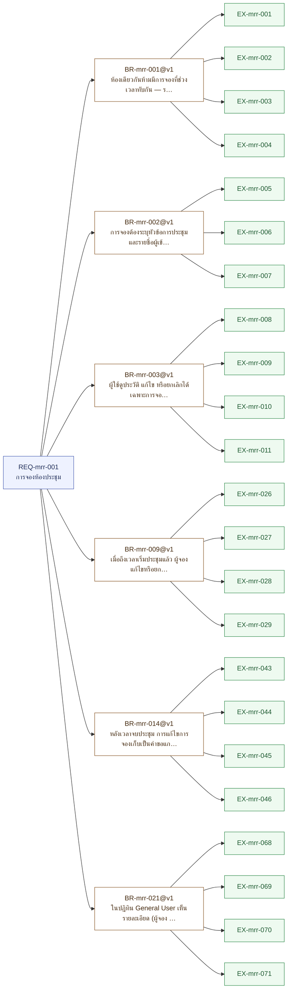
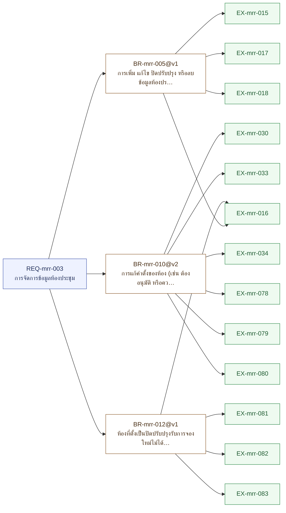
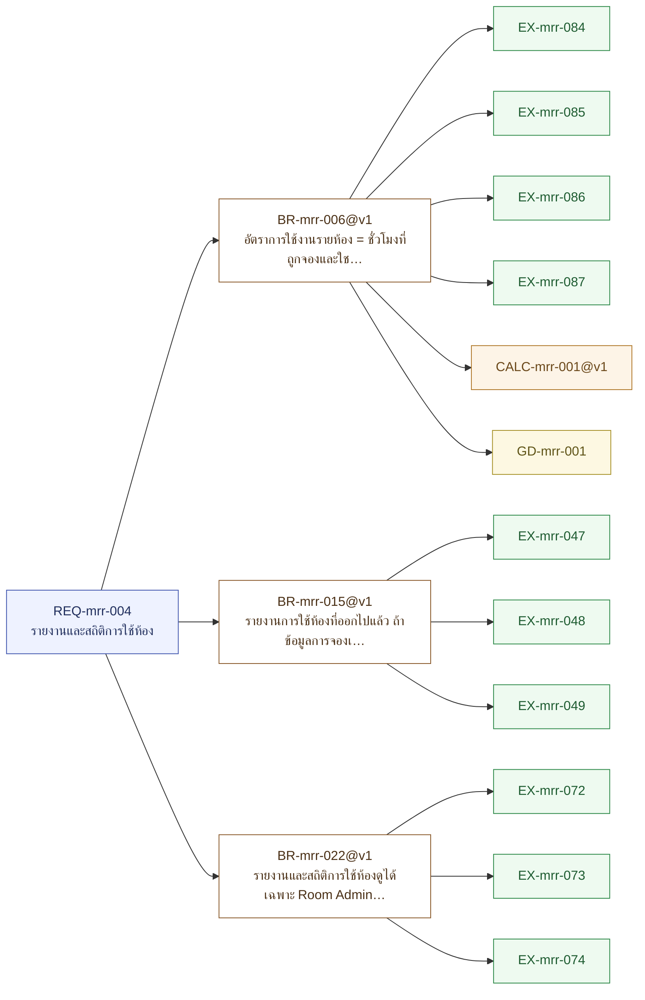
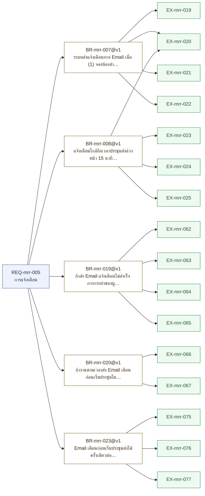

# เอกสารความต้องการระบบ — mrr

> เอกสารฉบับนี้ถูก **สร้างจาก `spec.json` ทั้งฉบับ** (renderer v2.0) — แก้ไฟล์นี้โดยตรงแล้วจะหายในการ render รอบถัดไป
> แก้ที่ต้นทางเสมอ: `/req:capture` `/req:ask` `/req:example` `/req:calc` `/req:golden` `/req:change`
> **ไฟเขียวของเอกสารฉบับนี้ไม่ใช่การอนุมัติ** — ด่านคือ `/req:check` และคนที่เซ็น CP1 คือเจ้าของ

> 🕒 **สแนปช็อตนี้ถ่ายเมื่อ:** `2026-10-19T04:05:40.520Z`
> เป็นไฟล์ต่อท้าย — ไม่มีใครเขียนทับหรือลบมัน เอาไว้วางเทียบกับใบก่อนหน้าเพื่อดูว่าอะไรขยับ
> **ไม่มีด่านไหนตรวจไฟล์นี้** (ประตู 16) — แก้ด้วยมือแล้วจะไม่มีอะไรบอก · กราฟ `.html` ต่างหากที่ `--validate` ตัดสิน

| คำถาม | คำตอบ |
|---|---|
| กฎที่ยังใช้อยู่ | 23 ข้อ |
| กฎที่มีตัวอย่างพิสูจน์แล้ว | 23 ข้อ (100%) |
| การ์ดแดงที่ยังเปิดอยู่ | 0 ใบ |
| คำถามที่เลื่อนไปเฟสหน้า | 8 ใบ (บล็อก CP2 ไม่ใช่ CP1) |
| เงื่อนไข CP1 ครบหรือยัง | ✅ ครบ |
| ใครรับมอบ Phase 1 | Noppasorn เมื่อ 2026-10-19T03:53:17.093Z |
| สถานะของ spec | validated |
| แก้ล่าสุดเมื่อ | 2026-10-19T12:10+07:00 |
| schema | 0.6.0 |

---

## สารบัญ — จากหัวข้อหลักลงไปหัวข้อเล็กสุด

✅ **ไม่มีหัวข้อไหนค้าง** — แต่ครบทุกหัวข้อ ≠ ได้รับอนุมัติ · คนที่เซ็น CP1 คือเจ้าของ (`/req:approve`)

| หัวข้อ | สถานะ | อ่านว่าอะไร | ทำต่อที่ |
|---|---|---|---|
| 1. ขอบเขตและผู้เกี่ยวข้อง | ✅ ครบแล้ว | ผู้เกี่ยวข้อง 4 ราย | — |
| 2. อภิธานศัพท์ | ✅ ครบแล้ว | 11 คำที่ตกลงกันแล้ว | — |
| 3. ความต้องการรายข้อ | ✅ ครบแล้ว | กฎ 23 ข้อ มีตัวอย่างพิสูจน์ครบทุกข้อ | — |
| 4. สัญญาการคำนวณและเลขเฉลย | ✅ ครบแล้ว | สัญญา 1 ใบ · เลขเฉลย 1 ชุด | — |
| 5. สิ่งที่ยังไม่ตัดสิน | ✅ ครบแล้ว | ไม่มีการ์ดแดงค้าง · เลื่อนไปเฟสหน้า 8 ใบ (บล็อก CP2 ไม่ใช่ CP1) | — |
| 6. ประวัติการเปลี่ยนแปลง | ✅ ครบแล้ว | 1 ใบ | — |
| 7. ต้นฉบับที่สาวกลับได้ | ✅ ครบแล้ว | 25 ต้นฉบับ | — |
| 8. ตารางสอบทาน | ✅ ครบแล้ว | ทุกแถวเต็ม | — |

### ผังต้นไม้ของความต้องการ

- **REQ-mrr-001** — การจองห้องประชุม · _draft_
  - `BR-mrr-001@v1` — ห้องเดียวกันห้ามมีการจองที่ช่วงเวลาทับกัน — ระบบตรวจสอบความพร้อมของห้องอัตโนมัติก่อนรับการจอง · ช่วงเวลานับแบบ [เริ่ม, จบ) การจองที่จบ 10:00 กับที่เริ่ม 10:00 ไม่นับว่าทับ จองต่อกันได้ · การจองที่รออนุมัตินับเป็นการจองที่กันช่วงเวลา จนกว่าจะถูกปฏิเสธหรือยกเลิก · ✅ 4 ตัวอย่าง
    - `EX-mrr-001` — happy · draft
    - `EX-mrr-002` — boundary · draft
    - `EX-mrr-003` — exception · draft
    - `EX-mrr-004` — alternate · draft
  - `BR-mrr-002@v1` — การจองต้องระบุหัวข้อการประชุมและรายชื่อผู้เข้าร่วม ส่วนอุปกรณ์เสริมเลือกหรือไม่เลือกก็ได้ · ✅ 3 ตัวอย่าง
    - `EX-mrr-005` — happy · draft
    - `EX-mrr-006` — exception · draft
    - `EX-mrr-007` — exception · draft
  - `BR-mrr-003@v1` — ผู้ใช้ดูประวัติ แก้ไข หรือยกเลิกได้เฉพาะการจองของตนเอง · ✅ 4 ตัวอย่าง
    - `EX-mrr-008` — happy · draft
    - `EX-mrr-009` — happy · draft
    - `EX-mrr-010` — exception · draft
    - `EX-mrr-011` — alternate · draft
  - `BR-mrr-009@v1` — เมื่อถึงเวลาเริ่มประชุมแล้ว ผู้จองแก้ไขหรือยกเลิกการจองเองไม่ได้ — ต้องให้ Room Administrator เป็นผู้แก้ไขหรือยกเลิก โดยต้องระบุเหตุผลทุกครั้ง · ✅ 4 ตัวอย่าง
    - `EX-mrr-026` — boundary · draft
    - `EX-mrr-027` — boundary · draft
    - `EX-mrr-028` — happy · draft
    - `EX-mrr-029` — exception · draft
  - `BR-mrr-014@v1` — หลังเวลาจบประชุม การแก้ไขการจองเก็บเป็นคำขอแก้แยก ค่าเดิมคงไว้ — คำขอจะมีผลต่อเมื่อได้รับอนุมัติจาก Room Administrator คนอื่นที่ไม่ใช่คนแก้ · ✅ 4 ตัวอย่าง
    - `EX-mrr-043` — boundary · draft
    - `EX-mrr-044` — boundary · draft
    - `EX-mrr-045` — happy · draft
    - `EX-mrr-046` — exception · draft
  - `BR-mrr-021@v1` — ในปฏิทิน General User เห็นรายละเอียด (ผู้จอง · หัวข้อ · ผู้เข้าร่วม) เฉพาะการจองที่ตัวเองจองหรือเป็นผู้เข้าร่วม — การจองของคนอื่นเห็นแค่ว่าช่วงเวลานั้น "ไม่ว่าง" · ✅ 4 ตัวอย่าง
    - `EX-mrr-068` — happy · draft
    - `EX-mrr-069` — happy · draft
    - `EX-mrr-070` — exception · draft
    - `EX-mrr-071` — exception · draft
- **REQ-mrr-002** — การอนุมัติการจอง · _draft_
  - `BR-mrr-004@v1` — การจองห้องที่ถูกตั้งไว้ว่า "ต้องอนุมัติ" จะใช้งานจริงได้ต่อเมื่อ Room Administrator อนุมัติแล้ว ห้องที่ไม่ได้ตั้งไว้ไม่ต้องรออนุมัติ · ✅ 4 ตัวอย่าง
    - `EX-mrr-001` — happy · draft
    - `EX-mrr-012` — happy · draft
    - `EX-mrr-013` — happy · draft
    - `EX-mrr-014` — exception · draft
  - `BR-mrr-011@v1` — Room Administrator เปลี่ยนผลการอนุมัติหรือปฏิเสธการจองได้ โดยต้องระบุเหตุผลทุกครั้ง และทำได้เฉพาะก่อนถึงเวลาเริ่มประชุม · ✅ 4 ตัวอย่าง
    - `EX-mrr-035` — happy · draft
    - `EX-mrr-036` — exception · draft
    - `EX-mrr-037` — boundary · draft
    - `EX-mrr-038` — boundary · draft
  - `BR-mrr-013@v1` — แต่ละห้องที่ต้องอนุมัติกำหนดผู้อนุมัติประจำห้อง (Room Administrator) ได้ — ถ้ายังไม่กำหนด Room Administrator ทุกคนอนุมัติได้ และกำหนดทีหลังได้ · ✅ 4 ตัวอย่าง
    - `EX-mrr-039` — happy · draft
    - `EX-mrr-040` — exception · draft
    - `EX-mrr-041` — alternate · draft
    - `EX-mrr-042` — happy · draft
  - `BR-mrr-016@v1` — การจองที่ยังรออนุมัติเมื่อถึงเวลาเริ่มประชุม ถูกยกเลิกอัตโนมัติ ปล่อยช่วงเวลาคืน และแจ้งผู้จอง — ถ้าส่ง Email แจ้งผู้จองไม่สำเร็จ ยังไม่ยกเลิก รองานรอบถัดไปทำใหม่ · ระหว่างที่ค้างอยู่ Room Administrator ยังอนุมัติได้ · ✅ 4 ตัวอย่าง
    - `EX-mrr-050` — boundary · draft
    - `EX-mrr-051` — happy · draft
    - `EX-mrr-052` — exception · draft
    - `EX-mrr-053` — alternate · draft
  - `BR-mrr-017@v1` — ทุกการกระทำของ Room Administrator ต่อการจอง (อนุมัติ · ปฏิเสธ · ถอยผล · แก้หรือยกเลิกแทนผู้จอง) ต้องบันทึกร่องรอย: ใคร · เมื่อไหร่ · ทำอะไร · เหตุผล · ✅ 4 ตัวอย่าง
    - `EX-mrr-054` — happy · draft
    - `EX-mrr-055` — happy · draft
    - `EX-mrr-056` — exception · draft
    - `EX-mrr-057` — exception · draft
  - `BR-mrr-018@v1` — ร่องรอยการกระทำดูได้เฉพาะ Room Administrator และ System Administrator — ผู้จองดูไม่ได้ · ✅ 4 ตัวอย่าง
    - `EX-mrr-058` — happy · draft
    - `EX-mrr-059` — happy · draft
    - `EX-mrr-060` — exception · draft
    - `EX-mrr-061` — exception · draft
- **REQ-mrr-003** — การจัดการข้อมูลห้องประชุม · _draft_
  - `BR-mrr-005@v1` — การเพิ่ม แก้ไข ปิดปรับปรุง หรือลบข้อมูลห้องประชุม ทำได้เฉพาะ Room Administrator · ✅ 4 ตัวอย่าง
    - `EX-mrr-015` — happy · draft
    - `EX-mrr-016` — happy · draft
    - `EX-mrr-017` — exception · draft
    - `EX-mrr-018` — exception · draft
  - `BR-mrr-010@v2` — การแก้ค่าตั้งของห้อง (เช่น ต้องอนุมัติ หรือความจุ — ไม่รวมการตั้งปิดปรับปรุง ซึ่งเป็นไปตาม BR-mrr-012) มีผลกับการจองที่ยังไม่ถึงเวลาเริ่มด้วย — ถ้าห้องถูกแก้เป็นต้องอนุมัติ การจองเดิมที่ยังไม่ถึงเวลาเริ่มจะกลับไปเป็นสถานะ 'รออนุมัติ' · ถ้าห้องถูกแก้เป็นไม่ต้องอนุมัติ การจองที่รออนุมัติอยู่จะใช้ได้ทันที · ✅ 6 ตัวอย่าง
    - `EX-mrr-030` — happy · draft
    - `EX-mrr-033` — boundary · draft
    - `EX-mrr-034` — alternate · draft
    - `EX-mrr-078` — happy · draft
    - `EX-mrr-079` — alternate · draft
    - `EX-mrr-080` — boundary · draft
  - `BR-mrr-012@v1` — ห้องที่ตั้งเป็นปิดปรับปรุงรับการจองใหม่ไม่ได้ — การจองที่มีอยู่แล้วคงไว้ตามเดิม · ✅ 4 ตัวอย่าง
    - `EX-mrr-016` — happy · draft
    - `EX-mrr-081` — exception · draft
    - `EX-mrr-082` — alternate · draft
    - `EX-mrr-083` — boundary · draft
- **REQ-mrr-004** — รายงานและสถิติการใช้ห้อง · _draft_
  - `BR-mrr-006@v1` — อัตราการใช้งานรายห้อง = ชั่วโมงที่ถูกจองและใช้ได้จริง (ไม่ต้องอนุมัติ หรืออนุมัติแล้ว — ไม่นับยกเลิก / ปฏิเสธ / รออนุมัติ) ÷ ชั่วโมงทำการของห้องในช่วงรายงาน · ปัดทุกจุดแบบ round half up · ใช้จัดอันดับห้องที่ใช้งานสูงสุด · ✅ 4 ตัวอย่าง
    - `EX-mrr-084` — happy · draft
    - `EX-mrr-085` — boundary · draft
    - `EX-mrr-086` — alternate · draft
    - `EX-mrr-087` — exception · draft
  - `BR-mrr-015@v1` — รายงานการใช้ห้องที่ออกไปแล้ว ถ้าข้อมูลการจองเปลี่ยนทีหลัง ต้องออกฉบับใหม่ทับ และเก็บฉบับเดิมไว้ — ห้ามแก้ฉบับที่ออกไปแล้ว · ✅ 3 ตัวอย่าง
    - `EX-mrr-047` — happy · draft
    - `EX-mrr-048` — exception · draft
    - `EX-mrr-049` — boundary · draft
  - `BR-mrr-022@v1` — รายงานและสถิติการใช้ห้องดูได้เฉพาะ Room Administrator · ✅ 3 ตัวอย่าง
    - `EX-mrr-072` — happy · draft
    - `EX-mrr-073` — exception · draft
    - `EX-mrr-074` — exception · draft
- **REQ-mrr-005** — การแจ้งเตือน · _draft_
  - `BR-mrr-007@v1` — ระบบส่งแจ้งเตือนทาง Email เมื่อ (1) จองห้องสำเร็จหรือได้รับการอนุมัติ — ถึงผู้จอง (2) ใกล้ถึงเวลาประชุม (3) มีการเปลี่ยนเวลาหรือยกเลิกการจอง — (2)(3) ถึงผู้จองและผู้เข้าร่วมทุกคน · การแก้เฉพาะหัวข้อหรือรายชื่อผู้เข้าร่วมไม่ส่ง Email · หัวเรื่อง: [จองห้องประชุม] <เหตุการณ์>: <หัวข้อ> · <ห้อง> <วัน> <เวลา> · ✅ 4 ตัวอย่าง
    - `EX-mrr-019` — happy · draft
    - `EX-mrr-020` — happy · draft
    - `EX-mrr-021` — happy · draft
    - `EX-mrr-022` — alternate · draft
  - `BR-mrr-008@v1` — แจ้งเตือนใกล้ถึงเวลาประชุมส่งล่วงหน้า 15 นาทีก่อนเวลาเริ่ม (ค่าตายตัว) · การจองที่สร้างเมื่อเหลือน้อยกว่า 15 นาทีก่อนเริ่ม ส่งเตือนทันที · การจองที่ยังรออนุมัติไม่ส่งเตือน · ✅ 4 ตัวอย่าง
    - `EX-mrr-020` — happy · draft
    - `EX-mrr-023` — boundary · draft
    - `EX-mrr-024` — boundary · draft
    - `EX-mrr-025` — exception · draft
  - `BR-mrr-019@v1` — ถ้าส่ง Email แจ้งเตือนไม่สำเร็จ การกระทำของผู้ใช้ที่ทำให้เกิดแจ้งเตือนนั้นล้มทันที และแจ้งผู้ใช้ให้กดใหม่ — ไม่มีคิวส่งซ้ำ · ✅ 4 ตัวอย่าง
    - `EX-mrr-062` — exception · draft
    - `EX-mrr-063` — exception · draft
    - `EX-mrr-064` — exception · draft
    - `EX-mrr-065` — alternate · draft
  - `BR-mrr-020@v1` — ถ้างานตามเวลาส่ง Email เตือนก่อนเริ่มประชุมไม่สำเร็จ ไม่ส่งซ้ำ — บันทึกว่าส่งไม่สำเร็จ · ✅ 2 ตัวอย่าง
    - `EX-mrr-066` — exception · draft
    - `EX-mrr-067` — exception · draft
  - `BR-mrr-023@v1` — Email เตือนก่อนเริ่มประชุมส่งได้ครั้งเดียวต่อการจอง — งานตามเวลาที่รันซ้ำต้องข้ามการจองที่ส่งไปแล้ว · ✅ 3 ตัวอย่าง
    - `EX-mrr-075` — happy · draft
    - `EX-mrr-076` — exception · draft
    - `EX-mrr-077` — boundary · draft

---

## 1. ขอบเขตและผู้เกี่ยวข้อง ✅

> **สถานะ ณ เวลาที่ export:** ✅ ครบแล้ว — ผู้เกี่ยวข้อง 4 ราย

| เรื่อง | ค่า |
|---|---|
| โมดูล | mrr |
| ขนาดที่ตกลงกัน | FULL |
| เริ่มเก็บเมื่อ | 2026-10-16T11:40+07:00 |

### ผู้เกี่ยวข้อง

| รหัส | ชื่อ | ชนิด | คำอธิบาย | สถานะ |
|---|---|---|---|---|
| `STK-mrr-001` | General User (ผู้ใช้งานทั่วไป) | internal | พนักงานทั่วไปที่ค้นหาห้อง ตรวจสอบตารางว่าง และจองห้องประชุม | draft |
| `STK-mrr-002` | Room Administrator (ผู้ดูแลระบบห้องประชุม) | internal | เจ้าหน้าที่ดูแลอาคาร/สถานที่ ที่อนุมัติการจอง จัดการข้อมูลห้อง และกำหนดสิ่งอำนวยความสะดวก | draft |
| `STK-mrr-003` | System Administrator (ผู้ดูแลระบบไอที) | internal | จัดการสิทธิ์การใช้งานของระบบ ตั้งค่าระบบหลังบ้าน และดูแลความปลอดภัย | draft |
| `STK-mrr-004` | งานแจ้งเตือนตามเวลา (ระบบ) | system | งานตามเวลาที่อ่านข้อมูลการจองแล้วส่งแจ้งเตือนก่อนเริ่มประชุม โดยไม่มีคนกด | draft |

## 2. อภิธานศัพท์ ✅

> **สถานะ ณ เวลาที่ export:** ✅ ครบแล้ว — 11 คำที่ตกลงกันแล้ว

คำที่ตกลงกันแล้ว — ทุกคำในเอกสารนี้ที่ปรากฏในตารางนี้ ใช้ความหมายตามตารางนี้เท่านั้น

| รหัส | คำ | อังกฤษ | นิยาม | อย่าสับสนกับ | สถานะ |
|---|---|---|---|---|---|
| [`UL-mrr-001`](../../docs/wiki/glossary/UL-mrr-001.md) | ห้องประชุม | MeetingRoom | ห้องที่เปิดให้จองใช้ได้ มีความจุ รูปภาพ และสิ่งอำนวยความสะดวกประจำห้อง จัดการข้อมูลโดย Room Administrator | — | draft |
| [`UL-mrr-002`](../../docs/wiki/glossary/UL-mrr-002.md) | การจอง | Booking | การขอใช้ห้องประชุมหนึ่งห้องในช่วงเวลาหนึ่ง ระบุหัวข้อการประชุม รายชื่อผู้เข้าร่วม และอุปกรณ์เสริมที่ต้องการ | — | draft |
| [`UL-mrr-003`](../../docs/wiki/glossary/UL-mrr-003.md) | สิ่งอำนวยความสะดวก | Facility | อุปกรณ์ที่ห้องมีอยู่ เช่น โปรเจคเตอร์ กระดานไวท์บอร์ด ระบบ Video Conference — ใช้กรองตอนค้นหาห้อง และเลือกระบุตอนจองว่าต้องการใช้ (เรียกอีกอย่างว่า อุปกรณ์เสริม) | — | draft |
| [`UL-mrr-005`](../../docs/wiki/glossary/UL-mrr-005.md) | การจองซ้ำ | BookingConflict | การจองห้องเดียวกันในช่วงเวลาที่ทับกับการจองที่มีอยู่แล้ว ระบบต้องตรวจจับอัตโนมัติ (Conflict Check) | — | draft |
| [`UL-mrr-006`](../../docs/wiki/glossary/UL-mrr-006.md) | การอนุมัติการจอง | BookingApproval | ขั้นที่ Room Administrator ต้องอนุมัติการจองก่อนจึงใช้ห้องได้จริง ใช้เฉพาะห้องที่ถูกตั้งไว้ว่าต้องอนุมัติ | — | draft |
| [`UL-mrr-007`](../../docs/wiki/glossary/UL-mrr-007.md) | ปิดปรับปรุง | — | สถานะของห้องที่ Room Administrator ตั้งให้ห้องรับการจองใหม่ไม่ได้ชั่วคราว โดยการจองที่มีอยู่แล้วคงไว้ และข้อมูลห้องยังไม่ถูกลบ | — | draft |
| [`UL-mrr-008`](../../docs/wiki/glossary/UL-mrr-008.md) | อัตราการใช้งาน | UtilizationRate | สัดส่วนชั่วโมงที่ห้องถูกจองและใช้ได้จริง ต่อชั่วโมงทำการของห้องในช่วงรายงาน ใช้จัดอันดับห้องเพื่อวางแผนทรัพยากร | — | draft |
| [`UL-mrr-009`](../../docs/wiki/glossary/UL-mrr-009.md) | งานแจ้งเตือนตามเวลา | ReminderJob | งานอัตโนมัติที่ระบบรันเองตามเวลา โดยไม่มีคนกด เช่น ส่งแจ้งเตือนก่อนเริ่มประชุม | — | draft |
| [`UL-mrr-010`](../../docs/wiki/glossary/UL-mrr-010.md) | ผู้อนุมัติประจำห้อง | RoomApprover | Room Administrator ที่ถูกกำหนดให้อนุมัติการจองของห้องหนึ่ง — ถ้าห้องยังไม่กำหนด Room Administrator ทุกคนอนุมัติได้ | — | draft |
| [`UL-mrr-011`](../../docs/wiki/glossary/UL-mrr-011.md) | คำขอแก้ไขการจอง | BookingAdjustmentRequest | รายการแก้ไขการจองที่ประชุมจบไปแล้ว เก็บแยกจากค่าเดิม และมีผลต่อเมื่อ Room Administrator คนอื่นที่ไม่ใช่คนแก้อนุมัติ | — | draft |
| [`UL-mrr-012`](../../docs/wiki/glossary/UL-mrr-012.md) | ชั่วโมงทำการของห้อง | RoomOperatingHours | ช่วงเวลาที่ห้องเปิดให้ใช้ ใช้เป็นตัวหารของอัตราการใช้งาน — ค่าเดียวทั้งองค์กร จ.–ศ. 08:00–18:00 (วันหยุดนักขัตฤกษ์นับตามปกติ) หักช่วงที่ห้องปิดปรับปรุง | — | draft |

## 3. ความต้องการรายข้อ ✅

> **สถานะ ณ เวลาที่ export:** ✅ ครบแล้ว — กฎ 23 ข้อ มีตัวอย่างพิสูจน์ครบทุกข้อ

หัวข้อใหญ่คือ **ความต้องการ** · หัวข้อย่อยคือ **กฎที่ระบบต้องบังคับ** · ใต้กฎแต่ละข้อคือ **ตัวอย่างที่พิสูจน์มัน**
**หน่วยของความครอบคลุมคือกฎ ไม่ใช่ความต้องการ** — ความต้องการที่เขียนสวยแต่ไม่มีกฎ ไม่มีอะไรให้สร้างและไม่มีอะไรให้ทดสอบ

### REQ-mrr-001 · การจองห้องประชุม

**สถานะ:** draft · **ผู้ใช้:** General User · **ความสำคัญ:** high · **มีหน้าจอ:** ใช่

**เป้าหมาย:** ค้นหาห้องว่าง ดูตารางการใช้ห้อง จองห้อง และจัดการการจองของตนเองได้ โดยไม่เกิดการจองซ้ำ — การจองห้องทุกครั้งต้องผ่านระบบ ไม่เหลือการจองนอกระบบ

**คุณค่าทางธุรกิจ:** ลดความซ้ำซ้อนในการจอง และบริหารจัดการทรัพยากรห้องประชุมขององค์กรให้เกิดประโยชน์สูงสุด

**คำศัพท์ที่ผูกอยู่:** [`UL-mrr-001`](../../docs/wiki/glossary/UL-mrr-001.md) ห้องประชุม · [`UL-mrr-002`](../../docs/wiki/glossary/UL-mrr-002.md) การจอง · [`UL-mrr-003`](../../docs/wiki/glossary/UL-mrr-003.md) สิ่งอำนวยความสะดวก · [`UL-mrr-005`](../../docs/wiki/glossary/UL-mrr-005.md) การจองซ้ำ · [`UL-mrr-011`](../../docs/wiki/glossary/UL-mrr-011.md) คำขอแก้ไขการจอง

#### ข้อกำหนดที่ไม่ใช่ฟังก์ชัน

| รหัส | ชนิด | ข้อความ | พิสูจน์โดย |
|---|---|---|---|
| [`NFR-mrr-001`](../../docs/wiki/nfr/NFR-mrr-001.md) | security | เข้าสู่ระบบด้วย Email ขององค์กรอย่างเดียว — ไม่เชื่อม Active Directory (SSO) ในรอบนี้ (SRC-010) | — |
| [`NFR-mrr-002`](../../docs/wiki/nfr/NFR-mrr-002.md) | performance | รองรับผู้ใช้งานพร้อมกัน 200 คน และหน้าจอตารางห้องประชุมโหลดเสร็จภายใน 2 วินาที (เอกสารเขียน "อย่างน้อย 100-200 คน" — เจ้าของเลือก 200 ดู Q-mrr-004) | load_test |
| [`NFR-mrr-003`](../../docs/wiki/nfr/NFR-mrr-003.md) | security | เข้ารหัสข้อมูลการใช้งานผ่าน HTTPS และจำกัดสิทธิ์การเข้าถึงตามระดับผู้ใช้งาน (Role-Based Access Control) | — |
| [`NFR-mrr-004`](../../docs/wiki/nfr/NFR-mrr-004.md) | availability | เปิดให้บริการตลอด 24 ชั่วโมง (Uptime 99.9%) | — |
| [`NFR-mrr-005`](../../docs/wiki/nfr/NFR-mrr-005.md) | usability | รองรับ Chrome, Safari, Edge, Firefox และแสดงผลได้ดีบนอุปกรณ์เคลื่อนที่ (Responsive Design) | — |

#### ความเชื่อมโยง

#### BR-mrr-001@v1 — invariant

> ห้องเดียวกันห้ามมีการจองที่ช่วงเวลาทับกัน — ระบบตรวจสอบความพร้อมของห้องอัตโนมัติก่อนรับการจอง · ช่วงเวลานับแบบ [เริ่ม, จบ) การจองที่จบ 10:00 กับที่เริ่ม 10:00 ไม่นับว่าทับ จองต่อกันได้ · การจองที่รออนุมัตินับเป็นการจองที่กันช่วงเวลา จนกว่าจะถูกปฏิเสธหรือยกเลิก

**สถานะ:** draft

**แนวทางทดสอบ:** BVA

| ตัวอย่าง | ชนิด | สถานะ | เมื่อ (given) | ทำอะไร (when) | ต้องได้ (then) |
|---|---|---|---|---|---|
| [`EX-mrr-001`](../../docs/wiki/examples/EX-mrr-001.md) | happy | draft | ห้อง A (ไม่ต้องอนุมัติ) มีการจอง 09:00–10:00 | ผู้ใช้จองห้อง A เวลา 10:00–11:00 | ระบบรับการจอง และแสดงข้อความ 'จองห้องสำเร็จ' — จบ 10:00 กับเริ่ม 10:00 ไม่นับว่าทับ |
| [`EX-mrr-002`](../../docs/wiki/examples/EX-mrr-002.md) | boundary | draft | ห้อง A (ไม่ต้องอนุมัติ) มีการจอง 09:00–10:00 | ผู้ใช้จองห้อง A เวลา 09:59–11:00 | ระบบไม่รับการจอง และแสดงข้อความ 'ห้องนี้ไม่ว่างในช่วงเวลาที่เลือก กรุณาเลือกเวลาอื่น' |
| [`EX-mrr-003`](../../docs/wiki/examples/EX-mrr-003.md) | exception | draft | ห้อง B (ต้องอนุมัติ) มีการจอง 09:00–10:00 สถานะรออนุมัติ | ผู้ใช้อีกคนจองห้อง B เวลา 09:30–10:30 | ระบบไม่รับการจอง และแสดงข้อความ 'ห้องนี้ไม่ว่างในช่วงเวลาที่เลือก กรุณาเลือกเวลาอื่น' — การจองที่รออนุมัติกันช่วงเวลาไว้ |
| [`EX-mrr-004`](../../docs/wiki/examples/EX-mrr-004.md) | alternate | draft | ห้อง A (ไม่ต้องอนุมัติ) มีการจอง 09:00–10:00 ที่ผู้จองยกเลิกแล้ว | ผู้ใช้อีกคนจองห้อง A เวลา 09:00–10:00 | ระบบรับการจอง และแสดงข้อความ 'จองห้องสำเร็จ' — การจองที่ถูกยกเลิกไม่กันช่วงเวลา |

#### BR-mrr-002@v1 — constraint

> การจองต้องระบุหัวข้อการประชุมและรายชื่อผู้เข้าร่วม ส่วนอุปกรณ์เสริมเลือกหรือไม่เลือกก็ได้

**สถานะ:** draft

**แนวทางทดสอบ:** EP

| ตัวอย่าง | ชนิด | สถานะ | เมื่อ (given) | ทำอะไร (when) | ต้องได้ (then) |
|---|---|---|---|---|---|
| [`EX-mrr-005`](../../docs/wiki/examples/EX-mrr-005.md) | happy | draft | ห้อง A (ไม่ต้องอนุมัติ) ว่างช่วง 13:00–14:00 | ผู้ใช้จองห้อง A 13:00–14:00 หัวข้อ 'ประชุมทีม' ผู้เข้าร่วม 3 คน ไม่เลือกอุปกรณ์เสริม | ระบบรับการจอง และแสดงข้อความ 'จองห้องสำเร็จ' — อุปกรณ์เสริมไม่บังคับ |
| [`EX-mrr-006`](../../docs/wiki/examples/EX-mrr-006.md) | exception | draft | ห้อง A (ไม่ต้องอนุมัติ) ว่างช่วง 13:00–14:00 | ผู้ใช้จองห้อง A 13:00–14:00 โดยเว้นช่องหัวข้อการประชุมว่าง ผู้เข้าร่วม 3 คน | ระบบไม่รับการจอง และแสดงข้อความ 'กรุณาระบุหัวข้อการประชุม' |
| [`EX-mrr-007`](../../docs/wiki/examples/EX-mrr-007.md) | exception | draft | ห้อง A (ไม่ต้องอนุมัติ) ว่างช่วง 13:00–14:00 | ผู้ใช้จองห้อง A 13:00–14:00 หัวข้อ 'ประชุมทีม' โดยไม่ใส่ผู้เข้าร่วมเลย (ผู้จองไม่ถูกนับอัตโนมัติ) | ระบบไม่รับการจอง และแสดงข้อความ 'กรุณาระบุผู้เข้าร่วมอย่างน้อย 1 คน' |

#### BR-mrr-003@v1 — policy

> ผู้ใช้ดูประวัติ แก้ไข หรือยกเลิกได้เฉพาะการจองของตนเอง

**สถานะ:** draft

**แนวทางทดสอบ:** decision_table

| ตัวอย่าง | ชนิด | สถานะ | เมื่อ (given) | ทำอะไร (when) | ต้องได้ (then) |
|---|---|---|---|---|---|
| [`EX-mrr-008`](../../docs/wiki/examples/EX-mrr-008.md) | happy | draft | U1 เป็นผู้จองห้อง A พรุ่งนี้ 10:00–11:00 หัวข้อ 'ประชุมทีม' (ยังไม่ถึงเวลาเริ่ม) | U1 แก้หัวข้อเป็น 'ประชุมวางแผน' แล้วกดบันทึก | ระบบบันทึกการแก้ไข และแสดงข้อความ 'บันทึกการแก้ไขสำเร็จ' |
| [`EX-mrr-009`](../../docs/wiki/examples/EX-mrr-009.md) | happy | draft | U1 เป็นผู้จองห้อง A พรุ่งนี้ 10:00–11:00 (ยังไม่ถึงเวลาเริ่ม) | U1 กดยกเลิกการจองนี้ | ระบบยกเลิกการจอง และแสดงข้อความ 'ยกเลิกการจองสำเร็จ' |
| [`EX-mrr-010`](../../docs/wiki/examples/EX-mrr-010.md) | exception | draft | U1 เป็นผู้จองห้อง A พรุ่งนี้ 10:00–11:00 และ U2 อยู่ในรายชื่อผู้เข้าร่วม (ไม่ใช่ผู้จอง) | U2 ส่งคำสั่งยกเลิกการจองนี้ (แม้หน้าจอจะซ่อนปุ่มไว้) | ระบบไม่ยกเลิก การจองคงเดิม และแสดงข้อความ 'เฉพาะผู้จองเท่านั้นที่แก้ไขหรือยกเลิกได้' |
| [`EX-mrr-011`](../../docs/wiki/examples/EX-mrr-011.md) | alternate | draft | U1 จองห้อง A พรุ่งนี้ 10:00–11:00 เอง และเป็นผู้เข้าร่วมในการจองห้อง B 13:00–14:00 ของ U2 | U1 เปิดหน้า My Bookings | รายการแสดงเฉพาะการจองห้อง A 10:00–11:00 ที่ U1 สร้างเอง ไม่แสดงการจองห้อง B ของ U2 |

#### BR-mrr-009@v1 — policy

> เมื่อถึงเวลาเริ่มประชุมแล้ว ผู้จองแก้ไขหรือยกเลิกการจองเองไม่ได้ — ต้องให้ Room Administrator เป็นผู้แก้ไขหรือยกเลิก โดยต้องระบุเหตุผลทุกครั้ง

**สถานะ:** draft

**แนวทางทดสอบ:** BVA · decision_table

| ตัวอย่าง | ชนิด | สถานะ | เมื่อ (given) | ทำอะไร (when) | ต้องได้ (then) |
|---|---|---|---|---|---|
| [`EX-mrr-026`](../../docs/wiki/examples/EX-mrr-026.md) | boundary | draft | U1 เป็นผู้จองห้อง A วันนี้ 10:00–11:00 และขณะนี้เวลา 09:59 | U1 กดยกเลิกการจองนี้ | ระบบยกเลิกการจอง และแสดงข้อความ 'ยกเลิกการจองสำเร็จ' |
| [`EX-mrr-027`](../../docs/wiki/examples/EX-mrr-027.md) | boundary | draft | U1 เป็นผู้จองห้อง A วันนี้ 10:00–11:00 และขณะนี้เวลา 10:00 | U1 กดยกเลิกการจองนี้ | การจองคงเดิม และแสดงข้อความ 'การประชุมเริ่มแล้ว กรุณาติดต่อผู้ดูแลห้องเพื่อแก้ไขหรือยกเลิก' |
| [`EX-mrr-028`](../../docs/wiki/examples/EX-mrr-028.md) | happy | draft | U1 เป็นผู้จองห้อง A วันนี้ 10:00–11:00 ขณะนี้เวลา 10:30 และผู้ใช้ล็อกอินเป็น Room Administrator | Room Administrator ยกเลิกการจองนี้แทน U1 พร้อมเหตุผล 'ห้องต้องใช้จัดงานด่วน' | ระบบยกเลิกการจอง และ Room Administrator เห็นข้อความ 'ยกเลิกการจองสำเร็จ' |
| [`EX-mrr-029`](../../docs/wiki/examples/EX-mrr-029.md) | exception | draft | U1 เป็นผู้จองห้อง A วันนี้ 10:00–11:00 ขณะนี้เวลา 10:30 และผู้ใช้ล็อกอินเป็น Room Administrator | Room Administrator ยกเลิกการจองนี้แทน U1 โดยเว้นช่องเหตุผลว่าง | การจองคงเดิม และแสดงข้อความ 'กรุณาระบุเหตุผล' |

#### BR-mrr-014@v1 — policy

> หลังเวลาจบประชุม การแก้ไขการจองเก็บเป็นคำขอแก้แยก ค่าเดิมคงไว้ — คำขอจะมีผลต่อเมื่อได้รับอนุมัติจาก Room Administrator คนอื่นที่ไม่ใช่คนแก้

**สถานะ:** draft

**แนวทางทดสอบ:** state_transition · decision_table

| ตัวอย่าง | ชนิด | สถานะ | เมื่อ (given) | ทำอะไร (when) | ต้องได้ (then) |
|---|---|---|---|---|---|
| [`EX-mrr-043`](../../docs/wiki/examples/EX-mrr-043.md) | boundary | draft | การจองห้อง A 18/10 10:00–11:00 หัวข้อ 'ประชุมทีม' ของ U1 · ขณะนี้ 18/10 11:00 (ตรงเวลาจบ) และผู้ใช้ล็อกอินเป็น RA1 | RA1 แก้หัวข้อเป็น 'ประชุมวางแผน' พร้อมเหตุผล 'ผู้จองพิมพ์หัวข้อผิด' แล้วกดบันทึก | ระบบสร้างคำขอแก้ไข หัวข้อของการจองยังเป็น 'ประชุมทีม' และ RA1 เห็นข้อความ 'ส่งคำขอแก้ไขแล้ว รอผู้ดูแลห้องคนอื่นอนุมัติ' |
| [`EX-mrr-044`](../../docs/wiki/examples/EX-mrr-044.md) | boundary | draft | การจองห้อง A 18/10 10:00–11:00 หัวข้อ 'ประชุมทีม' ของ U1 · ขณะนี้ 18/10 10:59 (ก่อนจบ 1 นาที) และผู้ใช้ล็อกอินเป็น RA1 | RA1 แก้หัวข้อเป็น 'ประชุมวางแผน' พร้อมเหตุผล 'ผู้จองพิมพ์หัวข้อผิด' แล้วกดบันทึก | หัวข้อของการจองเปลี่ยนเป็น 'ประชุมวางแผน' ทันที ไม่มีคำขอแก้ไข และ RA1 เห็นข้อความ 'บันทึกการแก้ไขสำเร็จ' |
| [`EX-mrr-045`](../../docs/wiki/examples/EX-mrr-045.md) | happy | draft | การจองห้อง A 18/10 10:00–11:00 หัวข้อ 'ประชุมทีม' ของ U1 ประชุมจบแล้ว · มีคำขอแก้ไขที่ RA1 สร้าง ขอเปลี่ยนหัวข้อเป็น 'ประชุมวางแผน' · ผู้ใช้ล็อกอินเป็น RA2 | RA2 กดอนุมัติคำขอแก้ไขนี้ | หัวข้อของการจองเปลี่ยนเป็น 'ประชุมวางแผน' และ RA2 เห็นข้อความ 'อนุมัติคำขอแก้ไขสำเร็จ' |
| [`EX-mrr-046`](../../docs/wiki/examples/EX-mrr-046.md) | exception | draft | การจองห้อง A 18/10 10:00–11:00 หัวข้อ 'ประชุมทีม' ของ U1 ประชุมจบแล้ว · มีคำขอแก้ไขที่ RA1 สร้าง ขอเปลี่ยนหัวข้อเป็น 'ประชุมวางแผน' · ผู้ใช้ล็อกอินเป็น RA1 | RA1 กดอนุมัติคำขอแก้ไขของตัวเอง | หัวข้อของการจองยังเป็น 'ประชุมทีม' คำขอยังรออนุมัติ และแสดงข้อความ 'ผู้แก้ไขอนุมัติคำขอของตัวเองไม่ได้ ต้องให้ผู้ดูแลห้องคนอื่นอนุมัติ' |

#### BR-mrr-021@v1 — policy

> ในปฏิทิน General User เห็นรายละเอียด (ผู้จอง · หัวข้อ · ผู้เข้าร่วม) เฉพาะการจองที่ตัวเองจองหรือเป็นผู้เข้าร่วม — การจองของคนอื่นเห็นแค่ว่าช่วงเวลานั้น "ไม่ว่าง"

**สถานะ:** draft

**แนวทางทดสอบ:** decision_table

| ตัวอย่าง | ชนิด | สถานะ | เมื่อ (given) | ทำอะไร (when) | ต้องได้ (then) |
|---|---|---|---|---|---|
| [`EX-mrr-068`](../../docs/wiki/examples/EX-mrr-068.md) | happy | draft | ห้อง A มีการจอง 17/10 10:00–11:00 หัวข้อ 'ประชุมทีม' ของ U1 ผู้เข้าร่วม U2, U3 · ผู้ใช้ล็อกอินเป็น U1 (General User · ผู้จอง) | U1 เปิดปฏิทินห้อง A วันที่ 17/10 | ช่อง 10:00–11:00 ของห้อง A แสดงผู้จอง 'U1' · หัวข้อ 'ประชุมทีม' · ผู้เข้าร่วม 'U2, U3' |
| [`EX-mrr-069`](../../docs/wiki/examples/EX-mrr-069.md) | happy | draft | ห้อง A มีการจอง 17/10 10:00–11:00 หัวข้อ 'ประชุมทีม' ของ U1 ผู้เข้าร่วม U2, U3 · ผู้ใช้ล็อกอินเป็น U2 (General User · ผู้เข้าร่วม) | U2 เปิดปฏิทินห้อง A วันที่ 17/10 | ช่อง 10:00–11:00 ของห้อง A แสดงผู้จอง 'U1' · หัวข้อ 'ประชุมทีม' · ผู้เข้าร่วม 'U2, U3' |
| [`EX-mrr-070`](../../docs/wiki/examples/EX-mrr-070.md) | exception | draft | ห้อง A มีการจอง 17/10 10:00–11:00 หัวข้อ 'ประชุมทีม' ของ U1 ผู้เข้าร่วม U2, U3 · ผู้ใช้ล็อกอินเป็น U4 (General User · ไม่ได้จองและไม่ได้เป็นผู้เข้าร่วม) | U4 เปิดปฏิทินห้อง A วันที่ 17/10 | ช่อง 10:00–11:00 ของห้อง A แสดงแค่คำว่า 'ไม่ว่าง' ไม่แสดงผู้จอง หัวข้อ หรือผู้เข้าร่วม |
| [`EX-mrr-071`](../../docs/wiki/examples/EX-mrr-071.md) | exception | draft | ห้อง B (ต้องอนุมัติ) มีการจอง 17/10 10:00–11:00 หัวข้อ 'ประชุมลูกค้า' ของ U1 สถานะ 'รออนุมัติ' ผู้เข้าร่วม U2 · ผู้ใช้ล็อกอินเป็น U4 (General User · ไม่เกี่ยวข้อง) | U4 เปิดปฏิทินห้อง B วันที่ 17/10 | ช่อง 10:00–11:00 ของห้อง B แสดงแค่คำว่า 'ไม่ว่าง' ไม่แสดงผู้จอง หัวข้อ ผู้เข้าร่วม หรือสถานะ 'รออนุมัติ' |

### REQ-mrr-002 · การอนุมัติการจอง

**สถานะ:** draft · **ผู้ใช้:** Room Administrator · **ความสำคัญ:** medium · **มีหน้าจอ:** ใช่

**เป้าหมาย:** กำหนดได้ว่าห้องใดต้องได้รับอนุมัติก่อนใช้งานจริง และอนุมัติการจองของห้องเหล่านั้น

**คำศัพท์ที่ผูกอยู่:** [`UL-mrr-001`](../../docs/wiki/glossary/UL-mrr-001.md) ห้องประชุม · [`UL-mrr-002`](../../docs/wiki/glossary/UL-mrr-002.md) การจอง · [`UL-mrr-006`](../../docs/wiki/glossary/UL-mrr-006.md) การอนุมัติการจอง · [`UL-mrr-010`](../../docs/wiki/glossary/UL-mrr-010.md) ผู้อนุมัติประจำห้อง · [`UL-mrr-009`](../../docs/wiki/glossary/UL-mrr-009.md) งานแจ้งเตือนตามเวลา

#### ความเชื่อมโยง

```mermaid
flowchart LR
  nREQ_mrr_002["REQ-mrr-002<br/>การอนุมัติการจอง"]:::req
  nBR_mrr_004_v1["BR-mrr-004@v1<br/>การจองห้องที่ถูกตั้งไว้ว่า 'ต้องอนุมัติ' จะใช…"]:::rule
  nREQ_mrr_002 --> nBR_mrr_004_v1
  nEX_mrr_001["EX-mrr-001"]:::ex
  nBR_mrr_004_v1 --> nEX_mrr_001
  nEX_mrr_012["EX-mrr-012"]:::ex
  nBR_mrr_004_v1 --> nEX_mrr_012
  nEX_mrr_013["EX-mrr-013"]:::ex
  nBR_mrr_004_v1 --> nEX_mrr_013
  nEX_mrr_014["EX-mrr-014"]:::ex
  nBR_mrr_004_v1 --> nEX_mrr_014
  nBR_mrr_011_v1["BR-mrr-011@v1<br/>Room Administrator เปลี่ยนผลการอนุมัติหรือปฏิ…"]:::rule
  nREQ_mrr_002 --> nBR_mrr_011_v1
  nEX_mrr_035["EX-mrr-035"]:::ex
  nBR_mrr_011_v1 --> nEX_mrr_035
  nEX_mrr_036["EX-mrr-036"]:::ex
  nBR_mrr_011_v1 --> nEX_mrr_036
  nEX_mrr_037["EX-mrr-037"]:::ex
  nBR_mrr_011_v1 --> nEX_mrr_037
  nEX_mrr_038["EX-mrr-038"]:::ex
  nBR_mrr_011_v1 --> nEX_mrr_038
  nBR_mrr_013_v1["BR-mrr-013@v1<br/>แต่ละห้องที่ต้องอนุมัติกำหนดผู้อนุมัติประจำห้…"]:::rule
  nREQ_mrr_002 --> nBR_mrr_013_v1
  nEX_mrr_039["EX-mrr-039"]:::ex
  nBR_mrr_013_v1 --> nEX_mrr_039
  nEX_mrr_040["EX-mrr-040"]:::ex
  nBR_mrr_013_v1 --> nEX_mrr_040
  nEX_mrr_041["EX-mrr-041"]:::ex
  nBR_mrr_013_v1 --> nEX_mrr_041
  nEX_mrr_042["EX-mrr-042"]:::ex
  nBR_mrr_013_v1 --> nEX_mrr_042
  nBR_mrr_016_v1["BR-mrr-016@v1<br/>การจองที่ยังรออนุมัติเมื่อถึงเวลาเริ่มประชุม …"]:::rule
  nREQ_mrr_002 --> nBR_mrr_016_v1
  nEX_mrr_050["EX-mrr-050"]:::ex
  nBR_mrr_016_v1 --> nEX_mrr_050
  nEX_mrr_051["EX-mrr-051"]:::ex
  nBR_mrr_016_v1 --> nEX_mrr_051
  nEX_mrr_052["EX-mrr-052"]:::ex
  nBR_mrr_016_v1 --> nEX_mrr_052
  nEX_mrr_053["EX-mrr-053"]:::ex
  nBR_mrr_016_v1 --> nEX_mrr_053
  nBR_mrr_017_v1["BR-mrr-017@v1<br/>ทุกการกระทำของ Room Administrator ต่อการจอง (…"]:::rule
  nREQ_mrr_002 --> nBR_mrr_017_v1
  nEX_mrr_054["EX-mrr-054"]:::ex
  nBR_mrr_017_v1 --> nEX_mrr_054
  nEX_mrr_055["EX-mrr-055"]:::ex
  nBR_mrr_017_v1 --> nEX_mrr_055
  nEX_mrr_056["EX-mrr-056"]:::ex
  nBR_mrr_017_v1 --> nEX_mrr_056
  nEX_mrr_057["EX-mrr-057"]:::ex
  nBR_mrr_017_v1 --> nEX_mrr_057
  nBR_mrr_018_v1["BR-mrr-018@v1<br/>ร่องรอยการกระทำดูได้เฉพาะ Room Administrator …"]:::rule
  nREQ_mrr_002 --> nBR_mrr_018_v1
  nEX_mrr_058["EX-mrr-058"]:::ex
  nBR_mrr_018_v1 --> nEX_mrr_058
  nEX_mrr_059["EX-mrr-059"]:::ex
  nBR_mrr_018_v1 --> nEX_mrr_059
  nEX_mrr_060["EX-mrr-060"]:::ex
  nBR_mrr_018_v1 --> nEX_mrr_060
  nEX_mrr_061["EX-mrr-061"]:::ex
  nBR_mrr_018_v1 --> nEX_mrr_061
  classDef req fill:#eef2ff,stroke:#4459b0,color:#22305e;
  classDef rule fill:#fff,stroke:#8a5a2b,color:#4a3016;
  classDef ex fill:#eefaf0,stroke:#2f8a4a,color:#1e5c31;
  classDef calc fill:#fdf4e7,stroke:#b0792c,color:#6b481a;
  classDef gold fill:#fdf8e2,stroke:#a8932c,color:#5f5417;
  classDef gap fill:#fdeeee,stroke:#a8341f,color:#7a2416,stroke-dasharray:3 3;
  classDef red fill:#fdeeee,stroke:#a8341f,color:#7a2416;
```

#### BR-mrr-004@v1 — policy

> การจองห้องที่ถูกตั้งไว้ว่า "ต้องอนุมัติ" จะใช้งานจริงได้ต่อเมื่อ Room Administrator อนุมัติแล้ว ห้องที่ไม่ได้ตั้งไว้ไม่ต้องรออนุมัติ

**สถานะ:** draft

**แนวทางทดสอบ:** state_transition · decision_table

| ตัวอย่าง | ชนิด | สถานะ | เมื่อ (given) | ทำอะไร (when) | ต้องได้ (then) |
|---|---|---|---|---|---|
| [`EX-mrr-001`](../../docs/wiki/examples/EX-mrr-001.md) | happy | draft | ห้อง A (ไม่ต้องอนุมัติ) มีการจอง 09:00–10:00 | ผู้ใช้จองห้อง A เวลา 10:00–11:00 | ระบบรับการจอง และแสดงข้อความ 'จองห้องสำเร็จ' — จบ 10:00 กับเริ่ม 10:00 ไม่นับว่าทับ |
| [`EX-mrr-012`](../../docs/wiki/examples/EX-mrr-012.md) | happy | draft | ห้อง B ถูกตั้งไว้ว่าต้องอนุมัติ และว่างช่วงพรุ่งนี้ 10:00–11:00 | U1 จองห้อง B พรุ่งนี้ 10:00–11:00 หัวข้อ 'ประชุมลูกค้า' ผู้เข้าร่วม 2 คน | การจองมีสถานะ 'รออนุมัติ' ยังใช้ห้องไม่ได้ และแสดงข้อความ 'ส่งคำขอจองแล้ว รอการอนุมัติ' |
| [`EX-mrr-013`](../../docs/wiki/examples/EX-mrr-013.md) | happy | draft | การจองห้อง B พรุ่งนี้ 10:00–11:00 ของ U1 มีสถานะ 'รออนุมัติ' และผู้ใช้ล็อกอินเป็น Room Administrator | Room Administrator กดอนุมัติการจองนี้ | การจองเปลี่ยนเป็นสถานะ 'อนุมัติแล้ว' ใช้ห้องได้ และ Room Administrator เห็นข้อความ 'อนุมัติการจองสำเร็จ' |
| [`EX-mrr-014`](../../docs/wiki/examples/EX-mrr-014.md) | exception | draft | การจองห้อง B พรุ่งนี้ 10:00–11:00 ของ U1 มีสถานะ 'รออนุมัติ' และ U1 เป็น General User | U1 ส่งคำสั่งอนุมัติการจองของตัวเอง | สถานะยังเป็น 'รออนุมัติ' และแสดงข้อความ 'เฉพาะผู้ดูแลห้องเท่านั้นที่อนุมัติได้' |

#### BR-mrr-011@v1 — policy

> Room Administrator เปลี่ยนผลการอนุมัติหรือปฏิเสธการจองได้ โดยต้องระบุเหตุผลทุกครั้ง และทำได้เฉพาะก่อนถึงเวลาเริ่มประชุม

**สถานะ:** draft

**แนวทางทดสอบ:** state_transition · BVA

| ตัวอย่าง | ชนิด | สถานะ | เมื่อ (given) | ทำอะไร (when) | ต้องได้ (then) |
|---|---|---|---|---|---|
| [`EX-mrr-035`](../../docs/wiki/examples/EX-mrr-035.md) | happy | draft | การจองห้อง B 18/10 10:00–11:00 ของ U1 มีสถานะ 'อนุมัติแล้ว' · ขณะนี้ 16/10 15:00 และผู้ใช้ล็อกอินเป็น Room Administrator | Room Administrator เปลี่ยนผลเป็นปฏิเสธ พร้อมเหตุผล 'อนุมัติผิดห้อง' | การจองเปลี่ยนเป็นสถานะ 'ปฏิเสธแล้ว' และ Room Administrator เห็นข้อความ 'เปลี่ยนผลการอนุมัติสำเร็จ' |
| [`EX-mrr-036`](../../docs/wiki/examples/EX-mrr-036.md) | exception | draft | การจองห้อง B 18/10 10:00–11:00 ของ U1 มีสถานะ 'อนุมัติแล้ว' · ขณะนี้ 16/10 15:00 และผู้ใช้ล็อกอินเป็น Room Administrator | Room Administrator เปลี่ยนผลเป็นปฏิเสธ โดยเว้นช่องเหตุผลว่าง | สถานะยังเป็น 'อนุมัติแล้ว' และแสดงข้อความ 'กรุณาระบุเหตุผล' |
| [`EX-mrr-037`](../../docs/wiki/examples/EX-mrr-037.md) | boundary | draft | การจองห้อง B 18/10 10:00–11:00 ของ U1 มีสถานะ 'ปฏิเสธแล้ว' ห้อง B ช่วงนั้นยังไม่มีการจองอื่น · ขณะนี้ 18/10 09:59 และผู้ใช้ล็อกอินเป็น Room Administrator | Room Administrator เปลี่ยนผลเป็นอนุมัติ พร้อมเหตุผล 'ปฏิเสธผิดคน' | การจองเปลี่ยนเป็นสถานะ 'อนุมัติแล้ว' และ Room Administrator เห็นข้อความ 'เปลี่ยนผลการอนุมัติสำเร็จ' — 1 นาทีก่อนเริ่มยังเปลี่ยนได้ |
| [`EX-mrr-038`](../../docs/wiki/examples/EX-mrr-038.md) | boundary | draft | การจองห้อง B 18/10 10:00–11:00 ของ U1 มีสถานะ 'อนุมัติแล้ว' · ขณะนี้ 18/10 10:00 และผู้ใช้ล็อกอินเป็น Room Administrator | Room Administrator เปลี่ยนผลเป็นปฏิเสธ พร้อมเหตุผล 'อนุมัติผิดห้อง' | สถานะยังเป็น 'อนุมัติแล้ว' และแสดงข้อความ 'การประชุมเริ่มแล้ว ไม่สามารถเปลี่ยนผลการอนุมัติได้' |

#### BR-mrr-013@v1 — policy

> แต่ละห้องที่ต้องอนุมัติกำหนดผู้อนุมัติประจำห้อง (Room Administrator) ได้ — ถ้ายังไม่กำหนด Room Administrator ทุกคนอนุมัติได้ และกำหนดทีหลังได้

**สถานะ:** draft

**แนวทางทดสอบ:** decision_table

| ตัวอย่าง | ชนิด | สถานะ | เมื่อ (given) | ทำอะไร (when) | ต้องได้ (then) |
|---|---|---|---|---|---|
| [`EX-mrr-039`](../../docs/wiki/examples/EX-mrr-039.md) | happy | draft | ห้อง B ต้องอนุมัติ และกำหนดผู้อนุมัติประจำห้องเป็น RA1 · การจองห้อง B 18/10 10:00–11:00 ของ U1 มีสถานะ 'รออนุมัติ' · ผู้ใช้ล็อกอินเป็น RA1 | RA1 กดอนุมัติการจองนี้ | การจองเปลี่ยนเป็นสถานะ 'อนุมัติแล้ว' และ RA1 เห็นข้อความ 'อนุมัติการจองสำเร็จ' |
| [`EX-mrr-040`](../../docs/wiki/examples/EX-mrr-040.md) | exception | draft | ห้อง B ต้องอนุมัติ และกำหนดผู้อนุมัติประจำห้องเป็น RA1 · การจองห้อง B 18/10 10:00–11:00 ของ U1 มีสถานะ 'รออนุมัติ' · ผู้ใช้ล็อกอินเป็น RA2 (เป็น Room Administrator แต่ไม่ใช่ผู้อนุมัติประจำห้อง B) | RA2 กดอนุมัติการจองนี้ | สถานะยังเป็น 'รออนุมัติ' และแสดงข้อความ 'เฉพาะผู้อนุมัติประจำห้องนี้เท่านั้นที่อนุมัติได้' |
| [`EX-mrr-041`](../../docs/wiki/examples/EX-mrr-041.md) | alternate | draft | ห้อง B ต้องอนุมัติ และยังไม่กำหนดผู้อนุมัติประจำห้อง · การจองห้อง B 18/10 10:00–11:00 ของ U1 มีสถานะ 'รออนุมัติ' · ผู้ใช้ล็อกอินเป็น RA2 | RA2 กดอนุมัติการจองนี้ | การจองเปลี่ยนเป็นสถานะ 'อนุมัติแล้ว' และ RA2 เห็นข้อความ 'อนุมัติการจองสำเร็จ' — ห้องที่ยังไม่กำหนด Room Administrator ทุกคนอนุมัติได้ |
| [`EX-mrr-042`](../../docs/wiki/examples/EX-mrr-042.md) | happy | draft | ห้อง B ต้องอนุมัติ ยังไม่กำหนดผู้อนุมัติประจำห้อง และผู้ใช้ล็อกอินเป็น Room Administrator | Room Administrator แก้ข้อมูลห้อง B กำหนดผู้อนุมัติประจำห้องเป็น RA1 แล้วกดบันทึก | ผู้อนุมัติประจำห้อง B เป็น RA1 และแสดงข้อความ 'บันทึกข้อมูลห้องสำเร็จ' — กำหนดทีหลังได้ |

#### BR-mrr-016@v1 — policy

> การจองที่ยังรออนุมัติเมื่อถึงเวลาเริ่มประชุม ถูกยกเลิกอัตโนมัติ ปล่อยช่วงเวลาคืน และแจ้งผู้จอง — ถ้าส่ง Email แจ้งผู้จองไม่สำเร็จ ยังไม่ยกเลิก รองานรอบถัดไปทำใหม่ · ระหว่างที่ค้างอยู่ Room Administrator ยังอนุมัติได้

**สถานะ:** draft

**แนวทางทดสอบ:** state_transition · BVA

| ตัวอย่าง | ชนิด | สถานะ | เมื่อ (given) | ทำอะไร (when) | ต้องได้ (then) |
|---|---|---|---|---|---|
| [`EX-mrr-050`](../../docs/wiki/examples/EX-mrr-050.md) | boundary | draft | ห้อง B (ต้องอนุมัติ) มีการจอง 18/10 10:00–11:00 หัวข้อ 'ประชุมลูกค้า' ของ U1 สถานะ 'รออนุมัติ' | งานตามเวลารันตอน 18/10 09:59 | การจองยังเป็นสถานะ 'รออนุมัติ' ช่วงเวลายังถูกกันไว้ และ U1 ไม่ได้รับ Email — ยังไม่ถึงเวลาเริ่ม |
| [`EX-mrr-051`](../../docs/wiki/examples/EX-mrr-051.md) | happy | draft | ห้อง B (ต้องอนุมัติ) มีการจอง 18/10 10:00–11:00 หัวข้อ 'ประชุมลูกค้า' ของ U1 สถานะ 'รออนุมัติ' | งานตามเวลารันตอน 18/10 10:00 และส่ง Email ถึง U1 สำเร็จ | การจองเปลี่ยนเป็นสถานะ 'ยกเลิกแล้ว' ช่วง 10:00–11:00 ของห้อง B ว่างให้จองได้ และ U1 ได้รับ Email หัวเรื่อง '[จองห้องประชุม] ยกเลิกอัตโนมัติ: ประชุมลูกค้า · ห้อง B 18/10 10:00–11:00' |
| [`EX-mrr-052`](../../docs/wiki/examples/EX-mrr-052.md) | exception | draft | ห้อง B (ต้องอนุมัติ) มีการจอง 18/10 10:00–11:00 หัวข้อ 'ประชุมลูกค้า' ของ U1 สถานะ 'รออนุมัติ' | งานตามเวลารันตอน 18/10 10:00 แต่ส่ง Email ถึง U1 ไม่สำเร็จ | การจองยังเป็นสถานะ 'รออนุมัติ' ช่วงเวลายังถูกกันไว้ และรองานตามเวลารอบถัดไปลองยกเลิกและส่ง Email ใหม่ |
| [`EX-mrr-053`](../../docs/wiki/examples/EX-mrr-053.md) | alternate | draft | ห้อง B (ต้องอนุมัติ) มีการจอง 18/10 10:00–11:00 หัวข้อ 'ประชุมลูกค้า' ของ U1 สถานะ 'รออนุมัติ' · งานตามเวลารอบ 10:00 ส่ง Email ไม่สำเร็จ การจองจึงยังค้างอยู่ · ขณะนี้ 18/10 10:03 และผู้ใช้ล็อกอินเป็น Room Administrator | Room Administrator กดอนุมัติการจองนี้ก่อนงานรอบถัดไปรัน | การจองเปลี่ยนเป็นสถานะ 'อนุมัติแล้ว' Room Administrator เห็นข้อความ 'อนุมัติการจองสำเร็จ' และงานรอบถัดไปไม่ยกเลิกการจองนี้ |

#### BR-mrr-017@v1 — invariant

> ทุกการกระทำของ Room Administrator ต่อการจอง (อนุมัติ · ปฏิเสธ · ถอยผล · แก้หรือยกเลิกแทนผู้จอง) ต้องบันทึกร่องรอย: ใคร · เมื่อไหร่ · ทำอะไร · เหตุผล

**สถานะ:** draft

**แนวทางทดสอบ:** decision_table

| ตัวอย่าง | ชนิด | สถานะ | เมื่อ (given) | ทำอะไร (when) | ต้องได้ (then) |
|---|---|---|---|---|---|
| [`EX-mrr-054`](../../docs/wiki/examples/EX-mrr-054.md) | happy | draft | การจองห้อง B 18/10 10:00–11:00 ของ U1 สถานะ 'รออนุมัติ' · ผู้ใช้ล็อกอินเป็น RA1 | 16/10 14:05 RA1 กดอนุมัติการจองนี้ แล้วเปิดดูร่องรอยของการจองนี้ | RA1 เห็นข้อความ 'อนุมัติการจองสำเร็จ' และร่องรอยมีรายการใหม่ 1 รายการ: ผู้ทำ RA1 · เวลา 16/10 14:05 · การกระทำ 'อนุมัติ' · เหตุผล '—' |
| [`EX-mrr-055`](../../docs/wiki/examples/EX-mrr-055.md) | happy | draft | การจองห้อง A 18/10 10:00–11:00 ของ U1 · ขณะนี้ 18/10 10:30 และผู้ใช้ล็อกอินเป็น RA1 | RA1 ยกเลิกการจองนี้แทน U1 พร้อมเหตุผล 'ห้องต้องใช้จัดงานด่วน' แล้วเปิดดูร่องรอยของการจองนี้ | RA1 เห็นข้อความ 'ยกเลิกการจองสำเร็จ' และร่องรอยมีรายการใหม่ 1 รายการ: ผู้ทำ RA1 · เวลา 18/10 10:30 · การกระทำ 'ยกเลิกแทนผู้จอง' · เหตุผล 'ห้องต้องใช้จัดงานด่วน' |
| [`EX-mrr-056`](../../docs/wiki/examples/EX-mrr-056.md) | exception | draft | U1 เป็นผู้จองห้อง A 18/10 10:00–11:00 · ขณะนี้ 17/10 09:00 (ยังไม่ถึงเวลาเริ่ม) | U1 กดยกเลิกการจองของตัวเอง แล้ว Room Administrator เปิดดูร่องรอยของการจองนี้ | U1 เห็นข้อความ 'ยกเลิกการจองสำเร็จ' และร่องรอยของการจองนี้ไม่มีรายการใหม่ — การกระทำของผู้จองเองไม่บันทึกร่องรอย |
| [`EX-mrr-057`](../../docs/wiki/examples/EX-mrr-057.md) | exception | draft | การจองห้อง A 18/10 10:00–11:00 ของ U1 · ขณะนี้ 18/10 10:30 และผู้ใช้ล็อกอินเป็น RA1 | RA1 ยกเลิกการจองนี้แทน U1 โดยเว้นช่องเหตุผลว่าง แล้วเปิดดูร่องรอยของการจองนี้ | การจองคงเดิม แสดงข้อความ 'กรุณาระบุเหตุผล' และร่องรอยของการจองนี้ไม่มีรายการใหม่ — การกระทำที่ไม่สำเร็จไม่บันทึกร่องรอย |

#### BR-mrr-018@v1 — policy

> ร่องรอยการกระทำดูได้เฉพาะ Room Administrator และ System Administrator — ผู้จองดูไม่ได้

**สถานะ:** draft

**แนวทางทดสอบ:** decision_table

| ตัวอย่าง | ชนิด | สถานะ | เมื่อ (given) | ทำอะไร (when) | ต้องได้ (then) |
|---|---|---|---|---|---|
| [`EX-mrr-058`](../../docs/wiki/examples/EX-mrr-058.md) | happy | draft | การจองห้อง A 18/10 10:00–11:00 ของ U1 ผู้เข้าร่วม U2 ถูก RA1 ยกเลิกแทนผู้จองเมื่อ 18/10 10:30 พร้อมเหตุผล 'ห้องต้องใช้จัดงานด่วน' · ผู้ใช้ล็อกอินเป็น RA2 (Room Administrator คนอื่นที่ไม่ใช่คนทำ) | RA2 เปิดดูร่องรอยของการจองนี้ | RA2 เห็นร่องรอย 1 รายการ: ผู้ทำ RA1 · เวลา 18/10 10:30 · การกระทำ 'ยกเลิกแทนผู้จอง' · เหตุผล 'ห้องต้องใช้จัดงานด่วน' |
| [`EX-mrr-059`](../../docs/wiki/examples/EX-mrr-059.md) | happy | draft | การจองห้อง A 18/10 10:00–11:00 ของ U1 ผู้เข้าร่วม U2 ถูก RA1 ยกเลิกแทนผู้จองเมื่อ 18/10 10:30 พร้อมเหตุผล 'ห้องต้องใช้จัดงานด่วน' · ผู้ใช้ล็อกอินเป็น System Administrator | System Administrator เปิดดูร่องรอยของการจองนี้ | System Administrator เห็นร่องรอย 1 รายการ: ผู้ทำ RA1 · เวลา 18/10 10:30 · การกระทำ 'ยกเลิกแทนผู้จอง' · เหตุผล 'ห้องต้องใช้จัดงานด่วน' |
| [`EX-mrr-060`](../../docs/wiki/examples/EX-mrr-060.md) | exception | draft | การจองห้อง A 18/10 10:00–11:00 ของ U1 ผู้เข้าร่วม U2 ถูก RA1 ยกเลิกแทนผู้จองเมื่อ 18/10 10:30 พร้อมเหตุผล 'ห้องต้องใช้จัดงานด่วน' · ผู้ใช้ล็อกอินเป็น U1 (ผู้จอง · General User) | U1 ส่งคำขอดูร่องรอยของการจองนี้ | U1 ไม่เห็นร่องรอย และแสดงข้อความ 'เฉพาะผู้ดูแลห้องและผู้ดูแลระบบเท่านั้นที่ดูร่องรอยได้' |
| [`EX-mrr-061`](../../docs/wiki/examples/EX-mrr-061.md) | exception | draft | การจองห้อง A 18/10 10:00–11:00 ของ U1 ผู้เข้าร่วม U2 ถูก RA1 ยกเลิกแทนผู้จองเมื่อ 18/10 10:30 พร้อมเหตุผล 'ห้องต้องใช้จัดงานด่วน' · ผู้ใช้ล็อกอินเป็น U2 (ผู้เข้าร่วม · General User) | U2 ส่งคำขอดูร่องรอยของการจองนี้ | U2 ไม่เห็นร่องรอย และแสดงข้อความ 'เฉพาะผู้ดูแลห้องและผู้ดูแลระบบเท่านั้นที่ดูร่องรอยได้' |

### REQ-mrr-003 · การจัดการข้อมูลห้องประชุม

**สถานะ:** draft · **ผู้ใช้:** Room Administrator · **ความสำคัญ:** medium · **มีหน้าจอ:** ใช่

**เป้าหมาย:** เพิ่ม แก้ไข ปิดปรับปรุง หรือลบข้อมูลห้องประชุม พร้อมกำหนดความจุ รูปภาพ และสิ่งอำนวยความสะดวก

**คำศัพท์ที่ผูกอยู่:** [`UL-mrr-001`](../../docs/wiki/glossary/UL-mrr-001.md) ห้องประชุม · [`UL-mrr-003`](../../docs/wiki/glossary/UL-mrr-003.md) สิ่งอำนวยความสะดวก · [`UL-mrr-007`](../../docs/wiki/glossary/UL-mrr-007.md) ปิดปรับปรุง

#### ความเชื่อมโยง

#### BR-mrr-005@v1 — policy

> การเพิ่ม แก้ไข ปิดปรับปรุง หรือลบข้อมูลห้องประชุม ทำได้เฉพาะ Room Administrator

**สถานะ:** draft

**แนวทางทดสอบ:** decision_table

| ตัวอย่าง | ชนิด | สถานะ | เมื่อ (given) | ทำอะไร (when) | ต้องได้ (then) |
|---|---|---|---|---|---|
| [`EX-mrr-015`](../../docs/wiki/examples/EX-mrr-015.md) | happy | draft | ผู้ใช้ล็อกอินเป็น Room Administrator และยังไม่มีห้อง C ในระบบ | Room Administrator เพิ่มห้อง C ความจุ 10 คน แล้วกดบันทึก | ระบบสร้างห้อง C และแสดงข้อความ 'บันทึกข้อมูลห้องสำเร็จ' |
| [`EX-mrr-016`](../../docs/wiki/examples/EX-mrr-016.md) | happy | draft | ผู้ใช้ล็อกอินเป็น Room Administrator และห้อง A เปิดใช้งานอยู่ มีการจองพรุ่งนี้ 10:00–11:00 | Room Administrator ตั้งห้อง A เป็นปิดปรับปรุง | ห้อง A เป็นสถานะปิดปรับปรุง การจองพรุ่งนี้ 10:00–11:00 คงเดิม และแสดงข้อความ 'ตั้งห้องเป็นปิดปรับปรุงแล้ว การจองที่มีอยู่คงเดิม' |
| [`EX-mrr-017`](../../docs/wiki/examples/EX-mrr-017.md) | exception | draft | ห้อง A ความจุ 8 คน และผู้ใช้ล็อกอินเป็น General User | General User ส่งคำสั่งแก้ความจุห้อง A เป็น 12 คน | ความจุห้อง A ยังเป็น 8 คน และแสดงข้อความ 'เฉพาะผู้ดูแลห้องเท่านั้นที่จัดการข้อมูลห้องได้' |
| [`EX-mrr-018`](../../docs/wiki/examples/EX-mrr-018.md) | exception | draft | ห้อง A ความจุ 8 คน และผู้ใช้ล็อกอินเป็น System Administrator | System Administrator ส่งคำสั่งแก้ความจุห้อง A เป็น 12 คน | ความจุห้อง A ยังเป็น 8 คน และแสดงข้อความ 'เฉพาะผู้ดูแลห้องเท่านั้นที่จัดการข้อมูลห้องได้' |

#### BR-mrr-010@v2 — policy

> การแก้ค่าตั้งของห้อง (เช่น ต้องอนุมัติ หรือความจุ — ไม่รวมการตั้งปิดปรับปรุง ซึ่งเป็นไปตาม BR-mrr-012) มีผลกับการจองที่ยังไม่ถึงเวลาเริ่มด้วย — ถ้าห้องถูกแก้เป็นต้องอนุมัติ การจองเดิมที่ยังไม่ถึงเวลาเริ่มจะกลับไปเป็นสถานะ 'รออนุมัติ' · ถ้าห้องถูกแก้เป็นไม่ต้องอนุมัติ การจองที่รออนุมัติอยู่จะใช้ได้ทันที

**สถานะ:** draft · **มีผลตั้งแต่:** 2026-10-19 · **แทนที่:** [`BR-mrr-010@v1`](../../docs/wiki/rules/BR-mrr-010@v1.md)

**แนวทางทดสอบ:** state_transition · decision_table

| ตัวอย่าง | ชนิด | สถานะ | เมื่อ (given) | ทำอะไร (when) | ต้องได้ (then) |
|---|---|---|---|---|---|
| [`EX-mrr-030`](../../docs/wiki/examples/EX-mrr-030.md) | happy | draft | ห้อง A ไม่ต้องอนุมัติ · วันที่ 16/10 เวลา 10:00 Room Administrator แก้ห้อง A เป็นต้องอนุมัติ และเห็นข้อความ 'บันทึกข้อมูลห้องสำเร็จ' · ห้อง A ว่างวันที่ 18/10 13:00–14:00 | วันที่ 16/10 เวลา 11:00 U2 จองห้อง A 18/10 13:00–14:00 หัวข้อ 'ประชุมทีม' ผู้เข้าร่วม 2 คน | การจองมีสถานะ 'รออนุมัติ' ยังใช้ห้องไม่ได้ และแสดงข้อความ 'ส่งคำขอจองแล้ว รอการอนุมัติ' — การจองที่สร้างหลังการแก้ใช้ค่าตั้งใหม่ |
| [`EX-mrr-033`](../../docs/wiki/examples/EX-mrr-033.md) | boundary | draft | ห้อง A ไม่ต้องอนุมัติ · วันที่ 16/10 เวลา 09:58 U2 เปิดฟอร์มจองห้อง A 18/10 15:00–16:00 · เวลา 10:00 Room Administrator แก้ห้อง A เป็นต้องอนุมัติ | วันที่ 16/10 เวลา 10:01 U2 กดยืนยันการจองจากฟอร์มที่เปิดไว้ หัวข้อ 'ประชุมย่อย' ผู้เข้าร่วม 1 คน | การจองมีสถานะ 'รออนุมัติ' และแสดงข้อความ 'ส่งคำขอจองแล้ว รอการอนุมัติ' — นับเวลาสร้างที่กดยืนยัน ไม่ใช่เวลาที่เปิดฟอร์ม |
| [`EX-mrr-034`](../../docs/wiki/examples/EX-mrr-034.md) | alternate | draft | ห้อง A (ไม่ต้องอนุมัติ) ความจุ 10 คน · วันที่ 16/10 เวลา 09:00 U1 จองห้อง A 18/10 10:00–11:00 ผู้เข้าร่วม 8 คน · เวลา 10:00 Room Administrator แก้ความจุห้อง A เป็น 4 คน และเห็นข้อความ 'บันทึกข้อมูลห้องสำเร็จ' · ห้อง A ว่าง 18/10 13:00–14:00 | วันที่ 16/10 เวลา 11:00 U2 จองห้อง A 18/10 13:00–14:00 หัวข้อ 'ประชุมใหญ่' ผู้เข้าร่วม 6 คน | ระบบรับการจองของ U2 และแสดงข้อความ 'จองห้องสำเร็จ' · การจองของ U1 (ผู้เข้าร่วม 8 คน) คงเดิมและยังใช้ห้องได้ — ความจุไม่บังคับจำนวนผู้เข้าร่วม ทั้งการจองเดิมและการจองที่สร้างหลังการแก้ |
| [`EX-mrr-078`](../../docs/wiki/examples/EX-mrr-078.md) | happy | draft | ห้อง A ไม่ต้องอนุมัติ · วันที่ 16/10 เวลา 09:00 U1 จองห้อง A 18/10 10:00–11:00 หัวข้อ 'ประชุมทีม' และเห็นข้อความ 'จองห้องสำเร็จ' | วันที่ 16/10 เวลา 10:00 Room Administrator แก้ห้อง A เป็นต้องอนุมัติ แล้วเปิดรายการการจองที่ 'รออนุมัติ' | Room Administrator เห็นข้อความ 'บันทึกข้อมูลห้องสำเร็จ' · การจองของ U1 วันที่ 18/10 10:00–11:00 เปลี่ยนเป็นสถานะ 'รออนุมัติ' ยังใช้ห้องไม่ได้ และอยู่ในรายการ 'รออนุมัติ' · U1 ไม่ได้รับ Email — การจองเดิมที่ยังไม่ถึงเวลาเริ่มกลับไปรออนุมัติ |
| [`EX-mrr-079`](../../docs/wiki/examples/EX-mrr-079.md) | alternate | draft | ห้อง B ต้องอนุมัติ · วันที่ 16/10 เวลา 09:00 U1 จองห้อง B 18/10 10:00–11:00 หัวข้อ 'ประชุมทีม' สถานะ 'รออนุมัติ' | วันที่ 16/10 เวลา 10:00 Room Administrator แก้ห้อง B เป็นไม่ต้องอนุมัติ แล้วเปิดรายการการจองที่ 'รออนุมัติ' | Room Administrator เห็นข้อความ 'บันทึกข้อมูลห้องสำเร็จ' · การจองของ U1 ไม่อยู่ในรายการ 'รออนุมัติ' และใช้ห้องได้ทันทีโดยไม่ขึ้นสถานะ 'อนุมัติแล้ว' (เหมือนจองห้องที่ไม่ต้องอนุมัติ) · U1 ได้รับ Email หัวเรื่อง '[จองห้องประชุม] จองสำเร็จ: ประชุมทีม · ห้อง B 18/10 10:00–11:00' |
| [`EX-mrr-080`](../../docs/wiki/examples/EX-mrr-080.md) | boundary | draft | ห้อง A ไม่ต้องอนุมัติ · มีการจองห้อง A วันที่ 16/10 สองรายการที่ใช้ห้องได้แล้ว: U1 10:00–11:00 หัวข้อ 'ประชุมเช้า' และ U2 11:00–12:00 หัวข้อ 'ประชุมสาย' | วันที่ 16/10 เวลา 10:00 พอดี Room Administrator แก้ห้อง A เป็นต้องอนุมัติ แล้วเปิดรายการการจองที่ 'รออนุมัติ' | การจองของ U1 (เริ่ม 10:00 = เวลาที่แก้) ไม่อยู่ในรายการ 'รออนุมัติ' และยังใช้ห้องได้ตามเดิม — เริ่มพอดีนับว่าถึงเวลาเริ่มแล้ว · การจองของ U2 (เริ่ม 11:00) เปลี่ยนเป็นสถานะ 'รออนุมัติ' และอยู่ในรายการ 'รออนุมัติ' |

#### BR-mrr-012@v1 — constraint

> ห้องที่ตั้งเป็นปิดปรับปรุงรับการจองใหม่ไม่ได้ — การจองที่มีอยู่แล้วคงไว้ตามเดิม

**สถานะ:** draft

**แนวทางทดสอบ:** state_transition · decision_table

| ตัวอย่าง | ชนิด | สถานะ | เมื่อ (given) | ทำอะไร (when) | ต้องได้ (then) |
|---|---|---|---|---|---|
| [`EX-mrr-016`](../../docs/wiki/examples/EX-mrr-016.md) | happy | draft | ผู้ใช้ล็อกอินเป็น Room Administrator และห้อง A เปิดใช้งานอยู่ มีการจองพรุ่งนี้ 10:00–11:00 | Room Administrator ตั้งห้อง A เป็นปิดปรับปรุง | ห้อง A เป็นสถานะปิดปรับปรุง การจองพรุ่งนี้ 10:00–11:00 คงเดิม และแสดงข้อความ 'ตั้งห้องเป็นปิดปรับปรุงแล้ว การจองที่มีอยู่คงเดิม' |
| [`EX-mrr-081`](../../docs/wiki/examples/EX-mrr-081.md) | exception | draft | ห้อง A ไม่ต้องอนุมัติ และ Room Administrator ตั้งห้อง A เป็นปิดปรับปรุงแล้ว · ห้อง A ไม่มีการจอง 18/10 13:00–14:00 | U2 จองห้อง A 18/10 13:00–14:00 หัวข้อ 'ประชุมทีม' ผู้เข้าร่วม 2 คน | ระบบไม่สร้างการจอง และแสดงข้อความ 'ห้องนี้ปิดปรับปรุง ไม่สามารถจองได้' |
| [`EX-mrr-082`](../../docs/wiki/examples/EX-mrr-082.md) | alternate | draft | U1 มีการจองห้อง A 18/10 10:00–11:00 หัวข้อ 'ประชุมทีม' ที่ใช้ห้องได้ · จากนั้น Room Administrator ตั้งห้อง A เป็นปิดปรับปรุง · ห้อง A ว่าง 18/10 14:00–15:00 | U1 แก้เวลาการจองของตนเป็น 18/10 14:00–15:00 แล้วกดบันทึก | ระบบไม่บันทึกการแก้ไข และแสดงข้อความ 'ห้องนี้ปิดปรับปรุง ไม่สามารถจองได้' · การจองของ U1 ยังเป็น 18/10 10:00–11:00 และใช้ห้องได้ตามเดิม — การเปลี่ยนเวลานับเป็นการจองใหม่ |
| [`EX-mrr-083`](../../docs/wiki/examples/EX-mrr-083.md) | boundary | draft | ห้อง A ไม่ต้องอนุมัติ และอยู่ในสถานะปิดปรับปรุง · ห้อง A ว่าง 18/10 13:00–14:00 | Room Administrator เปิดห้อง A กลับมาใช้งาน จากนั้น U2 จองห้อง A 18/10 13:00–14:00 หัวข้อ 'ประชุมทีม' ผู้เข้าร่วม 2 คน | Room Administrator เห็นข้อความ 'เปิดห้องใช้งานแล้ว' · การจองของ U2 สร้างสำเร็จทันที และแสดงข้อความ 'จองห้องสำเร็จ' — ออกจากปิดปรับปรุงแล้วรับการจองใหม่ได้ |

### REQ-mrr-004 · รายงานและสถิติการใช้ห้อง

**สถานะ:** draft · **ผู้ใช้:** Room Administrator · **ความสำคัญ:** low · **มีหน้าจอ:** ใช่

**เป้าหมาย:** ดูรายงานการใช้ห้องประชุมรายเดือน/รายปี และสถิติห้องที่มีอัตราการใช้งานสูงสุด เพื่อวางแผนทรัพยากร

**คำศัพท์ที่ผูกอยู่:** [`UL-mrr-001`](../../docs/wiki/glossary/UL-mrr-001.md) ห้องประชุม · [`UL-mrr-008`](../../docs/wiki/glossary/UL-mrr-008.md) อัตราการใช้งาน · [`UL-mrr-012`](../../docs/wiki/glossary/UL-mrr-012.md) ชั่วโมงทำการของห้อง

#### ความเชื่อมโยง

#### BR-mrr-006@v1 — calculation

> อัตราการใช้งานรายห้อง = ชั่วโมงที่ถูกจองและใช้ได้จริง (ไม่ต้องอนุมัติ หรืออนุมัติแล้ว — ไม่นับยกเลิก / ปฏิเสธ / รออนุมัติ) ÷ ชั่วโมงทำการของห้องในช่วงรายงาน · ปัดทุกจุดแบบ round half up · ใช้จัดอันดับห้องที่ใช้งานสูงสุด

**สถานะ:** draft · **ตัวเลขถูกพินโดย:** [`CALC-mrr-001@v1`](../../docs/wiki/calculations/CALC-mrr-001@v1.md)

**แนวทางทดสอบ:** BVA

| ตัวอย่าง | ชนิด | สถานะ | เมื่อ (given) | ทำอะไร (when) | ต้องได้ (then) |
|---|---|---|---|---|---|
| [`EX-mrr-084`](../../docs/wiki/examples/EX-mrr-084.md) | happy | draft | ต.ค. 2569 มีวัน จ.–ศ. 22 วัน (ชั่วโมงทำการ 13,200 นาทีต่อห้อง) · ห้อง A มีการจองที่ใช้ได้จริง (ไม่ต้องอนุมัติ หรืออนุมัติแล้ว) ทุกวัน จ.–ศ. 09:00–12:20 รวม 4,400 นาที และมีการจองที่ยกเลิก 5/10 13:00–15:00 · รออนุมัติ 6/10 13:00–14:00 · ถูกปฏิเสธ 7/10 13:00–14:00 · ห้อง B มีการจองที่ใช้ได้จริงทุกวัน จ.–ศ. 08:00–14:40 รวม 8,800 นาที | Room Administrator เปิดรายงานการใช้ห้องเดือน ต.ค. 2569 | อันดับ 1 ห้อง B '66.67%' · อันดับ 2 ห้อง A '33.33%' — การจองที่ยกเลิก / รออนุมัติ / ถูกปฏิเสธไม่นับ และ 66.666… ปัดแบบ round half up เป็น 66.67 |
| [`EX-mrr-085`](../../docs/wiki/examples/EX-mrr-085.md) | boundary | draft | ห้อง C ใน ต.ค. 2569 มีการจองที่ใช้ได้จริงเพียง 2 รายการ: ศ. 30/10 17:00–19:00 และ ส. 31/10 10:00–12:00 | Room Administrator เปิดรายงานการใช้ห้องเดือน ต.ค. 2569 | ห้อง C แสดง '0.45%' — นับเฉพาะ 17:00–18:00 ของวันศุกร์ (60 นาที) ส่วนหลัง 18:00 และวันเสาร์ไม่นับ · 60 ÷ 13,200 × 100 = 0.4545… ปัดเป็น 0.45 |
| [`EX-mrr-086`](../../docs/wiki/examples/EX-mrr-086.md) | alternate | draft | ห้อง D ปิดปรับปรุงเต็มวัน 19/10–23/10 (จ.–ศ. 5 วัน = 3,000 นาทีในเวลาทำการ) · มีการจองที่คงอยู่ระหว่างปิดปรับปรุง 21/10 10:00–11:00 · วัน จ.–ศ. อื่นอีก 17 วันมีการจองที่ใช้ได้จริง 08:00–13:00 ทุกวัน รวม 5,100 นาที | Room Administrator เปิดรายงานการใช้ห้องเดือน ต.ค. 2569 | ห้อง D แสดง '50.00%' — ตัวหารเหลือ 13,200 − 3,000 = 10,200 นาที และการจอง 21/10 ที่อยู่ในช่วงปิดปรับปรุงไม่นับในตัวตั้ง |
| [`EX-mrr-087`](../../docs/wiki/examples/EX-mrr-087.md) | exception | draft | ห้อง E ปิดปรับปรุงทุกวัน จ.–ศ. ตลอด ต.ค. 2569 · มีการจองที่คงอยู่ 5/10 10:00–11:00 | Room Administrator เปิดรายงานการใช้ห้องเดือน ต.ค. 2569 | ห้อง E แสดง '—' ไม่มีเลขอันดับ และไม่อยู่ในอันดับห้องที่มีอัตราการใช้งานสูงสุด — ชั่วโมงทำการเหลือ 0 จึงไม่คำนวณ |

#### BR-mrr-015@v1 — invariant

> รายงานการใช้ห้องที่ออกไปแล้ว ถ้าข้อมูลการจองเปลี่ยนทีหลัง ต้องออกฉบับใหม่ทับ และเก็บฉบับเดิมไว้ — ห้ามแก้ฉบับที่ออกไปแล้ว

**สถานะ:** draft

**แนวทางทดสอบ:** state_transition

| ตัวอย่าง | ชนิด | สถานะ | เมื่อ (given) | ทำอะไร (when) | ต้องได้ (then) |
|---|---|---|---|---|---|
| [`EX-mrr-047`](../../docs/wiki/examples/EX-mrr-047.md) | happy | draft | รายงานการใช้ห้องประจำเดือน ต.ค. 2569 ออกไปแล้วเป็นฉบับที่ 1 เมื่อ 1/11 · วันที่ 3/11 การจองห้อง A 15/10 10:00–11:00 ถูกแก้เวลาผ่านคำขอแก้ไขที่อนุมัติแล้ว · ผู้ใช้ล็อกอินเป็น Room Administrator | Room Administrator สั่งออกรายงานเดือน ต.ค. 2569 อีกครั้ง | ระบบสร้างรายงานฉบับที่ 2 ที่คิดจากข้อมูลการจองล่าสุด ฉบับที่ 1 ยังอยู่ในรายการรายงาน และแสดงข้อความ 'ออกรายงานฉบับใหม่แล้ว ฉบับเดิมยังเก็บไว้' |
| [`EX-mrr-048`](../../docs/wiki/examples/EX-mrr-048.md) | exception | draft | รายงานการใช้ห้องประจำเดือน ต.ค. 2569 ออกไปแล้วเป็นฉบับที่ 1 เมื่อ 1/11 · ผู้ใช้ล็อกอินเป็น Room Administrator | Room Administrator ส่งคำสั่งแก้ตัวเลขชั่วโมงที่ถูกจองของห้อง A ในรายงานฉบับที่ 1 | ตัวเลขในฉบับที่ 1 คงเดิม และแสดงข้อความ 'รายงานที่ออกแล้วแก้ไขไม่ได้ กรุณาออกฉบับใหม่' |
| [`EX-mrr-049`](../../docs/wiki/examples/EX-mrr-049.md) | boundary | draft | รายงานการใช้ห้องประจำเดือน ต.ค. 2569 ออกไปแล้วเป็นฉบับที่ 1 เมื่อ 1/11 · หลังข้อมูลการจองเปลี่ยน Room Administrator ออกฉบับที่ 2 แล้วเมื่อ 3/11 | Room Administrator เปิดดูรายงานเดือน ต.ค. 2569 ฉบับที่ 1 | ฉบับที่ 1 แสดงตัวเลขทุกค่าเท่ากับตอนออกเมื่อ 1/11 ไม่เปลี่ยนตามข้อมูลการจองที่แก้ทีหลัง — ตัวเลขที่เปลี่ยนแล้วอยู่ในฉบับที่ 2 เท่านั้น |

#### BR-mrr-022@v1 — policy

> รายงานและสถิติการใช้ห้องดูได้เฉพาะ Room Administrator

**สถานะ:** draft

**แนวทางทดสอบ:** decision_table

| ตัวอย่าง | ชนิด | สถานะ | เมื่อ (given) | ทำอะไร (when) | ต้องได้ (then) |
|---|---|---|---|---|---|
| [`EX-mrr-072`](../../docs/wiki/examples/EX-mrr-072.md) | happy | draft | รายงานการใช้ห้องประจำเดือน ต.ค. 2569 ออกแล้ว · ผู้ใช้ล็อกอินเป็น Room Administrator | Room Administrator เปิดหน้ารายงานการใช้ห้อง เดือน ต.ค. 2569 | เห็นรายงานเดือน ต.ค. 2569 พร้อมอันดับห้องที่มีอัตราการใช้งานสูงสุด |
| [`EX-mrr-073`](../../docs/wiki/examples/EX-mrr-073.md) | exception | draft | รายงานการใช้ห้องประจำเดือน ต.ค. 2569 ออกแล้ว · ผู้ใช้ล็อกอินเป็น System Administrator | System Administrator ส่งคำขอเปิดหน้ารายงานการใช้ห้อง เดือน ต.ค. 2569 | System Administrator ไม่เห็นรายงานและสถิติ และแสดงข้อความ 'เฉพาะผู้ดูแลห้องเท่านั้นที่ดูรายงานได้' |
| [`EX-mrr-074`](../../docs/wiki/examples/EX-mrr-074.md) | exception | draft | รายงานการใช้ห้องประจำเดือน ต.ค. 2569 ออกแล้ว · ผู้ใช้ล็อกอินเป็น U1 (General User) | U1 ส่งคำขอเปิดหน้ารายงานการใช้ห้อง เดือน ต.ค. 2569 | U1 ไม่เห็นรายงานและสถิติ และแสดงข้อความ 'เฉพาะผู้ดูแลห้องเท่านั้นที่ดูรายงานได้' |

### REQ-mrr-005 · การแจ้งเตือน

**สถานะ:** draft · **ผู้ใช้:** General User · งานแจ้งเตือนตามเวลา (ระบบ) · **ความสำคัญ:** medium · **มีหน้าจอ:** ไม่

**เป้าหมาย:** ได้รับแจ้งเตือนทาง Email เมื่อการจองมีความเคลื่อนไหวหรือใกล้ถึงเวลาประชุม

**คำศัพท์ที่ผูกอยู่:** [`UL-mrr-002`](../../docs/wiki/glossary/UL-mrr-002.md) การจอง · [`UL-mrr-006`](../../docs/wiki/glossary/UL-mrr-006.md) การอนุมัติการจอง · [`UL-mrr-009`](../../docs/wiki/glossary/UL-mrr-009.md) งานแจ้งเตือนตามเวลา

#### ความเชื่อมโยง

#### BR-mrr-007@v1 — policy

> ระบบส่งแจ้งเตือนทาง Email เมื่อ (1) จองห้องสำเร็จหรือได้รับการอนุมัติ — ถึงผู้จอง (2) ใกล้ถึงเวลาประชุม (3) มีการเปลี่ยนเวลาหรือยกเลิกการจอง — (2)(3) ถึงผู้จองและผู้เข้าร่วมทุกคน · การแก้เฉพาะหัวข้อหรือรายชื่อผู้เข้าร่วมไม่ส่ง Email · หัวเรื่อง: [จองห้องประชุม] <เหตุการณ์>: <หัวข้อ> · <ห้อง> <วัน> <เวลา>

**สถานะ:** draft

**แนวทางทดสอบ:** EP

| ตัวอย่าง | ชนิด | สถานะ | เมื่อ (given) | ทำอะไร (when) | ต้องได้ (then) |
|---|---|---|---|---|---|
| [`EX-mrr-019`](../../docs/wiki/examples/EX-mrr-019.md) | happy | draft | ห้อง A (ไม่ต้องอนุมัติ) ว่างวันที่ 17/10 10:00–11:00 | U1 จองห้อง A 17/10 10:00–11:00 หัวข้อ 'ประชุมทีม' ผู้เข้าร่วม U2, U3 | U1 ได้รับ Email หัวเรื่อง '[จองห้องประชุม] จองสำเร็จ: ประชุมทีม · ห้อง A 17/10 10:00–11:00' — U2 และ U3 ไม่ได้รับ Email |
| [`EX-mrr-020`](../../docs/wiki/examples/EX-mrr-020.md) | happy | draft | การจองห้อง A 17/10 10:00–11:00 หัวข้อ 'ประชุมทีม' ของ U1 ใช้ได้จริง ผู้เข้าร่วม U2, U3 | ถึงเวลา 09:45 วันที่ 17/10 | U1, U2 และ U3 ได้รับ Email หัวเรื่อง '[จองห้องประชุม] ใกล้ถึงเวลาประชุม: ประชุมทีม · ห้อง A 17/10 10:00–11:00' |
| [`EX-mrr-021`](../../docs/wiki/examples/EX-mrr-021.md) | happy | draft | การจองห้อง A 17/10 10:00–11:00 หัวข้อ 'ประชุมทีม' ของ U1 ผู้เข้าร่วม U2, U3 (ยังไม่ถึงเวลาเริ่ม) และห้อง A ว่างช่วง 14:00–15:00 | U1 เปลี่ยนเวลาเป็น 14:00–15:00 | U1, U2 และ U3 ได้รับ Email หัวเรื่อง '[จองห้องประชุม] เปลี่ยนเวลา: ประชุมทีม · ห้อง A 17/10 14:00–15:00' |
| [`EX-mrr-022`](../../docs/wiki/examples/EX-mrr-022.md) | alternate | draft | การจองห้อง A 17/10 10:00–11:00 หัวข้อ 'ประชุมทีม' ของ U1 ผู้เข้าร่วม U2, U3 (ยังไม่ถึงเวลาเริ่ม) | U1 แก้หัวข้อเป็น 'ประชุมวางแผน' โดยไม่เปลี่ยนเวลา | ระบบบันทึกการแก้ไข แสดงข้อความ 'บันทึกการแก้ไขสำเร็จ' และไม่มีใครได้รับ Email |

#### BR-mrr-008@v1 — constraint

> แจ้งเตือนใกล้ถึงเวลาประชุมส่งล่วงหน้า 15 นาทีก่อนเวลาเริ่ม (ค่าตายตัว) · การจองที่สร้างเมื่อเหลือน้อยกว่า 15 นาทีก่อนเริ่ม ส่งเตือนทันที · การจองที่ยังรออนุมัติไม่ส่งเตือน

**สถานะ:** draft

**แนวทางทดสอบ:** BVA

| ตัวอย่าง | ชนิด | สถานะ | เมื่อ (given) | ทำอะไร (when) | ต้องได้ (then) |
|---|---|---|---|---|---|
| [`EX-mrr-020`](../../docs/wiki/examples/EX-mrr-020.md) | happy | draft | การจองห้อง A 17/10 10:00–11:00 หัวข้อ 'ประชุมทีม' ของ U1 ใช้ได้จริง ผู้เข้าร่วม U2, U3 | ถึงเวลา 09:45 วันที่ 17/10 | U1, U2 และ U3 ได้รับ Email หัวเรื่อง '[จองห้องประชุม] ใกล้ถึงเวลาประชุม: ประชุมทีม · ห้อง A 17/10 10:00–11:00' |
| [`EX-mrr-023`](../../docs/wiki/examples/EX-mrr-023.md) | boundary | draft | การจองห้อง A 17/10 10:00–11:00 หัวข้อ 'ประชุมทีม' ของ U1 ใช้ได้จริง ผู้เข้าร่วม U2, U3 | ถึงเวลา 09:44 วันที่ 17/10 | ยังไม่มีใครได้รับ Email หัวเรื่อง '[จองห้องประชุม] ใกล้ถึงเวลาประชุม: ประชุมทีม · ห้อง A 17/10 10:00–11:00' |
| [`EX-mrr-024`](../../docs/wiki/examples/EX-mrr-024.md) | boundary | draft | ห้อง A (ไม่ต้องอนุมัติ) ว่างวันที่ 17/10 10:00–11:00 และขณะนี้เวลา 09:50 | U1 จองห้อง A 17/10 10:00–11:00 หัวข้อ 'ประชุมด่วน' ผู้เข้าร่วม U2 | U1 ได้รับ Email หัวเรื่อง '[จองห้องประชุม] จองสำเร็จ: ประชุมด่วน · ห้อง A 17/10 10:00–11:00' และ U1, U2 ได้รับ Email หัวเรื่อง '[จองห้องประชุม] ใกล้ถึงเวลาประชุม: ประชุมด่วน · ห้อง A 17/10 10:00–11:00' ทันที |
| [`EX-mrr-025`](../../docs/wiki/examples/EX-mrr-025.md) | exception | draft | ห้อง B (ต้องอนุมัติ) มีการจอง 17/10 10:00–11:00 หัวข้อ 'ประชุมลูกค้า' ของ U1 สถานะรออนุมัติ ผู้เข้าร่วม U2 | ถึงเวลา 09:45 วันที่ 17/10 | ไม่มีใครได้รับ Email หัวเรื่อง '[จองห้องประชุม] ใกล้ถึงเวลาประชุม: ประชุมลูกค้า · ห้อง B 17/10 10:00–11:00' |

#### BR-mrr-019@v1 — policy

> ถ้าส่ง Email แจ้งเตือนไม่สำเร็จ การกระทำของผู้ใช้ที่ทำให้เกิดแจ้งเตือนนั้นล้มทันที และแจ้งผู้ใช้ให้กดใหม่ — ไม่มีคิวส่งซ้ำ

**สถานะ:** draft

**แนวทางทดสอบ:** decision_table

| ตัวอย่าง | ชนิด | สถานะ | เมื่อ (given) | ทำอะไร (when) | ต้องได้ (then) |
|---|---|---|---|---|---|
| [`EX-mrr-062`](../../docs/wiki/examples/EX-mrr-062.md) | exception | draft | ห้อง A (ไม่ต้องอนุมัติ) ว่าง 17/10 13:00–14:00 · ระบบ Email ส่งไม่สำเร็จ (mail server ล่ม) | U1 จองห้อง A 17/10 13:00–14:00 หัวข้อ 'ประชุมทีม' ผู้เข้าร่วม U2 | ระบบไม่สร้างการจอง ห้อง A ช่วง 13:00–14:00 ยังว่าง และแสดงข้อความ 'ส่ง Email แจ้งเตือนไม่สำเร็จ กรุณากดใหม่อีกครั้ง' |
| [`EX-mrr-063`](../../docs/wiki/examples/EX-mrr-063.md) | exception | draft | การจองห้อง A 17/10 10:00–11:00 หัวข้อ 'ประชุมทีม' ของ U1 ผู้เข้าร่วม U2 (ยังไม่ถึงเวลาเริ่ม) ห้อง A ว่าง 14:00–15:00 · ระบบ Email ส่งไม่สำเร็จ (mail server ล่ม) | U1 เปลี่ยนเวลาเป็น 14:00–15:00 | การจองยังเป็น 10:00–11:00 ตามเดิม และแสดงข้อความ 'ส่ง Email แจ้งเตือนไม่สำเร็จ กรุณากดใหม่อีกครั้ง' |
| [`EX-mrr-064`](../../docs/wiki/examples/EX-mrr-064.md) | exception | draft | การจองห้อง B 17/10 10:00–11:00 ของ U1 สถานะ 'รออนุมัติ' ผู้ใช้ล็อกอินเป็น Room Administrator · ระบบ Email ส่งไม่สำเร็จ (mail server ล่ม) | Room Administrator กดอนุมัติการจองนี้ | สถานะยังเป็น 'รออนุมัติ' และ Room Administrator เห็นข้อความ 'ส่ง Email แจ้งเตือนไม่สำเร็จ กรุณากดใหม่อีกครั้ง' |
| [`EX-mrr-065`](../../docs/wiki/examples/EX-mrr-065.md) | alternate | draft | การจองห้อง A 17/10 10:00–11:00 หัวข้อ 'ประชุมทีม' ของ U1 (ยังไม่ถึงเวลาเริ่ม) · ระบบ Email ส่งไม่สำเร็จ (mail server ล่ม) | U1 แก้หัวข้อเป็น 'ประชุมวางแผน' โดยไม่เปลี่ยนเวลา | ระบบบันทึกการแก้ไข และแสดงข้อความ 'บันทึกการแก้ไขสำเร็จ' — การกระทำนี้ไม่ส่ง Email จึงไม่ล้มตาม |

#### BR-mrr-020@v1 — policy

> ถ้างานตามเวลาส่ง Email เตือนก่อนเริ่มประชุมไม่สำเร็จ ไม่ส่งซ้ำ — บันทึกว่าส่งไม่สำเร็จ

**สถานะ:** draft

**แนวทางทดสอบ:** decision_table

| ตัวอย่าง | ชนิด | สถานะ | เมื่อ (given) | ทำอะไร (when) | ต้องได้ (then) |
|---|---|---|---|---|---|
| [`EX-mrr-066`](../../docs/wiki/examples/EX-mrr-066.md) | exception | draft | การจองห้อง A 17/10 10:00–11:00 หัวข้อ 'ประชุมทีม' ของ U1 ใช้ได้จริง ผู้เข้าร่วม U2, U3 · ระบบ Email ส่งไม่สำเร็จ (mail server ล่ม) | งานตามเวลารันตอน 17/10 09:45 | U1, U2 และ U3 ไม่ได้รับ Email หัวเรื่อง '[จองห้องประชุม] ใกล้ถึงเวลาประชุม: ประชุมทีม · ห้อง A 17/10 10:00–11:00' · ระบบบันทึกการส่งเตือนของการจองนี้เป็น 'ส่งไม่สำเร็จ' และการจองยังใช้ได้ตามเดิม |
| [`EX-mrr-067`](../../docs/wiki/examples/EX-mrr-067.md) | exception | draft | การจองห้อง A 17/10 10:00–11:00 หัวข้อ 'ประชุมทีม' ของ U1 ใช้ได้จริง ผู้เข้าร่วม U2, U3 · งานตามเวลารอบ 09:45 ส่ง Email เตือนไม่สำเร็จ และบันทึกเป็น 'ส่งไม่สำเร็จ' แล้ว · ตอนนี้ระบบ Email กลับมาใช้ได้ | งานตามเวลารันรอบถัดไปตอน 17/10 09:50 | ยังไม่มีใครได้รับ Email หัวเรื่อง '[จองห้องประชุม] ใกล้ถึงเวลาประชุม: ประชุมทีม · ห้อง A 17/10 10:00–11:00' และบันทึกการส่งเตือนยังเป็น 'ส่งไม่สำเร็จ' — ไม่ส่งซ้ำ |

#### BR-mrr-023@v1 — invariant

> Email เตือนก่อนเริ่มประชุมส่งได้ครั้งเดียวต่อการจอง — งานตามเวลาที่รันซ้ำต้องข้ามการจองที่ส่งไปแล้ว

**สถานะ:** draft

**แนวทางทดสอบ:** state_transition

| ตัวอย่าง | ชนิด | สถานะ | เมื่อ (given) | ทำอะไร (when) | ต้องได้ (then) |
|---|---|---|---|---|---|
| [`EX-mrr-075`](../../docs/wiki/examples/EX-mrr-075.md) | happy | draft | การจองห้อง A 17/10 10:00–11:00 หัวข้อ 'ประชุมทีม' ของ U1 ใช้ได้จริง ผู้เข้าร่วม U2, U3 · ยังไม่เคยส่ง Email เตือนของการจองนี้ | งานตามเวลารันตอน 17/10 09:45 | U1, U2 และ U3 ได้รับ Email หัวเรื่อง '[จองห้องประชุม] ใกล้ถึงเวลาประชุม: ประชุมทีม · ห้อง A 17/10 10:00–11:00' คนละ 1 ฉบับ และระบบบันทึกว่าการจองนี้ส่งเตือนแล้ว |
| [`EX-mrr-076`](../../docs/wiki/examples/EX-mrr-076.md) | exception | draft | การจองห้อง A 17/10 10:00–11:00 หัวข้อ 'ประชุมทีม' ของ U1 ใช้ได้จริง ผู้เข้าร่วม U2, U3 · งานตามเวลารอบ 09:45 ส่ง Email เตือนของการจองนี้สำเร็จแล้ว | งานตามเวลารันซ้ำตอน 17/10 09:50 | ไม่มีใครได้รับ Email หัวเรื่อง '[จองห้องประชุม] ใกล้ถึงเวลาประชุม: ประชุมทีม · ห้อง A 17/10 10:00–11:00' เพิ่ม — U1, U2 และ U3 มี Email นี้คนละ 1 ฉบับเท่าเดิม |
| [`EX-mrr-077`](../../docs/wiki/examples/EX-mrr-077.md) | boundary | draft | ขณะนี้ 17/10 09:50 · U1 จองห้อง A 17/10 10:00–11:00 หัวข้อ 'ประชุมด่วน' ผู้เข้าร่วม U2 และ U1, U2 ได้รับ Email หัวเรื่อง '[จองห้องประชุม] ใกล้ถึงเวลาประชุม: ประชุมด่วน · ห้อง A 17/10 10:00–11:00' ทันทีตอนจอง | งานตามเวลารันตอน 17/10 09:55 | ไม่มีใครได้รับ Email หัวเรื่อง '[จองห้องประชุม] ใกล้ถึงเวลาประชุม: ประชุมด่วน · ห้อง A 17/10 10:00–11:00' เพิ่ม — Email ที่ส่งทันทีตอนจองนับเป็นครั้งเดียวของการจองนี้แล้ว |

---

## 4. สัญญาการคำนวณและเลขเฉลย ✅

> **สถานะ ณ เวลาที่ export:** ✅ ครบแล้ว — สัญญา 1 ใบ · เลขเฉลย 1 ชุด

ขั้นที่เอกสารความต้องการทั่วไปไม่มี และเป็นเหตุผลที่โค้ดคำนวณผิดทั้งที่ requirement ครบ
*"ปัดเศษให้สม่ำเสมอ"* ไม่ใช่สัญญา · สัญญาคือชนิดตัวเลข วิธีปัด **ปัดตรงไหน** และพฤติกรรมที่ขอบ

### CALC-mrr-001@v1 — พินกฎ [`BR-mrr-006@v1`](../../docs/wiki/rules/BR-mrr-006@v1.md)

**สถานะ:** draft · **ใช้อยู่:** ใช่

**สูตร:** `utilization_pct = booked_minutes ÷ operating_minutes × 100`

| ตัวแปรเข้า | ชนิด | คำอธิบาย |
|---|---|---|
| booked_minutes | int | ผลรวมนาทีของการจองที่ใช้ได้จริง (ไม่ต้องอนุมัติ หรืออนุมัติแล้ว) ของห้องในช่วงรายงาน — นับเฉพาะส่วนที่อยู่ใน จ.–ศ. 08:00–18:00 และไม่ทับช่วงที่ห้องปิดปรับปรุง |
| operating_minutes | int | 600 นาที × จำนวนวัน จ.–ศ. ในช่วงรายงาน (วันหยุดนักขัตฤกษ์นับตามปกติ) − นาทีในเวลาทำการที่ห้องปิดปรับปรุง |

| เรื่อง | ค่า |
|---|---|
| ชนิดตัวเลข | decimal |
| วิธีปัด | HALF_UP |
| ปัดตรงไหน | ตัวตั้งและตัวหารเป็นนาทีจำนวนเต็ม ไม่มีการปัดก่อนหาร · ปัดจุดเดียวที่ผลเปอร์เซ็นต์ เหลือทศนิยม 2 ตำแหน่ง (เช่น 62.50) — ไม่ปัดสัดส่วนก่อนคูณ 100 · สอดคล้อง DQ-mrr-009 (ปัดทุกจุดที่เกิดค่า) และ DQ-mrr-008 |
| เศษที่เหลือตกกับใคร | — |

**พฤติกรรมที่ขอบ** — ทุกการคำนวณมีขอบ และขอบที่ไม่มีใครเขียนไว้ คือที่ที่โค้ดสองคนเขียนออกมาไม่เหมือนกัน

- การจองที่เลยนอกเวลาทำการ (เช่น 17:00–19:00) → นับเฉพาะส่วนใน 08:00–18:00 จ.–ศ. — อัตราจึงไม่เกิน 100%
- นับเฉพาะการจองที่ใช้ได้จริง — ไม่นับที่ยกเลิก / ปฏิเสธ / รออนุมัติ (BR-mrr-006@v1)
- ช่วงที่ห้องปิดปรับปรุง → หักออกจากตัวหาร และการจองที่คงอยู่ในช่วงนั้น (BR-mrr-012@v1) ไม่นับในตัวตั้ง
- operating_minutes = 0 (ห้องปิดปรับปรุงทั้งช่วงรายงาน) → ไม่คำนวณ แสดง "—" และไม่เข้าอันดับ
- วันหยุดนักขัตฤกษ์ที่ตรงกับ จ.–ศ. → นับเป็นเวลาทำการตามปกติ (ระบบไม่ต้องมีปฏิทินวันหยุด)

**หมายเหตุ:** ชั่วโมงทำการ จ.–ศ. 08:00–18:00 มาจากคำตอบของเจ้าของ ตัวเลขที่ยกเป็นตัวอย่างระหว่างถามไม่ได้ถูกใช้แทนคำตอบ · decimal(p,s) ใน DB ยังรอ DQ-mrr-010 (Phase 2)

### เลขเฉลยที่คนยืนยันแล้ว

| รหัส | พิสูจน์ | จำนวนแถว | คำนวณโดย | สถานะ | คนยืนยัน |
|---|---|---|---|---|---|
| [`GD-mrr-001`](../../docs/wiki/golden/GD-mrr-001.md) | BR-mrr-006@v1 · CALC-mrr-001@v1 | 14 | golden/CALC-mrr-001@v1.mjs | validated | Adisorn |

---

## 5. สิ่งที่ยังไม่ตัดสิน ✅

> **สถานะ ณ เวลาที่ export:** ✅ ครบแล้ว — ไม่มีการ์ดแดงค้าง · เลื่อนไปเฟสหน้า 8 ใบ (บล็อก CP2 ไม่ใช่ CP1)

### การ์ดแดง — บล็อก CP1 (0 ใบเปิดอยู่)

| รหัส | คำถาม | ตั้งจาก | สถานะ | คำตอบ |
|---|---|---|---|---|
| [`Q-mrr-001`](../../docs/wiki/questions/Q-mrr-001.md) | §3.1 ระบุ หัวข้อการประชุม / รายชื่อผู้เข้าร่วม / อุปกรณ์เสริม — ช่องไหนบังคับ | BR-mrr-002@v1 | ✅ ตอบแล้ว | หัวข้อการประชุมและรายชื่อผู้เข้าร่วมบังคับ อุปกรณ์เสริมไม่บังคับ |
| [`Q-mrr-002`](../../docs/wiki/questions/Q-mrr-002.md) | §2 บอกว่า Room Administrator จัดการข้อมูลห้อง — เป็นคนเดียวที่ทำได้หรือไม่ | BR-mrr-005@v1 | ✅ ตอบแล้ว | ใช่ เฉพาะ Room Administrator |
| [`Q-mrr-003`](../../docs/wiki/questions/Q-mrr-003.md) | §3.3 "Reminders เช่น ก่อนเริ่ม 15 นาที" — 15 นาทีเป็นกฎหรือแค่ตัวอย่าง | BR-mrr-008@v1 | ✅ ตอบแล้ว | เป็นกฎ 15 นาทีตายตัว |
| [`Q-mrr-004`](../../docs/wiki/questions/Q-mrr-004.md) | §4 "รองรับผู้ใช้งานพร้อมกันได้อย่างน้อย 100-200 คน" — เป้าที่ใช้ทดสอบคือเท่าไร | SRC-001 | ✅ ตอบแล้ว | 200 คน |

### คำถามที่เลื่อนไปเฟสหน้า — บล็อก CP2 (8 ใบเปิดอยู่)

| รหัส | คำถาม | รอจนกว่า | เฟสที่ตอบ | สถานะ |
|---|---|---|---|---|
| [`DQ-mrr-001`](../../docs/wiki/questions/DQ-mrr-001.md) | การจองเก่าเก็บค่าตั้งของห้อง ณ ตอนจองไว้ยังไง | entity:MeetingRoom | domain | ✅ ตอบแล้ว |
| [`DQ-mrr-002`](../../docs/wiki/questions/DQ-mrr-002.md) | แก้ข้อมูลห้องแล้ว แก้เวอร์ชันเดิมได้ไหม หรือต้องสร้างเวอร์ชันใหม่เสมอ | entity:MeetingRoom | domain | ⏭ เปิดอยู่ |
| [`DQ-mrr-003`](../../docs/wiki/questions/DQ-mrr-003.md) | ข้อมูลห้องต้อง soft-delete / archive ไหม — §3.2 เขียนว่า "ลบข้อมูลห้องประชุม" แต่ DQ-mrr-001 ตอบว่าห้ามลบ ต้องตกลงว่า "ลบ" หมายถึงอะไร | entity:MeetingRoom | domain | ⏭ เปิดอยู่ |
| [`DQ-mrr-004`](../../docs/wiki/questions/DQ-mrr-004.md) | หน้าจอจัดการห้องต้องแสดงประวัติเวอร์ชันของห้องไหม | entity:MeetingRoom | screen | ⏭ เปิดอยู่ |
| [`DQ-mrr-005`](../../docs/wiki/questions/DQ-mrr-005.md) | ข้อมูลที่เขียนไปแล้วก่อนส่ง Email (เช่น บันทึกการจอง) — rollback หรือค้างครึ่งทาง เมื่อส่ง Email ไม่สำเร็จ (transaction boundary) | entity:Booking | plan | ⏭ เปิดอยู่ |
| [`DQ-mrr-006`](../../docs/wiki/questions/DQ-mrr-006.md) | natural key ของการจองคือฟิลด์อะไร (ห้อง + ช่วงเวลา?) ที่ DB ใช้กันการจองซ้ำ | entity:Booking | domain | ⏭ เปิดอยู่ |
| [`DQ-mrr-007`](../../docs/wiki/questions/DQ-mrr-007.md) | ข้อความ error ภาษาไทยตรงตัวที่ผู้ใช้เห็นเมื่อจองซ้ำหรือช่วงเวลาไม่ว่าง | screen:booking-form | screen | ✅ ตอบแล้ว |
| [`DQ-mrr-008`](../../docs/wiki/questions/DQ-mrr-008.md) | อัตราการใช้งานปัดที่ทศนิยมกี่ตำแหน่ง (แสดงเป็นเปอร์เซ็นต์กี่ตำแหน่ง) | entity:RoomUtilization | domain | ✅ ตอบแล้ว |
| [`DQ-mrr-009`](../../docs/wiki/questions/DQ-mrr-009.md) | ปัดทีละขั้นหรือปัดตอนท้าย | entity:RoomUtilization | domain | ✅ ตอบแล้ว |
| [`DQ-mrr-010`](../../docs/wiki/questions/DQ-mrr-010.md) | decimal(p,s) ของค่าอัตราการใช้งานใน DB เท่าไหร่ | entity:RoomUtilization | domain | ⏭ เปิดอยู่ |
| [`DQ-mrr-011`](../../docs/wiki/questions/DQ-mrr-011.md) | หัวหน้าเห็นรายละเอียดการจองของลูกน้องไหม | entity:User (สายบังคับบัญชา) | domain | ⏭ เปิดอยู่ |
| [`DQ-mrr-012`](../../docs/wiki/questions/DQ-mrr-012.md) | โอนการจองให้คนอื่นได้ไหม — ถ้าได้ ผู้จองเดิมยังเห็นรายละเอียดไหม | entity:Booking | domain | ⏭ เปิดอยู่ |
| [`DQ-mrr-013`](../../docs/wiki/questions/DQ-mrr-013.md) | รายงาน / ยอดรวม / export ใช้ขอบเขตข้อมูลเดียวกันไหม | screen:reports | screen | ✅ ตอบแล้ว |

---

## 6. ประวัติการเปลี่ยนแปลง ✅

> **สถานะ ณ เวลาที่ export:** ✅ ครบแล้ว — 1 ใบ

| รหัส | เมื่อ | เหตุผล | ผู้ขอ | ผู้อนุมัติ | ทำให้เกิดเวอร์ชันใหม่ | ทำให้เลขเฉลยใช้ไม่ได้ |
|---|---|---|---|---|---|---|
| [`CHG-mrr-001`](../../docs/wiki/changes/CHG-mrr-001.md) | 2026-10-19T10:00+07:00 | ลูกค้าขอให้เปลี่ยน — การแก้ค่าตั้งของห้องต้องมีผลกับการจองที่ยังไม่ถึงเวลาเริ่มด้วย ไม่ใช่เฉพาะการจองใหม่ | ลูกค้า (คุณ Somchai) ในการประชุมล่าสุด | Adisorn | BR-mrr-010@v2 | — |

---

## 7. ต้นฉบับที่สาวกลับได้ ✅

> **สถานะ ณ เวลาที่ export:** ✅ ครบแล้ว — 25 ต้นฉบับ

ทุกข้อความในเอกสารนี้สาวกลับไปหาต้นฉบับได้ · ต้นฉบับที่หายไป แปลว่าข้อความนั้นกลายเป็นความจำของใครบางคน

| รหัส | ชนิด | ที่อยู่ | เก็บเมื่อ | เก็บโดย | ปกปิด PII |
|---|---|---|---|---|---|
| [`SRC-001`](../../docs/wiki/sources/SRC-001.md) | file | docs/requirements/Meeting_Room_Reservation_System_Requirements.docx | 2026-10-16T11:40+07:00 | /req:capture mrr docs/requirements/Meeting_Room_Reservation_System_Requirements.docx | — |
| [`SRC-002`](../../docs/wiki/sources/SRC-002.md) | chat | — | 2026-10-16T11:51+07:00 | /req:ask end_goal,scope (ชั้น 1 รอบ A) | — |
| [`SRC-003`](../../docs/wiki/sources/SRC-003.md) | chat | — | 2026-10-16T12:02+07:00 | /req:ask actors,language (ชั้น 1 รอบ B) | — |
| [`SRC-004`](../../docs/wiki/sources/SRC-004.md) | chat | — | 2026-10-16T12:15+07:00 | /req:ask permission | — |
| [`SRC-005`](../../docs/wiki/sources/SRC-005.md) | chat | — | 2026-10-16T12:28+07:00 | /req:ask temporal | — |
| [`SRC-006`](../../docs/wiki/sources/SRC-006.md) | chat | — | 2026-10-16T12:40+07:00 | /req:ask reversal | — |
| [`SRC-007`](../../docs/wiki/sources/SRC-007.md) | chat | — | 2026-10-16T12:52+07:00 | /req:ask approval | — |
| [`SRC-008`](../../docs/wiki/sources/SRC-008.md) | chat | — | 2026-10-16T13:05+07:00 | /req:ask freeze_point | — |
| [`SRC-009`](../../docs/wiki/sources/SRC-009.md) | chat | — | 2026-10-16T13:18+07:00 | /req:ask audit | — |
| [`SRC-010`](../../docs/wiki/sources/SRC-010.md) | chat | — | 2026-10-16T13:30+07:00 | /req:ask integration | — |
| [`SRC-011`](../../docs/wiki/sources/SRC-011.md) | chat | — | 2026-10-16T13:45+07:00 | /req:ask idempotency | — |
| [`SRC-012`](../../docs/wiki/sources/SRC-012.md) | chat | — | 2026-10-16T13:58+07:00 | /req:ask calculation | — |
| [`SRC-013`](../../docs/wiki/sources/SRC-013.md) | chat | — | 2026-10-16T14:10+07:00 | /req:ask data_scope | — |
| [`SRC-014`](../../docs/wiki/sources/SRC-014.md) | chat | — | 2026-10-16T14:30+07:00 | /req:calc BR-mrr-006@v1 | — |
| [`SRC-015`](../../docs/wiki/sources/SRC-015.md) | chat | — | 2026-10-16T14:45+07:00 | /req:example BR-mrr-001@v1 | — |
| [`SRC-016`](../../docs/wiki/sources/SRC-016.md) | chat | — | 2026-10-16T14:55+07:00 | /req:example BR-mrr-002@v1 | — |
| [`SRC-017`](../../docs/wiki/sources/SRC-017.md) | chat | — | 2026-10-16T15:05+07:00 | /req:example BR-mrr-003@v1 | — |
| [`SRC-018`](../../docs/wiki/sources/SRC-018.md) | chat | — | 2026-10-16T15:15+07:00 | /req:example BR-mrr-004@v1 | — |
| [`SRC-019`](../../docs/wiki/sources/SRC-019.md) | chat | — | 2026-10-16T15:25+07:00 | /req:example BR-mrr-005@v1 | — |
| [`SRC-020`](../../docs/wiki/sources/SRC-020.md) | chat | — | 2026-10-16T15:40+07:00 | /req:example BR-mrr-007@v1 | — |
| [`SRC-021`](../../docs/wiki/sources/SRC-021.md) | chat | — | 2026-10-16T15:55+07:00 | /req:example BR-mrr-008@v1 | — |
| [`SRC-022`](../../docs/wiki/sources/SRC-022.md) | chat | — | 2026-10-16T16:05+07:00 | /req:example BR-mrr-009@v1 | — |
| [`SRC-023`](../../docs/wiki/sources/SRC-023.md) | chat | — | 2026-10-19T10:00+07:00 | /req:change BR-mrr-010 | — |
| [`SRC-024`](../../docs/wiki/sources/SRC-024.md) | chat | — | 2026-10-19T11:00+07:00 | /req:example BR-mrr-012 | — |
| [`SRC-025`](../../docs/wiki/sources/SRC-025.md) | chat | — | 2026-10-19T11:30+07:00 | /req:example BR-mrr-006 | — |

---

## 8. ตารางสอบทาน ✅

> **สถานะ ณ เวลาที่ export:** ✅ ครบแล้ว — ทุกแถวเต็ม

หนึ่งแถวต่อหนึ่งกฎที่ยังใช้อยู่ · ช่องว่างในตารางนี้คือช่องว่างของงาน ไม่ใช่ช่องว่างของเอกสาร
**ด่านที่ตัดสินเรื่องนี้คือ `/req:check` ไม่ใช่ตารางนี้** — ตารางนี้แสดงให้เห็น ด่านเป็นคนบล็อก

| ความต้องการ | กฎ | ชนิด | ตัวอย่าง | สัญญาการคำนวณ | เลขเฉลย |
|---|---|---|---|---|---|
| REQ-mrr-001 | [`BR-mrr-001@v1`](../../docs/wiki/rules/BR-mrr-001@v1.md) | invariant | ✅ 4 | — | — |
| REQ-mrr-001 | [`BR-mrr-002@v1`](../../docs/wiki/rules/BR-mrr-002@v1.md) | constraint | ✅ 3 | — | — |
| REQ-mrr-001 | [`BR-mrr-003@v1`](../../docs/wiki/rules/BR-mrr-003@v1.md) | policy | ✅ 4 | — | — |
| REQ-mrr-002 | [`BR-mrr-004@v1`](../../docs/wiki/rules/BR-mrr-004@v1.md) | policy | ✅ 4 | — | — |
| REQ-mrr-003 | [`BR-mrr-005@v1`](../../docs/wiki/rules/BR-mrr-005@v1.md) | policy | ✅ 4 | — | — |
| REQ-mrr-004 | [`BR-mrr-006@v1`](../../docs/wiki/rules/BR-mrr-006@v1.md) | calculation | ✅ 4 | ✅ CALC-mrr-001@v1 | ✅ GD-mrr-001 |
| REQ-mrr-005 | [`BR-mrr-007@v1`](../../docs/wiki/rules/BR-mrr-007@v1.md) | policy | ✅ 4 | — | — |
| REQ-mrr-005 | [`BR-mrr-008@v1`](../../docs/wiki/rules/BR-mrr-008@v1.md) | constraint | ✅ 4 | — | — |
| REQ-mrr-001 | [`BR-mrr-009@v1`](../../docs/wiki/rules/BR-mrr-009@v1.md) | policy | ✅ 4 | — | — |
| REQ-mrr-003 | [`BR-mrr-010@v2`](../../docs/wiki/rules/BR-mrr-010@v2.md) | policy | ✅ 6 | — | — |
| REQ-mrr-002 | [`BR-mrr-011@v1`](../../docs/wiki/rules/BR-mrr-011@v1.md) | policy | ✅ 4 | — | — |
| REQ-mrr-003 | [`BR-mrr-012@v1`](../../docs/wiki/rules/BR-mrr-012@v1.md) | constraint | ✅ 4 | — | — |
| REQ-mrr-002 | [`BR-mrr-013@v1`](../../docs/wiki/rules/BR-mrr-013@v1.md) | policy | ✅ 4 | — | — |
| REQ-mrr-001 | [`BR-mrr-014@v1`](../../docs/wiki/rules/BR-mrr-014@v1.md) | policy | ✅ 4 | — | — |
| REQ-mrr-004 | [`BR-mrr-015@v1`](../../docs/wiki/rules/BR-mrr-015@v1.md) | invariant | ✅ 3 | — | — |
| REQ-mrr-002 | [`BR-mrr-016@v1`](../../docs/wiki/rules/BR-mrr-016@v1.md) | policy | ✅ 4 | — | — |
| REQ-mrr-002 | [`BR-mrr-017@v1`](../../docs/wiki/rules/BR-mrr-017@v1.md) | invariant | ✅ 4 | — | — |
| REQ-mrr-002 | [`BR-mrr-018@v1`](../../docs/wiki/rules/BR-mrr-018@v1.md) | policy | ✅ 4 | — | — |
| REQ-mrr-005 | [`BR-mrr-019@v1`](../../docs/wiki/rules/BR-mrr-019@v1.md) | policy | ✅ 4 | — | — |
| REQ-mrr-005 | [`BR-mrr-020@v1`](../../docs/wiki/rules/BR-mrr-020@v1.md) | policy | ✅ 2 | — | — |
| REQ-mrr-001 | [`BR-mrr-021@v1`](../../docs/wiki/rules/BR-mrr-021@v1.md) | policy | ✅ 4 | — | — |
| REQ-mrr-004 | [`BR-mrr-022@v1`](../../docs/wiki/rules/BR-mrr-022@v1.md) | policy | ✅ 3 | — | — |
| REQ-mrr-005 | [`BR-mrr-023@v1`](../../docs/wiki/rules/BR-mrr-023@v1.md) | invariant | ✅ 3 | — | — |

---

**สรุปกราฟ:** 181 โหนด · 222 เส้นเชื่อม · ดูแบบกดคลิกได้ที่ [`requirement-graph.html`](requirement-graph.html)
