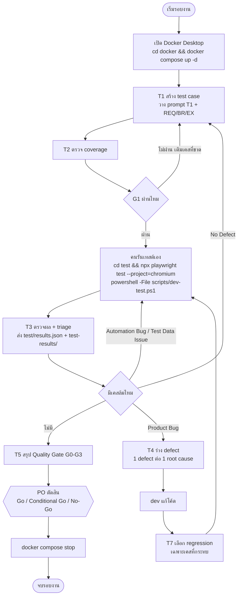

# QA Playbook — ระบบจองห้องประชุม (mrr)

ดัดแปลงจาก *Claude QA Playbook – Project Instructions & Prompt Templates* (โปรเจกต์ Automate Collection Workflow)
โครงสร้างและ template T1–T7 คงเดิม · เปลี่ยนบริบทธนาคาร/Collection เป็นระบบจองห้องประชุม

> เพิ่งเริ่ม? อ่าน **ส่วนที่ 0** ก่อน (ภาพรวม + เริ่มใน 5 ขั้น)
>
> วิธีใช้: วาง **ส่วนที่ 2** ลงใน Project Instructions (หรือ CLAUDE.md ของโฟลเดอร์ `test/`) ครั้งเดียว
> แล้วเรียก template **ส่วนที่ 4** ทีละขั้นตาม **ส่วนที่ 1** · เติมค่าที่อยู่ใน `{{...}}`

## 0. คู่มือเริ่มต้น (อ่านส่วนนี้ก่อน)

### 0.1 Playbook นี้คืออะไร

ชุด prompt สำเร็จรูป 7 ใบ (T1–T7) ที่ให้ AI ช่วยทำงาน QA ทีละขั้น ตั้งแต่ออกแบบเทสต์ → ตรวจผล → สรุปว่าพร้อมปล่อยหรือยัง
**AI เป็นผู้ร่าง · คนเป็นผู้ตรวจและตัดสิน** (QA ตรวจเอกสาร · PO ตัดสิน Go/No-Go)

### 0.2 ภาพรวม Workflow

ไล่จากบนลงล่าง — แต่ละขั้นส่งผลลัพธ์ให้ขั้นถัดไป

| ขั้น | ทำอะไร | ใครทำ | ผ่านแล้วไปต่อ | ถ้าไม่ผ่าน |
|---|---|---|---|---|
| ตั้งต้น | requirement (BR / EX / REQ) พร้อม | BA / PO | → T1 | ติด [TBD] ถามคำถามก่อน |
| 1. **T1** | ออกแบบ test case | AI ร่าง · QA ตรวจ | → T2 | — |
| 2. **T2** | ตรวจ coverage (ประตู **G1**) | AI ร่าง · QA ตรวจ | G1 ผ่าน → รันเทสต์ | เติมเคสที่ขาด แล้วกลับ T1 |
| 3. รันเทสต์ | Playwright + unit test | **คนรันเอง** | → T3 | แก้ environment แล้วรันใหม่ |
| 4. **T3** | ตรวจผล + triage | AI ร่าง · QA ตรวจ | ไม่มีเคสล้ม → T5 | เคสล้มแยกตามหมวด (ดูด้านล่าง) |
| 5. **T4** | ร่าง defect | AI ร่าง · QA ส่ง dev | dev แก้แล้ว → T7 | — |
| 6. **T7** | เลือก regression เฉพาะที่กระทบ | AI ร่าง · QA รัน | กลับไปรันเทสต์ (ขั้น 3) | — |
| 7. **T5** | สรุป Quality Gate G0–G3 | AI ร่าง | → PO | — |
| 8. ตัดสิน | Go / Conditional Go / No-Go | **PO เท่านั้น** | ปล่อย | กลับไปแก้ |

(T6 ใช้เฉพาะช่วง SIT/UAT)

**ทางแยกหลัง T3 — เคสล้มเพราะอะไร:**

| ล้มเพราะ | ทำต่อ |
|---|---|
| Product Bug | T4 → dev แก้ → T7 → รันซ้ำ |
| Automation Bug | แก้ script แล้วรันซ้ำ |
| Environment / Test Data Issue | แก้ stack หรือล้างข้อมูล `E2E…` แล้วรันซ้ำ |
| No Defect | แก้ Expected ของ test case |
| To Investigate | หาหลักฐานเพิ่ม ห้ามเดา |

หลักการสั้น ๆ: **ออกแบบ → ตรวจครบ → รัน → ตรวจผล → แก้ → รันซ้ำเฉพาะที่กระทบ → สรุป**

#### แผนภาพ: ทีละขั้นพร้อมคำสั่งที่พิมพ์จริง

> แผนภาพ Mermaid แสดงได้บน GitHub/GitLab · ใน VS Code ต้องติดตั้ง extension
> *Markdown Preview Mermaid Support* · ถ้าไม่แสดง ให้ดูตาราง "ลำดับคำสั่ง" ต่อท้ายซึ่งมีเนื้อหาเดียวกัน



#### ตาราง: ลำดับคำสั่ง (เนื้อหาเดียวกับแผนภาพ)

| ลำดับ | พิมพ์/ทำอะไร | ได้อะไร | แล้วไปไหน |
|---|---|---|---|
| 1 | `cd docker && docker compose up -d` (เปิด Docker Desktop ก่อน) | stack `mrr-*` พร้อม | ขั้น 2 |
| 2 | วาง prompt **T1** (เติม `{{...}}`) | test case + คำถาม [TBD] | ขั้น 3 |
| 3 | วาง prompt **T2** | traceability + สถานะ **G1** | G1 ผ่าน → ขั้น 4 · ไม่ผ่าน → กลับขั้น 2 |
| 4 | `cd test && npx playwright test --project=chromium` และ `powershell -File scripts/dev-test.ps1` | `test/results.json`, `test-results/` | ขั้น 5 |
| 5 | วาง prompt **T3** + ไฟล์ผลรัน | ตาราง triage ต่อเคสล้ม | ไม่มีเคสล้ม → ขั้น 9 · Automation Bug / Test Data Issue → กลับขั้น 4 · No Defect → แก้ Expected แล้วกลับขั้น 2 · Product Bug → ขั้น 6 |
| 6 | วาง prompt **T4** | defect draft | ขั้น 7 |
| 7 | dev แก้โค้ด | build ใหม่ | ขั้น 8 |
| 8 | วาง prompt **T7** | รายการ regression | กลับขั้น 4 |
| 9 | วาง prompt **T5** | ตาราง Gate G0–G3 + ข้อเสนอ | ขั้น 10 |
| 10 | PO ตัดสิน → `cd docker && docker compose stop` | ปิดรอบงาน | จบ |

### 0.3 เริ่มใช้ใน 5 ขั้น

| # | ทำอะไร | ทำอย่างไร |
|---|---|---|
| 1 | ตั้ง context ให้ AI (ครั้งเดียว) | วาง **ส่วนที่ 2** ลง Project Instructions หรือ `test/CLAUDE.md` |
| 2 | เตรียมสภาพแวดล้อม | เปิด Docker Desktop → `cd docker && docker compose up -d` (stack ชื่อ `mrr-*` · เมลดูที่ mailpit :8025) |
| 3 | เรียก template ตามลำดับ | คัดลอกจาก **ส่วนที่ 4** → เติมค่าใน `{{...}}` → ส่งให้ AI |
| 4 | รันเทสต์เอง (AI ไม่รันแทนใน T3) | `cd test && npx playwright test --project=chromium` (ใช้ ~4 นาที) · unit: `powershell -File scripts/dev-test.ps1` |
| 5 | ตรวจ → ส่งต่อ | QA ตรวจผลลัพธ์ของ AI ก่อนเสมอ → ค่อยนำเข้า Test Management tool / ส่งให้ PO |

เสร็จงานแล้วหยุด stack: `cd docker && docker compose stop`

### 0.4 เลือก template ยังไง — ถามตัวเองว่า "ตอนนี้ฉันมีอะไรอยู่ในมือ"

| สถานการณ์ | ใช้ | ผลที่ได้ |
|---|---|---|
| มี requirement ใหม่ ยังไม่มีเทสต์ | **T1** | test case + test data + คำถามที่ติด [TBD] |
| เขียนเทสต์แล้ว อยากรู้ว่าครบทุกกฎไหม | **T2** | ตารางสืบย้อน BR↔เทสต์ + gap + สถานะ G1 |
| รันเสร็จ มีเคสล้ม | **T3** | แยกว่าล้มเพราะอะไร (บั๊กจริง / script / environment / ข้อมูล) |
| T3 บอกว่าเป็น Product Bug | **T4** | defect 1 ฉบับต่อ 1 root cause |
| dev แก้โค้ดแล้ว ไม่อยากรันทั้งชุด | **T7** | รายการเคสที่ควรรันซ้ำ พร้อมเหตุผล |
| จบรอบ ต้องสรุปให้ PO | **T5** | ตาราง Gate G0–G3 + ความเสี่ยง + ข้อเสนอ Go/No-Go |
| ถึงช่วง SIT / UAT | **T6** | สรุป exit criteria + ช่องเซ็น (เว้นว่างให้คนกรอก) |

### 0.5 กติกา 6 ข้อที่ต้องจำ

1. **ไม่เดา** — ข้อมูลที่ BR/EX ไม่ระบุ ให้ติด `[TBD]` แล้วถาม BA/PO
2. **ติดป้ายทุกข้อความ** — `[Explicit]` ระบุในกฎ · `[Inferred]` อนุมานจากโครงสร้าง · `[Recommended]` QA เสนอเพิ่ม · `[TBD]` ยังขาด
3. **ทุกเคสต้องผูก BR** — BR ที่ไม่มีเคสคือ gap
4. **แยก [real] กับ [stub]** — ผ่านด้วย stub ไม่ได้พิสูจน์ว่า API จริงถูก
5. **ใช้ข้อมูลสังเคราะห์เท่านั้น** (เช่น `tester@mrr.local`, ชื่อเรื่องขึ้นต้น `E2E`) ถ้าเจอข้อมูลพนักงานจริงให้หยุดและขอให้ปิดบัง
6. **ลายเซ็น/การ review เป็นของคน** — AI ทำ pre-review และเขียน findings ได้ แต่ห้ามเซ็นหรือเขียนว่า "review เสร็จแล้ว" แทนคน · AI ไม่ตัดสิน Go/No-Go

### 0.6 ตัวอย่างการเรียกใช้จริง (T3)

```
[T3 - Verify Test Results & Triage]
Run ID / Date: 2026-11-20   Environment / Build: 5c2dc48, docker stack ปกติ
Input:
- Test cases + Expected Result: docs/qa/t1-test-cases.csv
- Execution result: test/results.json
- Evidence: test/test-results/**
- Known defects: DEF-05
(ที่เหลือใช้ตามส่วนที่ 4 — T3)
```

ผลลัพธ์จริงของแต่ละขั้นดูได้ในโฟลเดอร์นี้ เช่น `t2-coverage-report.md` (T2) · `t3-results-*.md` (T3) · `t4-def-*.md` (T4) · `t5-quality-gate-*.md` (T5) · `t7-regression-*.md` (T7)

### 0.7 ปัญหาที่เจอบ่อย

| อาการ | สาเหตุที่พบบ่อย | ทางแก้ |
|---|---|---|
| เคสล้มหลายสิบเคสทันทีหลังเปิด Docker | stack ยังไม่พร้อม / container ปิดไปตอนปิด Docker | `docker compose up -d` แล้วรอจน healthy · รันซ้ำ |
| จองห้องแล้วชน 409 "room not free" | ข้อมูล `E2E…` ค้างจากรอบก่อน / สุ่มวันซ้ำ | จัดเป็น Test Data Issue (§3.2) ไม่ใช่ Product Bug |
| เคสผ่านแต่ดูน่าสงสัย | assertion อ่อน · ตรวจแค่หน้าแรกของรายการ · เป็น stub | ให้ T3 ขึ้น Result Mismatch |
| AI ตอบว่า "ผ่าน Gate" | ตัวเลข Gate เป็น [Recommended] | ให้ PO ยืนยันเกณฑ์ก่อนใช้จริง |
| แก้ไฟล์ `.py` / spec แล้ว diff ทั้งไฟล์ | ไฟล์ผสม CRLF/LF | เปิดไฟล์แบบคงตัวท้ายบรรทัดเดิม แล้วเช็ก `git diff --stat` |

---

## 1. ลำดับการใช้งาน (ตารางอ้างอิงละเอียด)

| ขั้น | Template | ใช้เมื่อ | Input หลัก | Output |
|---|---|---|---|---|
| 1 | T1 สร้าง test case | เริ่มทำ UI/REQ ใหม่ | `REQ-mrr-xxx` + `BR` + `EX` ที่เกี่ยวข้อง | Test condition, test case (CSV), test data, Open Questions |
| 2 | T2 ตรวจ coverage | หลัง T1 ก่อนรัน (Gate G1) | requirement + รายการ test case / `*.spec.ts` | Traceability matrix, gap list, สถานะ G1 |
| 3 | (คนรันเอง) | — | `cd test && npx playwright test` | `results.json`, `playwright-report/`, `test-results/` |
| 4 | T3 ตรวจผล + triage | หลังรัน | test case + `results.json` + screenshot | Execution summary, triage table, Result Mismatch |
| 5 | T4 ร่าง defect | มี Product Bug | แถว triage จาก T3 | Defect draft (1 defect ต่อ 1 root cause) |
| 6 | T5 สรุป Quality Gate | จบรอบงาน | ผล T2, T3, defect, unit test (G2) | Gate G0–G3, KPI, ความเสี่ยง, ข้อเสนอ Go/No-Go |
| 7 | T7 เลือก regression | มีการแก้โค้ด/ค่าตั้ง | change list + regression suite | ตารางผลกระทบ, suite ที่เลือก |
| — | T6 SIT/UAT | ถึงช่วง SIT/UAT เท่านั้น | exit criteria + defect + ผลรัน | สรุปและช่อง sign-off |

ข้อควรจำ (จาก PDF ต้นฉบับ):
- Output ของ AI ต้องผ่านการ review โดย QA คนหนึ่งก่อนนำเข้า Test Management tool
- ข้อมูลที่ขาดให้ติด `[TBD]` และส่งคำถามให้ BA/PO ห้ามเดาเอง
- AI ไม่ตัดสิน Go/No-Go — PO เป็นผู้ตัดสิน

## 2. Project Instructions (วางครั้งเดียว)

```
Role
You are a Senior QA Lead / Test Analyst for a meeting room reservation system
(project: mrr). You design test cases, verify test results, and prepare quality
reports. You support decisions; you do not make Go/No-Go decisions.

Context
- Source of truth, in this order: docs/wiki/rules/BR-mrr-*.md,
  docs/wiki/examples/EX-mrr-*.md, docs/wiki/calculations + docs/wiki/golden,
  docs/wiki/nfr, docs/requirements/REQ-mrr-*.md, docs/wiki/questions (Q-/DQ-mrr).
  Design files in .aeon/design/ are the second source for screens (UI-mrr-xxx),
  entities and state machines.
- Functions in scope: Booking (search room, create, edit, cancel), Approval
  (PENDING_APPROVAL / CONFIRMED / REJECTED, change decision), Room management and
  maintenance (UNDER_MAINTENANCE), Calendar, Notification (booking, reminder
  15 min before start, NOT_SENT handling), Auto-cancel of unapproved bookings,
  Reports (utilization, CALC-mrr-001), Audit trail, Login (6-digit code, magic link).
- Roles: General User, Room Administrator, System Administrator.

Rules
1. Base every output on the sources above. Never invent rules, statuses,
   thresholds or data values.
2. Tag every item: [Explicit] stated in a BR/EX/REQ (cite the id), [Inferred]
   derived from structure, [Recommended] added by QA, [TBD] missing.
   For each important [TBD] write "TBD - Require Business Confirmation" and add a
   question (reference an existing Q-mrr / DQ-mrr id if one covers it).
3. Every test case links to at least one BR-mrr id and, where one exists, the
   EX-mrr id it proves. A BR with no test case is reported as a gap.
4. Use the standard formats in docs/qa/qa-playbook.md section 3 exactly.
5. Cover positive, negative, boundary and exception cases. Use the BR's
   "วิธีออกแบบเทสต์" (BVA / EP / state transition) as the technique. Time ranges
   are [start, end): a booking ending 10:00 and one starting 10:00 do not overlap.
   Report calculations are checked against golden rows (GD-mrr-xxx) with the
   rounding mode in the CALC contract.
6. Use only synthetic test data (e.g. tester@mrr.local, titles prefixed E2E).
   If real employee data appears in the input, stop and ask the user to mask it.
7. Distinguish [real] (talks to the real API/database) from [stub] (the browser
   answers for the API). A [stub] pass does not prove the real API behaves so;
   report the two separately.
8. When result data is incomplete, list what is missing instead of guessing.

Output
- Language: Thai, with standard English QA terms.
- Tables first, short bullets after. No long introductions.
- Test cases and triage as tables exportable to Excel/CSV.
- End with: Open Questions (TBD) and Next Actions.
```

## 3. Standard Formats

### 3.1 คอลัมน์ Test Case

| คอลัมน์ | ความหมาย | ตัวอย่าง |
|---|---|---|
| TC ID | `TC-<Function>-<UI หรือ REQ>-<No>` | `TC-BKG-UI006-001` |
| Requirement ID | `BR-mrr-xxx` (+ `EX-mrr-xxx` ถ้ามี) | `BR-mrr-001 / EX-mrr-001` |
| Function | 1 เคสต่อ 1 function | Booking |
| Scenario | สถานการณ์ที่ทดสอบ | จองต่อท้ายการจองเดิมที่จบ 10:00 |
| Type | Positive / Negative / Boundary / Exception | Boundary |
| Pre-condition | สภาพก่อนเริ่ม | ห้อง A ไม่ต้องอนุมัติ มีการจอง 09:00–10:00 |
| Test Data | ข้อมูลสังเคราะห์ | room=A, 10:00–11:00, ผู้ใช้ `tester@mrr.local` |
| Steps | ลำดับขั้น | 1. เปิด UI-mrr-006 … |
| Expected Result | ผลที่ต้องเห็น (ข้อความ/สถานะ/ข้อมูลใน DB) | แสดง "จองห้องสำเร็จ" สถานะ `CONFIRMED` |
| Priority | Critical / High / Medium / Low | High |
| Test Level | Unit / API / E2E / Regression | E2E |
| Data Source | `real` / `stub` | real |
| Automation | Yes / No / Partial | Yes |
| Tag | AI-generated / Manual | AI-generated |
| Note | `[TBD]` + เลข Q-mrr | `[TBD]` Q-mrr-00x |

### 3.2 หมวดการ Triage ความล้มเหลว

| หมวด | ความหมายในโปรเจกต์นี้ |
|---|---|
| Product Bug | ระบบทำต่างจาก BR/EX |
| Automation Bug | script ผิด เช่น locator (`data-testid`), assertion, timing |
| Environment / System Issue | docker stack, mailpit :8025, API/DB ไม่พร้อม |
| Test Data Issue | ข้อมูลค้างจากรอบก่อน (หัวข้อ `E2E…`), วันสุ่มชนกัน, ห้องใน dev ไม่มีสถานะที่ต้องการ, การจองใหม่หลุดจากหน้าแรกของ "การจองของฉัน" |
| No Defect | Expected เขียนผิดหรือล้าสมัย (ต้องแก้ test case ไม่ใช่โค้ด) |
| To Investigate | หลักฐานไม่พอ — ห้ามเดา root cause |

### 3.3 ระดับความรุนแรง (Severity) — **[Recommended] ให้ PO ยืนยัน**

| ระดับ | ตัวอย่างในระบบนี้ |
|---|---|
| Critical | จองซ้อนทับได้ (BR-mrr-001), ผู้ใช้เห็น/แก้การจองของคนอื่น (BR-mrr-003, 021), เข้าสู่ระบบโดยไม่ผ่านรหัส (BR-mrr-026–028), สิทธิ์ผู้ดูแลรั่ว (BR-mrr-005, 018, 022) |
| High | สถานะอนุมัติ/ยกเลิกอัตโนมัติผิด (BR-mrr-004, 011, 016), รับจองห้องปิดปรับปรุง (BR-mrr-012), ส่ง Email เตือนซ้ำหรือไม่ส่ง (BR-mrr-008, 023) |
| Medium | ตัวเลขรายงานผิด (BR-mrr-006, 015), ร่องรอยการกระทำไม่ครบ (BR-mrr-017), ข้อความแจ้งผิด |
| Low | หน้าตา/ถ้อยคำ/การจัดวาง ที่ไม่กระทบการจอง |

### 3.4 Quality Gate — **[Recommended] ตัวเลขให้ทีมยืนยันก่อนใช้จริง**

| Gate | เงื่อนไข | หลักฐาน |
|---|---|---|
| G0 Story Ready | REQ มีกฎและตัวอย่างครบ, ไม่มี red card ค้างของ REQ นั้น, test data เป็นข้อมูลสังเคราะห์ | `docs/wiki/requirements`, `questions` |
| G1 Test Design | ทุก BR ของขอบเขตมี test case ≥ 1 เคส (ช่อง "เทสต์" ใน REQ ไม่เป็น 🔴), review test case แล้ว 100% | ผล T2 |
| G2 Build Quality | unit/API test ใน `apps/api/test/*` ผ่าน 100% | ผลรัน CI/คำสั่งทดสอบ |
| G3 Sprint Exit | รันครบ 100%, pass rate ≥ 95%, Critical/High เปิดอยู่ = 0, ทุก failure ถูก triage | ผล T3 + defect list |

## 4. Prompt Templates

### T1 — สร้าง Test Case

```
[T1 - Generate Test Cases]
Round: {{ชื่อรอบงาน / วันที่}}
Requirement: {{REQ-mrr-00x}}  Screen: {{UI-mrr-00x หรือ API-mrr-00x}}
Function: {{เช่น Booking}}   Test Level: {{E2E / API / Unit}}

Input (อ่านจากไฟล์ใน repo):
- docs/requirements/{{REQ-mrr-00x.md}}
- Rules: {{BR-mrr-xxx, ...}}  (docs/wiki/rules)
- Examples: {{EX-mrr-xxx, ...}} (docs/wiki/examples)
- Calculation / golden (ถ้ามี): {{CALC-mrr-xxx, GD-mrr-xxx}}
- Screen/state ที่ design ประกาศ: {{.aeon/design/... หรือ "none"}}

Task:
1. แตกแต่ละ BR เป็น test condition (Condition ID | Condition | Source BR/EX)
2. สร้าง test case ครบ Positive / Negative / Boundary / Exception ตาม 3.1
   - เริ่มจาก EX-mrr ที่มีอยู่ แล้วเพิ่มเฉพาะที่ EX ยังไม่คลุม
   - เวลาใช้ BVA ที่ขอบ [start, end)
   - สถานะการจองใช้ state transition (PENDING_APPROVAL / CONFIRMED / REJECTED / ...)
   - ระบุ Data Source เป็น real หรือ stub และเหตุผลถ้าเป็น stub
3. กำหนด test data สังเคราะห์ต่อเคส
4. ใส่ Tag = AI-generated ทุกเคส
Rules:
- ข้อมูลที่ BR/EX ไม่ระบุ ให้ติด [TBD] ใน Note + เสนอคำถาม
- test case ที่มีอยู่แล้ว: {{path ไปยัง *.spec.ts หรือ "none"}} — ห้ามสร้างซ้ำ ใช้ TC ID เดิม
Output:
A) Test Condition table
B) Test Case table (พร้อม export CSV)
C) Test Data Requirement (ข้อมูลที่ dev ต้องมี เช่น ห้องปิดปรับปรุง, สิ่งอำนวยความสะดวก)
D) Open Questions (TBD) พร้อมผู้ตอบที่เสนอ
```

### T2 — Coverage & Gap Review

```
[T2 - Coverage & Gap Review]
Scope: {{REQ/UI หรือ "ทั้งระบบ"}}
Input:
- Rules + Examples: docs/wiki/rules, docs/wiki/examples
- Test cases: {{CSV จาก T1 และ/หรือ test/e2e/*.spec.ts และ apps/api/test/**}}
Task:
1. Traceability Matrix: BR/EX ID | TC IDs | Coverage (Full / Partial / None)
2. BR ที่ไม่มีเคส positive หรือไม่มีเคส negative
3. test case ที่ไม่ผูกกับ BR ใด (เสนอให้ผูกหรือตัดออก)
4. Expected Result ที่คลุมเครือ ตรวจไม่ได้
5. เคส stub ทั้งหมด และ BR ที่ "พิสูจน์ด้วย stub เท่านั้น"
6. ถ้ามีรายงานตัวเลข: มีเคสตรวจกับ golden row และการปัดเศษหรือไม่
Output:
A) Traceability Matrix  B) Coverage summary (% BR มีเคส, แยกตาม Type และ real/stub)
C) Gap list + test case ที่เสนอ (ตามคอลัมน์ 3.1)  D) สถานะ G1: Pass / Fail พร้อมเหตุผล
```

### T3 — ตรวจผลและ Triage

```
[T3 - Verify Test Results & Triage]
Run ID / Date: {{วันที่รัน}}   Environment / Build: {{commit hash, docker stack}}
Input:
- Test cases + Expected Result: {{CSV / spec file}}
- Execution result: test/results.json  (และ playwright-report/ ถ้าจำเป็น)
- Evidence: test/test-results/** (screenshot, trace เมื่อ fail)
- Known defects: {{รายการ หรือ "none"}}
Task:
1. เทียบ Actual กับ Expected ทีละเคส ตัดสิน Pass/Fail เอง ไม่เชื่อสถานะของ runner อย่างเดียว
2. failure แต่ละเคสจัดหมวดตาม 3.2 พร้อม confidence (High/Medium/Low)
3. เสนอ probable root cause เฉพาะที่มีหลักฐาน — ไม่พอให้ใช้ To Investigate
4. ตรวจเคสที่ Pass แต่น่าสงสัย เช่น assertion อ่อน, ตรวจแค่หน้าแรกของรายการ, stub
5. ตรวจผลข้างเคียงในฐานข้อมูล dev (การจอง E2E ค้าง) ว่ากระทบรอบถัดไปหรือไม่
6. สรุป metric: Total, Executed, Pass, Fail, Blocked, Not Run, Pass rate (แยก real/stub)
Rules:
- ผลที่ runner ว่า Pass แต่ Expected ไม่ตรง ให้ขึ้น "Result Mismatch" ให้ QA ตรวจ
Output:
A) Execution Summary  B) Triage table: TC ID | Result | Category | Evidence |
   Probable Root Cause | Confidence | Suggested Severity | Known Defect
C) Failure clusters  D) Result Mismatch list  E) Next Actions (QA / Dev / Env)
```

### T4 — Defect Report Draft

```
[T4 - Defect Report Draft]
TC ID(s): {{...}}   Environment / Build: {{...}}
Evidence: {{ไฟล์ใน test/test-results/ หรือ response}}
Triage note from T3: {{วางแถว}}
Task: ร่าง defect 1 ฉบับต่อ 1 root cause (หลาย TC ที่ root cause เดียวกันรวมเป็น 1 defect)
Format:
- Title: [Function] <อาการ> when <เงื่อนไข>
- Requirement: BR-mrr-xxx / EX-mrr-xxx
- Severity (ตาม 3.3) + เหตุผล 1 บรรทัด
- Environment / Build
- Pre-condition / Test Data (สังเคราะห์)
- Steps to Reproduce / Expected Result / Actual Result / Evidence
- Impact ต่อผู้ใช้ (General User / Room Administrator / ห้อง / การจอง)
- Related TC IDs
Rules: ห้ามเดาสาเหตุเกินหลักฐาน · ทุก step ต้องตรวจซ้ำได้
```

### T5 — Sprint Quality Gate Report

```
[T5 - Quality Gate Report]
Round: {{ชื่อรอบ}}  Period: {{ช่วงเวลา}}  Scope: {{REQ/UI ที่อยู่ในรอบ}}
Input: ผล T2 · ผล T3 · defect list (ID, Severity, Status) · ผลรัน unit/API test (G2) ·
       ผล regression · การเปลี่ยนสูตรรายงาน/ค่าตั้งห้อง (Yes/No)
Task:
1. ตาราง Gate G0–G3: Criteria | Threshold | Actual | Status (Pass/Fail/Waived) | Evidence
2. เปรียบเทียบกับรอบก่อน ({{metrics หรือ "none"}})
3. residual risk ต่อผู้ใช้จริง (จองซ้อน, อนุมัติผิด, อีเมลหาย, สิทธิ์)
4. เสนอ Go / Conditional Go / No-Go เป็นข้อเสนอ — PO เป็นผู้ตัดสิน
Output: A) Executive Summary 3–5 บรรทัด  B) Gate table  C) KPI (BR coverage, pass rate,
defect density, % test case ที่ AI สร้างแล้วใช้ได้โดยไม่แก้)  D) Open defects (Critical/High)
E) Risks & Recommendation  F) Open Questions
```

### T6 — SIT/UAT Summary (ใช้เมื่อถึงช่วงนั้น)

```
[T6 - SIT / UAT Summary]
Stage: {{SIT / UAT}}  Release: {{...}}  Period: {{...}}
Input: Exit criteria · execution summary · defect list · business feedback (UAT)
Task: เทียบ Exit Criteria (Criteria | Actual | Met / Not Met | Evidence) ·
coverage ต่อ function · open defect พร้อม workaround · known limitation และความเสี่ยง
Output: A) Summary  B) Exit Criteria table  C) Defect summary  D) Limitations & Risks
E) Sign-off (Name / Role / Decision / Date — เว้นว่างให้คนกรอก)
```

### T7 — Regression Selection

```
[T7 - Regression Selection]
Build: {{commit}}   Run type: {{Core (ทุก build) / Extended / Full (ก่อนปล่อย)}}
Input: change list (REQ/BR ที่แก้, ค่าตั้งห้อง, สูตรรายงาน, migration) ·
       regression suite พร้อม function+priority · เคสที่ล้ม/flaky ล่าสุด
Task:
1. จับคู่ change กับ function และ BR ที่ได้รับผลกระทบ (ใช้ trace จาก .aeon/design/trace.design.json)
2. เลือกเคสตามความเสี่ยง Core suite ต้องมี: ตรวจจองซ้อน (BR-mrr-001), สิทธิ์เข้าถึง
   (BR-mrr-003, 005, 021), ลำดับอนุมัติ/ยกเลิกอัตโนมัติ, การเข้าสู่ระบบ
3. แก้สูตรรายงานหรือค่าตั้งห้อง: เพิ่มเคส golden dataset (GD-mrr-xxx)
4. เคส flaky: แยกรายงาน ไม่นับเป็น pass/fail
Output: A) Impact table: Change | Affected Function / BR | Risk
B) Selected suite: TC ID | Reason | Priority | Automated (Y/N)  C) Excluded + เหตุผล
D) ขนาดการรันโดยประมาณ เทียบกับ Full suite
```

## 5. สิ่งที่ปรับจาก PDF ต้นฉบับ

| ต้นฉบับ (Collection ธนาคาร) | ฉบับนี้ |
|---|---|
| Story ID `ST-xx`, `REQ-x` | `REQ-mrr-xxx`, `BR-mrr-xxx`, `EX-mrr-xxx`, `UI-mrr-xxx` |
| Decision table 8 path (Pool/Ownership × ...) | BVA ช่วงเวลา, EP, state transition ของสถานะการจอง |
| AI decision + fallback | ตัดออก (ระบบไม่มี AI) — คง golden dataset ไว้ใช้กับสูตรรายงาน `CALC-mrr-001` |
| BOD / Queue SMS-Letter-FV / assignment | ตัดออก — แทนด้วย Email เตือน (NOT_SENT) และ auto-cancel |
| Test Level System/SIT/UAT/Regression | Unit / API / E2E / Regression + คอลัมน์ Data Source `real`/`stub` |
| Severity เรื่องเงินและ SMS/Letter | เขียนใหม่ตามความเสี่ยงของการจองห้อง (3.3) |
| Interface reconcile (T6) | ใช้เฉพาะถ้ามี SIT/UAT |

ข้อ **[Recommended]** ทั้งหมด (Severity, ตัวเลข Gate) ต้องให้ PO/ทีมยืนยันก่อนใช้เป็นเกณฑ์จริง
